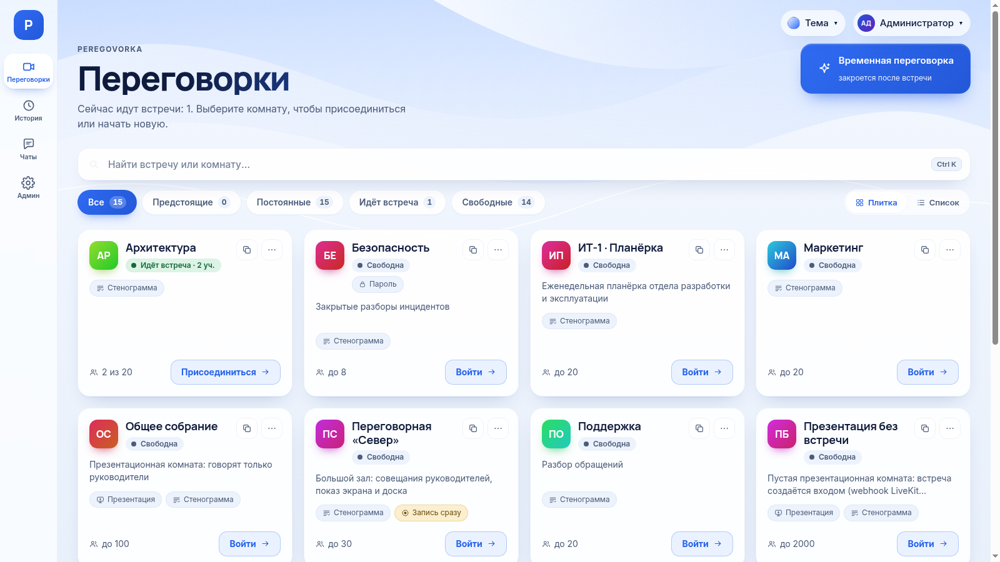
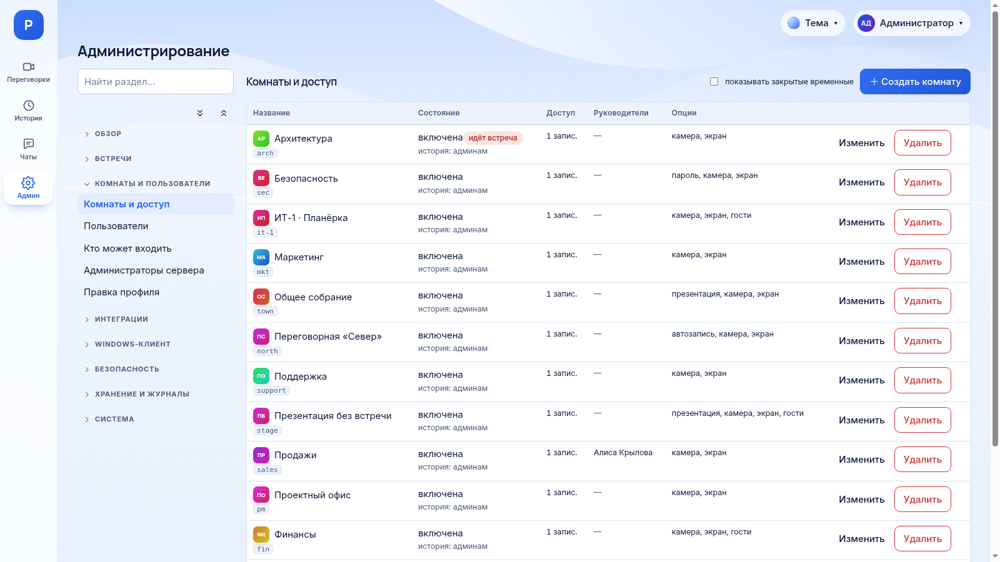
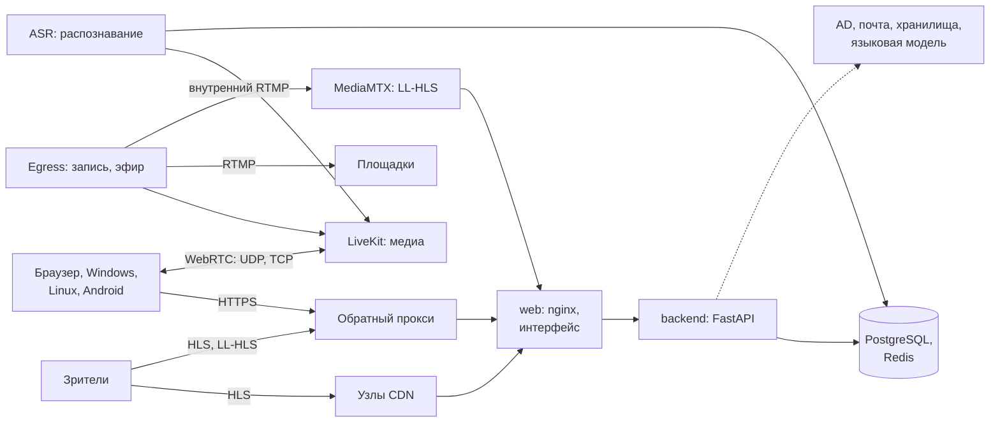

<div align="center">

# Peregovorka

### Видеовстречи на сервере вашей организации: стенограмма, протоколы, трансляции и корпоративные интеграции

[](https://github.com/calleograph/peregovorka/actions)
[](https://github.com/calleograph/peregovorka/releases)


</div>

---

## Что такое Peregovorka

Peregovorka — система видеовстреч, которую организация разворачивает на своём сервере. Сотрудники входят доменной учётной записью и проводят встречи в браузере или приложении. Система распознаёт речь каждого участника, а после встречи готовит протокол, резюме и карту разговора.

Записи, стенограммы, распознавание речи и обезличивание работают на вашем сервере. Разработчик проекта не получает ваших данных и не участвует в работе сервера. Наружу уходит только то, что вы подключили сами. Например, текст в языковую модель: всегда без паролей и ключей, а при обезличивании ещё и без имён, контактов и реквизитов.

## Какие задачи решает

- Внутренние совещания без передачи звука и записей посторонним сервисам.
- Протокол вместо ручного конспекта: решения, задачи «кто, что, срок», открытые вопросы.
- Встречи с внешними участниками по гостевой ссылке.
- Трансляции для зрителей по ссылке и параллельно на внешних площадках.
- Единое место для материалов встреч с правами и сроками хранения.
- Переписка сотрудников внутри организации.

## Основные возможности

| Возможность | Что входит |
| --- | --- |
| **Видеовстречи** | голос, видео, показ экрана, общая доска, своя раскладка у каждого участника |
| **Стенограмма** | речь каждого участника распознаётся отдельно, на русском языке, на вашем сервере |
| **Протоколы и резюме** | языковая модель по API: облачная, корпоративный шлюз или своя; у пунктов есть реплика-источник |
| **Обезличивание** | до отправки в модель участники становятся «Иван И.» или «Участник 2», контакты и реквизиты заменяются, пароли и ключи убираются всегда |
| **Карта разговора** | темы на шкале времени, кто сколько говорил, переход к реплике |
| **Запись** | общая аудиозапись и видеозапись MP4, по кнопке или автоматически |
| **Трансляции** | зрители смотрят по ссылке без входа, 1080p и 2K, вопросы ведущему, RUTUBE, VK Видео, YouTube, Twitch, запись эфира, пароли и отзыв ссылок, панель диагностики |
| **Низкая задержка эфира** | около 3 секунд в замере на одном тестовом сервере, без учёта вашей сети. Safari, iPhone и узлы CDN смотрят обычный поток |
| **Свои узлы CDN** | отдельный сервер подключается из администрирования по SSH и сам настраивается, зрители получают эфир с него |
| **Файловые хранилища** | локальный диск, сетевые папки SMB, внешние тома; перенос данных с проверкой копий |
| **Корпоративные чаты** | переписка, файлы, диктовка |
| **Outlook и Exchange** | встречи из календаря, надстройка Outlook |
| **Active Directory, Bitrix24, SIP** | вход доменной учётной записью, доступ по группам, профили, звонки через АТС |
| **API** | публичный API, события (webhooks), OpenAPI |
| **Свой вид** | название, логотип, цвета и документы организации настраиваются в браузере |

Полный перечень: [Возможности](https://github.com/calleograph/peregovorka/wiki/Возможности). Когда система не подойдёт: [Когда продукт не подходит](https://github.com/calleograph/peregovorka/wiki/Когда-продукт-не-подходит).

## Для кого

| Кто | Что получает |
| --- | --- |
| Сотрудники | встречи, стенограмму и материалы в одном месте, без ручного конспекта |
| Организаторы и руководители | приглашения, гостей, запись, протокол, рассылку материалов |
| Ведущие трансляций | эфир из комнаты, площадки и вопросы зрителей в одном окне |
| Гости и зрители | вход по ссылке, без учётной записи и установки |
| Администраторы | настройку в браузере, обновление по кнопке, резервные копии, диагностику |
| Служба ИБ | данные на своём сервере, журнал аудита, обезличивание, описание потоков данных |

## Как выглядит работа

**Список комнат.** Поиск, фильтры, карточки комнат.



**Администрирование.** Всё настраивается в браузере.



<sub>Снимки сделаны на тестовом экземпляре с вымышленными данными.</sub>

## Чем отличаются веб и приложения

Все клиенты подключаются к одному серверу организации. Учётная запись, комнаты и материалы у них общие. Браузер и приложения на компьютере показывают один интерфейс сервера, поэтому новые функции приходят вместе с обновлением сервера.

| | Браузер | Windows и Linux | Android |
| --- | --- | --- | --- |
| Установка | не нужна | EXE, MSI, пакет APT | файл APK, предварительная версия |
| Встреча, чат, показ экрана | да | да | да |
| Доска, стенограмма в комнате | да | да | нет |
| Управление записью, эфиром, участниками | да | да | нет |
| Системные уведомления, трей, автозапуск | нет | да | нет |
| Несколько организаций | вкладки браузера | да | да |
| Вход сохраняется | пока действует сеанс | да, пароль не хранится | да |

Основная проверка идёт в актуальных Chrome и Edge. Гостям и зрителям хватает браузера. Версии для iPhone и iPad нет. Подробно: [Веб-версия и приложения](https://github.com/calleograph/peregovorka/wiki/Веб-версия-и-приложения).

## Как развернуть свой сервер

Коротко ниже. Подробное руководство для тех, кто делает это впервые: [docs/INSTALL_GUIDE.md](docs/INSTALL_GUIDE.md).

**1. Подготовка.** Нужен сервер с Ubuntu или Debian, права `sudo`, доступ сервера в интернет на время установки, имя в DNS и сертификат для рабочей эксплуатации. Если на сервере уже работают другие приложения, используйте [установку на общий сервер](https://github.com/calleograph/peregovorka/wiki/Установка-на-общий-сервер).

**2. Установка.** Команды скачивают установщик и запускают его:

```bash
wget -O install.sh https://raw.githubusercontent.com/calleograph/peregovorka/main/install.sh
chmod +x install.sh
sudo ./install.sh --host meet.example.org
```

Установщик сам поставит Docker и остальное, соберёт и запустит службы, проверит их и покажет адрес, логин и первичный пароль. Обычно это занимает 10–30 минут.

**3. Первоначальная настройка.** Откройте адрес в браузере, войдите как `admin` и задайте новый пароль. Мастер проведёт через каталог, сертификаты, группы администраторов, хранилище и почту. Каждый шаг можно пропустить. Языковая модель, запись и трансляции включаются в разделе **Администрирование**.

**4. Подключение.** Замените самоподписанный сертификат на доверенный и откройте порты звонков: 443/tcp, `LIVEKIT_UDP_PORT`/udp и `LIVEKIT_TCP_PORT`/tcp. Страница идёт через HTTPS, а звук и видео идут напрямую на сервер. Сообщите сотрудникам адрес вида `https://meet.example.org`.

**5. Проверка.**

```bash
cd /opt/peregovorka
sudo ./scripts/status.sh
sudo ./scripts/smoke-test.sh
```

Ожидаемый результат: `Все сервисы работают` и `Smoke test: PASS`. Затем проведите пробную встречу с двух устройств: участники слышат друг друга, в панели «Транскрипция» появляются реплики.

## Требования к серверу

| Параметр | Что нужно |
| --- | --- |
| Система | установщик принимает Ubuntu от 22.04, рекомендуется 24.04, и Debian от 12; x86_64 |
| Порог установщика | 4 vCPU, 8 ГБ памяти, 30 ГБ свободного места |
| Сеть | имя в DNS и HTTPS; 443/tcp и порты звонков UDP и TCP напрямую на сервер |
| На запись и эфир | дополнительно процессор и память; образ службы около 3,8 ГБ; локальный диск: эфир 1080p около 2,2 ГБ в час и столько же на копию |

Порог установщика не является рабочей конфигурацией: система целиком на нём не испытывалась, запись и эфир в него не входят. Подтверждённой вместимости всей системы пока нет, сквозного нагрузочного испытания не проводилось. Что измерялось и в каких условиях: [Производительность и масштабирование](https://github.com/calleograph/peregovorka/wiki/Производительность-и-масштабирование), [Что проверено](https://github.com/calleograph/peregovorka/wiki/Границы-проверки). Расчёт под вашу нагрузку: [Системные требования](https://github.com/calleograph/peregovorka/wiki/Системные-требования). Какие испытания нужны: [Матрица нагрузочных испытаний](https://github.com/calleograph/peregovorka/wiki/Матрица-нагрузочных-испытаний).

## Как установить клиент

В браузере достаточно открыть адрес сервера. В приложении при первом запуске введите этот адрес. Развёртывание на компьютерах организации: [Windows-приложение в организации](https://github.com/calleograph/peregovorka/wiki/Как-развернуть-приложение-Windows-в-организации).

### Windows и Linux

<!-- desktop-release:start -->
**Версия 1.5.1** · [страница выпуска](https://github.com/calleograph/peregovorka/releases/tag/desktop-v1.5.1) · [контрольные суммы](https://github.com/calleograph/peregovorka/releases/download/desktop-v1.5.1/SHA256SUMS.txt)

- **[Peregovorka-Setup-1.5.1.exe](https://github.com/calleograph/peregovorka/releases/download/desktop-v1.5.1/Peregovorka-Setup-1.5.1.exe)** — установка для себя, без прав администратора
- **[Peregovorka-1.5.1-x64.msi](https://github.com/calleograph/peregovorka/releases/download/desktop-v1.5.1/Peregovorka-1.5.1-x64.msi)** — для развёртывания в организации (групповые политики)
- **Linux** (Ubuntu 22.04/24.04, Debian 12/13): [репозиторий APT](https://calleograph.github.io/peregovorka-apt/) — `curl -fsSL https://calleograph.github.io/peregovorka-apt/install.sh | sudo sh`, обновления через `apt upgrade`; или пакет [peregovorka_1.5.1_amd64.deb](https://github.com/calleograph/peregovorka/releases/download/desktop-v1.5.1/peregovorka_1.5.1_amd64.deb)

Несколько серверов организаций в одном окне, трей и уведомления, оформление «Стекло». Для Windows установщики пока не подписаны сертификатом издателя: при первом запуске Windows может показать SmartScreen — «Подробнее» → «Выполнить в любом случае». Для Linux пакеты ставятся и обновляются через APT, подпись репозитория проверяет сам apt ([docs/LINUX.md](docs/LINUX.md)).
<!-- desktop-release:end -->

### Android

<!-- android-release:start -->
**Версия 0.1.9** · [страница выпуска](https://github.com/calleograph/peregovorka/releases/tag/android-v0.1.9) · [контрольные суммы](https://github.com/calleograph/peregovorka/releases/download/android-v0.1.9/SHA256SUMS.txt)

- **[Peregovorka-0.1.9-android.apk](https://github.com/calleograph/peregovorka/releases/download/android-v0.1.9/Peregovorka-0.1.9-android.apk)** — установка вручную (Android 8.0 и новее; для аккуратного вида разделов нужен сервер 0.49.6 или новее)

Приложение подключается к серверу вашей организации (адрес сообщает администратор), вход выполняет сам сервер. APK подписан постоянным ключом организации: следующие версии ставятся поверх с сохранением данных (0.1.9 ставится поверх 0.1.7, 0.1.6, 0.1.5 и 0.1.4; переход с 0.1.3 и ранее — один раз через удаление прежней версии). Проверено на эмуляторах Android 10, 14 и 16 в CI (клавиатура, вход в конференцию с настоящим LiveKit, фон и возврат, плавающее окно встречи, показ своего экрана) и автотестами клиента; **звонок с камерой и микрофоном на настоящем телефоне и работа с живым сервером ещё не проверены**. Версии для iPhone и iPad нет.
<!-- android-release:end -->

## Где инструкции и техническая документация

| Кому | С чего начать |
| --- | --- |
| Сотрудник | [Первый день в Peregovorka](https://github.com/calleograph/peregovorka/wiki/Первый-день-в-Peregovorka), [Как войти во встречу](https://github.com/calleograph/peregovorka/wiki/Как-войти-во-встречу) |
| Организатор | [Маршрут организатора](https://github.com/calleograph/peregovorka/wiki/Маршрут-организатора) |
| Ведущий трансляции | [Маршрут ведущего трансляции](https://github.com/calleograph/peregovorka/wiki/Маршрут-ведущего-трансляции), [Сценарий: первая трансляция](https://github.com/calleograph/peregovorka/wiki/Сценарий-Первая-трансляция) |
| Администратор | [Руководство администратора](https://github.com/calleograph/peregovorka/wiki/Руководство-системного-администратора), [Каталог интеграций](https://github.com/calleograph/peregovorka/wiki/Архитектура-Каталог-интеграций), [Порты и сервисы](https://github.com/calleograph/peregovorka/wiki/Архитектура-Порты-и-сервисы) |
| Поддержка | [Руководство поддержки](https://github.com/calleograph/peregovorka/wiki/Руководство-технической-поддержки), [Решение проблем](https://github.com/calleograph/peregovorka/wiki/Решение-проблем) |
| Служба ИБ | [Справочник для проверки ИБ](https://github.com/calleograph/peregovorka/wiki/Справочник-для-проверки-ИБ), [Обработка персональных данных](https://github.com/calleograph/peregovorka/wiki/Архитектура-Обработка-персональных-данных) |
| Инженер | [Архитектура и техническое устройство](https://github.com/calleograph/peregovorka/wiki/Архитектура-и-техническое-устройство), [Участие в разработке](https://github.com/calleograph/peregovorka/wiki/Участие-в-разработке) |
| Владелец системы | [Технический паспорт](docs/TECHNICAL_PASSPORT.md), [Что проверено](https://github.com/calleograph/peregovorka/wiki/Границы-проверки) |

Как устроена система:



Обновление: **Администрирование → Система → Обновления и версии → Обновить проект** или `sudo ./scripts/update.sh`, [Как обновить и откатить](https://github.com/calleograph/peregovorka/wiki/Как-обновить-и-откатить). Резервные копии: `sudo scripts/backup.sh --full`, [Резервирование и восстановление](https://github.com/calleograph/peregovorka/wiki/Архитектура-Резервирование-и-восстановление).

- [Вики](https://github.com/calleograph/peregovorka/wiki): руководства, архитектура, решение проблем, справочники.
- [Указатель документов](docs/README.md): техническая документация репозитория.
- [Выпуски](https://github.com/calleograph/peregovorka/releases), [CHANGELOG.md](CHANGELOG.md): что нового; [HISTORY.md](HISTORY.md): журнал разработки.
- [API](docs/api/README.md), [Безопасность и приватность](https://github.com/calleograph/peregovorka/wiki/Безопасность-и-приватность), [Политика безопасности](https://github.com/calleograph/peregovorka/wiki/Политика-безопасности).
