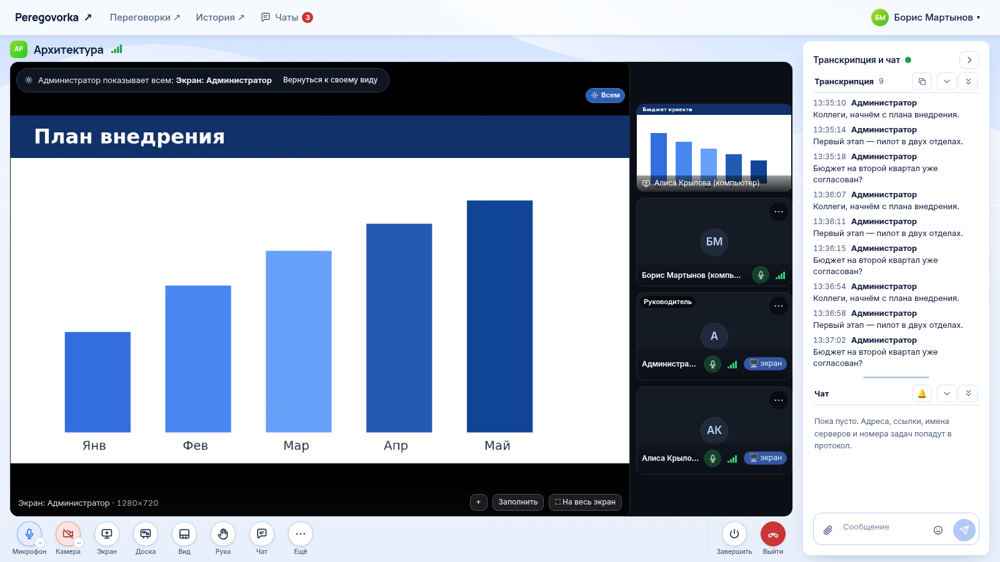
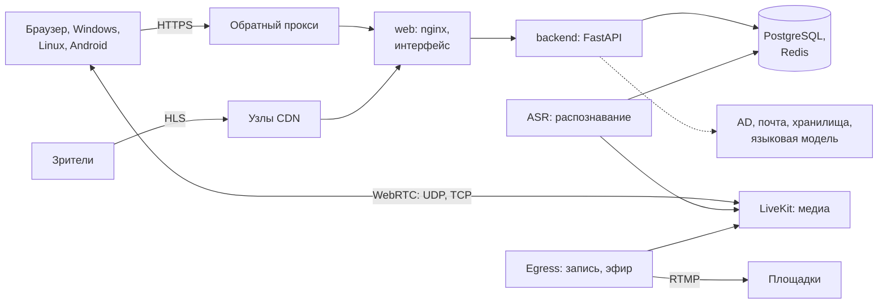

<div align="center">

# Peregovorka

### Видеовстречи на сервере вашей организации: стенограмма, протоколы, трансляции и корпоративные интеграции

Сотрудники входят доменной учётной записью, речь каждого участника автоматически превращается в текст, а после встречи готовы протокол, резюме и карта разговора.
Записи, стенограммы и распознавание речи — на вашем сервере. В языковую модель уходит только текст: без паролей и ключей, а при обезличивании — без имён, контактов и реквизитов.

[](https://github.com/calleograph/peregovorka/actions)
[](https://github.com/calleograph/peregovorka/releases)



</div>

---

## Для чего это

Peregovorka заменяет внешние сервисы видеосвязи, когда разговоры и записи должны оставаться внутри организации. Сотрудники проводят встречи в браузере или приложении, система сама записывает «кто что сказал», а после встречи готовит протокол с решениями и поручениями.

Какие задачи решает:

- внутренние совещания без передачи звука и записей посторонним сервисам;
- протокол вместо ручного конспекта: решения, задачи «кто — что — срок», открытые вопросы;
- встречи с внешними участниками по гостевой ссылке;
- массовые эфиры для сотен и тысяч зрителей;
- единое место для материалов встреч с правами и сроками хранения.

## Возможности

| | |
| --- | --- |
| 🎥 **Видеовстречи** | голос, видео и до пяти показов экрана одновременно; своя раскладка у каждого, общая доска |
| 📝 **Стенограмма** | речь каждого участника распознаётся отдельно, на русском, на вашем сервере |
| 📋 **Протоколы и резюме** | языковая модель по API: облачная, корпоративный шлюз или своя; у пунктов — реплика-источник |
| 🛡 **Обезличивание** | до отправки в модель участники становятся «Иван И.» или «Участник 2», контакты и реквизиты заменяются, пароли и ключи убираются всегда |
| 🗺 **Карта разговора** | темы на шкале времени, кто сколько говорил, переход к реплике |
| ⏺ **Запись** | общая аудиозапись и видеозапись MP4 по кнопке или автоматически |
| 📡 **Массовые трансляции** | зрители смотрят по ссылке без входа; 1080p и 2K; вопросы ведущему; параллельно на RUTUBE, VK Видео, YouTube, Twitch; запись эфира; пароли и отзыв ссылок; панель диагностики всей цепочки от выступающего до зрителя |
| 🌐 **Свои узлы CDN** | отдельный сервер подключается из администрирования по SSH и сам настраивается; основной сервер отдаёт один поток при любом числе зрителей |
| 💬 **Корпоративные чаты** | переписка, файлы, диктовка |
| 📅 **Outlook и Exchange** | встречи из календаря и надстройка Outlook |
| 🏢 **Active Directory, Bitrix24, SIP** | вход доменной учётной записью, доступ по группам, профили, звонки через АТС |
| 🔌 **API** | публичный API, события (webhooks), OpenAPI |
| 🎨 **Свой вид** | название, логотип, цвета и документы организации — через браузер |


<sub>Снимки сделаны на тестовом экземпляре с вымышленными данными.</sub>

## Как устроена система

**Сервер разворачивается в инфраструктуре организации:** на физическом сервере, виртуальной машине или в своём облаке. Он работает в контейнерах Docker на Linux. Внешних обязательных сервисов нет: разработчик проекта не получает ваших данных и не участвует в работе сервера.

**Клиенты подключаются к этому серверу.** Администратор сообщает сотрудникам адрес вида `https://meet.example.org`. Дальше можно работать в браузере или в приложении: внутри приложений тот же интерфейс сервера, поэтому новые функции приходят вместе с обновлением сервера.

## Клиентские приложения

| Клиент | Для кого | Как получить |
| --- | --- | --- |
| **Браузер** | всем, ничего ставить не нужно; актуальные Chrome и Edge | адрес сервера организации |
| **Windows** | несколько организаций, трей, уведомления, вход без пароля после перезагрузки; EXE и MSI с групповыми политиками | ниже |
| **Linux** | Ubuntu 22.04/24.04, Debian 12/13: пакет и репозиторий APT | ниже |
| **Android** | предварительная версия: конференции со звуком в фоне, показ экрана, чаты, календарь | ниже |

### Windows и Linux

<!-- desktop-release:start -->
**Версия 1.5.0** · [страница выпуска](https://github.com/calleograph/peregovorka/releases/tag/desktop-v1.5.0) · [контрольные суммы](https://github.com/calleograph/peregovorka/releases/download/desktop-v1.5.0/SHA256SUMS.txt)

- **[Peregovorka-Setup-1.5.0.exe](https://github.com/calleograph/peregovorka/releases/download/desktop-v1.5.0/Peregovorka-Setup-1.5.0.exe)** — установка для себя, без прав администратора
- **[Peregovorka-1.5.0-x64.msi](https://github.com/calleograph/peregovorka/releases/download/desktop-v1.5.0/Peregovorka-1.5.0-x64.msi)** — для развёртывания в организации (групповые политики)
- **Linux** (Ubuntu 22.04/24.04, Debian 12/13): [репозиторий APT](https://calleograph.github.io/peregovorka-apt/) — `curl -fsSL https://calleograph.github.io/peregovorka-apt/install.sh | sudo sh`, обновления через `apt upgrade`; или пакет [peregovorka_1.5.0_amd64.deb](https://github.com/calleograph/peregovorka/releases/download/desktop-v1.5.0/peregovorka_1.5.0_amd64.deb)

Несколько серверов организаций в одном окне, трей и уведомления, оформление «Стекло». Для Windows установщики пока не подписаны сертификатом издателя: при первом запуске Windows может показать SmartScreen — «Подробнее» → «Выполнить в любом случае». Для Linux пакеты ставятся и обновляются через APT, подпись репозитория проверяет сам apt ([docs/LINUX.md](docs/LINUX.md)).
<!-- desktop-release:end -->

### Android

<!-- android-release:start -->
**Версия 0.1.8** · [страница выпуска](https://github.com/calleograph/peregovorka/releases/tag/android-v0.1.8) · [контрольные суммы](https://github.com/calleograph/peregovorka/releases/download/android-v0.1.8/SHA256SUMS.txt)

- **[Peregovorka-0.1.8-android.apk](https://github.com/calleograph/peregovorka/releases/download/android-v0.1.8/Peregovorka-0.1.8-android.apk)** — установка вручную (Android 8.0 и новее; для аккуратного вида разделов нужен сервер 0.49.6 или новее)

Приложение подключается к серверу вашей организации (адрес сообщает администратор), вход выполняет сам сервер. APK подписан постоянным ключом организации: следующие версии ставятся поверх с сохранением данных (0.1.8 ставится поверх 0.1.7, 0.1.6, 0.1.5 и 0.1.4; переход с 0.1.3 и ранее — один раз через удаление прежней версии). Проверено на эмуляторах Android 10, 14 и 16 в CI (клавиатура, вход в конференцию с настоящим LiveKit, фон и возврат, плавающее окно встречи, показ своего экрана) и автотестами клиента; **звонок с камерой и микрофоном на настоящем телефоне и работа с живым сервером ещё не проверены**. Версии для iPhone и iPad нет.
<!-- android-release:end -->

## Безопасность и конфиденциальность

- **Данные у вас.** Звук, записи, стенограммы, распознавание речи и обезличивание работают на вашем сервере.
- **В языковую модель уходит только текст.** Пароли и ключи убираются всегда, при обезличивании — ещё имена, контакты и реквизиты. Если обработка не выполнена, отправка блокируется. Проходит ли что-то наружу, решает администратор: модель можно не подключать.
- **Права проверяет сервер**, а не интерфейс; действия администраторов и руководителей попадают в журнал аудита.
- **Секреты хранятся зашифрованными**, вход защищён от перебора, доступна двухфакторная проверка, публичный API по умолчанию выключен.

Подробно: [Безопасность и приватность](https://github.com/calleograph/peregovorka/wiki/Безопасность-и-приватность), [Справочник для проверки ИБ](https://github.com/calleograph/peregovorka/wiki/Справочник-для-проверки-ИБ), [Обработка персональных данных](https://github.com/calleograph/peregovorka/wiki/Архитектура-Обработка-персональных-данных).

## Архитектура



Всё запускается в Docker Compose. Подробно, со схемами C4, развёртыванием, сетевыми потоками и последовательностями: раздел вики [Архитектура и техническое устройство](https://github.com/calleograph/peregovorka/wiki/Архитектура-и-техническое-устройство).

## Системные требования

| | Минимум |
| --- | --- |
| Система | Ubuntu 24.04 (рекомендуется), Ubuntu 22.04+, Debian 12+, x86_64 |
| Ресурсы | 4 vCPU, 8 ГБ ОЗУ, 30 ГБ свободного места |
| Сеть | имя в DNS и HTTPS; 443/tcp и порты звонков UDP и TCP напрямую на сервер |

Сколько нужно под вашу нагрузку: [Системные требования](https://github.com/calleograph/peregovorka/wiki/Системные-требования), [Ограничения и требования](https://github.com/calleograph/peregovorka/wiki/Архитектура-Ограничения-и-требования).

## Быстрый старт

На чистом сервере:

```bash
wget -O install.sh https://raw.githubusercontent.com/calleograph/peregovorka/main/install.sh
chmod +x install.sh
sudo ./install.sh
```

Установщик сам поставит Docker и остальное, запустит службы, проверит их и покажет адрес, логин и первичный пароль администратора. Откройте адрес в браузере и войдите.

## Подробная установка

[Установка на чистый сервер](https://github.com/calleograph/peregovorka/wiki/Установка-на-чистый-сервер) — все шаги по порядку, от подготовки до первой встречи. Если на сервере уже есть другие приложения: [Установка на общий сервер](https://github.com/calleograph/peregovorka/wiki/Установка-на-общий-сервер). Домен и сертификат: [Как настроить reverse proxy и HTTPS](https://github.com/calleograph/peregovorka/wiki/Как-настроить-reverse-proxy-и-HTTPS).

## Подключение клиентов

Сообщите сотрудникам адрес сервера. В браузере достаточно открыть его. В приложении при первом запуске введите этот адрес. Для развёртывания на компьютерах организации: [Windows-приложение в организации](https://github.com/calleograph/peregovorka/wiki/Как-развернуть-приложение-Windows-в-организации).

## Обновление

**Администрирование → Обновления и версии → Обновить проект** или `sudo ./scripts/update.sh`. Перед обновлением делается резервная копия базы, при сбое система возвращается к прежней версии. Подробно: [Как обновить и откатить](https://github.com/calleograph/peregovorka/wiki/Как-обновить-и-откатить).

## Резервирование и восстановление

`scripts/backup.sh` делает дамп базы, ключевой файл `.env` с главным ключом храните отдельно. Что копировать, как часто и что делать при каждом виде отказа: [Резервирование и восстановление](https://github.com/calleograph/peregovorka/wiki/Архитектура-Резервирование-и-восстановление).

## Администрирование и диагностика

Настройка — в браузере: **Администрирование**. На сервере: `scripts/status.sh`, `scripts/verify.sh`, `scripts/diag.sh` (пакет для поддержки без паролей и содержимого встреч).

| Для кого | С чего начать |
| --- | --- |
| Администратор | [Руководство администратора](https://github.com/calleograph/peregovorka/wiki/Руководство-системного-администратора), [Каталог интеграций](https://github.com/calleograph/peregovorka/wiki/Архитектура-Каталог-интеграций), [Порты и сервисы](https://github.com/calleograph/peregovorka/wiki/Архитектура-Порты-и-сервисы) |
| Поддержка | [Руководство поддержки](https://github.com/calleograph/peregovorka/wiki/Руководство-технической-поддержки), [Решение проблем](https://github.com/calleograph/peregovorka/wiki/Решение-проблем) |
| Служба ИБ | [Справочник для проверки ИБ](https://github.com/calleograph/peregovorka/wiki/Справочник-для-проверки-ИБ) |
| Владелец системы | [Технический паспорт](docs/TECHNICAL_PASSPORT.md), [Что проверено](https://github.com/calleograph/peregovorka/wiki/Границы-проверки) |

## Документация и выпуски

- [Вики](https://github.com/calleograph/peregovorka/wiki): руководства, архитектура, решение проблем, справочники.
- [Указатель документов](docs/README.md): техническая документация репозитория.
- [Выпуски](https://github.com/calleograph/peregovorka/releases), [CHANGELOG.md](CHANGELOG.md): что нового; [HISTORY.md](HISTORY.md): журнал разработки.
- [API](docs/api/README.md), [Политика безопасности](https://github.com/calleograph/peregovorka/wiki/Политика-безопасности), [Участие в разработке](https://github.com/calleograph/peregovorka/wiki/Участие-в-разработке).
