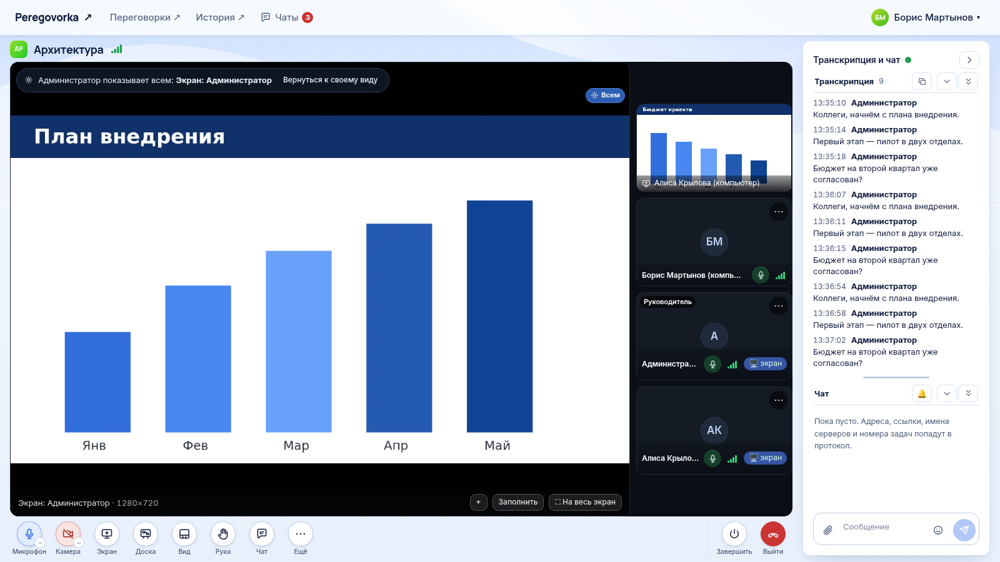
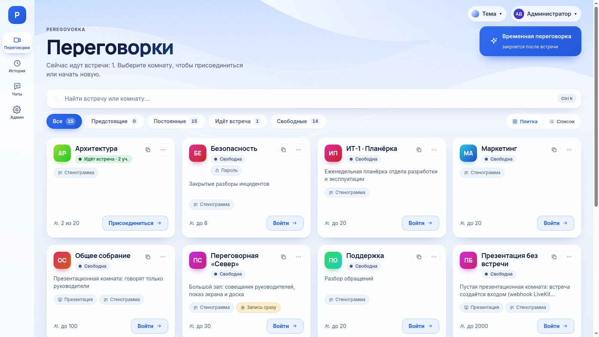

<div align="center">

# Peregovorka

### Self-hosted видеовстречи со стенограммой, протоколами, локальным AI и корпоративными интеграциями

Сотрудники входят доменной учётной записью, речь каждого участника автоматически превращается в текст, а после встречи готовы протокол, резюме и карта разговора.
Всё работает на вашем сервере: записи, тексты и учётные данные наружу не уходят.

[](https://github.com/calleograph/peregovorka/actions)
[](https://github.com/calleograph/peregovorka/releases)



</div>

---

|  |  |
| --- | --- |
| 🎥 **Видеовстречи** | голос, видео и несколько демонстраций экрана одновременно; своя раскладка у каждого, «показать всем» у ведущего |
| 📝 **Стенограмма** | «кто что сказал» — речь каждого участника распознаётся отдельно, на русском, без интернета |
| 📋 **Протоколы и резюме** | решения, задачи «кто — что — срок», открытые вопросы; у каждого пункта — реплика-источник |
| 🧠 **Локальный AI** | встроенная модель работает на вашем сервере; внешние модели — по желанию, с обезличиванием |
| 🗺 **Карта разговора** | темы встречи на шкале времени, кто сколько говорил, переход к нужной реплике |
| ⏺ **Запись** | запись звука встречи по кнопке или автоматически; после встречи — одна общая аудиозапись со всеми участниками; **видеозапись всей встречи одним MP4** (по желанию, нужна служба LiveKit Egress: [docs/VIDEO_RECORDING.md](docs/VIDEO_RECORDING.md)); плавающий плеер в истории с волновой формой, субтитрами и стенограммой: поиск слова или фразы, переход к найденному месту записи, цитата и ссылка на момент |
| 📡 **Массовые трансляции** | комната «Трансляционная»: выступающие в конференции, зрители смотрят эфир по ссылке (HLS, без подключения к LiveKit), пароли выступающих и зрителей, отзыв ссылок, метка «ЭФИР», запись в историю |
| ✏️ **Общая доска** | схемы и диаграммы (draw.io) вместе во время встречи; сохраняются с материалами |
| 🔌 **API** | публичный API, события (webhooks), фоновое формирование документов |
| 🏢 **Active Directory и Bitrix24** | вход доменной учётной записью, доступ по группам, профили сотрудников с портала |
| ☎️ **SIP** | звонок с телефона во встречу и из встречи на телефон через вашу АТС |
| 🎨 **Свой вид** | название, логотип, цвета, документы и контакты вашей организации — через браузер; оформление «Стекло» по умолчанию и темы на выбор у каждого пользователя |
| 🖥 **Приложение для Windows** | несколько организаций сразу, трей и уведомления Windows, вход без пароля после перезагрузки, ссылки на встречи открываются в приложении; EXE и MSI с групповыми политиками |
| 🔒 **Self-hosted и безопасность** | данные на вашем сервере, журнал аудита, права проверяет сервер |
| 📈 **Масштаб** | 2000 одновременных пользователей на сервере приложения 8 vCPU (4 процесса); падение процесса, перезапуск Redis и кратковременная недоступность базы — без ошибок у участников; медиасервер — по расчёту ([нагрузка и расчёт](docs/DB_AND_SCALING.md)) |

## Быстрый старт

Нужен сервер с чистой **Ubuntu 24.04** или Debian 12/13, **от 4 процессоров и 8 ГБ памяти**, доступ в интернет и права `sudo`. Docker, nginx и всё остальное установщик поставит сам.

```bash
wget -O install.sh https://raw.githubusercontent.com/calleograph/peregovorka/main/install.sh
chmod +x install.sh
sudo ./install.sh
```

Установка занимает 10–30 минут и заканчивается проверкой всех сервисов и сообщением **«УСТАНОВКА ЗАВЕРШЕНА»** с адресом и одноразовым паролем администратора.
Дальше всё делается в браузере: мастер первоначальной настройки проведёт через подключение к домену, сертификаты, группы, хранилище и почту.
Прервалось — запустите `sudo ./install.sh` ещё раз: готовые шаги пропускаются. Потеряли пароль администратора — `sudo /opt/peregovorka/scripts/admin-reset.sh`.

Параметры установщика, установка на сервер, где уже работают другие сервисы, и восстановление доступа — [docs/INSTALL_AND_UPDATE.md](docs/INSTALL_AND_UPDATE.md).

## Возможности

- **Комната на весь экран.** Сцена занимает всю ширину окна, панель управления — один компактный ряд, доска «Развернуть» на всё окно, на телефоне вся встреча без прокрутки.
- **Комната встречи.** Несколько демонстраций экрана одновременно, закрепление участников и демонстраций для себя, «показать всем» у ведущего, раскладки «Авто / Сетка / Сцена / Рядом», полный экран и «картинка в картинке», плавные переходы без перезапуска видео.
- **Управление встречей.** Руководитель комнаты выключает микрофоны и камеры, останавливает демонстрацию экрана, даёт слово в презентационной комнате, снимает поднятую руку, удаляет участника. «Заглушить для себя» доступно каждому.
- **Материалы своей комнаты.** Руководитель комнаты видит историю и материалы всех её встреч (в том числе без участия), выдаёт и отзывает доступ к отдельной встрече сотрудникам и группам каталога (групповая выдача — только после явного подтверждения), для каждого материала (протокол, резюме, стенограмма, карта) выбирает, кому его отправлять по почте, и видит подробный журнал действий комнаты; администратор — всех комнат.
- **Стенограмма и чат** в правой панели одновременно; файлы и картинки в чате; чат и доска учитываются в протоколе.
- **Документы после встречи:** протокол, резюме и карта разговора — в Word, PDF, HTML, Markdown; рассылка участникам по шаблону письма; протокол и карта открываются аккуратной страницей в оформлении «Стекло» (просмотр, печать, автономный файл); для карты можно выбрать модель, а прежняя карта не пропадает, пока не построена новая.
- **Модели на выбор:** встроенная локальная Qwen3 1.7B или внешние API — отдельно для протокола и резюме, на уровне системы, комнаты и встречи.
- **Массовые трансляции:** трансляционная комната, страница зрителя `/live/…`, два пароля (выступающих и зрителей), защита самого потока подписью, отзыв ссылок на лету; внешние площадки и CDN — в следующих выпусках ([docs/BROADCASTS.md](docs/BROADCASTS.md)).
- **Гостевой доступ** по ссылке без учётной записи, временные переговорки, презентационные комнаты.
- **Шифрование:** чат и стенограммы при хранении (AES-256-GCM) и сквозное шифрование звука и видео (E2EE LiveKit) с наглядным индикатором защиты и схемами.
- **Корпоративные чаты:** кнопка «Чаты» в верхнем меню — личные и групповые переписки вне встреч в большом окне поверх страницы (встреча не прерывается): поиск сотрудников в каталоге AD, папки, закрепление и архив, поиск по истории, файлы и скриншоты (Ctrl+V), голосовая диктовка через то же распознавание речи, что и встречи, уведомления и «в сети», синхронизация между устройствами — [docs/CHATS.md](docs/CHATS.md).
- **Приложение Peregovorka для Windows** (отдельные выпуски `desktop-v*`, предварительная версия): несколько корпоративных серверов одновременно — у каждой организации свой вход, чаты и уведомления; работа в трее и автозапуск; уведомления Windows о сообщениях, упоминаниях и встречах с переходом в нужное место; вход сохраняется без хранения пароля (отзываемый токен устройства, DPAPI); ссылки `peregovorka://` из писем; выбор экрана или окна с индикатором показа; установщики EXE и MSI, групповые политики (ADMX), обновление новым установщиком поверх с проверкой подписи. **Корпоративные сборки**: администратор подписывает EXE/MSI сертификатом своей организации (или собственным) на своём подписывающем узле — ключ не покидает узел, адрес сервера уже вписан в MSI; корпоративный канал обновлений.
- **Конференция из Outlook:** кнопка в окне встречи, ссылка в приглашении, обратный отсчёт и вход за N минут до начала; на главной — блок **«Предстоящие встречи»** над постоянными переговорками: время в вашем часовом поясе, организатор, состояние, обратный отсчёт и приглашённые (видят их только те, кому положено); у серии — ближайшее занятие с учётом перенесённых и отменённых занятий и часового пояса самой встречи.
- **Календарь Outlook внутри Peregovorka:** свои события (день, неделя, месяц, список; встреча, серия, постоянная комната, событие Outlook — подписью и цветом) и назначение встреч прямо из Peregovorka: событие создаётся в календаре самого сотрудника, приглашения рассылает Exchange; подключение — по согласию сотрудника — [docs/OUTLOOK_CALENDAR.md](docs/OUTLOOK_CALENDAR.md). В приглашении Outlook — две ссылки: для сотрудников и отдельная гостевая (с отзывом и перевыпуском).
- **Сетевая доступность:** администратор получает точный перечень портов и заявку для сетевого администратора по настройкам своего сервера (в браузере и командой `scripts/ports.sh`) — [docs/NETWORK.md](docs/NETWORK.md).
- **Паспорт встречи и восстановление материалов:** рядом с материалами каждой новой встречи — подписанный `manifest.json`; после переноса хранилища администратор находит и возвращает материалы, права восстанавливаются только по проверенному паспорту, остальное — в изолированную область — [docs/RESTORE.md](docs/RESTORE.md).
- **Равноправные комнаты по ссылке** без ведущего и **правка своего профиля** (приоритет над каталогом, «Восстановить из LDAP»).
- **Качество звука и связи:** три режима шумоподавления (в том числе нейросеть RNNoise на устройстве), автоматическое снижение качества видео при плохом канале — звук остаётся в приоритете.
- **Безопасность входа:** двухфакторная аутентификация (TOTP, резервные коды, политика для администраторов, всех или групп), локальная CAPTCHA без внешних сервисов (с кнопкой «Проверить CAPTCHA» в настройках), подписанный журнал аудита с фильтрами и выгрузкой.
- **Копия настроек по расписанию** на SMB-папку в зашифрованном виде, с проверкой и предупреждением, если копия давно не создавалась; чек-лист «Первоначальная настройка и проверка сервера» всегда под рукой.
- **Администрирование в браузере:** LDAPS и сертификаты, доступ по группам, хранилища (каталог или SMB), почта, журнал событий, обновление в один клик и по расписанию — не прерывая идущие встречи.

## Скриншоты



<sub>Снимки сделаны на тестовом стенде с вымышленными данными.</sub>

## Приложение для Windows

<!-- desktop-release:start -->
**Версия 1.3.0** · [страница выпуска](https://github.com/calleograph/peregovorka/releases/tag/desktop-v1.3.0) · [контрольные суммы](https://github.com/calleograph/peregovorka/releases/download/desktop-v1.3.0/SHA256SUMS.txt)

- **[Peregovorka-Setup-1.3.0.exe](https://github.com/calleograph/peregovorka/releases/download/desktop-v1.3.0/Peregovorka-Setup-1.3.0.exe)** — установка для себя, без прав администратора
- **[Peregovorka-1.3.0-x64.msi](https://github.com/calleograph/peregovorka/releases/download/desktop-v1.3.0/Peregovorka-1.3.0-x64.msi)** — для развёртывания в организации (групповые политики)

Несколько серверов организаций в одном окне, трей и уведомления Windows, новое оформление «Стекло». Установщики пока не подписаны сертификатом издателя: при первом запуске Windows может показать SmartScreen — «Подробнее» → «Выполнить в любом случае».
<!-- desktop-release:end -->

## Архитектура

Браузер (React + LiveKit) → nginx → backend (FastAPI) с PostgreSQL и Redis; звук и видео идут через LiveKit (WebRTC), распознавание речи — отдельный сервис GigaAM, документы формирует локальная или внешняя языковая модель.
Всё запускается в Docker Compose; обновление из браузера выполняет небольшой помощник на сервере, контейнеры доступа к Docker не получают. Подробно — [docs/INTERNALS.md](docs/INTERNALS.md).

## API

Публичный API `/api/public/v1` (по умолчанию выключен): ключи с правами и ограничением по комнатам, встречи, участники, стенограмма (JSON, TXT, Markdown, VTT, SRT), протоколы, резюме, карта разговора, записи и чат;
события (webhooks) с подписью и повторами; фоновое формирование документов; OpenAPI 3.1 и справочная страница. Пошаговое руководство — [docs/api/README.md](docs/api/README.md).

## Интеграции

| Интеграция | Что даёт | Документация |
| --- | --- | --- |
| Active Directory (LDAPS) | вход доменной учётной записью, доступ и роли по группам, профиль сотрудника | [docs/ADMIN_SETUP.md](docs/ADMIN_SETUP.md) |
| Bitrix24 | должность, подразделение, телефон и фото с корпоративного портала | [docs/BITRIX24.md](docs/BITRIX24.md) |
| SIP / АТС | телефонные участники встречи | [docs/SIP.md](docs/SIP.md) |
| Почта (SMTP) | рассылка материалов встречи | [docs/MAIL.md](docs/MAIL.md) |
| SMB / каталог | хранение записей, документов и вложений | [docs/STORAGE.md](docs/STORAGE.md) |
| Внешние LLM | протоколы и резюме внешней моделью, с обезличиванием по желанию | [docs/LOCAL_LLM.md](docs/LOCAL_LLM.md) |

Версии сторонних компонентов (LiveKit, PyTorch, FastAPI, PostgreSQL, React и др.) закреплены и пересматриваются **при каждом релизе**: проверенный комплект, решения по новым версиям и раздел «Версии компонентов» в админке — [docs/DEPENDENCIES.md](docs/DEPENDENCIES.md).

## Установка

Сервер: Ubuntu 24.04 или Debian 12/13, от 4 vCPU, 8 ГБ RAM, 20 ГБ диска. Участникам нужны **443/tcp** (HTTPS) и порты звонков LiveKit (UDP и TCP из `.env`); телефония использует отдельные порты только для вашей АТС.
Обновление — «Администрирование → Обновления и версии → Обновить проект» или `sudo ./scripts/update.sh`. Оно транзакционное: источники сборки проверяются до переключения версии, при сбое база возвращается к резервной копии без потери данных, а сервер — к прежней версии; итог виден в отчёте об обновлении. Подробно: [docs/INSTALL_AND_UPDATE.md](docs/INSTALL_AND_UPDATE.md), порты и сеть — [DEPLOYMENT.md](DEPLOYMENT.md).

## Безопасность

Данные и модели — на вашем сервере; права проверяет сервер, а не интерфейс; действия администраторов и руководителей попадают в журнал аудита; секреты хранятся зашифрованными;
публичный API выключен по умолчанию и защищён от обращений во внутреннюю сеть; вход защищён от перебора на сервере (видимая CAPTCHA, блокировки адресов, определение адреса клиента только от доверенных прокси). Для публичного сервера: ограничение доступа по доверенным подсетям (выключено по умолчанию, с защитой от самоизоляции администратора), журнал событий безопасности, ручные блокировки адресов и лёгкий встроенный WAF (режимы «Наблюдение» и «Защита»); он дополняет, но не заменяет внешний firewall и промышленный WAF. Результаты аудита — [docs/SECURITY_AUDIT.md](docs/SECURITY_AUDIT.md), HTTPS и HSTS — [docs/HTTPS_AND_HSTS.md](docs/HTTPS_AND_HSTS.md).

## Документация

| Документ | О чём |
| --- | --- |
| [CHANGELOG.md](CHANGELOG.md) | что нового в каждой версии |
| [docs/INSTALL_AND_UPDATE.md](docs/INSTALL_AND_UPDATE.md) | установка, обновление, откат, восстановление доступа |
| [docs/SITE_SETTINGS.md](docs/SITE_SETTINGS.md) | оформление под организацию: название, логотип, документы, контакты, темы |
| [docs/ADMIN_SETUP.md](docs/ADMIN_SETUP.md) | первая настройка в браузере |
| [docs/ROOMS_AND_ROLES.md](docs/ROOMS_AND_ROLES.md) | роли, комнаты, сцена встречи, модерация |
| [docs/COLLABORATION.md](docs/COLLABORATION.md) | общая доска, чат, гостевой доступ |
| [docs/ENCRYPTION.md](docs/ENCRYPTION.md) | шифрование: соединение, хранилище, индикатор защиты |
| [docs/CHATS.md](docs/CHATS.md) | корпоративные чаты: возможности, устройство, права, хранение, диктовка |
| [docs/DESKTOP_USER.md](docs/DESKTOP_USER.md) | приложение для Windows: установка, вход, организации, трей, уведомления |
| [docs/DESKTOP_ADMIN.md](docs/DESKTOP_ADMIN.md) | приложение для Windows: MSI, тихая установка, преднастройка, групповые политики |
| [docs/DESKTOP_SIGNING.md](docs/DESKTOP_SIGNING.md) | приложение для Windows: подпись, сертификат организации (AD CS), корпоративные сборки, ключи обновлений |
| [docs/DESKTOP_ACCEPTANCE.md](docs/DESKTOP_ACCEPTANCE.md) | приложение для Windows: план ручной приёмки на Windows 10/11 |
| [docs/DESKTOP.md](docs/DESKTOP.md) · [DESKTOP_SUPPORT.md](docs/DESKTOP_SUPPORT.md) | устройство и разработка приложения; диагностика для службы поддержки |
| [docs/OUTLOOK_ADDIN.md](docs/OUTLOOK_ADDIN.md) | надстройка Outlook: установка администратором и работа, две ссылки и гостевая ссылка |
| [docs/OUTLOOK_CALENDAR.md](docs/OUTLOOK_CALENDAR.md) | календарь Outlook в Peregovorka: права Graph и EWS, согласие, создание встреч, ограничения |
| [docs/NETWORK.md](docs/NETWORK.md) | сетевые порты и публикация в интернете: перечень по настройкам сервера, `scripts/ports.sh` |
| [docs/RESTORE.md](docs/RESTORE.md) | паспорт встречи (`manifest.json`) и восстановление материалов после переноса хранилища |
| [docs/PEER_ROOMS.md](docs/PEER_ROOMS.md) | временные равноправные комнаты по ссылке |
| [docs/PROFILE_EDIT.md](docs/PROFILE_EDIT.md) | правка профиля пользователем и приоритет над каталогом |
| [docs/AUDIO_QUALITY.md](docs/AUDIO_QUALITY.md) | шумоподавление и адаптивное качество видео |
| [docs/TWO_FACTOR.md](docs/TWO_FACTOR.md) | двухфакторная аутентификация: политика, резервные коды, восстановление доступа |
| [docs/CAPTCHA.md](docs/CAPTCHA.md) | локальная CAPTCHA: режимы и устройство |
| [docs/AUDIT_LOG.md](docs/AUDIT_LOG.md) | журнал аудита: события, поля, выгрузка, проверка целостности |
| [docs/CONFIG_BACKUP.md](docs/CONFIG_BACKUP.md) | резервная копия конфигурации: шифрованный экспорт и перенос на новый сервер |
| [docs/RECORDINGS.md](docs/RECORDINGS.md) | общая запись встречи, плеер в истории |
| [docs/VIDEO_RECORDING.md](docs/VIDEO_RECORDING.md) | видеозапись встреч (LiveKit Egress): режимы, установка, пределы, что не проверено |
| [docs/ROOM_ICONS.md](docs/ROOM_ICONS.md) | значки комнат: библиотека, загрузка, кадрирование, права, лицензии |
| [docs/DB_AND_SCALING.md](docs/DB_AND_SCALING.md) | масштабирование: процессы, пулы базы, нагрузочные замеры на 2000, сбои, расчёт медиасервера |
| [docs/CORPORATE_CHECKS.md](docs/CORPORATE_CHECKS.md) | проверки, возможные только в корпоративной среде (AD, SMTP/Exchange, нагрузка) |
| [docs/LOCAL_LLM.md](docs/LOCAL_LLM.md) | локальная модель и протоколы |
| [docs/MAPS_AND_KNOWLEDGE.md](docs/MAPS_AND_KNOWLEDGE.md) | карта разговора |
| [docs/api/README.md](docs/api/README.md) | публичный API и события |
| [docs/INTERNALS.md](docs/INTERNALS.md) | устройство системы, данные, ограничения |
| [docs/VERSIONING.md](docs/VERSIONING.md) | версии и выпуск релизов |
| [HISTORY.md](HISTORY.md) | технический журнал разработки |
