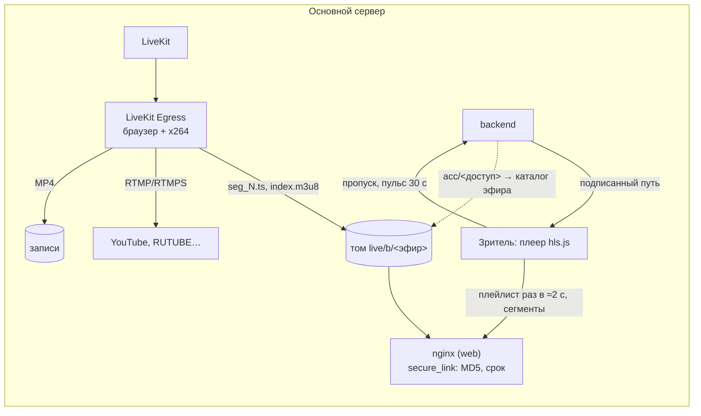
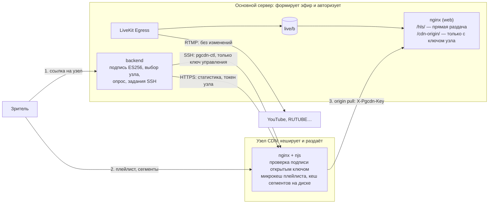
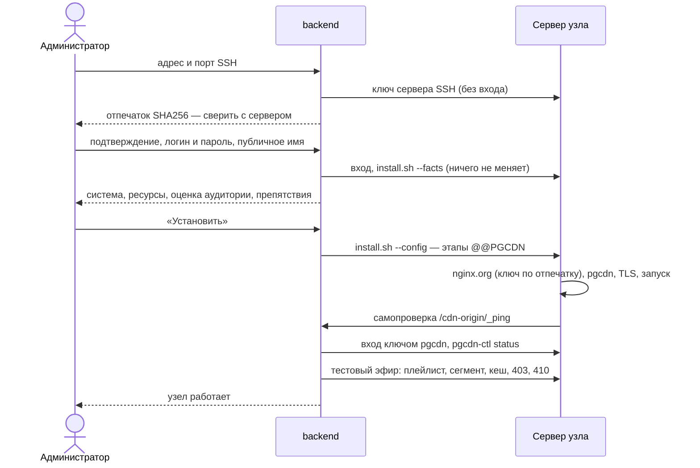

# Свои узлы CDN для трансляций

Как устроена массовая раздача эфиров с отдельных серверов: аудит прежней схемы, принятые решения и причины, подключение узла, защита, отказоустойчивость, замеры. Инструкция администратора — вики, страница [Узлы CDN](https://github.com/calleograph/peregovorka/wiki/Узлы-CDN). Формирование эфира и прежняя прямая раздача — [BROADCASTS.md](BROADCASTS.md).

## Аудит прежней схемы

Что основной сервер делает для каждого зрителя (по коду и замерам):

| Операция | Частота на зрителя | Цена |
|---|---|---|
| Выдача ссылки (`POST /live/<токен>/access`): проверка зрителя, пароля, подпись | старт + раз в 7,5 мин | backend и база |
| Пульс счётчика зрителей | раз в 30 с | backend и Redis |
| Плейлист | ≈ раз в 2 с | nginx, файл ≈ 700 байт |
| Сегмент | раз в ≈2 с, ≈1,3 МБ (1080p), ≈2,2 МБ (1440p) | **весь исходящий трафик** |

**Главное ограничение прямой раздачи — канал и исходящий трафик основного сервера.** 300 зрителей 1080p — ≈1,6 Гбит/с из того же сервера, где идут LiveKit, Egress и конференции. Egress формирует один поток независимо от числа зрителей, так что основной рост — это передача одних и тех же байтов множеству зрителей.

| Данные | Кешируются | Срок |
|---|---|---|
| `seg_N.ts` | да, неизменяемы | минуты (уборка на источнике — `segment_keep_min`) |
| `index.m3u8` | коротко | доли секунды: новый сегмент каждые ≈2 с, запас плеера 2,5 с |
| Проверка подписи | да | до конца срока ссылки |
| Выдача ссылки, пароль, зритель, пульс, вопросы | нет | только основной сервер |

**Что уже было в разделе CDN (0.49.2).** Адрес внешнего CDN (`cdn_base_url`), проверка `/hls/healthz`, галочка «Раздавать через CDN» в комнате, запасной переход плеера на источник. Подпись проверял **основной сервер**: CDN забирал те же пути `/hls/…`, поэтому кеш был привязан к подписи и окну 5 минут, а каждое новое окно давало промах по всем живым сегментам. Секрет подписи общий (MD5 + секрет) и узлу CDN его отдать нельзя: узел мог бы выписывать ссылки на любые эфиры. Механизм работает и сохранён как режим «Внешний CDN»; повторно использованы: галочка в комнате, окно срока подписи, запасной переход плеера, пульс и счётчик зрителей.

**Откуда задержка:** захват → выход Egress ≈2 с (браузер-компоновщик, x264 `veryfast` без `zerolatency`; в Egress не настраивается), сегмент готов ≈3,3 с, запас плеера 2,5 с. Узел добавляет к этому только свежесть плейлиста (до 0,3 с) и передачу. LL-HLS Egress не выпускает.

**Ограничения.** Egress: одна дорожка, сегмент 2 с, ключевой кадр задаётся длиной сегмента. HLS: без частей (LL-HLS) ниже ≈5 с не опуститься. Хранилище: том `live/b`, запись идёт на диск основного сервера; узлы от него не зависят — у них свой кеш.

## Новая схема

Основной сервер отвечает за комнаты, LiveKit и Egress, HLS, авторизацию зрителей, гостевые ссылки, эфиры и записи. Узел — за получение HLS, кеш, раздачу, проверку срока и подписи, статистику. Внешние RTMP-площадки — отдельное направление: их поток идёт от Egress и узлов не касается. Запись эфира после окончания отдаётся с основного сервера, как раньше.

## Решения и причины

### Origin Pull

| Вариант | Плюсы | Минусы |
|---|---|---|
| **Origin Pull** — выбран | узел хранит только то, что смотрят; новый узел работает сразу; источник отвечает за одно: отдать файл; отказ узла не мешает источнику | первый запрос сегмента на узле идёт на источник |
| Origin Push | сегмент на узле раньше первого зрителя | Egress пишет на локальный том: нужна служба слежения и отправки, очередь и повторы на каждый узел; трафик на все узлы даже без зрителей; выпавший узел нужно догонять |
| Комбинированная | плюсы обоих | выигрыша нет: наплыв 1000 моделируемых зрителей за 1 с на холодный кеш — ни одной остановки, с источника 5,6 Мбит/с. Push окупился бы только при большой задержке до источника |

### Движок: nginx Open Source

| | nginx OSS + njs | Apache Traffic Server | Varnish | Caddy |
|---|---|---|---|---|
| Замер: 300 зрителей, 1,6 Гбит/с, HTTP, 4 vCPU | CPU 0,14 ядра, 153 МБ, запросов к источнику 450, сегмент p99 503 мс | CPU 0,24 ядра, 110 МБ, запросов к источнику 125, сегмент p99 50 мс | не измерялся | не измерялся |
| Склейка запросов к источнику | `proxy_cache_lock`, ожидание шагами по 500 мс | есть (read-while-writer), гибче | есть | нет |
| Диск и память | файлы + страничный кеш ОС, `sendfile` | свой кеш на «сыром» диске, RAM-кеш | в памяти или файл | нет |
| Своя проверка ES256 | njs: WebCrypto, общая память | только HMAC (`url_sig`) или свой плагин на C++ | VCL + модули | модуль на Go |
| TLS | встроен | встроен | нет (нужен отдельный терминатор) | встроен |
| Пакеты для 5 систем на amd64/arm64 | nginx.org: все 10 сочетаний есть | пакеты дистрибутивов: 9.2 в Debian 12 и Ubuntu 24.04, в Debian 13 пакета нет | packagecloud | свой репозиторий |
| Сопровождение | тот же nginx, что на источнике | отдельный стек настройки | отдельный стек | просто, но без кеша |

Выбран **nginx OSS с njs**: единственный вариант, где проверка асимметричной подписи делается штатными средствами, без своих плагинов на C/C++. Он в 1,7 раза экономнее по процессору, есть для всех поддерживаемых систем и уже работает на источнике. ATS лучше склеивает запросы и не имеет шага 500 мс, но эта разница затрагивает ≈1 % запросов сегмента, а остальные его сильные стороны раскрываются на больших CDN с собственными дисками. Перед замером ATS кеш плейлиста у обоих был одинаковый (1 с), поэтому сравнение честное, но оба давали остановки — см. «Плейлист».

### Плейлист: свой микрокеш в njs

Цифры — 50 зрителей, 1080p, 60 с, узел в одной сети с источником:

| Вариант | Остановки у зрителей | Запросов к источнику/с |
|---|---|---|
| Прямо с источника | 0, 0 | — |
| Кеш nginx 1 с, `use_stale updating` | 16, 33, 14 | 1 |
| Кеш nginx 1 с | 45, 27, 9 | 1 |
| Без кеша плейлиста | 0, 0 | 32 |
| **Микрокеш njs 0,3 с + склейка запросов** | **0, 0** | **3** |

Срок кеша nginx не бывает меньше 1 с, а запас плеера — 2,5 с: 1 с опоздания плейлиста + фаза опроса съедают запас. `use_stale updating` ещё и важнее сроков из `stale-while-revalidate`: после простоя первый зритель получал плейлист двухминутной давности. Без кеша каждый опрос каждого зрителя идёт на источник (≈1000 запросов/с на 1500 зрителей). Микрокеш в общей памяти (`pgcdn.playlist`): 0,3 с, за обновлением идёт один запрос (атомарный `add`), остальные ждут его шагами 25 мс; при ошибке источника — прежний плейлист ещё 10 с.

### Сегменты

Кеш nginx на диске: ключ — доступ и имя файла, **без подписи**: все зрители и все окна срока делят одну копию. `proxy_cache_lock`: новый сегмент запрашивается с источника один раз, остальные ждут. Ждущие проверяют кеш шагами 500 мс (задано в коде nginx); это ≈1 % запросов сегмента и укладывается в запас плеера. Перекодирования нет: узел отдаёт те же байты, что записал Egress.

### Подпись ссылок: ES256

Ссылка на узел: `/hls/<доступ>/<срок>/<kid>.<подпись>/<файл>`, подпись ES256 строки `pgcdn1|<доступ>|<срок>`.

* Узел знает только **открытые** ключи: захваченный узел не может выписать ссылку ни на что.
* Закрытый ключ нигде не хранится: выводится из главного ключа приложения и номера поколения.
* Проверенная подпись запоминается в общей памяти до конца срока (ECDSA — один раз на окно, остальные запросы — поиск в памяти).
* Смена ключа: узлы сначала получают новый открытый ключ, затем ссылки начинают подписываться им. Принимаются текущее и предыдущее поколения; двойная смена отзывает ключ полностью.
* Неверных подписей с адреса > 60 в минуту → 429 без вычислений: подбор не нагружает процессор.
* Истёкшая ссылка — 410: плеер берёт новую, не прерывая показ. Чужая или поддельная — 403.
* Отзыв ссылки или смена пароля удаляют `acc/<доступ>` на источнике: плейлист узла получает 404 в течение 0,3 с. Уже скачанные сегменты в кеше остаются, но новых зритель не увидит.
* Сегменты в кеше узла лежат открытыми байтами — как и на источнике; диск узла надо защищать так же. Шифрование эфира (E2EE) с трансляцией несовместимо и запрещено раньше.

### Доступ узла к источнику

`GET /cdn-origin/<доступ>/<файл>` с заголовком `X-Pgcdn-Key`. Ключ у каждого узла свой, случайный; список — `live/nginx/cdn-keys.map` (права как у секрета подписи), его применяет `live-secret.sh` через `nginx -t` и перечитывание. Удаление узла отзывает ключ. Без ключа — 403. Плейлист отдаётся с `max-age=1, stale-if-error=10`.

### Выбор узла, отказ, возврат

Взвешенное рандеву-хеширование по зрителю среди включённых исправных узлов: зритель остаётся на своём узле, при выпадении узла переезжают только его зрители. Опрос раз в 15 с: 2 неудачи подряд — узел исключён, 2 удачи — возвращён.

| Режим | Поведение |
|---|---|
| CDN выключен | прямая раздача, как раньше |
| Внешний CDN (`cdn_base_url`) | как раньше |
| Один узел / несколько | ссылка на узел; ссылка на источник — запасная |
| Все узлы недоступны | прямая раздача, если разрешена; иначе 503 и повтор |

Плеер не ждёт опроса: при сбое узла сразу просит другой (`avoid`), а если другого нет — переходит на запасной путь. Плановое продление ссылки возвращает зрителя на узел после восстановления.

Сначала сделан один надёжный узел; несколько узлов и регионы работают тем же механизмом. Геораспределения по адресу зрителя нет: для этого нужны геобаза или DNS-балансировка, а задача пока этого не требует.

## Подключение по SSH

* Пароль или ключ администратора сервера хранятся зашифрованными в Redis не дольше 30 минут и удаляются после установки; в базу и журналы не попадают. `sudo` получает пароль через стандартный вход.
* Ключ сервера закреплён: подмена — отказ `host_key_mismatch`.
* После установки — только учётная запись `pgcdn`, вход по ключу ed25519, `restrict` и принудительная команда: разрешены лишь подкоманды `pgcdn-ctl`; `sudo` — только для этого файла.
* Один запуск на узел (замок в Redis и `/run/pgcdn-install.lock`). Повторная установка безопасна. Сбой: этап, журнал, «Повторить установку». Перезапуск основного сервера посреди установки — узел в «ошибке», а не в вечной установке.
* `pgcdn-ctl apply` проверяет настройки `nginx -t` и возвращает прежние при отказе.

Ручная установка: узел с флажком «Установлю сам», пакет и настройки из администрирования, `sudo bash install.sh --config node.json`, затем «Подключить установленный».

Сертификат: Let's Encrypt (HTTP-01, таймер certbot), свой (PEM) или самоподписанный — только для стенда.

## Безопасное внедрение

Новая схема включается параметром. Настройки, ссылки и прямая раздача не меняются. Откат — снять «Раздавать эфиры через свои узлы»: следующие продления ссылок вернут зрителей на прямую раздачу, плеер сам перейдёт на запасной путь. Таблица `cdn_nodes` (миграция 0060) в резервную копию настроек не входит: её ключи привязаны к серверу, на новом сервере узлы подключаются заново.

## Испытания

Стенд и инструменты: `tests/live/cdn/` — генератор зрителей на Go (`loadgen`), настоящий эфир через Egress (`broadcast.py`), прогон с замером (`load_run.py`), установка через API (`install_e2e.py`), ВМ без привилегий (`vm/`).

### Нагрузка: моделирование на одной машине

**Это не испытание на настоящем оборудовании.** Источник с настоящими LiveKit и Egress, узел и генератор зрителей работают на одном сервере (20 ядер), трафик идёт через виртуальный мост, TLS настоящий. Зрители — программы, ведущие себя как hls.js, а не браузеры. Канал интернета, потери и NVMe под нагрузкой не проверялись: сегменты живут в страничном кеше ОС.

Эфир настоящий: синтетический докладчик → LiveKit → Egress → HLS. Узел — контейнер 8 vCPU / 16 ГБ, 60 с измерения.

| Прогон | Отдано | Сегмент p50 / p99, мс | Остановки | С источника | CPU узла, ядер | Память процессов |
|---|---|---|---|---|---|---|
| 1080p, **без узла**, 300 зрителей | 1,55 Гбит/с | 1,7 / 3,3 | 0 | **1408 Мбит/с** | — | — |
| 1080p, узел, 100 | 0,52 Гбит/с | 5,5 / 10,7 | 0 | 5,5 Мбит/с | 0,42 | 166 МБ |
| 1080p, узел, 300 | 1,57 Гбит/с | 5,5 / 12,9 | 0 | **5,5 Мбит/с** | 1,15 | 174 МБ |
| 1080p, узел, 500 | 2,63 Гбит/с | 5,7 / 13,3 | 0 | 5,5 Мбит/с | 1,88 | 180 МБ |
| 1080p, узел, 1000 | 5,24 Гбит/с | 6,8 / 39,8 | 0 | 5,5 Мбит/с | 3,22 | 196 МБ |
| 1080p, узел, 1500 | **7,87 Гбит/с** | 9,6 / 126 | **0** | 5,5 Мбит/с | 4,76 | 211 МБ |
| 1440p, узел, 500 | 4,64 Гбит/с | 13,9 / 96 | 0 | 9,7 Мбит/с | 2,82 | 218 МБ |
| 1440p, узел, 1000 | 9,36 Гбит/с | 21 / 271 | 1 | 9,6 Мбит/с | 5,03 | 228 МБ |
| 1440p, узел, 1500 | 13,7 Гбит/с | 490 / 2183 | **2672** | 9,8 Мбит/с | 7,24 из 8 — предел | 552 МБ |
| 1440p, узел 12 vCPU, 1500 | 14,0 Гбит/с | 120 / 656 | 159 | 9,6 Мбит/с | 6,87 — предел стенда | 320 МБ |
| Холодный кеш, 1000 за 1 с | 5,29 Гбит/с | 21 / 278 | 0 | 5,6 Мбит/с | 3,56 | 264 МБ |
| Два эфира, 500 + 500 | 7,29 Гбит/с | 35–40 / 310–428 | 7 и 47 | 15,1 Мбит/с | 3,7 | 295 МБ |

Выводы:

* **Узел снимает с источника 99,6 % трафика сегментов** (замер 300 зрителей, 60 с: 1408 → 5,5 Мбит/с): трафик источника равен одному потоку эфира и не зависит от числа зрителей. Служебные запросы зрителей (страница, ссылка, пульс, вопросы) идут на основной сервер и в замер не входят.
* Узел на 8 vCPU раздавал ≈1,65–1,86 Гбит/с TLS на ядро (ориентир с запасом — 1,5 Гбит/с, расчётная оценка) и отдавал до ≈9 Гбит/с. **1500 моделируемых зрителей 1080p: 0 остановок за 60 с**; 1000 моделируемых зрителей 1440p: 1 остановка. Статус обоих: проверено в ограниченном сценарии (одна машина, виртуальный мост, настоящих зрителей нет).
* **1500 зрителей 1440p (14 Гбит/с) здесь не подтверждены**: на 8 vCPU упор в процессор узла, на 12 vCPU — в стенд (узел не занят полностью, но генератор, эфир и мост делят одну машину).
* Два эфира и второй Egress на одной машине дали единичные остановки при загруженном процессоре стенда: нужна проверка на раздельном оборудовании.
* Показанные профили расчёта опираются на эти замеры; предел настоящего узла, как правило, — канал провайдера.
* Память: процессы занимают ≈200 МБ, остальное ОЗУ работает как страничный кеш. kTLS мог бы снизить нагрузку на процессор, но не проверялся (нужен модуль ядра `tls`) и не включён.

### Отказы

| Что проверено | Как | Результат |
|---|---|---|
| Отказ узла при просмотре | настоящий Chromium, `docker kill` узла | ≈7 с заминки, плеер сам продолжил со второго узла |
| Потеря связи с источником на 15 с | 200 зрителей, настоящий эфир | новых сегментов нет: каждый зритель один раз остановился, 502/504 на время сбоя, после возврата эфир пошёл сам |
| Истёкшая ссылка, чужой эфир, неизвестный ключ, подделка | узел | 410, 403, 403, 403; после 60 неверных подписей в минуту — 429 |
| Вход с подменённым ключом SSH | backend | отказ `host_key_mismatch` |
| Управление узлом | ключ `pgcdn` | произвольные команды, цепочка через `;`, проброс порта — отказ |

| Отказ всех узлов | Chromium, `docker kill` | ≈8–16 с, плеер перешёл на основной сервер; после возврата узла вернулся на него сам, без перезапуска показа |
| Заполнение кеша | предел 40 МБ, 100 зрителей 1440p, 150 с | кеш 49 МБ, вытеснение работает, остановок нет, ошибок нет |
| Перечитывание настроек | 3 раза под нагрузкой 200 зрителей | ни одной ошибки |
| Перезапуск службы nginx | под нагрузкой 200 зрителей | у каждого зрителя одна короткая заминка, дальше сам |

### Подключение по SSH: настоящие ВМ

ВМ — QEMU без ускорения (`tests/live/cdn/vm`), вход паролем пользователя с `sudo`, весь путь — через API администрирования: отпечаток → проверка → установка → вход ключом `pgcdn` → тестовый эфир через узел (данные совпали, кеш, 403, 410).

| Система | Архитектура | Результат |
|---|---|---|
| Ubuntu 22.04 | amd64 | узел работает; обновление пакета 1.0.0 → 1.0.1, смена ключа, повторная установка, вывод из работы |
| Ubuntu 24.04 | amd64 | узел работает |
| Ubuntu 26.04 | amd64 | узел работает |
| Debian 12 | amd64 | узел работает |
| Debian 13 | amd64 | узел работает; удаление: служба, настройки, учётная запись и правило sudo убраны с сервера, ключ источника отозван |
| Ubuntu 24.04 | arm64 | узел работает; полная эмуляция arm64, пределы времени установки подняты после этой проверки; защита от двойного запуска и повтор после сбоя проверены здесь |

Время установки на эмуляции — 6–20 минут. На настоящем сервере не измерялось.

### Не проверено

* Настоящий Let's Encrypt: нужны DNS и открытый порт 80. Свой сертификат установлен на ВМ Debian 13: ключ 600, в настройках его нет; проверка раздачи по цепочке доверия — только автотестом выбора контекста.
* Настоящие зрители, интернет-канал, потери, NVMe под холодным кешем — всё в разделе «Нагрузка» смоделировано на одной машине.
* 1500 зрителей 1440p, несколько эфиров на раздельном оборудовании.
* Safari/iOS с узлом. Приложения Windows, Linux и Android — по коду: они ограничивают навигацию, а не загрузку данных, страница зрителя та же; запуском не проверялись.
* Настоящие площадки дальше их приёмного сервера не менялись и не проверялись заново: RTMP идёт от Egress мимо узлов.
