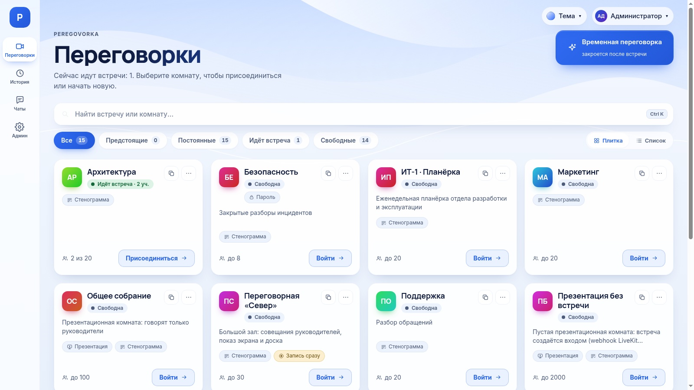

# Peregovorka

**Peregovorka — видеовстречи, которые работают на сервере вашей организации.** Сотрудники входят под своей доменной учётной записью. Пока идёт встреча, система записывает, кто что сказал. Когда встреча заканчивается, она готовит протокол с решениями и поручениями. Звук, записи и стенограммы хранятся на вашем сервере, распознавание речи работает без интернета. Протокол пишет языковая модель, которую вы подключаете по API; перед отправкой текст можно обезличить прямо на сервере, а пароли и ключи в модель не уходят никогда.

Продукт рассчитан на организации, которым нельзя отправлять разговоры во внешние облака: ИТ-отделы, руководство, юристы, госструктуры. Если вам нужен облачный сервис без своего сервера, Peregovorka не подойдёт. Подробнее об этом — на странице [Когда продукт не подходит](Когда-продукт-не-подходит).



## С чего начать

Найдите себя в таблице: у каждой роли свой путь по статьям. Если нужен ответ на конкретный вопрос, откройте [поиск по вопросам](Поиск-по-вопросам).

| Вы | Начните здесь | Что будете уметь |
| --- | --- | --- |
| Новый сотрудник | [Мой первый рабочий день](Первый-день-в-Peregovorka), затем [маршрут сотрудника](Маршрут-сотрудника) | войти, проверить оборудование, участвовать во встрече, найти материалы |
| Организатор встреч | [Маршрут организатора](Маршрут-организатора) | провести совещание, пригласить людей, получить протокол |
| Руководитель комнаты | [Маршрут руководителя комнаты](Маршрут-руководителя-комнаты) | настроить комнату, управлять участниками и доступом |
| Гость | [Маршрут гостя](Маршрут-гостя) | войти по ссылке без учётной записи |
| Ведущий трансляции | [Маршрут ведущего](Маршрут-ведущего-трансляции) | провести эфир, отвечать на вопросы, вывести на площадки |
| Зритель трансляции | [Маршрут зрителя](Маршрут-зрителя) | смотреть эфир и задавать вопросы |
| Администратор сервера | [Маршрут администратора](Маршрут-администратора) | установить, настроить, обновлять и восстанавливать сервер |
| Техническая поддержка | [Маршрут поддержки](Маршрут-поддержки) | принять обращение, найти причину, собрать диагностику |
| Интегратор, эксплуатация | [Маршрут интегратора](Маршрут-интегратора) | подключить каталог, почту, Outlook, API и другие системы |

**Изучаете устройство системы.** Раздел [Архитектура и техническое устройство](Архитектура-и-техническое-устройство) показывает компоненты, сетевые потоки, порты и обработку персональных данных.

**Оцениваете защищённость.** Вам нужны [Безопасность и приватность](Безопасность-и-приватность), [Справочник для проверки ИБ](Справочник-для-проверки-ИБ) и [Что проверено](Границы-проверки).

**Планируете внедрение.** Откройте [Системные требования](Системные-требования) и [Производительность и масштабирование](Производительность-и-масштабирование): там показано, что измерено, а что нет.

**Что-то не работает.** Раздел [Решение проблем](Решение-проблем) собирает неисправности по симптомам: что видно, почему, что сделать.

## Сценарии от начала до конца

Семь практических курсов проводят через реальную задачу целиком:

1. [Мой первый рабочий день](Первый-день-в-Peregovorka)
2. [Организация совещания](Сценарий-Организация-совещания)
3. [Встреча с внешними участниками](Сценарий-Встреча-с-внешними-участниками)
4. [Первая трансляция](Сценарий-Первая-трансляция)
5. [Получение протокола](Сценарий-Получение-протокола)
6. [Новый сервер](Сценарий-Новый-сервер)
7. [Восстановление после сбоя](Сценарий-Восстановление-после-сбоя)

## Популярные вопросы

- [Как включить показ экрана?](Как-показать-экран)
- [Почему меня не слышат?](Решение-проблем-микрофона)
- [Как подключить гостя?](Как-подключить-гостя)
- [Где найти запись и протокол?](Где-найти-материалы-встречи)
- [Как отправить протокол участникам?](Как-отправить-материалы)
- [Почему трансляция не запускается?](Решение-проблем-видеозаписи-и-трансляций)

## Что умеет система

Кратко: встречи со звуком, видео, показом экрана и доской; стенограмма по каждому участнику; протоколы и резюме; записи; трансляции по ссылке и на внешние площадки; чаты; приложения для Windows, Linux и Android; интеграции с Active Directory, почтой, сетевыми папками, телефонией, Outlook и API. Полный перечень с ограничениями: [Возможности](Возможности).

## Как установить

На чистом сервере Ubuntu 24.04 нужно выполнить три команды:

```bash
wget -O install.sh https://raw.githubusercontent.com/calleograph/peregovorka/main/install.sh
chmod +x install.sh
sudo ./install.sh
```

Установщик сам поставит Docker и nginx, скачает модели, соберёт образы и проверит систему. Весь путь до рабочей эксплуатации, с доменом, сетью и резервными копиями, описан на странице [Установка на чистый сервер](Установка-на-чистый-сервер). В конце он покажет адрес сервера и одноразовый пароль администратора. Подробности — в статье [Быстрый старт](Быстрый-старт).

**Что нужно для работы.** Сервер с Ubuntu 22.04 или новее либо Debian 12–13 (x86_64), не меньше 4 ядер, 8 ГБ памяти и 30 ГБ диска. Это пороги проверки установщика, а не обещание вместимости: что измерено и что нет, описано в [Системных требованиях](Системные-требования). Встречи открываются в Chrome или Edge, а также в приложениях для Windows 10/11 и Android 8.0 или новее. Серверу нужен HTTPS и открытые порты для звонков ([Порты и сеть](Справочник-порты-и-сеть)).

## Версии

- Сервер — 0.75.0. Номер 0.X.Y означает, что продукт ещё не достиг версии 1.0.
- Приложение для Windows — 1.5.1, предварительный выпуск. Обновления устанавливаются из приложения (описание версии подписано ключом издателя); сами установщики пока не подписаны сертификатом издателя.
- Приложение для Linux — 1.5.1 (Ubuntu 22.04/24.04, Debian 12/13; x86_64 и ARM64): [репозиторий APT](https://calleograph.github.io/peregovorka-apt/), обновления через `apt upgrade` — [Как установить приложение для Linux](Как-установить-приложение-для-Linux).
- Приложение для Android — 0.1.9, предварительный выпуск. Подписано постоянным ключом: следующие версии ставятся поверх с сохранением данных.

Продукт работает в тестовой среде разработчиков. На настоящей корпоративной инфраструктуре проверено ещё не всё. Что именно осталось, перечислено на странице [Что проверено](Границы-проверки).

## Ссылки

- [Репозиторий](https://github.com/calleograph/peregovorka) и [последний выпуск сервера](https://github.com/calleograph/peregovorka/releases/latest)
- [Технический паспорт](https://github.com/calleograph/peregovorka/blob/main/docs/TECHNICAL_PASSPORT.md)
- [Сообщить об ошибке или предложить функцию](https://github.com/calleograph/peregovorka/issues)
- [Лицензия](Лицензия), [Политика безопасности](Политика-безопасности), [Участие в разработке](Участие-в-разработке), [Планы развития](Планы-развития)
