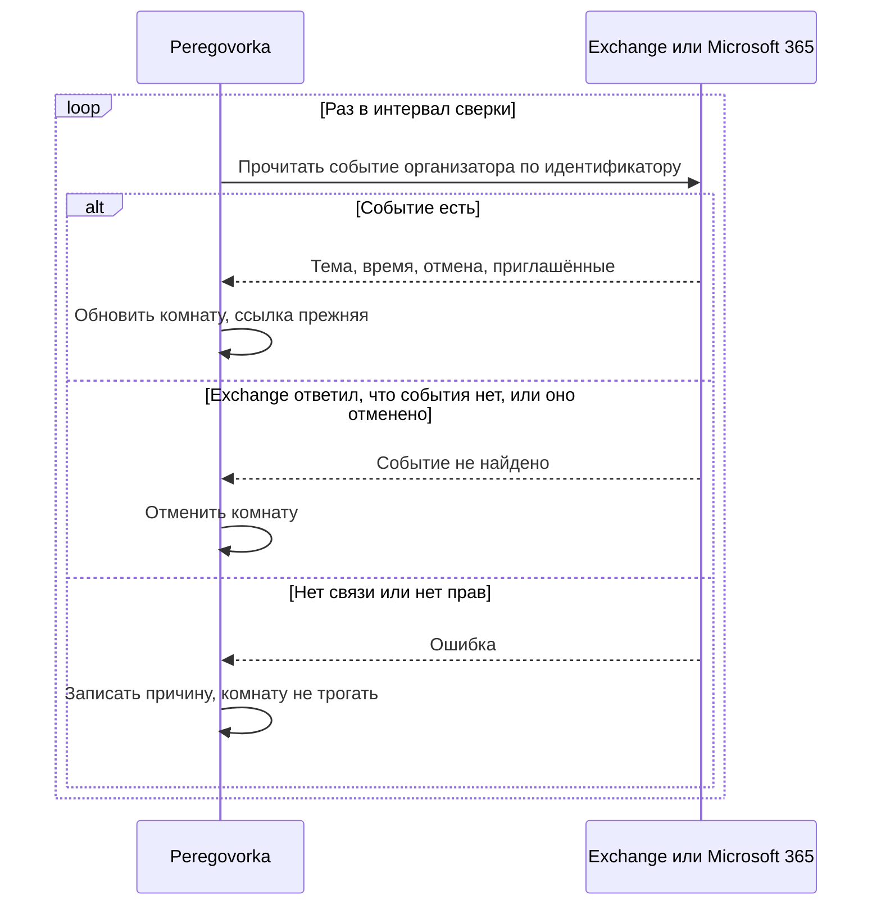

# Синхронизация и повторяющиеся встречи

*Для кого: администратор и организатор встреч.*

## Зачем это нужно

Встречу можно изменить в разных местах: в Outlook, на телефоне, в Peregovorka. Статья объясняет, как изменение доходит до комнаты, когда не доходит и что происходит с сериями.

> На настоящем сервере Exchange это не проверялось. Не подтверждены рассылка приглашений и отмен по занятию серии, изменение времени серии в EWS, часовые пояса Windows и чтение идентификаторов в настоящем Outlook. Проверка шла на подставных ответах Graph и EWS. Проверьте сценарии этой страницы на пилотных ящиках.

## Как изменение доходит до Peregovorka

| Что произошло | Как узнаёт Peregovorka | Что нужно | Результат |
| --- | --- | --- | --- |
| Нажата кнопка в Outlook впервые | панель надстройки | надстройка | создана комната |
| Встреча изменена, нажато **Обновить конференцию** | панель надстройки | надстройка | время, тема и окно входа обновлены, ссылка прежняя |
| Нажато **Отправить** или **Отправить обновление** | обработчик отправки | Microsoft 365 и **Передавать изменения при отправке приглашения** | время, тема и идентификаторы ушли на сервер |
| Встреча изменена в другом клиенте | сверка | сверка и идентификатор события | расписание обновлено |
| Встреча удалена или отменена в Outlook | сверка | сверка и идентификатор события | комната отменена, ссылка не пускает |
| Изменён список приглашённых | панель, отправка, сверка | см. выше | обновлён список для блока **Предстоящие встречи** |
| Изменение в разделе «Календарь» | сразу в Exchange и в комнате | запись включена | Exchange уведомляет участников |

Надстройка сама не сообщает серверу об отмене. Без сверки отмена в Outlook не закрывает комнату: она закроется по расписанию.

Список приглашённых определяет, кто видит встречу на главной странице. Доступ к входу он не определяет.

## Как работает сверка

- Интервал задаёт настройка **Как часто сверять**: от 1 до 1440 минут, по умолчанию 10.
- Сверка выключена по умолчанию. Включение: [Как подключить календарь Exchange](Как-подключить-календарь-Exchange).
- Текст письма не читается.
- Ошибка связи или прав никогда не отменяет комнату. Отмена бывает только по явному ответу, что события нет, или при признаке отмены.
- После восстановления связи сверка продолжается сама.
- Пока календарь недоступен, карточка на главной показывает последнее подтверждённое время с подписью **Сверено с календарём**.

## Какие встречи отслеживаются

Сверка находит событие только по идентификатору.

| Откуда встреча | Как появляется идентификатор |
| --- | --- |
| Раздел «Календарь» | сервер получает его от Exchange при создании |
| Надстройка | надстройка читает его в Outlook, если встреча сохранена и клиент это умеет |

Проверьте результат в таблице **Созданные конференции**, столбец **Сверка**:

| Надпись | Что значит |
| --- | --- |
| время | встреча сверена |
| **ещё не сверялась** | идентификатор есть, дождитесь прохода или нажмите **Сверить сейчас** |
| **не отслеживается** | идентификатора нет, сервер не узнает о переносах и отменах |
| текст ошибки | сверка не удалась, комната не тронута |

Для Graph нужен идентификатор Graph, для EWS идентификатор EWS. Если сменить способ сверки, встречи без нужного идентификатора выпадут из прохода.

## Ограничение надстройки на локальном Exchange

Этот вывод сделан по коду и документации Microsoft. На настоящем клиенте он не проверен.

Надстройка читает идентификатор события вызовом Office.js `getItemIdAsync`, а шаблон серии свойством `recurrence`. Microsoft относит их к наборам Mailbox 1.8 и 1.7. [Exchange 2016, 2019 и Subscription Edition поддерживают наборы до 1.5](https://learn.microsoft.com/en-us/javascript/api/requirement-sets/outlook/outlook-api-requirement-sets). По той же таблице новый вызов работает, только если его поддерживает сам клиент Outlook. Outlook 2019 указан с пределом 1.6, классический Outlook в браузере на локальном Exchange тоже с пределом 1.6.

Если клиент этих вызовов не выполнит, произойдёт следующее:

- Конференция создастся, ссылка попадёт в приглашение.
- В столбце **Сверка** будет **не отслеживается**. Переносы и отмены вне панели до сервера не дойдут.
- Серия будет принята за разовую встречу: в панели и в таблице не будет слова **серия**. Комната закроется после первого занятия, и ссылка перестанет работать для следующих.

Что делать:

1. На пилоте создайте разовую встречу и серию из нужного клиента.
2. Проверьте столбец **Сверка** и отметку **серия**.
3. Если отметок нет, создавайте серии в разделе «Календарь». Там сервер сам знает шаблон и идентификатор.
4. Перенос разовой встречи подтверждайте кнопкой **Обновить конференцию**.

## Повторяющиеся встречи

Все занятия серии проходят в одной комнате по одной постоянной ссылке. Вход открыт в любое время, расписание окна входа к серии не применяется. Каждое занятие попадает в **Историю** отдельной встречей.

На главной странице показывается ближайшее занятие с учётом отменённых и перенесённых занятий. Эти сведения приходят со сверкой. Срок закрытия серии: два года от создания или последнего обновления расписания.

Календарь показывает каждое занятие отдельно. При изменении или отмене занятия Peregovorka спрашивает:

| Выбор | Что происходит |
| --- | --- |
| **Только это занятие** | изменяется одно занятие, в Outlook оно становится исключением. Комната серии работает дальше |
| **Всю серию** | изменяется вся серия. При отмене всей серии комната закрывается |

В серии можно изменить название, место, участников, время суток и длительность. Дата начала серии остаётся прежней. Время считается в часовом поясе вашего браузера, поэтому переход на летнее время учитывается.

Если перенести или отменить одно занятие в Outlook, это не переносит и не отменяет серию. Сверка запишет исключение при следующем проходе.

## Защита от дублей и конфликтов

- Повторное нажатие кнопки надстройки возвращает ту же комнату.
- Повторный запрос создания из календаря не создаёт второе событие.
- Перед записью Peregovorka берёт актуальную версию события. Если событие уже изменили, она просит обновить календарь и повторить.
- Организатор определяется по событию в Exchange.
- Отменённую по ошибке встречу возвращает в работу повторное нажатие кнопки, если встреча ещё не закончилась.

## Если Exchange недоступен

Календарь показывает последние известные события до 15 минут с пометкой, что они могли устареть. Встреча не считается созданной или изменённой, если Exchange вернул ошибку.

## Если не получается

| Симптом | Причина | Что сделать |
| --- | --- | --- |
| Встречу отменили, а ссылка работает | сверка выключена или встреча не отслеживается | включите сверку, проверьте столбец **Сверка** |
| Серия закрылась после первого занятия | клиент не передал признак серии | создайте серию в разделе «Календарь» |
| «Идентификатор события не принят EWS…» | событие пересохранено | нажмите кнопку в Outlook ещё раз |
| Обновление опаздывает | ждём интервал сверки | нажмите **Сверить сейчас** |
| События в календаре обновились не сразу | ответ кэшируется на минуту | нажмите **Обновить из Exchange** |

## Что дальше

- [Как подключить календарь Exchange](Как-подключить-календарь-Exchange)
- [Диагностика типичных ошибок](Outlook-Диагностика-типичных-ошибок)
- [Требования и совместимость](Outlook-Требования-и-совместимость)
