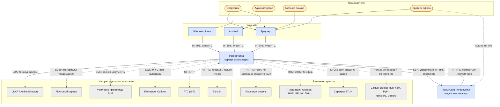
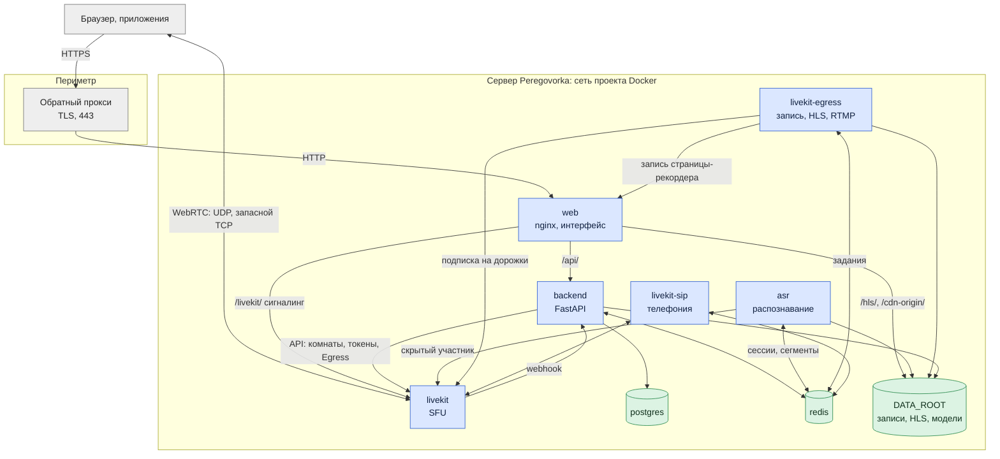

# Архитектура: контекст и контейнеры

*Для кого: архитектор, администратор, специалист по ИБ.*

**Что получится:** вы видите систему целиком: кто с ней работает, с чем она связана и где проходят границы доверия.

Обозначения — на странице [Архитектура и техническое устройство](Архитектура-и-техническое-устройство).

## Уровень 1: контекст

Распознавание речи работает на сервере Peregovorka, внешний сервис для него не нужен. Обязательных внешних связей нет: всё, что показано пунктиром, включается настройкой.

## Границы доверия

| Зона | Что внутри | Чему доверяет |
|---|---|---|
| Интернет и сети пользователей | браузеры, приложения, гости, зрители | никому: всё проверяется на сервере |
| Периметр | обратный прокси, TLS | прокси передаёт настоящий адрес клиента, только если он в списке доверенных |
| Сеть проекта Docker | `web`, `backend`, `asr`, `livekit`, `egress`, `postgres`, `redis` | внутренняя сеть, наружу опубликованы только порты `web` и медиа LiveKit |
| Инфраструктура организации | каталог, почта, хранилища, АТС | с проверкой TLS, где протокол это позволяет |
| Внешние сервисы | LLM, площадки | только то, что администратор отправил явно; секреты маскируются всегда: [Обработка персональных данных](Архитектура-Обработка-персональных-данных) |
| Узел CDN | кеш сегментов | узел не может выписать ссылку: у него только открытые ключи; доступ к источнику отзывается |

## Уровень 2: контейнеры

Главные правила устройства:

- **Медиа не идёт через HTTP-прокси.** Клиенты соединяются с LiveKit напрямую по UDP или TCP.
- **ASR не обращается к базе.** Обмен с backend только через Redis ([контракт](https://github.com/calleograph/peregovorka/blob/main/docs/ASR_CONTRACT.md)).
- **Один путь к языковой модели.** Все запросы идут через `LlmClient.complete`, где работает обязательная маскировка.
- **Фоновые задачи с одним исполнителем** выполняет ведущий процесс (аренда в Redis), поэтому `backend` может работать в нескольких процессах.

## Что дальше

- [Развёртывание](Архитектура-Развёртывание)
- [Сетевые потоки](Архитектура-Сетевые-потоки)
- [Безопасность и приватность](Безопасность-и-приватность)
