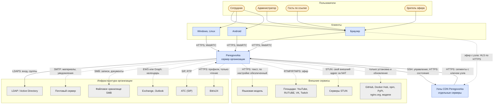
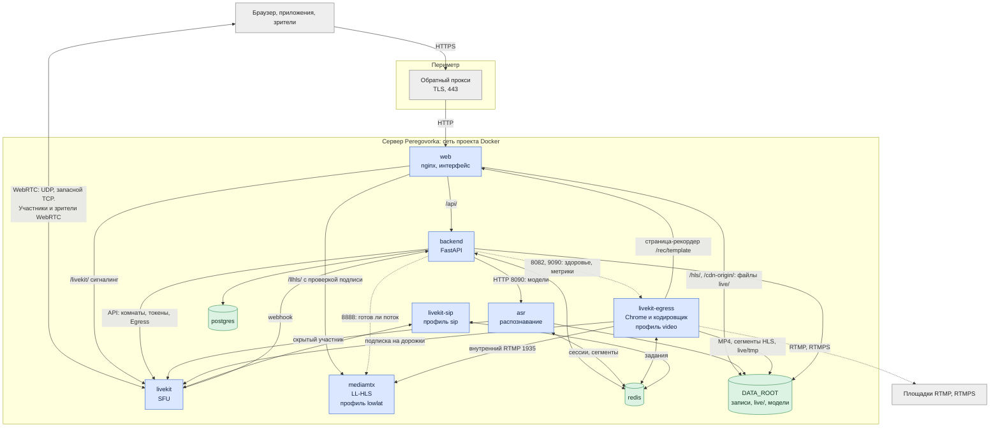

# Архитектура: контекст и контейнеры

*Для кого: архитектор, администратор, специалист по ИБ.*

Страница показывает систему целиком: кто с ней работает, с чем она связана и где проходят границы доверия. Обозначения объяснены на странице [Архитектура и техническое устройство](Архитектура-и-техническое-устройство). Назначение каждой службы: [Назначение и состав](Архитектура-Назначение-и-состав).

## Уровень 1: контекст

Распознавание речи работает на сервере Peregovorka, внешний сервис для него не нужен. Обязательных внешних связей нет: всё, что показано пунктиром, включается настройкой или зависит от сети сервера.

Что сервер делает сам, без действий администратора: обращается к STUN, если стоит за NAT и публичный адрес задан как `auto`. Если включено автоматическое обновление, раз в сутки проверяет новую версию.

## Границы доверия

| Зона | Что внутри | Чему доверяет |
|---|---|---|
| Интернет и сети пользователей | браузеры, приложения, гости, зрители | никому: всё проверяется на сервере |
| Периметр | обратный прокси, TLS | прокси передаёт настоящий адрес клиента, только если он в списке доверенных |
| Сеть проекта Docker | все службы проекта: `web`, `backend`, `asr`, `livekit`, `livekit-egress`, `mediamtx`, `livekit-sip`, `postgres`, `redis` | внутренняя сеть. Наружу опубликованы `web`, порты медиа LiveKit, при профиле `sip` порты SIP и RTP. Порт `LIVEKIT_HTTP_PORT` опубликован только на `127.0.0.1` |
| Инфраструктура организации | каталог, почта, хранилища, АТС | с проверкой TLS, где протокол это позволяет |
| Внешние сервисы | LLM, площадки | только то, что администратор отправил явно; секреты маскируются всегда: [Обработка персональных данных](Архитектура-Обработка-персональных-данных) |
| Узел CDN | кеш сегментов | узел не может выписать ссылку: у него только открытые ключи; доступ к источнику отзывается |

## Уровень 2: контейнеры

Главные правила устройства:

- **Медиа не идёт через HTTP-прокси.** Участники и зрители WebRTC соединяются с LiveKit напрямую по UDP или TCP.
- **Зрители HLS не нагружают LiveKit.** Сегменты раздаёт `web` с диска, LL-HLS отдаёт `mediamtx` через `web`. Служебные запросы зрителя при этом идут в `backend`: выдача подписанной ссылки, пульс, вопросы.
- **ASR не обращается к базе.** Стенограмма идёт только через Redis ([контракт](https://github.com/calleograph/peregovorka/blob/main/docs/ASR_CONTRACT.md)). По HTTP на порт 8090 `backend` управляет моделями и проверяет готовность.
- **Один путь к языковой модели.** Все запросы идут через `LlmClient.complete`, где работает обязательная маскировка.
- **Фоновые задачи с одним исполнителем** выполняет ведущий процесс (аренда в Redis), поэтому `backend` может работать в нескольких процессах.
- **`mediamtx` не публикует портов** и не проверяет доступ сам: подпись проверяет `web`, а имя потока совпадает с идентификатором доступа, поэтому отзыв ссылки действует и на LL-HLS.

## Что дальше

- [Развёртывание](Архитектура-Развёртывание)
- [Сетевые потоки](Архитектура-Сетевые-потоки)
- [Безопасность и приватность](Безопасность-и-приватность)
