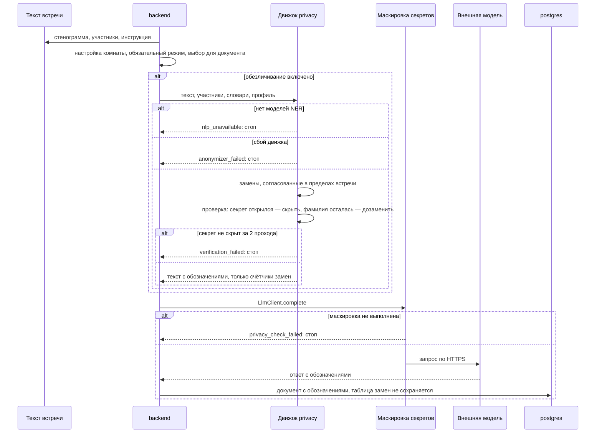

# Архитектура: обработка персональных данных

*Для кого: специалист по ИБ, ответственный за персональные данные, администратор.*

Страница отвечает на четыре вопроса: какие персональные данные есть в системе, где они появляются, где хранятся и кто их видит. Затем показан путь текста до внешней языковой модели и работа обезличивания.

Настройка: [Как настроить обезличивание](Как-настроить-обезличивание). Простое объяснение для сотрудников: [Как работает обезличивание](Как-работает-обезличивание). Правила распознавания: [docs/ANONYMIZATION.md](https://github.com/calleograph/peregovorka/blob/main/docs/ANONYMIZATION.md).

Страница описывает, что делает программа. Правовое основание, согласия и уведомления определяет организация. Тексты для страницы входа и страницы «Обработка данных» задаются в **Администрирование → Система → Конфиденциальность и cookie**.

## Категории данных

| Категория | Что входит | Где появляется | Где хранится | Срок |
|---|---|---|---|---|
| Профиль сотрудника | логин, UPN, ФИО, почта, должность, подразделение, телефон, фото | при входе из каталога, из Bitrix24, правка в личном кабинете | PostgreSQL `users`, `DATA_ROOT/avatars` | автоматической очистки нет |
| Участие во встрече | снимок профиля на момент встречи, время входа и выхода | вход в комнату | PostgreSQL `meeting_participants` | остаётся в истории вместе со встречей |
| Гость по ссылке | имя, адрес IP, браузер, почта и согласие на материалы, если указал | вход по гостевой ссылке | PostgreSQL `guest_participants` | почта стирается по сроку текстов, остальное остаётся со встречей |
| Абонент телефона | полный номер как имя участника; в журнале вызовов середина номера скрыта по умолчанию | входящий или исходящий звонок SIP | PostgreSQL `guest_participants`, `sip_calls` | журнал вызовов по настройке, по умолчанию 365 дней; имя участника остаётся со встречей |
| Зритель эфира | имя, почта и согласие, если указал, вопросы | страница эфира | PostgreSQL `live_viewers`, `live_questions` | вместе с текстами встречи |
| Голос и изображение в звонке | звук, видео, экран | комната | на диск не пишутся, только память `livekit` | пока идёт передача |
| Записи | дорожки участников: сырой PCM во время встречи, затем WAV; общая аудиозапись, MP4 | запись включена | `DATA_ROOT/recordings`, временно `DATA_ROOT/live/tmp`, хранилища SMB | аудио 60 дней, видео 30 дней |
| Сегменты эфира | изображение и голос выступающих | эфир | `DATA_ROOT/live/b`, память `mediamtx`, кеш узлов CDN | сегменты старше 15 минут удаляются во время эфира, каталог убирается после эфира |
| Стенограмма | текст с именами говорящих | распознавание | PostgreSQL `transcript_segments`, выгрузка в хранилище | по сроку текстов, по умолчанию бессрочно |
| Материалы встречи | чат, вложения, доска, протокол, резюме, карта разговора | встреча, формирование документов | PostgreSQL, `DATA_ROOT/chat-files`, `exports`, хранилища | по сроку текстов |
| Корпоративные чаты | сообщения, файлы | переписка | PostgreSQL, `DATA_ROOT/chat-files` | по настройке раздела, по умолчанию без срока |
| Журнал аудита | кто, что, когда, адрес IP, браузер | действия администраторов, руководителей, отказы | PostgreSQL `audit_log` | по умолчанию не удаляется |
| Журнал событий | имя, комната, адрес IP, браузер, ошибки устройств | вход, подключение, сбои | PostgreSQL `event_log`, по настройке внешнее хранилище | 30 дней |
| Журнал почты | адрес и имя получателя, тема | отправка | PostgreSQL `mail_messages` | 90 дней |
| События безопасности | адрес IP, учётная запись, результат, правило | вход, блокировки, WAF | PostgreSQL `security_events` | 30 дней, не больше 200 000 записей |
| Подтверждения документов | кто, версия документа, адрес IP, браузер | принятие документа | PostgreSQL `legal_consents` | автоматической очистки нет |
| Журнал публичного API | клиент, адрес IP, шаблон маршрута, код ответа | запрос к API | PostgreSQL `api_request_log` | 30 дней |
| Диагностика эфира | показатели эфира; у зрителей браузер и статистика плеера | эфир | показатели зрителей: Redis; журнал эфира: PostgreSQL `live_diag_events`, `live_diag_samples` | Redis 5 минут, журнал 30 дней |
| Журналы контейнеров | в том числе адреса клиентов и пути запросов в журнале nginx | работа служб | журналы Docker | по объёму: 5 файлов по 10 МБ на службу |
| Сессии | логин, имя, группы, адрес входа, браузер | вход | Redis, файлы в `DATA_ROOT/redis` | до конца сессии: 8 часов простоя, 24 часа всего |
| Резервные копии | дамп и архив файлов: всё перечисленное. Копия `.pgcfg`: только настройки | `scripts/backup.sh`, «Резервная копия конфигурации» | `DATA_ROOT/backups`, `BACKUP_COPY_DIR`, профиль хранилища | ротация `--keep` |

Сроки в таблице указаны по умолчанию. Как их изменить: [Сроки хранения материалов](Сроки-хранения-материалов).

## Кто имеет доступ

Права проверяет сервер при каждом запросе. Знание адреса или идентификатора встречи доступа не даёт.

| Кто | Что видит |
|---|---|
| Администратор сервера | все встречи и материалы, журналы, настройки |
| Руководитель комнаты | встречи своей комнаты, их материалы, рассылку |
| Организатор встречи | свою завершённую встречу, пока его не удалили из неё |
| Участник идущей встречи | стенограмму и чат этой встречи |
| Участник завершённой встречи | материалы, пока не покинул страницу встречи и не вышел срок (по умолчанию 120 минут). Постоянно, только если в комнате выбран доступ к истории для участников: по умолчанию он закрыт |
| Сотрудник с явным разрешением | материалы одной встречи, разрешение выдаёт руководитель комнаты или администратор |
| Гость | только идущую встречу, в которую вошёл. Истории и стенограммы у него нет |
| Зритель эфира | сам эфир, свои вопросы, запись эфира, если организатор её открыл. В режиме WebRTC ещё дорожки комнаты и общую сцену |
| Организатор и администратор | почту гостя. Другие участники её не видят |
| Внешняя система с ключом API | то, что разрешено областями ключа и областью комнат |
| Администратор операционной системы сервера | всё, что лежит на диске, в пределах шифрования хранилища |

Что шифруется на диске: [Шифрование](Шифрование). Роли полностью: [Справочник: роли и права](Справочник-роли-и-права).

## Что выходит за границу сервера

| Куда | Что | Когда |
|---|---|---|
| Языковая модель | текст встречи: стенограмма, участники, чат, подписи доски, инструкция | если модель подключена и документ формируется |
| Почта | материалы получателям, приглашения | если настроена отправка |
| Хранилище SMB, внешний том | записи и документы | если выбрано хранилище |
| Площадки RTMP | изображение и голос выступающих | если в эфире включена площадка |
| Узлы CDN и сторонний CDN | сегменты эфира. Журнал доступа на узле не ведётся, адрес зрителя держится в памяти 40 секунд для подсчёта зрителей | если включена раздача через CDN |
| Получатели webhook | идентификаторы, название комнаты, текст ошибки | если настроена подписка |
| Внешняя система с ключом API | стенограммы, документы, записи участников в пределах областей ключа. Стенограмма отдаётся исходной, без обезличивания | если выпущен ключ |
| Exchange, Microsoft Graph | события календаря | если подключён календарь |
| Bitrix24 | только чтение профилей, данные наружу не отправляются | если подключён |

Звук в языковую модель не передаётся. Распознавание речи и обезличивание работают на сервере: внешних служб для них нет.

## Потоки данных (DFD)

Схема показывает основной путь встречи. Остальные передачи перечислены в таблице выше.

## Путь текста к языковой модели

| Шаг | Что происходит | Где данные | Что проверяется |
|---|---|---|---|
| 1. Получение | голос, чат, файлы; у гостя — имя и почта по согласию | LiveKit, память процессов | право на вход; DTLS-SRTP, TLS |
| 2. Распознавание | речь в текст | `asr`, сеть проекта | звук не покидает сервер |
| 3. Хранение | стенограмма, чат, записи | PostgreSQL, `DATA_ROOT`, SMB | сроки хранения, права доступа, шифрование по настройке |
| 4. Подготовка | стенограмма, шапка, чат, подписи доски, инструкция | память `backend` | выбран ли провайдер, разрешена ли задача |
| 5. Обезличивание | люди, организации, контакты, реквизиты, здоровье — обозначениями | память `backend` | включено ли в комнате; обязательный режим администратора сильнее выбора комнаты |
| 6. Проверка результата | повторный поиск секретов и оставшихся фамилий | память `backend` | секрет открылся после замен — скрыть; не вышло за 2 прохода — стоп |
| 7. Маскировка секретов | пароли, токены, ключи, коды | `LlmClient.complete` | работает **всегда**, даже при выключенном обезличивании |
| 8. Передача | запрос к провайдеру по HTTPS | модель | адрес и ключ из настроек |
| 9. Результат | ответ сохраняется | `protocols.content` | ответ модели повторно не проверяется: она получила только обработанный текст |

## Как проходит обезличивание

Есть два уровня защиты:

1. **Секреты убираются всегда.** Пароли, токены, ключи и коды скрываются в единственной точке выхода к модели, при любых настройках.
2. **Обезличивание людей и реквизитов** работает по настройке. В новой комнате оно выключено, поэтому без настройки имена уходят в модель как есть. Администратор может сделать его обязательным для всех комнат. Иначе решает комната, а для одного документа режим можно выбрать отдельно. При обязательном режиме снять его для одного документа может только администратор сервера.

Профили:

| Профиль | Как выглядит результат |
|---|---|
| Базовый | «Иван И.», города остаются |
| Строгий | «Участник 1», места и все организации заменяются |
| Настраиваемый | свои действия по категориям |

Стенограмма в системе остаётся исходной. Обезличенная версия создаётся при передаче в модель, при выгрузке с параметром и в письме по настройке комнаты.

## Когда передача блокируется

| Случай | Код | Результат |
|---|---|---|
| Обезличивание включено, модели распознавания имён не установлены | `nlp_unavailable` | документ не создан, в модель ничего не ушло |
| Внутренний сбой обезличивания | `anonymizer_failed` | то же |
| Секрет не скрыт за два прохода | `verification_failed` | то же |
| Обязательная маскировка не выполнена | `privacy_check_failed` | то же, при любом режиме |
| Карта разговора | тот же этап обезличивания, что у протокола | строится на обезличенной стенограмме; сбой обезличивания — отказ, в модель ничего не уходит |

Принцип — отказ при сомнении: если обработка не выполнена, данные не отправляются.

## Важные свойства

- **В документе остаются обозначения.** Таблица замен не сохраняется, вернуть настоящие имена нельзя.
- **В журналы не попадают** исходный текст, найденные значения и таблица соответствия: только числа.
- **Выключенное обезличивание** означает, что имена и контакты уходят в модель как есть. Скрываются только пароли и ключи.
- **Обезличивание не делает человека неузнаваемым по смыслу:** должность и содержание разговора могут указать на него.
- **Текст на изображениях не распознаётся:** OCR нет.
- По сроку хранения текстов стираются имя и почта зрителей с их вопросами и почта гостей. Имя, адрес IP и браузер гостя остаются в истории встречи.
- Письмо со стенограммой следует настройке комнаты. Если обезличить не удалось, стенограмма в письмо не попадёт.

## Что дальше

- [Как настроить обезличивание](Как-настроить-обезличивание)
- [Сроки хранения материалов](Сроки-хранения-материалов)
- [Справочник для проверки ИБ](Справочник-для-проверки-ИБ)
