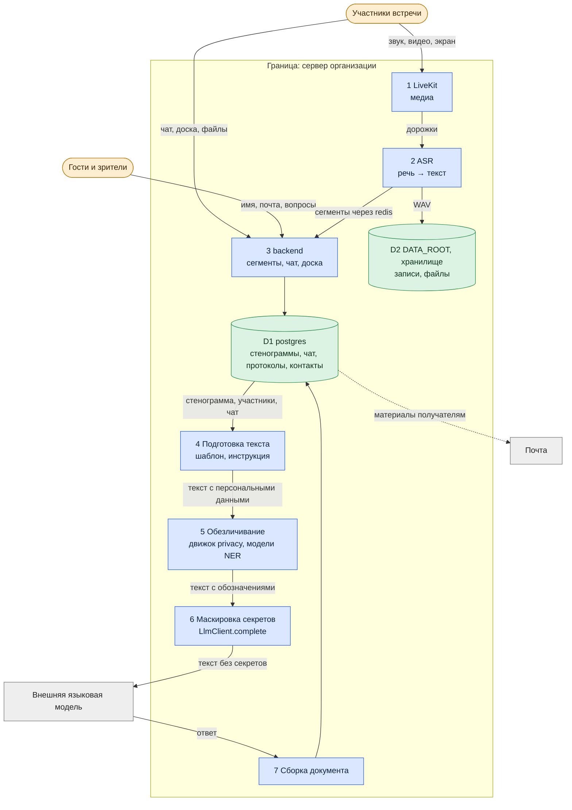
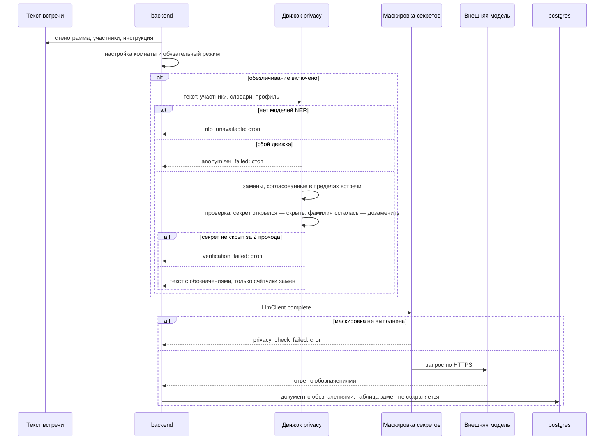

# Архитектура: обработка персональных данных

*Для кого: специалист по ИБ, ответственный за персональные данные, администратор.*

**Что получится:** вы видите путь данных от момента получения до внешней языковой модели: где они хранятся, где обрабатываются и что блокирует передачу. Настройка: [Как настроить обезличивание](Как-настроить-обезличивание). Правила распознавания: [docs/ANONYMIZATION.md](https://github.com/calleograph/peregovorka/blob/main/docs/ANONYMIZATION.md).

## Потоки данных (DFD)

За границу сервера персональные данные выходят только в модель и почту. Распознавание речи и обезличивание работают на сервере: внешних служб для них нет.

## Путь данных по шагам

| Шаг | Что происходит | Где данные | Что проверяется |
|---|---|---|---|
| 1. Получение | голос, чат, файлы; у гостя — имя и почта по согласию | LiveKit, память процессов | право на вход; DTLS-SRTP, TLS |
| 2. Распознавание | речь в текст | `asr`, сеть проекта | звук не покидает сервер |
| 3. Хранение | стенограмма, чат, записи | PostgreSQL, `DATA_ROOT`, SMB | сроки хранения, права доступа, шифрование по настройке |
| 4. Подготовка | стенограмма, шапка, чат, подписи доски, инструкция | память `backend` | выбран ли провайдер, разрешена ли задача |
| 5. Обезличивание | люди, организации, контакты, реквизиты, здоровье — обозначениями | память `backend` | включено ли в комнате; обязательный режим администратора сильнее |
| 6. Проверка результата | повторный поиск секретов и оставшихся фамилий | память `backend` | секрет открылся после замен — скрыть; не вышло за 2 прохода — стоп |
| 7. Маскировка секретов | пароли, токены, ключи, коды | `LlmClient.complete` | работает **всегда**, даже при выключенном обезличивании |
| 8. Передача | запрос к провайдеру по HTTPS | модель | адрес и ключ из настроек |
| 9. Результат | ответ сохраняется | `protocols.content` | ответ модели повторно не проверяется: она получила только обработанный текст |

## Обезличивание: последовательность

## Когда передача блокируется

| Случай | Код | Результат |
|---|---|---|
| Обезличивание включено, модели распознавания имён не установлены | `nlp_unavailable` | документ не создан, в модель ничего не ушло |
| Внутренний сбой обезличивания | `anonymizer_failed` | то же |
| Секрет не скрыт за два прохода | `verification_failed` | то же |
| Обязательная маскировка не выполнена | `privacy_check_failed` | то же, при любом режиме |
| Карта разговора при включённом обезличивании | — | карта не строится, пользователь видит причину |

Принцип — отказ при сомнении: если обработка не выполнена, данные не отправляются.

## Важные свойства

- **В документе остаются обозначения.** Таблица замен не сохраняется, вернуть настоящие имена нельзя.
- **В журналы не попадают** исходный текст, найденные значения и таблица соответствия: только числа.
- **Выключенное обезличивание** означает, что имена и контакты уходят в модель как есть. Скрываются только пароли и ключи.
- **Обезличивание не делает человека неузнаваемым по смыслу:** должность и содержание разговора могут указать на него.
- **Текст на изображениях не распознаётся:** OCR нет.
- Сведения о зрителях и гостях стираются по сроку хранения текстов вместе с вопросами.

## Что дальше

- [Как настроить обезличивание](Как-настроить-обезличивание)
- [Сроки хранения материалов](Сроки-хранения-материалов)
- [Справочник для проверки ИБ](Справочник-для-проверки-ИБ)
