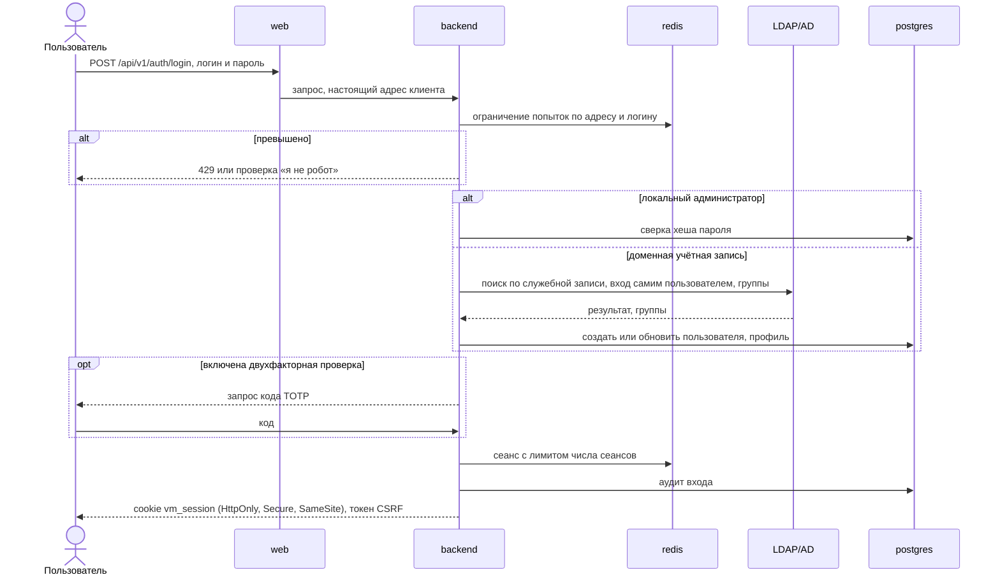
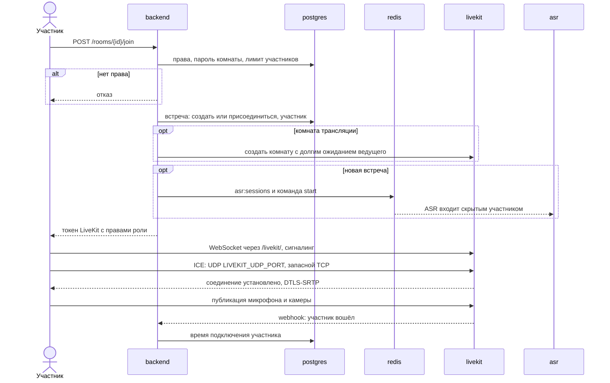
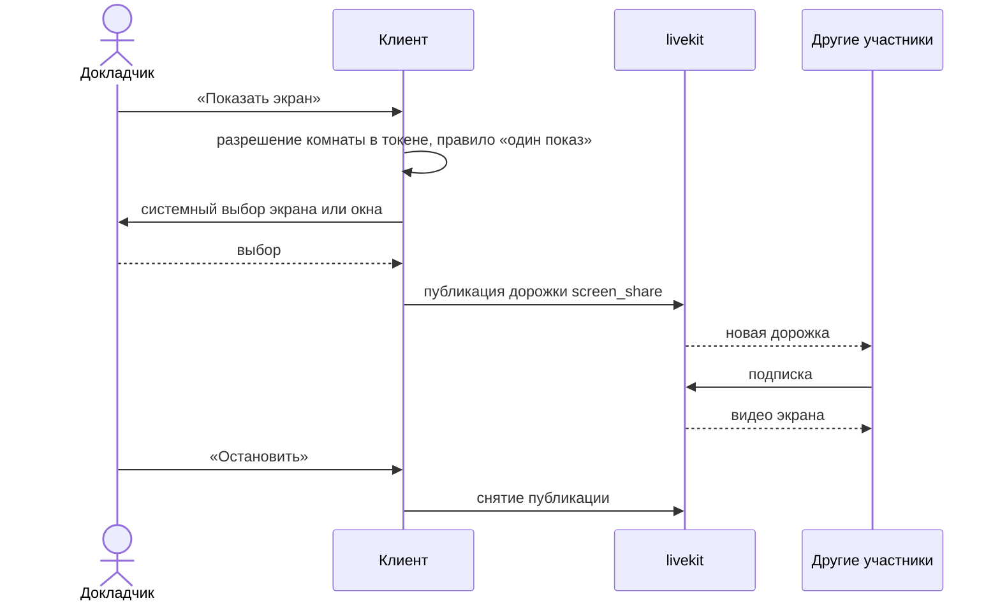
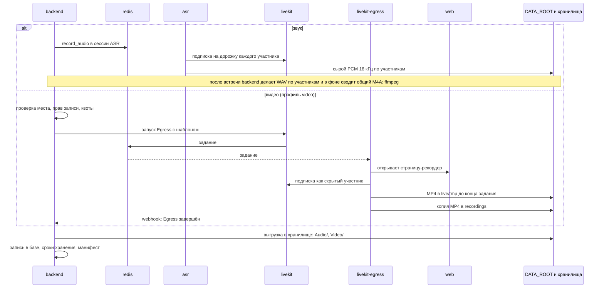
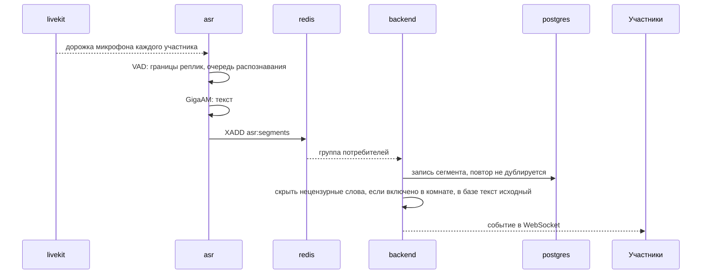
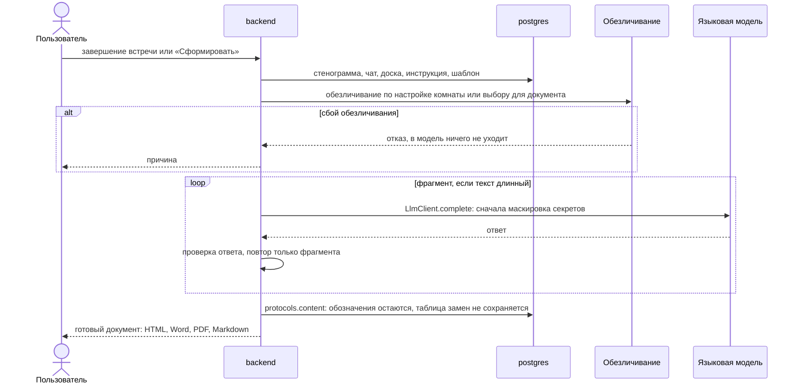
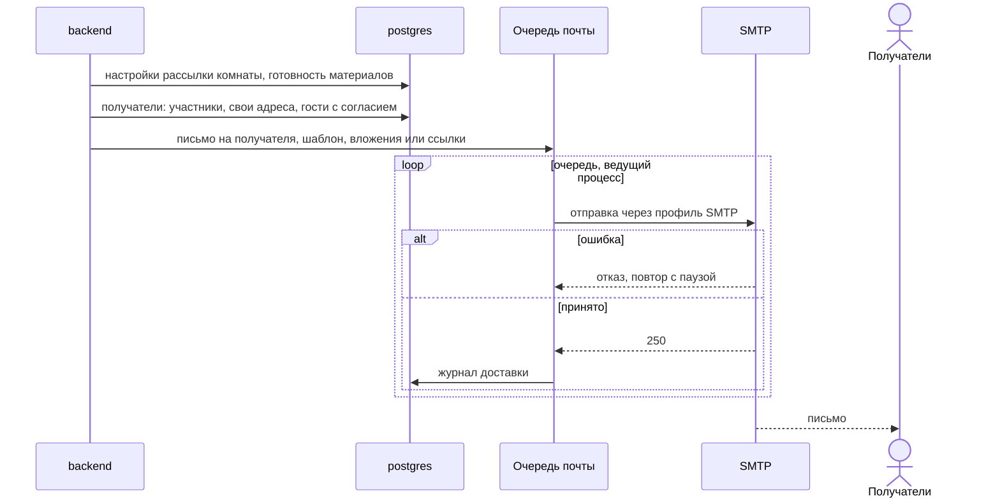

# Архитектура: последовательности встреч

*Для кого: инженер сопровождения, разработчик, специалист по ИБ.*

Страница показывает, как идут вход, подключение, запись, стенограмма, протокол и письмо: кто кого вызывает, что проверяется и где сохраняется.

## Вход пользователя

Изменяющие запросы требуют токен CSRF и допустимый заголовок Origin. Подробнее: [Безопасность входа](Как-настроить-безопасность-входа).

## Подключение к комнате

Обычную комнату LiveKit создаёт сам при первом подключении. Токен LiveKit живёт 300 секунд (`LIVEKIT_TOKEN_TTL_SECONDS`), этого хватает только на вход.

Гость проходит тот же путь через `POST /api/v1/guest/room/{token}/join`. Учётной записи у него нет: сервер выдаёт короткую гостевую сессию, привязанную к этой встрече.

Если ICE не проходит, страница открывается, а звука нет: [Решение проблем: звонки и сеть](Решение-проблем-звонков-и-сети).

## Демонстрация экрана

Право показывать экран определяется ролью и настройкой комнаты в токене LiveKit: сервер отклонит публикацию без права. Сервер LiveKit только пересылает дорожки и не перекодирует их.

## Запись встречи

Сбой Egress или нехватка места останавливают запись, а не разговор. Файл до конца задания лежит на локальном диске в `DATA_ROOT/live/tmp`, поэтому место нужно и там, и в томе записей: [Как устроена память и диск службы Egress](Архитектура-Развёртывание#как-устроена-память-и-диск-службы-egress).

## Транскрибация

Кто говорит, известно из дорожки: у каждого свой микрофон. Звук не покидает сервер. В комнате с полным сквозным шифрованием у сервера нет ключа, поэтому стенограммы и записи звука нет. В режиме с доверенным компонентом ключ встречи получает служба `asr`, он передаётся через Redis. Подробно: [Как работают стенограмма и протоколы](Как-работают-стенограмма-и-протоколы).

## Формирование протокола

Форматы строятся из одного сохранённого результата, без новых запросов к модели. Путь данных подробно: [Обработка персональных данных](Архитектура-Обработка-персональных-данных).

## Отправка материалов по почте

Автоматическая рассылка настраивается в настройках комнаты на вкладке **Автоотправка** и по умолчанию выключена. Вручную материалы отправляются со страницы встречи.

Как работает автоотправка:

- Действуют только настройки комнаты. У каждого материала свой режим получателей: никому, руководителю, владельцу, организатору, всем, выбранным людям или своим адресам.
- Рассылка выполняется один раз на встречу. Одинаковые получатели получают одно письмо.
- Если протокола или резюме нет, сервер формирует их при наличии материалов. Карту разговора он ждёт до 45 минут.
- Неполный документ автоматически не уходит. Если чего-то не хватает, настройка решает: отправить готовое или не отправлять ничего.
- Предел: 100 выбранных людей на материал и 50 своих адресов. У временных комнат вкладки нет.

Инструкция: [Автоотправка материалов](Автоотправка-материалов).

## Что дальше

- [Трансляции: последовательности](Архитектура-Последовательности-трансляций)
- [Обработка персональных данных](Архитектура-Обработка-персональных-данных)
- [Каталог интеграций](Архитектура-Каталог-интеграций)
