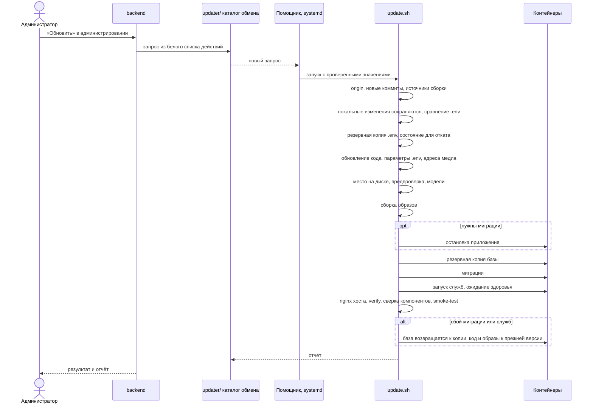
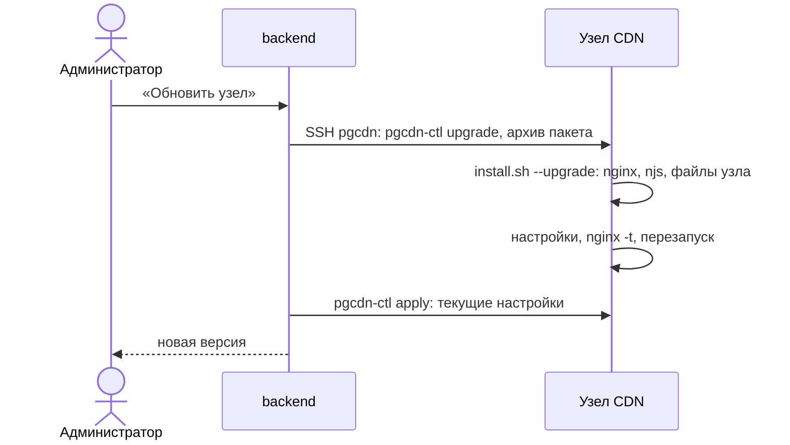

# Архитектура: последовательности обновления

*Для кого: администратор.*

Страница показывает, как обновляются сервер и приложения и где можно остановиться без последствий. Инструкция: [Как обновить и откатить](Как-обновить-и-откатить).

## Обновление сервера

Обновление идёт пронумерованными шагами, они видны в выводе команды. Без помощника та же команда запускается на сервере: `sudo scripts/update.sh`.

Где можно остановиться без последствий:

- До сборки образов включительно рабочая версия продолжает работать: сбой не трогает идущие встречи, код возвращается на прежнюю версию.
- Если нужны миграции, приложение останавливается перед резервной копией. С этого момента идущие встречи прерываются.
- После миграции автоматический откат возвращает базу к копии. Команда `scripts/rollback.sh` базу не откатывает: если схема уже новая, она останавливается с кодом 3.

Образы Egress и MediaMTX подготавливаются как необязательные: если образ MediaMTX не скачался, обновление продолжается, а эфиры идут обычным HLS.

## Обновление приложений

| Приложение | Как приходит обновление | Чем защищено |
|---|---|---|
| Windows | приложение проверяет манифест `update.json`, скачивает установщик, ставит по согласию; MSI обновляет администратор | подпись манифеста Ed25519, подпись кода, если настроена |
| Linux | `apt`, менеджер обновлений или `unattended-upgrades`; у приложения своего механизма нет | подпись репозитория APT |
| Android | новый файл APK ставится поверх | постоянный ключ подписи приложения |

Интерфейс внутри приложений приходит с сервера организации, поэтому большинство новых функций не требует обновления клиента.

Пути обновления приложений описаны на страницах установки: [Windows](Как-установить-приложение-для-Windows), [Linux](Как-установить-приложение-для-Linux), [Android](Как-установить-приложение-для-Android).

## Обновление узла CDN

## Что дальше

- [Обработка персональных данных](Архитектура-Обработка-персональных-данных)
- [Резервирование и восстановление](Архитектура-Резервирование-и-восстановление)
