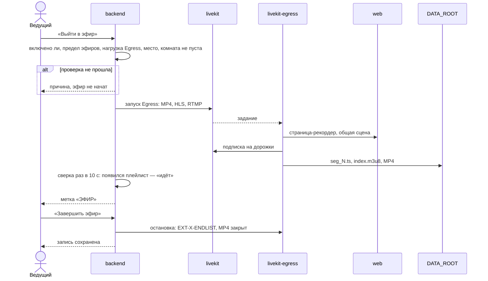
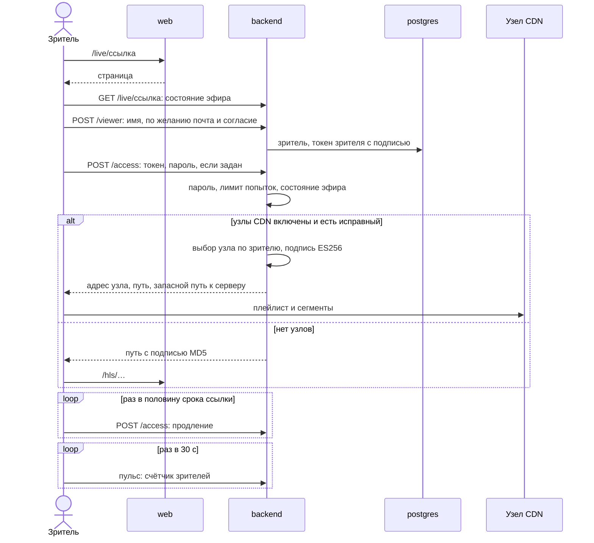
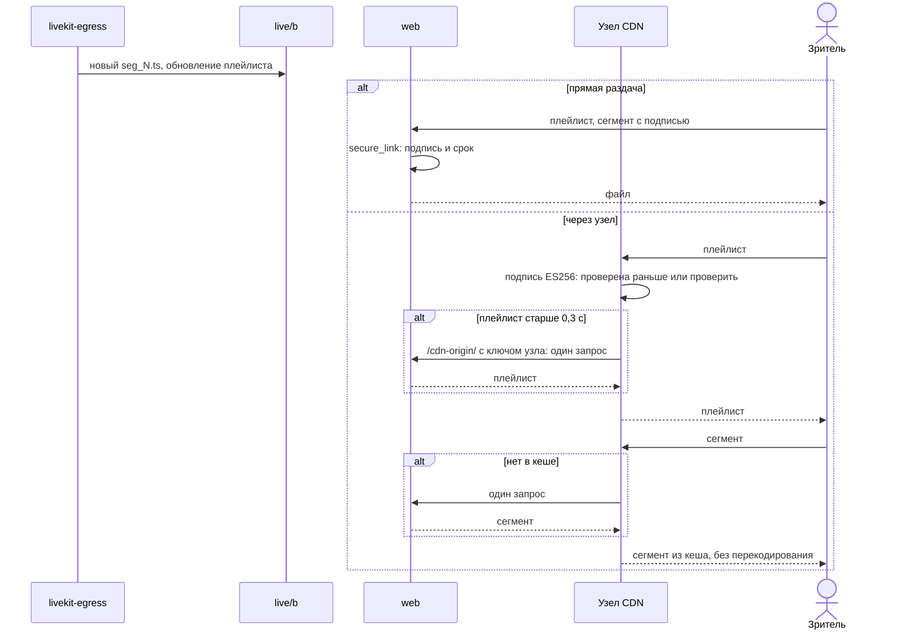
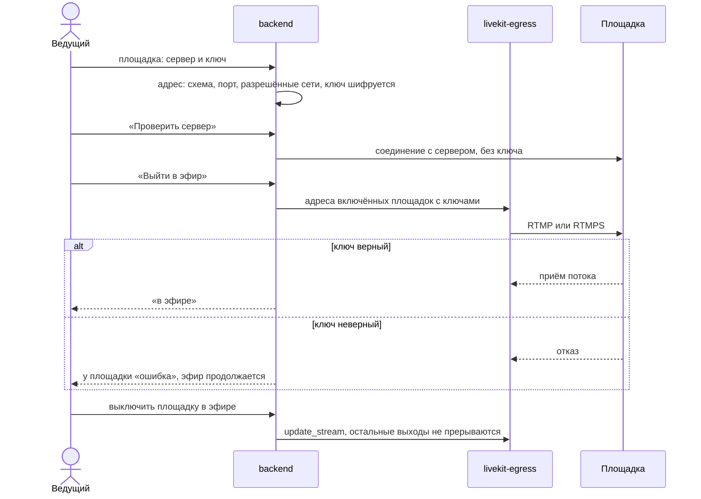

# Архитектура: последовательности трансляций

*Для кого: инженер сопровождения, специалист по ИБ.*

**Что получится:** вы видите, как начинается эфир, как зритель получает доступ, как идут сегменты HLS и поток на площадки. Устройство подробно: [docs/BROADCASTS.md](https://github.com/calleograph/peregovorka/blob/main/docs/BROADCASTS.md), [docs/BROADCAST_CDN.md](https://github.com/calleograph/peregovorka/blob/main/docs/BROADCAST_CDN.md).

## Проведение трансляции

## Подключение зрителя

Зритель не подключается к LiveKit и не нужен ему вход в систему. Если ссылку отозвали или сменили пароль, идентификатор доступа заменяется и старые адреса сразу дают 404.

## Передача сегментов HLS

Просроченная подпись — 410, плеер берёт новую. Чужая или поддельная — 403.

## Поток на внешнюю площадку

Сервер принимает только проверку соединения: ключ проверяет сама площадка при старте. Ключ потока не отдаётся ни одним ответом API и не пишется в журнал.

## Что дальше

- [Обновление: последовательности](Архитектура-Последовательности-обновления)
- [Массовые трансляции](Массовые-трансляции)
- [Узлы CDN](Узлы-CDN)
