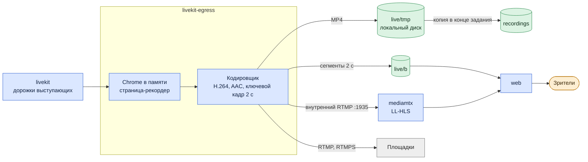
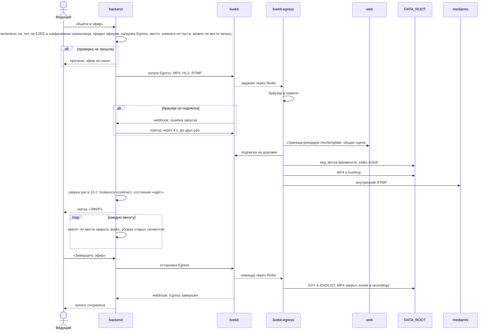
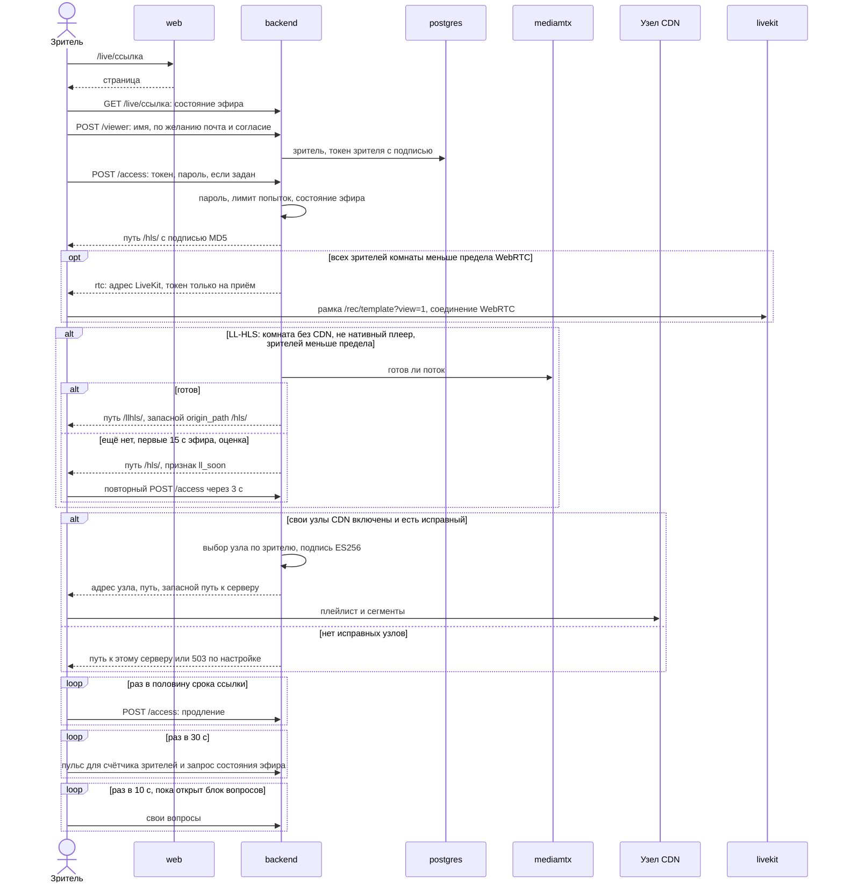
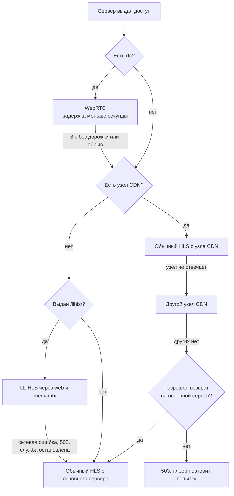
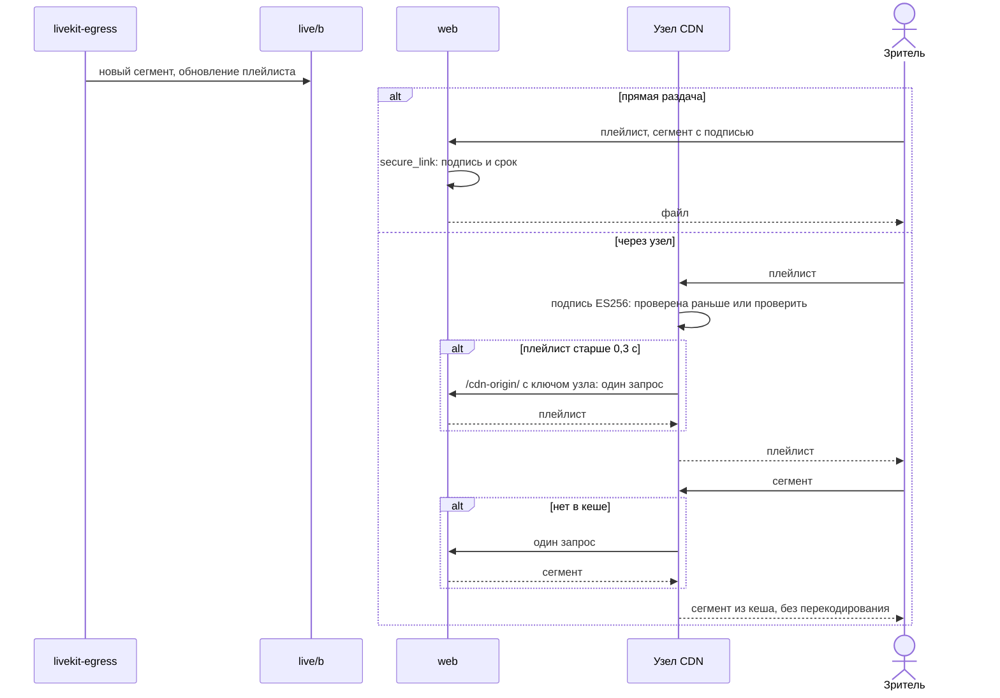
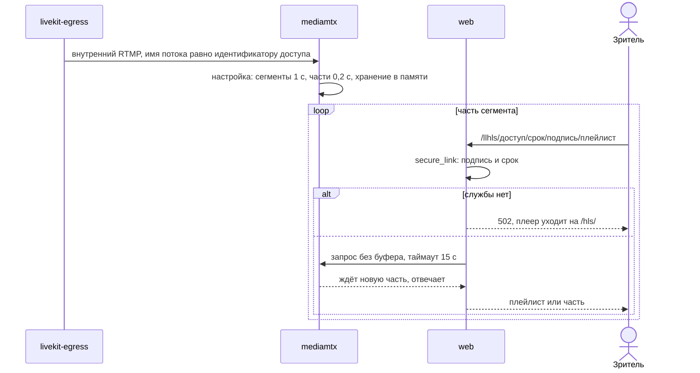
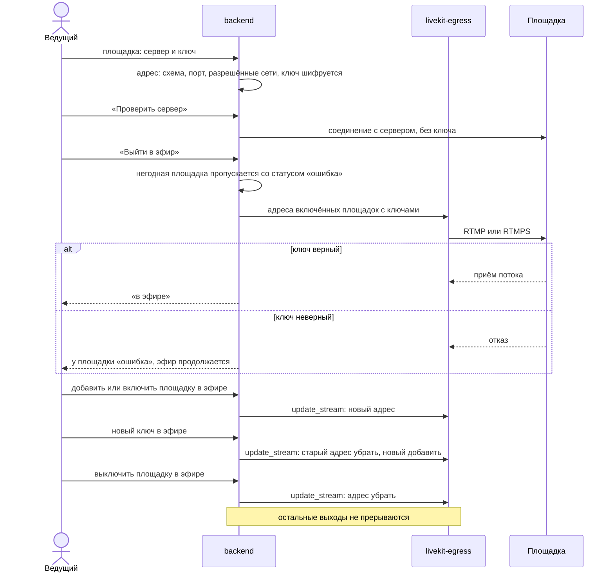

# Архитектура: последовательности трансляций

*Для кого: инженер сопровождения, специалист по ИБ.*

Страница показывает, как начинается эфир, как зритель получает доступ, как плеер откатывается при сбое и как идёт поток на площадки. Устройство подробно: [docs/BROADCASTS.md](https://github.com/calleograph/peregovorka/blob/main/docs/BROADCASTS.md), [docs/BROADCAST_CDN.md](https://github.com/calleograph/peregovorka/blob/main/docs/BROADCAST_CDN.md).

## Один эфир, четыре выхода

Один процесс Egress собирает картинку комнаты и кодирует её один раз. Дальше поток расходится.

Выход в MediaMTX добавляется, только если есть собственный просмотр и включена настройка **Низкая задержка для зрителей (LL-HLS)**. Падение MediaMTX не трогает запись и площадки.

Для зрителей на слабой связи служба `live-relay` берёт из MediaMTX тот же поток и публикует из него только звук (`-vn -c:a copy`) под отдельным путём `<доступ>-a`. Страница зрителя получает этот путь в ответе `/access` и сама решает, когда переключиться (`frontend/src/live/adaptive.ts`). Подпись ссылки одна на видео и звук. Без службы `live-relay` или без низкой задержки дорожки нет, и зритель смотрит только видео.

Зритель WebRTC в эту схему не входит: он смотрит комнату напрямую через LiveKit, той же страницей `/rec/template`, но в своём браузере.

## Проведение трансляции

Запись эфира обязательна: если её нельзя начать, эфир не начинается. Если места не хватает, `backend` останавливает эфир заранее, сообщает причину, и файл успевает закрыться. Во время эфира нельзя менять качество, запись и собственный просмотр: сервер ответит 409 `live_running`.

## Подключение зрителя

Вход в систему зрителю не нужен. Зритель HLS и LL-HLS не подключается к LiveKit. Зритель WebRTC подключается, но только на приём и не виден в списке участников. По умолчанию режим WebRTC выключен: **Зрителей по WebRTC, не больше** равно 0. Пределы WebRTC и LL-HLS сравниваются с числом всех зрителей комнаты за последнюю минуту, а не только зрителей этой ветки.

Зритель WebRTC подписан на дорожки комнаты, как скрытый участник. Кроме токена LiveKit он получает токен сцены на 12 часов: им читается состояние сцены через `/api/v1/rec/state`, в том числе общая доска, если она не закрытая.

Если ссылку отозвали или сменили пароль, идентификатор доступа заменяется. Старые адреса HLS сразу дают 404, поток LL-HLS переезжает на новое имя, а подключённых зрителей WebRTC сервер отключает сам.

## Откат зрителя

Плеер переходит на более простую ветку сам, зритель видит короткую паузу.

Особые случаи:

- Safari, iPhone и iPad используют нативный плеер и долгую подпись: LL-HLS им не выдаётся. Ветка WebRTC для них не закрыта, но не проверялась.
- Комната с CDN никогда не получает LL-HLS, в том числе при откате на основной сервер.
- Сверх предела **Зрителей с низкой задержкой, не больше** новые зрители идут на обычный HLS.
- После перехода с LL-HLS на обычный HLS зритель остаётся на нём до конца просмотра.
- При стороннем CDN плеер при ошибке берёт те же подписанные адреса прямо с основного сервера.
- **Ссылка на поток** для внешних плееров идёт мимо этой схемы: свой идентификатор доступа, подпись на 30 дней (`stream_link_days`), пароль зрителя не спрашивается, откатов нет.

## Передача сегментов HLS

Просроченная подпись даёт 410, плеер берёт новую. Чужая или поддельная подпись даёт 403. Сегменты идут мимо `backend`, но выдача ссылок и пульс зрителей идут через него.

## Передача LL-HLS

## Поток на внешнюю площадку

Команды `backend` доходят до Egress через API LiveKit и Redis, на схеме этот шаг опущен. Сервер проверяет только соединение: ключ проверяет сама площадка при старте. Ключ потока не отдаётся ни одним ответом API и не пишется в журнал. Дубль «сервер и ключ» сервер отклоняет с кодом 409.

Настройка в комнате: кнопка **Настройки эфира**. Инструкции: [Трансляция по ссылке и внешние площадки](Трансляция-по-ссылке-и-внешние-площадки), [RTMP и RTMPS простыми словами](RTMP-и-RTMPS-простыми-словами).

## Что дальше

- [Обновление: последовательности](Архитектура-Последовательности-обновления)
- [Режим трансляции](Режим-трансляции)
- [Узлы CDN](Узлы-CDN)
