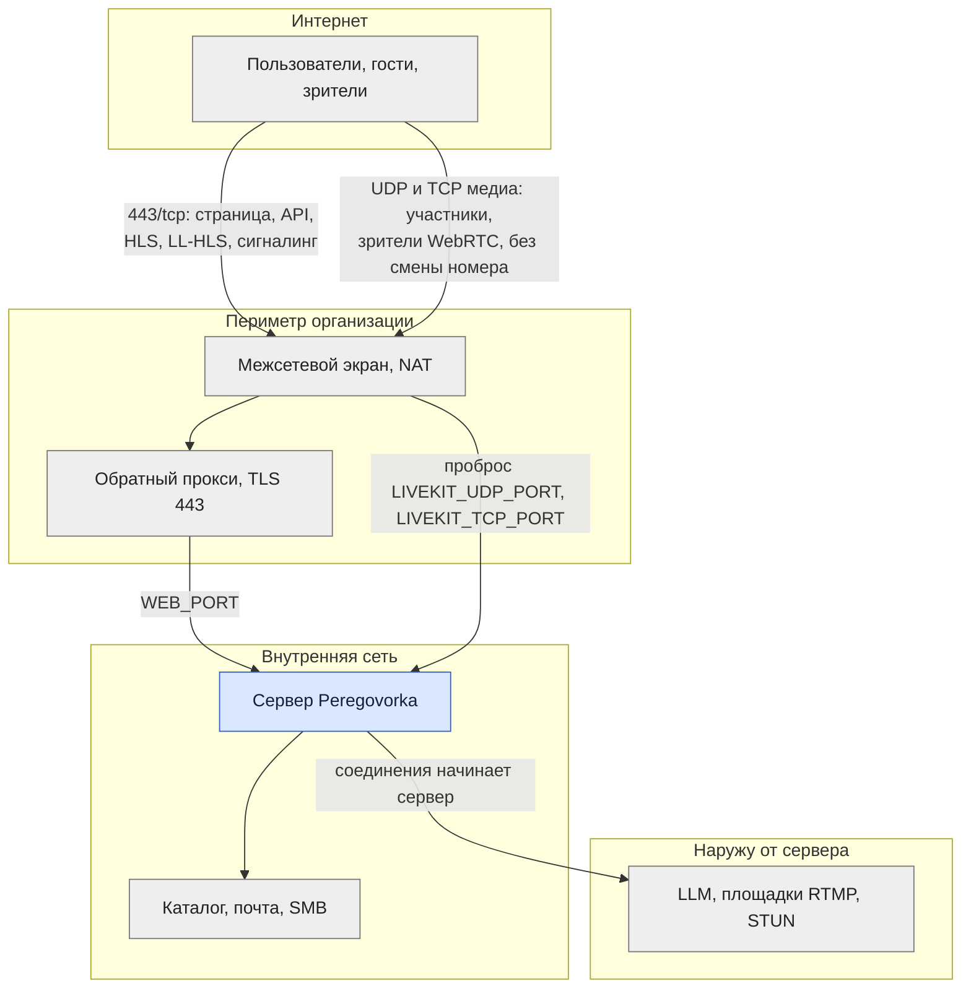

# Архитектура: публикация во внешний контур

*Для кого: администратор и сетевой инженер.*

Страница помогает выбрать схему публикации для пользователей вне сети организации: что открыть, что оставить внутри и какие соединения сервер начинает сам.

Пошаговая настройка: [Как настроить reverse proxy и HTTPS](Как-настроить-reverse-proxy-и-HTTPS). Перечень правил для вашего сервера: [Как опубликовать сервис в интернете](Как-опубликовать-сервис-в-интернете).

## Схема

## Что доступно из интернета

| Компонент | Из интернета | Комментарий |
|---|---|---|
| Страница, API, гостевая ссылка, HLS, LL-HLS | да, через прокси | только 443 |
| Медиа LiveKit | да, напрямую | UDP и запасной TCP |
| `/internal/`, PostgreSQL, Redis, ASR, MediaMTX, Egress | нет | не публикуются |
| LDAP, SMTP, SMB, АТС | нет | соединения идут изнутри |
| SSH, порты диагностики | нет | только сеть администраторов или VPN |

## Минимальная конфигурация

Встречи для сотрудников и гостей:

| Что | Значение |
|---|---|
| DNS | `meet.example.org` → внешний адрес |
| TLS | сертификат на это имя на прокси |
| `APP_PUBLIC_URL` | `https://meet.example.org` |
| `LIVEKIT_PUBLIC_URL` | `wss://meet.example.org/livekit` |
| Правила | 443/tcp, `LIVEKIT_UDP_PORT`/udp, `LIVEKIT_TCP_PORT`/tcp |

Без HTTPS браузер не даёт доступ к микрофону и экрану. Прокси должен передавать WebSocket: `/livekit/` и `/api/v1/ws`.

Если на прокси настроен обязательный вход, пропускайте без него пути зрителя: `/live/`, `/hls/`, `/llhls/`, `/rec/template`, `/api/v1/live/`, `/api/v1/rec/`, `/livekit/`, статику `/assets/` и `/fonts/`, а для узлов CDN ещё `/cdn-origin/`. Полный перечень путей: [Сетевые потоки](Архитектура-Сетевые-потоки#обратный-прокси).

## Расширенная конфигурация

| Функция | Что добавить |
|---|---|
| Вход через домен снаружи | соединение сервера с контроллером домена по внутренней сети |
| Почта | исходящий SMTP |
| Протоколы внешней моделью | исходящий HTTPS к провайдеру |
| Трансляция на площадки | исходящий RTMP 1935 или RTMPS 443 |
| Эфир зрителям с основного сервера | ничего нового: HLS и LL-HLS идут через 443 |
| Просмотр эфира по WebRTC | те же медиапорты, что у участников |
| Большая аудитория | узлы CDN со своим именем и портами 80, 443 |
| Телефония | SIP и RTP только с адресов АТС |
| Outlook | адрес сервера, доступный надстройке, и связь с Exchange |

## NAT

- Публичный адрес сервер определяет через STUN или он задаётся `LIVEKIT_PUBLIC_IP`. Клиенты получают и внешний адрес, и адрес в локальной сети: «петля» NAT не нужна.
- Порты пробрасываются **без смены номера и протокола**.
- CGNAT не работает: проброс на своём маршрутизаторе не поможет.
- TURN не используется: без открытых медиапортов звонка не будет.

Режимы и схема: [Сетевые потоки](Архитектура-Сетевые-потоки#stun-turn-и-nat). Команды проверки: [Справочник: порты и сеть](Справочник-порты-и-сеть).

## VPN

| Вариант | Как работает | Что учесть |
|---|---|---|
| Сервер только внутри, сотрудники через VPN | ничего не публикуется | гостям нужен VPN; маршрут до адреса сервера через туннель, UDP разрешён; MTU VPN |
| Публичный вход, служебные связи через VPN | сервер снаружи, каталог и почта по VPN | адрес внутренних служб должен быть доступен серверу |

## Межсетевой экран

- Разрешите только порты из таблицы: лишнего Peregovorka не требует.
- Проверка «изнутри» сервера не доказывает доступность снаружи: проверяйте с внешнего адреса.
- Для защиты API: [Защита публичного сервера](Защита-публичного-сервера-Peregovorka).
- Настоящий адрес клиента передаётся только от доверенных прокси: **Администрирование → Безопасность → Сеть и IP-адреса (прокси, WAF)**.

## Что дальше

- [Порты и сервисы](Архитектура-Порты-и-сервисы)
- [Защита публичного сервера](Защита-публичного-сервера-Peregovorka)
- [Решение проблем: HTTPS и прокси](Решение-проблем-HTTPS-и-прокси)
