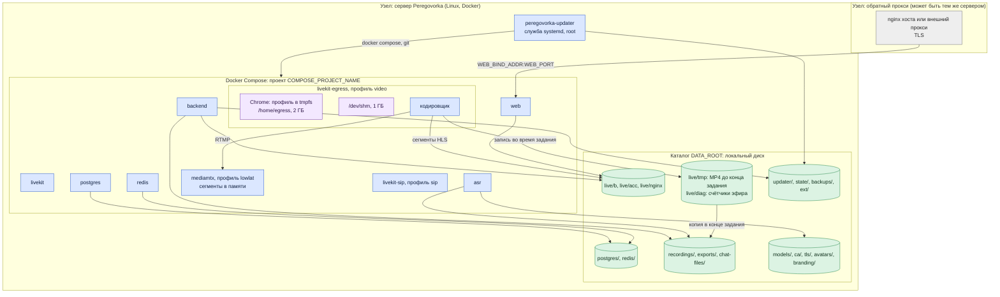
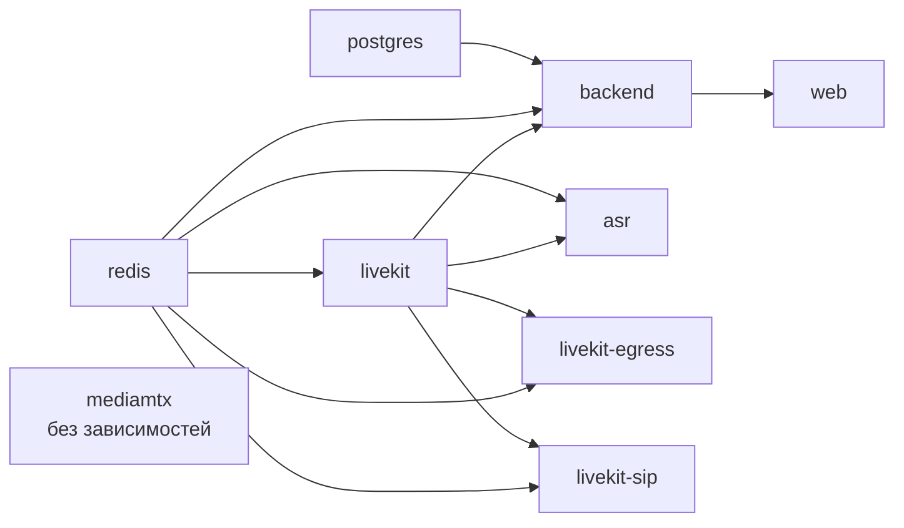
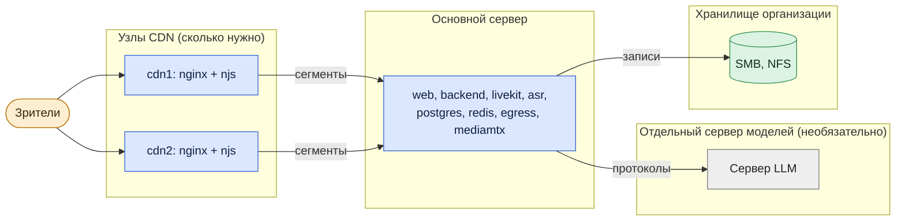

# Архитектура: развёртывание

*Для кого: администратор, планирующий размещение.*

Страница показывает, что где работает, где лежат данные и какие варианты размещения возможны. Установка по шагам: [Установка на чистый сервер](Установка-на-чистый-сервер).

## Одна площадка

| Что | Где | Как запускается |
|---|---|---|
| `web`, `backend`, `livekit`, `asr`, `postgres`, `redis` | контейнеры | всегда, `restart: unless-stopped` |
| `livekit-egress` | контейнер | профиль `video`: включается из администрирования или `scripts/video.sh enable` |
| `mediamtx` | контейнер | профиль `lowlat`: добавляется вместе с `video`, если образ уже на сервере |
| `livekit-sip` | контейнер | профиль `sip`: включается при подключении телефонии |
| nginx хоста | служба системы | только если вы используете его, а не внешний прокси |
| `peregovorka-updater-<проект>` | служба systemd от root | ставит установщик в профиле `standalone`, в `shared-host` команда `scripts/updater.sh install` |
| `.env` | каталог установки, права 600 | секреты и `APP_MASTER_KEY` |

## Где лежат данные

| Каталог `DATA_ROOT` | Что внутри | Кто пишет |
|---|---|---|
| `postgres/`, `redis/` | база и данные Redis | контейнеры `postgres`, `redis` |
| `recordings/` | дорожки участников, во время встречи сырой PCM; общая аудиозапись, MP4 | `asr`, `backend`, `livekit-egress` |
| `exports/` | выгрузки документов | `backend` |
| `chat-files/`, `avatars/`, `branding/` | вложения, фото профилей, оформление | `backend` |
| `models/` | модели GigaAM. Модели распознавания имён лежат не здесь, а в образе `backend` | `scripts/models.sh`, `asr` только читает |
| `ca/` | корневые сертификаты каталога и почты | `backend` |
| `tls/` | самоподписанный сертификат установки одной командой | `scripts/setup.sh` |
| `live/b/` | сегменты эфиров | `livekit-egress` |
| `live/acc/` | ссылки доступа зрителей на каталог эфира | `backend` |
| `live/nginx/` | секрет подписи и ключи узлов CDN | `backend`, читает `web` |
| `live/tmp/` | файл записи и временные каталоги Egress | `livekit-egress` |
| `live/diag/` | счётчик процессора Egress для диагностики | `livekit-egress`, `backend` |
| `ext/` | точки подключения внешних томов | помощник на хосте |
| `updater/`, `state/` | обмен с помощником, состояние обновлений | `backend`, помощник, скрипты |
| `backups/` | резервные копии, если `BACKUP_DIR` не задан | `scripts/backup.sh` |

Как копировать эти каталоги: [Резервирование и восстановление](Архитектура-Резервирование-и-восстановление).

## Как устроена память и диск службы Egress

Настройка находится в `deployment/compose.yml`. Её стоит понимать до того, как планировать длинные эфиры.

- **Браузер живёт в памяти.** Домашний каталог `/home/egress` смонтирован как tmpfs на 2 ГБ, у контейнера есть 1 ГБ общей памяти `shm`. Команда `entrypoint` создаёт обёртку `/home/egress/bin/google-chrome` и ставит её первой в `PATH`. Обёртка запускает настоящий браузер с профилем `/home/egress/chrome/<номер процесса>`. На занятом диске запуск браузера растягивался дольше предела в 20 секунд, поэтому профиль не лежит на диске.
- **Файл записи живёт на диске.** Egress держит весь MP4 в `/home/egress/tmp` до конца задания. Этот путь через символьную ссылку ведёт в `/live/tmp`, то есть в `DATA_ROOT/live/tmp`. В памяти такой файл обрывал эфир 1080p на 52-й минуте.
- **`live/tmp` должен быть локальным.** Том записей для него не подходит: на SMB нет сокета IPC, который нужен службе.
- **Место считается дважды.** Пока идёт запись, файл лежит в `live/tmp`. В конце задания он копируется в том записей. Сколько закладывать: [Ограничения и требования](Архитектура-Ограничения-и-требования#диск).
- **Уборка.** Проверка здоровья контейнера раз в 15 секунд убирает старые временные файлы, каталоги завершившихся браузеров и записывает счётчик процессора в `live/diag/egress.cpu`.
- **Запас места проверяет приложение.** Если свободного места меньше, чем занимает `live/tmp`, плюс 1 ГБ, `backend` заранее останавливает эфиры и записи, чтобы файл успел закрыться и скопироваться.

Настройка `cpu_shares` задаёт вес при конкуренции за процессор, это не предел: `livekit` и `livekit-egress` по 8192, `asr` 512, остальные 1024.

## Зависимости запуска

Стрелка означает «нужен для запуска». `backend` стартует, когда исправны база, Redis и LiveKit. У `mediamtx` нет зависимостей и проверки здоровья.

Сбой Egress, SIP или ASR не останавливает встречи: пропадают запись и эфир, телефония или стенограмма. Сбой `mediamtx` не трогает запись и площадки: зрители уходят на обычный HLS.

## Профили установки

| Профиль | Когда | Что делает установщик |
|---|---|---|
| `standalone` | сервер отдан под Peregovorka | ставит Docker, nginx, утилиты; применяет параметры ядра в `/etc/sysctl.d/99-peregovorka.conf`; ставит помощника обновлений |
| `shared-host` | на сервере другие приложения | не ставит Docker и nginx и не меняет параметры ядра. Создаёт свой site nginx, каталоги и контейнеры своего проекта |

## Варианты размещения

### Всё в одной инфраструктуре

Сервер в локальной сети организации, пользователи внутри сети или по VPN. Один сервер, все службы на нём. Интернет нужен для установки и обновления. Режим сети `lan`: см. [Сетевые потоки](Архитектура-Сетевые-потоки#stun-turn-и-nat).

### Сервер в DMZ или облаке

Сервер с публичным адресом или за пробросом портов. Каталог и почта остаются в организации и доступны через VPN или защищённый маршрут. Подробно: [Публикация во внешний контур](Архитектура-Публикация-во-внешний-контур).

### Распределённая инфраструктура

Что можно вынести с основного сервера: языковую модель, файловые хранилища, раздачу эфиров (узлы CDN). Обратный прокси можно разместить отдельно.

Что **не выносится штатно**: LiveKit, Egress, MediaMTX, ASR, PostgreSQL и Redis работают на одном сервере в одном проекте Compose. Адреса базы и Redis заданы в `compose.yml` жёстко. Несколько процессов `backend` поддерживаются настройкой `BACKEND_WORKERS`. Узел LiveKit один: кластера LiveKit в поставке нет.

## Что дальше

- [Сетевые потоки](Архитектура-Сетевые-потоки)
- [Порты и сервисы](Архитектура-Порты-и-сервисы)
- [Установка на общий сервер](Установка-на-общий-сервер)
