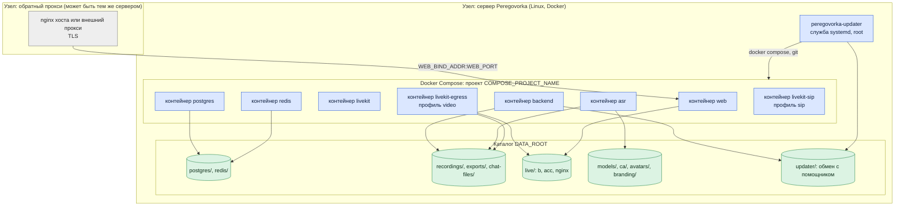
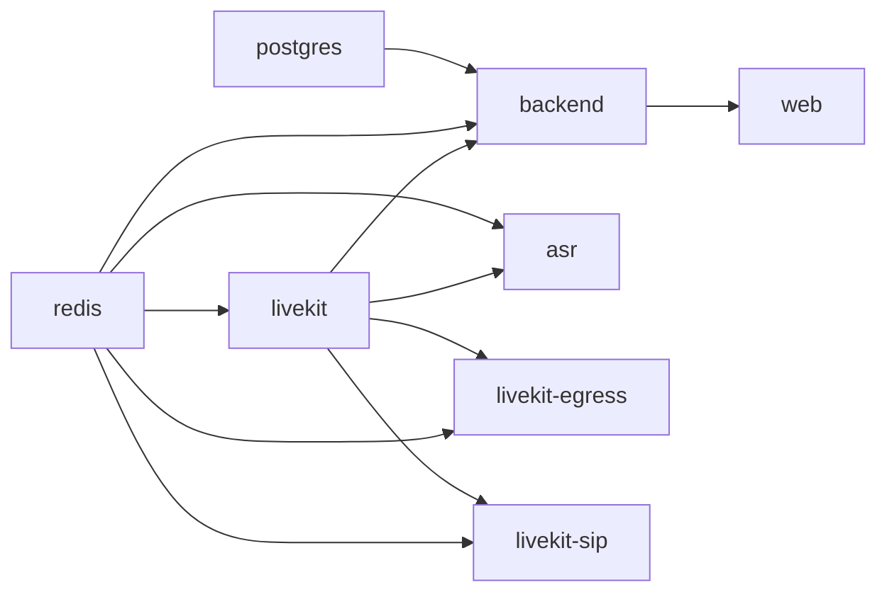
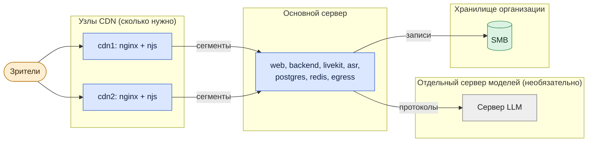

# Архитектура: развёртывание

*Для кого: администратор, планирующий размещение.*

**Что получится:** вы знаете, что где работает, где лежат данные и какие варианты размещения возможны. Установка по шагам — [Установка на чистый сервер](Установка-на-чистый-сервер).

## Одна площадка

| Что | Где | Как запускается |
|---|---|---|
| `web`, `backend`, `livekit`, `asr`, `postgres`, `redis` | контейнеры | всегда, `restart: unless-stopped` |
| `livekit-egress` | контейнер | профиль `video`: включается из администрирования |
| `livekit-sip` | контейнер | профиль `sip`: включается при подключении телефонии |
| nginx хоста | служба системы | только если вы используете его, а не внешний прокси |
| `peregovorka-updater-<проект>` | служба systemd от root | ставит установщик в профиле `standalone`, в `shared-host` — `scripts/updater.sh install` |
| `.env` | каталог установки, права 600 | секреты и `APP_MASTER_KEY` |

Что где лежит: [Резервирование и восстановление](Архитектура-Резервирование-и-восстановление).

## Зависимости запуска

Стрелка: «нужен для запуска». `backend` стартует, когда база и Redis исправны. Сбой Egress, SIP или ASR не останавливает встречи: пропадают запись, телефония или стенограмма.

## Профили установки

| Профиль | Когда | Что делает установщик |
|---|---|---|
| `standalone` | сервер отдан под Peregovorka | ставит Docker, nginx, утилиты; применяет параметры ядра; ставит помощника обновлений |
| `shared-host` | на сервере другие приложения | ничего не ставит и не меняет в системе: только свой site nginx, каталоги и контейнеры своего проекта |

## Варианты размещения

### Всё в одной инфраструктуре

Сервер в локальной сети организации, пользователи внутри сети или по VPN. Минимальная схема: один сервер, все службы на нём. Интернет нужен только для установки и обновления.

### Сервер в DMZ или облаке

Сервер с публичным адресом или за пробросом портов. Каталог и почта остаются в организации и доступны через VPN или защищённый маршрут. Подробно: [Публикация во внешний контур](Архитектура-Публикация-во-внешний-контур).

### Распределённая инфраструктура

Что можно вынести с основного сервера: языковую модель, файловые хранилища, раздачу эфиров (узлы CDN). Обратный прокси можно разместить отдельно.

Что **не выносится штатно**: LiveKit, Egress, ASR, PostgreSQL и Redis работают на одном сервере в одном проекте Compose. Несколько процессов `backend` поддерживаются (`BACKEND_WORKERS`). Узел LiveKit один: кластера LiveKit в поставке нет.

## Что дальше

- [Сетевые потоки](Архитектура-Сетевые-потоки)
- [Порты и сервисы](Архитектура-Порты-и-сервисы)
- [Установка на общий сервер](Установка-на-общий-сервер)
