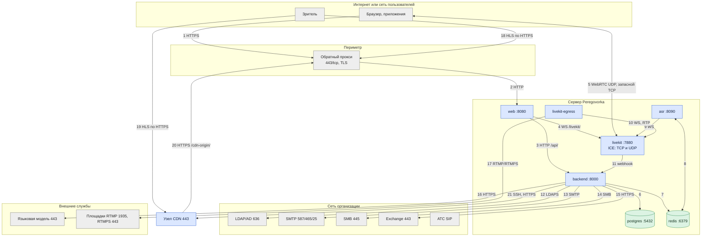

# Архитектура: сетевые потоки

*Для кого: сетевой инженер и специалист по ИБ.*

**Что получится:** вы знаете, кто с кем соединяется и как защищено каждое соединение. Номера портов и правила публикации — [Порты и сервисы](Архитектура-Порты-и-сервисы).

## Схема

## Потоки

| № | Откуда → куда | Протокол, порт | Назначение | Защита |
|---|---|---|---|---|
| 1 | клиент → прокси | HTTPS, 443 | страница, API, WebSocket событий, сигналинг | TLS; при необходимости HSTS |
| 2 | прокси → `web` | HTTP, `WEB_PORT` | то же | локальный адрес или доверенная сеть |
| 3 | `web` → `backend` | HTTP, 8000 | API | сеть проекта Docker |
| 4 | `web` → `livekit` | WebSocket, 7880 | сигналинг WebRTC | сеть проекта Docker; снаружи TLS |
| 5 | клиент ↔ `livekit` | UDP `LIVEKIT_UDP_PORT`, запасной TCP `LIVEKIT_TCP_PORT` | звук, видео, экран | DTLS-SRTP; по настройке сквозное шифрование E2EE |
| 6 | `backend` → `postgres` | PostgreSQL, 5432 | основная база | сеть проекта, пароль |
| 7 | `backend` → `redis` | Redis, 6379 | сессии, очереди | сеть проекта, пароль |
| 8 | `asr` ↔ `redis` | Redis, 6379 | команды и сегменты стенограммы | сеть проекта, пароль |
| 9 | `asr` → `livekit` | WebSocket и WebRTC | подписка на звук | сеть проекта, токен LiveKit |
| 10 | `livekit-egress` → `livekit` | WebSocket и WebRTC | запись, эфир | сеть проекта, токен LiveKit |
| 11 | `livekit` → `backend` | HTTP, 8000, `/internal/v1/livekit/webhook` | события комнат | подпись webhook ключом LiveKit |
| 12 | `backend` → каталог | LDAPS, 636 (или STARTTLS, 389) | вход, группы, профили | TLS с проверкой по каталогу CA |
| 13 | `backend` → SMTP | SMTP, STARTTLS или SSL | письма | TLS, вход по паролю или NTLM |
| 14 | `backend` → SMB | SMB 2/3, 445 | записи, документы | учётная запись, шифрование по политике ресурса |
| 15 | `backend` → Exchange | HTTPS, 443 | календарь: EWS или Graph | TLS, учётные данные службы |
| 16 | `backend` → модель | HTTPS, 443 (или HTTP внутри сети) | протоколы | TLS, ключ API, маскировка секретов |
| 17 | `livekit-egress` → площадка | RTMP 1935 или RTMPS 443 | внешняя трансляция | ключ потока; RTMPS — TLS |
| 18 | зритель → сервер | HTTPS, 443, `/hls/` | прямая раздача | TLS, подпись и срок в адресе |
| 19 | зритель → узел CDN | HTTPS, 443, `/hls/` | раздача с узла | TLS, подпись ES256 в адресе |
| 20 | узел CDN → сервер | HTTPS, 443, `/cdn-origin/` | забор сегментов | TLS, ключ узла `X-Pgcdn-Key` |
| 21 | `backend` → узел CDN | SSH, 22 и HTTPS, 443 | управление; состояние | закреплённый ключ сервера, ключ `pgcdn`; токен узла |

Прочие исходящие: STUN в режиме `nat-stun`, Bitrix24 и webhooks по HTTPS, SIP с АТС. При установке и обновлении: GitHub, Docker Hub, npm, PyPI, зеркала apt, источники моделей.

TURN не используется: если медиапорты закрыты, звонок не установится. HTTP-прокси медиа не передаёт.

## Что дальше

- [Порты и сервисы](Архитектура-Порты-и-сервисы)
- [Публикация во внешний контур](Архитектура-Публикация-во-внешний-контур)
- [Справочник: порты и сеть](Справочник-порты-и-сеть)
