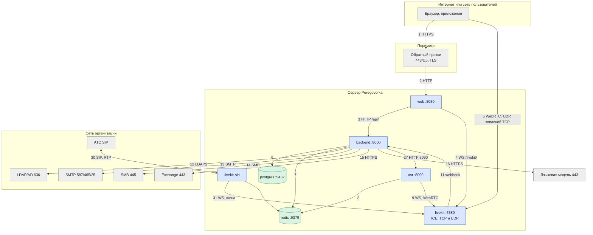
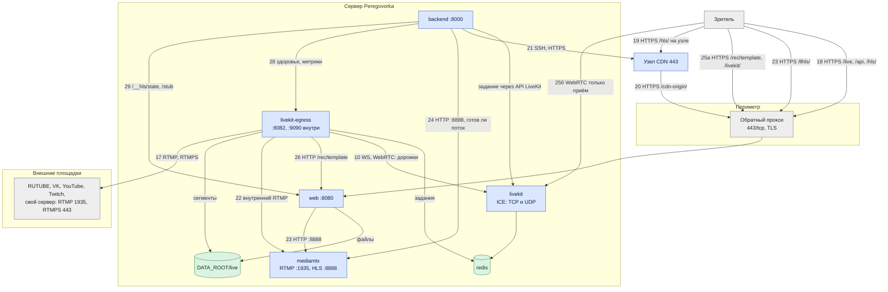
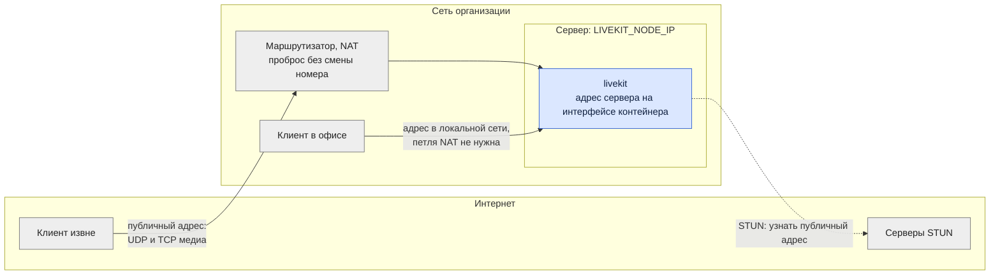

# Архитектура: сетевые потоки

*Для кого: сетевой инженер и специалист по ИБ.*

Страница показывает, кто с кем соединяется, в каком направлении и как защищено каждое соединение. Номера портов и правила публикации: [Порты и сервисы](Архитектура-Порты-и-сервисы).

Стрелка всегда идёт от того, кто начинает соединение.

## Встречи

## Эфир и зрители

## Потоки

| № | Откуда → куда | Протокол, порт | Назначение | Защита |
|---|---|---|---|---|
| 1 | клиент → прокси | HTTPS, 443 | страница, API, WebSocket событий, сигналинг | TLS; при необходимости HSTS |
| 2 | прокси → `web` | HTTP, `WEB_PORT` | то же | локальный адрес или доверенная сеть |
| 3 | `web` → `backend` | HTTP, 8000 | API | сеть проекта Docker |
| 4 | `web` → `livekit` | WebSocket, 7880 | сигналинг WebRTC | сеть проекта Docker; снаружи TLS |
| 5 | клиент → `livekit`, дальше в обе стороны | UDP `LIVEKIT_UDP_PORT`, запасной TCP `LIVEKIT_TCP_PORT` | звук, видео, экран | DTLS-SRTP; по настройке сквозное шифрование E2EE |
| 6 | `backend` → `postgres` | PostgreSQL, 5432 | основная база | сеть проекта, пароль |
| 7 | `backend` → `redis` | Redis, 6379 | сессии, очереди | сеть проекта, пароль |
| 8 | `asr` → `redis` | Redis, 6379 | команды и сегменты стенограммы | сеть проекта, пароль |
| 9 | `asr` → `livekit` | WebSocket и WebRTC | подписка на звук | сеть проекта, токен LiveKit |
| 10 | `livekit-egress` → `livekit` | WebSocket и WebRTC | запись, эфир | сеть проекта, токен LiveKit |
| 11 | `livekit` → `backend` | HTTP, 8000, `/internal/v1/livekit/webhook` | события комнат | подпись webhook ключом LiveKit |
| 12 | `backend` → каталог | LDAPS, 636 (или STARTTLS, 389) | вход, группы, профили | TLS с проверкой по каталогу CA |
| 13 | `backend` → SMTP | SMTP, STARTTLS или SSL | письма | TLS, вход по паролю или NTLM |
| 14 | `backend` → SMB | SMB 2/3, 445 | записи, документы | учётная запись, шифрование по политике ресурса |
| 15 | `backend` → Exchange | HTTPS, 443 | календарь: EWS или Graph | TLS, учётные данные службы |
| 16 | `backend` → модель | HTTPS, 443 (или HTTP внутри сети) | протоколы | TLS, ключ API, маскировка секретов |
| 17 | `livekit-egress` → площадка | RTMP 1935 или RTMPS 443 | внешняя трансляция | ключ потока; RTMPS добавляет TLS |
| 18 | зритель → сервер | HTTPS, 443, `/live/…`, `/api/v1/live/…`, `/hls/…` | страница, ссылка, обычный HLS | TLS, подпись и срок в адресе |
| 19 | зритель → узел CDN | HTTPS, 443, `/hls/` | раздача с узла | TLS, подпись ES256 в адресе |
| 20 | узел CDN → сервер | HTTPS, 443, `/cdn-origin/` | забор сегментов | TLS, ключ узла `X-Pgcdn-Key` |
| 21 | `backend` → узел CDN | SSH, 22 и HTTPS, 443 | управление; состояние | закреплённый ключ сервера, ключ `pgcdn`; токен узла |
| 22 | `livekit-egress` → `mediamtx` | RTMP, 1935, только сеть проекта | поток для LL-HLS. Имя потока равно идентификатору доступа | сеть проекта |
| 23 | зритель → прокси → `web` → `mediamtx` | HTTPS 443, затем HTTP 8888 | LL-HLS, `/llhls/<доступ>/<срок>/<подпись>/…` | TLS, подпись проверяет `web` |
| 24 | `backend` → `mediamtx` | HTTP, 8888 | готов ли поток. LL-HLS отвечает после семи сегментов: по расчёту около 15 секунд после начала эфира | сеть проекта |
| 25а | зритель WebRTC → прокси → `web` → `livekit` | HTTPS 443, WebSocket | страница `/rec/template?view=1` в рамке, сигналинг `/livekit/` | TLS, токен только на приём |
| 25б | зритель WebRTC → `livekit`, дальше в обе стороны | те же UDP и TCP, что у потока 5 | просмотр с задержкой меньше секунды | DTLS-SRTP. В списке участников зритель не виден |
| 26 | `livekit-egress` → `web` | HTTP, 8080, `http://web:8080/rec/template` | общая сцена для записи и эфира | сеть проекта, подписанный токен в адресе |
| 27 | `backend` → `asr` | HTTP, 8090 | управление моделями, готовность | сеть проекта |
| 28 | `backend` → `livekit-egress` | HTTP, 8082 и 9090 | нагрузка службы, метрики диагностики | сеть проекта |
| 29 | `backend` → `web` | HTTP, `/__hls/state` на 8080, `/stub` на 8081 | применён ли секрет подписи, счётчики nginx | сеть проекта |
| 30 | АТС ↔ `livekit-sip` | SIP `SIP_SIGNALING_PORT`, RTP `SIP_RTP_START`–`SIP_RTP_END` | телефония | только адреса АТС |
| 31 | `livekit-sip` → `livekit`, `redis` | WebSocket, Redis db 1 | соединение звонка с комнатой | сеть проекта, токен, пароль |
| 32 | `livekit`, `livekit-egress` → `redis` | Redis db 1 | шина заданий Egress и SIP | сеть проекта, пароль |

Прочие исходящие: STUN в режиме `nat-stun`, Bitrix24 и webhooks по HTTPS. При установке и обновлении: GitHub, Docker Hub, npm, PyPI, зеркала apt, источники моделей.

## Обратный прокси

Прокси стоит перед `web` и завершает TLS. Это nginx хоста или ваш прокси.

| Что должно проходить через прокси | Зачем | Особенность |
|---|---|---|
| `/` и статика | интерфейс | обычный HTTP |
| `/api/` | API | таймаут `web` 120 с |
| `/api/v1/ws` | события интерфейса | WebSocket, долгий таймаут, без буфера |
| `/livekit/` | сигналинг WebRTC | WebSocket, долгий таймаут, без буфера |
| `/live/<код>`, `/rec/template` | страница зрителя и сцена WebRTC | доступны без входа в систему |
| `/hls/…` | обычный HLS | доступ определяет подпись |
| `/llhls/…` | LL-HLS | запрос плейлиста висит, пока не появится новая часть сегмента |
| `/cdn-origin/…` | сегменты для узлов CDN | вместо подписи ключ узла |
| `/internal/` | не нужен | `web` отвечает 404 |

Если прокси требует вход, пути зрителя и `/cdn-origin/` нужно пропускать без него, иначе эфир не откроется.

Шаблон nginx хоста содержит отдельные правила для `/api/v1/ws`, `/livekit/` и `/llhls/`. Правило `/llhls/` отключает буферизацию и журнал доступа, потому что в пути лежит подпись. С настоящим nginx оно не запускалось. Как настройки буферизации внешнего прокси влияют на LL-HLS, не проверялось. Если зрители за вашим прокси получают обычную задержку, отключите буферизацию для `/llhls/`.

## STUN, TURN и NAT

Клиент соединяется с сервером по адресу, который ему сообщает LiveKit в кандидатах ICE. LiveKit работает в сети Docker, поэтому его собственный адрес клиентам не годится. Адреса вычисляет один код `backend/app/services/medianet.py`. Его вызывают установщик, обновление, `scripts/medianet.sh` и раздел **Сетевая доступность**.

| Режим `LIVEKIT_MEDIA_MODE` | Когда | Что получают клиенты |
|---|---|---|
| `direct` | публичный адрес прямо на интерфейсе | этот адрес |
| `nat-stun` | частный адрес, `LIVEKIT_PUBLIC_IP=auto`, STUN ответил | публичный адрес и `LIVEKIT_NODE_IP` |
| `nat-manual` | `LIVEKIT_PUBLIC_IP=<IPv4>` | заданный адрес и `LIVEKIT_NODE_IP` |
| `lan` | `LIVEKIT_PUBLIC_IP=off` или публичный адрес не определён | только `LIVEKIT_NODE_IP` |

Как это работает:

- **STUN нужен только для адреса.** В режиме `nat-stun` скрипт запуска контейнера `livekit` при каждом старте спрашивает серверы STUN по очереди до первого ответа: `LIVEKIT_STUN_SERVERS`, затем встроенные Cloudflare, Twilio и Google. Никто не ответил: объявляется последний известный адрес.
- **Адрес меняется на ходу.** Раз в `LIVEKIT_IP_RECHECK` секунд (300) адрес определяется снова. Новый адрес подтвердился три раза подряд: LiveKit перезапускается, участники переподключаются.
- **Два адреса за NAT.** Скрипт запуска добавляет `LIVEKIT_NODE_IP` на интерфейс контейнера с маской /32. Для этого службе нужна возможность `NET_ADMIN`. Без неё клиенты офиса получат только публичный адрес.
- **Браузеры тоже знают STUN.** LiveKit передаёт им те же адреса для кандидатов ICE.
- **TURN в поставке нет.** Если медиапорты закрыты, звонок не установится и зритель WebRTC не подключится. HTTP-прокси медиа не передаёт.
- **CGNAT и двойной NAT.** Проброс на своём маршрутизаторе не поможет. Признаки показывает `scripts/medianet.sh check`.

Настройка по шагам: [Как настроить LiveKit](Как-настроить-LiveKit). Команды проверки: [Справочник: порты и сеть](Справочник-порты-и-сеть).

## Что дальше

- [Порты и сервисы](Архитектура-Порты-и-сервисы)
- [Публикация во внешний контур](Архитектура-Публикация-во-внешний-контур)
- [Справочник: порты и сеть](Справочник-порты-и-сеть)
