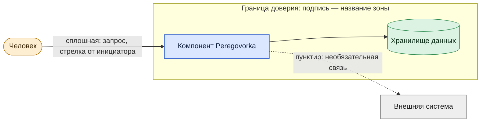

# Архитектура и техническое устройство

*Для кого: системный администратор, инженер сопровождения, специалист по ИБ, разработчик.*

**Что получится:** системное представление о Peregovorka: из чего она состоит, как части взаимодействуют, какие данные передаются, где проходят границы доверия и как система восстанавливается после отказов.

Инструкции по настройке живут в разделе «Администраторам», пользовательские — в разделе «Сотрудникам». Здесь — устройство.

## Как читать раздел

| Вопрос | Страница |
|---|---|
| Что это за продукт и из чего состоит | [Назначение и состав](Архитектура-Назначение-и-состав) |
| С кем система взаимодействует, где границы доверия | [Контекст и контейнеры](Архитектура-Контекст-и-контейнеры) |
| Что где работает: контейнеры, службы, данные | [Развёртывание](Архитектура-Развёртывание) |
| Кто с кем соединяется, каким протоколом | [Сетевые потоки](Архитектура-Сетевые-потоки) |
| Какие порты открыть | [Порты и сервисы](Архитектура-Порты-и-сервисы) |
| Как идут вход, встреча, запись, протокол | [Встречи: последовательности](Архитектура-Последовательности-встреч) |
| Как идут эфир, зритель, HLS, RTMP | [Трансляции: последовательности](Архитектура-Последовательности-трансляций) |
| Как обновляются сервер и приложения | [Обновление: последовательности](Архитектура-Последовательности-обновления) |
| Что происходит с персональными данными | [Обработка персональных данных](Архитектура-Обработка-персональных-данных) |
| Как устроена каждая интеграция | [Каталог интеграций](Архитектура-Каталог-интеграций) |
| Как открыть доступ из интернета | [Публикация во внешний контур](Архитектура-Публикация-во-внешний-контур) |
| Что делать при отказе | [Резервирование и восстановление](Архитектура-Резервирование-и-восстановление) |
| Какие ресурсы нужны, что ограничено | [Ограничения и требования](Архитектура-Ограничения-и-требования) |

## Нотации

| Что показываем | Нотация |
|---|---|
| Контекст и контейнеры | модель C4 |
| Развёртывание | диаграмма развёртывания UML |
| Последовательности | диаграмма последовательности UML |
| Потоки данных | DFD |
| Сеть | топологическая схема |

Диаграммы — текст Mermaid прямо на страницах: каталог `wiki/` в репозитории. Правка диаграммы — обычная правка файла, вместе с кодом.

## Условные обозначения

Адреса и имена в примерах условные: `meet.example.org`, `192.0.2.10`.

Значения портов берутся из `deployment/compose.yml`, `.env.example` и скриптов. Если страница расходится с вашим сервером, верен сервер: **Администрирование → Система → Сетевая доступность** и `scripts/ports.sh`.

## Что дальше

- [Назначение и состав](Архитектура-Назначение-и-состав)
- [Как устроена Peregovorka](Как-устроена-Peregovorka) — короткий обзор
- [Что проверено](Границы-проверки)
