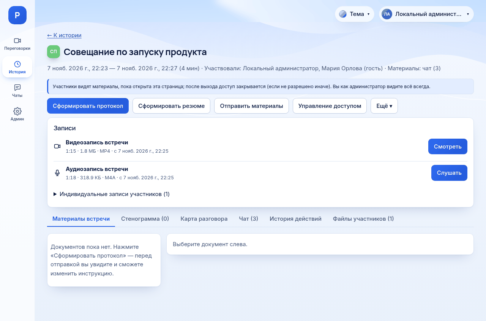

# Где найти материалы встречи

*Для кого: все сотрудники, организаторы, руководители комнат, администраторы.*

## Зачем это нужно

Все материалы встречи собраны на одной странице: записи, стенограмма, документы, карта разговора, чат, доска. Но доступ к завершённой встрече ограничен, и это удивляет многих. **По умолчанию обычный участник видит завершённую встречу только пока открыта её страница.** Прочитайте раздел [Кто видит завершённую встречу](#кто-видит-завершённую-встречу) до того, как уйдёте со страницы.

## Когда пригодится

- Встреча закончилась, и нужно забрать протокол.
- Коллега спрашивает, что решили на прошлой неделе.
- Встречи нет в списке, и нужно понять почему.
- Нужно открыть материалы человеку, который не участвовал.

## Что потребуется

Учётная запись сотрудника и основание для доступа к встрече: см. таблицу ниже. Гостевая ссылка к материалам не ведёт.

## Где найти

- Левая панель: **История**.
- Меню вашего имени сверху справа: **История моих встреч**.
- Сразу после завершения встречи: кнопка **Перейти к протоколу** в комнате. Через несколько секунд переход происходит сам. Тот, кто нажал **Завершить**, попадает на страницу сразу.

В приложении для Android: вкладка **История** открывает ту же страницу. Скачивания файлов в приложении нет, поэтому файлы скачивайте в браузере.

## Как это сделать

1. Откройте **История**. На странице **История встреч** показаны только встречи, к которым у вас сейчас есть доступ.
2. Найдите встречу. В поле **Поиск: комната или участник** можно ввести название комнаты или имя. Поиск работает по уже загруженной части списка, остальное подгружается при прокрутке.
3. Нажмите **Открыть** или название комнаты.

На странице встречи:

| Где | Что там |
| --- | --- |
| Верх страницы | дата, длительность, участники; кнопки **Сформировать протокол**, **Сформировать резюме**, **Отправить материалы**, **Управление доступом**, **Ещё** |
| Блок **Записи** | видео (**Смотреть**) и звук (**Слушать**) |
| Вкладка **Материалы встречи** | протоколы и резюме |
| Вкладка **Стенограмма** | все реплики |
| Вкладка **Карта разговора** | темы встречи |
| Вкладка **Чат** | переписка встречи, кнопка **Скачать чат (.txt)** |
| Вкладка **Вопросы зрителей** | вопросы, если был прямой эфир |
| Вкладка **Доска** | схема с общей доски |
| Вкладка **История действий** | кто что делал с материалами |
| Вкладка **Файлы участников** | отдельные записи участников |

Вкладки **Чат**, **Вопросы зрителей** и **Доска** появляются, только если в них есть содержимое. Блок **Записи** виден, только если записи есть.

## Кто видит завершённую встречу

Сервер проверяет права при каждом запросе. Знание ссылки на встречу доступа не даёт.

| Кто | Идущая встреча | Завершённая встреча |
| --- | --- | --- |
| Администратор сервера | видит | видит всегда |
| Руководитель комнаты | видит | видит все встречи своей комнаты всегда, даже если не участвовал |
| Человек, которому выдан доступ к этой встрече | только если участвует | видит только эту встречу, всегда |
| Участник, если в комнате выбрано «все участники встречи» | видит | видит всегда |
| Участник при настройке по умолчанию | видит | только временно, см. ниже |
| Организатор, если он не руководитель комнаты | видит | видит всегда, если его не удалили из встречи |
| Гость | только свою идущую встречу и только чат | не видит |
| Зритель прямого эфира | страницу эфира | страницы встречи нет; запись эфира только по ссылке |

**Организатор** здесь: тот, кто начал встречу. Встреча остаётся у него в **Истории**, а на её странице у него больше кнопок. Если организатора удалили из встречи, он теряет этот доступ.

### Временный доступ участника

При настройке по умолчанию участник сохраняет доступ, только если выполнены оба условия:

1. Он **был в комнате в момент завершения встречи**. Кто вышел раньше, временного доступа не получает.
2. Он ещё не ушёл со страницы встречи, и с момента завершения не прошло 120 минут. Это значение настраивает администратор.

Доступ закрывается, когда вы уходите со страницы завершённой встречи. Это значит:

- переход на другую страницу приложения закрывает доступ сразу;
- закрытие вкладки закрывает доступ примерно через 30 секунд;
- **обновление страницы доступ не закрывает**: страница вернётся, и прежний срок продолжит идти.

Поэтому страница показывает предупреждение: **Не закрывайте эту страницу, пока не сохранили нужное.** Его видят только те, чей доступ держится на открытой странице. Руководитель, организатор, обладатель выданного доступа и участник комнаты с настройкой **все участники встречи** его не видят. Сначала скачайте всё нужное, затем уходите. Ждать протокол тоже придётся на этой странице: он появится в списке сам, обновлять страницу не нужно.

### Какие комнаты работают иначе

Настройку **Кто видит встречу после завершения** меняет администратор сервера: [Настройки комнаты](Настройки-комнаты), вкладка **Доступ и гости**. Варианты: **Администраторы и руководители** (по умолчанию) и **Администраторы, руководители и все участники встречи**.

Руководитель комнаты видит действующее значение на вкладке **Материалы** в строке **Кто видит завершённую встречу**, но менять его не может.

Во временных комнатах, в равноправных комнатах и в конференциях, созданных из Outlook, значение по умолчанию другое: участники видят встречи всегда. Участник, удалённый со встречи, этого права не получает.

## Что можно делать на странице

| Действие | Участник с доступом | Организатор | Руководитель | Администратор |
| --- | --- | --- | --- | --- |
| Читать стенограмму, документы, карту, чат | да | да | да | да |
| Слушать и смотреть общую запись | да | да | да | да |
| Скачать стенограмму и документы | да | да | да | да |
| Скачать файл общей записи | нет | да | да | да |
| Формировать и переформировывать протокол, резюме, карту | нет | да | да | да |
| Редактировать документ | нет | да | да | да |
| Выбрать другую модель на один раз | нет | нет | да | да |
| Отправить материалы | нет | да | да | да |
| Править темы карты | нет | нет | да | да |
| **Управление доступом**, **История действий** | нет | нет | да | да |
| Слушать записи отдельных участников | нет | нет | нет | да |
| Удалить документ, запись, встречу | нет | нет | нет | да |

Человек, получивший доступ через **Управление доступом**, в этой таблице считается участником с доступом.

В комнате без руководителей управлять записью и транскрибацией во время встречи может любой участник (кроме презентационной комнаты). На права в этой таблице это не влияет.

## Как открыть встречу другому человеку

Нужны права руководителя комнаты или администратора.

1. Откройте страницу встречи.
2. Нажмите **Управление доступом**.
3. Выберите **Пользователь (ФИО, логин, почта)** или **Группа каталога** и введите не меньше 2 символов.
4. Нажмите **Найти**.
5. Для человека нажмите **Выдать доступ**. Для группы нажмите **Состав группы…**, проверьте число людей и нажмите **Подтверждаю: выдать доступ N чел.** Группу больше 300 человек выдать нельзя.

Получатель может только просматривать материалы этой одной встречи. Он не видит другие встречи комнаты и не может выдавать доступ дальше. Кнопка **Отозвать** действует сразу.

Администратору доступно то же через **Ещё → Доступ к встрече…**: там пользователь должен был хотя бы раз войти в систему.

## Что получится

Встреча видна в **Истории**, страница открывается, материалы доступны по вашей роли. Письмо с материалами доступа к странице не даёт: ссылка из письма откроется только у того, у кого доступ уже есть.

## Если не получается

| Симптом | Причина | Что сделать |
| --- | --- | --- |
| Встречи нет в **Истории** | вы ушли со страницы, вышли раньше завершения или прошло 120 минут | попросите руководителя комнаты выдать доступ или прислать материалы |
| «Встреча не найдена или доступ закрыт» | то же; ответ одинаков и для несуществующей встречи | то же |
| После обновления страницы встреча пропала | вышло 120 минут, или страницу возвращали дольше 30 секунд | то же |
| Организатор не может вернуться к встрече | организатора удалили из встречи | попросите руководителя комнаты выдать доступ |
| Нет блока **Записи** | запись не велась, или срок её хранения истёк | проверьте настройки комнаты и [сроки хранения](Сроки-хранения-материалов) |
| Встречи нет у администратора | встречу удалили | см. **Журнал аудита** |

## Что дальше

- [Запись, стенограмма, протокол: в чём разница](Запись-стенограмма-протокол-в-чём-разница)
- [Как сформировать протокол](Как-сформировать-протокол)
- [Как получить стенограмму](Как-получить-стенограмму)
- [Как отправить материалы](Как-отправить-материалы)
