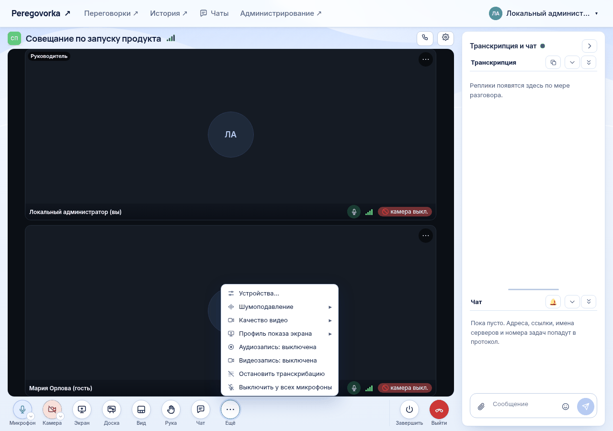

# Запись и транскрибация в комнате

*Для кого: руководитель комнаты и администратор.*

## Зачем это нужно

В комнате работают три независимых механизма:

| Что | Что получается | Как включается по умолчанию |
| --- | --- | --- |
| Транскрибация | текст реплик, стенограмма | идёт с начала встречи |
| Аудиозапись | звук встречи | выключена, разрешается в настройках |
| Видеозапись | один файл MP4 со всей встречей | выключена, требует включения на сервере |

Любой из них можно остановить, не трогая остальные. Простое объяснение разницы: [Запись, стенограмма, протокол: в чём разница](Запись-стенограмма-протокол-в-чём-разница).

## Когда пригодится

- Планёрка должна записываться всегда, без напоминаний.
- Часть обсуждения конфиденциальна, транскрибацию нужно приостановить.
- Для презентации нужна видеозапись с показанным экраном.

## Что потребуется

- Права руководителя этой комнаты или администратора.
- Для видеозаписи: администратор включил службу видеозаписи, см. [Как настроить видеозапись и трансляции на сервере](Как-настроить-видеозапись-и-трансляции-на-сервере).
- Браузер или приложение для Windows и Linux.

В приложении для Android: управлять записью и транскрибацией из встречи нельзя.

## Где найти

| Задача | Путь |
| --- | --- |
| Постоянные настройки | шестерёнка **Настройки** → **Настройки комнаты…** → **Встреча и запись** |
| Управление во время встречи | кнопка **Ещё** на панели встречи |
| Готовые записи | **История** → встреча → блок **Записи** |

## Как это сделать

### Настроить запись заранее

1. Откройте вкладку **Встреча и запись**.
2. Для аудиозаписи в блоке **Аудиозапись и стенограмма** выберите один вариант:
   - **Разрешить аудиозапись**: запись включается вручную во время встречи;
   - **Начинать аудиозапись автоматически**: запись начинается вместе со встречей.
3. В поле **Общая аудиозапись встречи** выберите:
   - **Собирать**: после встречи появится один общий файл;
   - **Не собирать**: общего файла не будет, файлы участников для расшифровки всё равно сохраняются.
4. Для видеозаписи в блоке **Видеозапись** выберите **Режим**:
   - **Вручную**: запись включает руководитель, а если руководителей нет, любой участник;
   - **Автоматически, пока есть участники**. Пустая комната не записывается.
5. Выберите **Качество**: **720p** или **1080p**.
6. Нажмите **Сохранить**.

### Управлять во время встречи

Откройте **Ещё** и выберите пункт:

| Пункт | Что делает |
| --- | --- |
| **Аудиозапись: выключена** | начинает запись звука |
| **Аудиозапись: включена** | останавливает запись звука. Транскрибация продолжается |
| **Видеозапись: выключена** | начинает видеозапись с текущего момента |
| **Видеозапись: включена** | останавливает видеозапись. Повторный запуск создаст новый фрагмент |
| **Остановить транскрибацию** | реплики перестают попадать в стенограмму. Звонок и запись продолжаются |
| **Возобновить транскрибацию** | реплики снова попадают в стенограмму |

### Узнать, что сейчас идёт

Все участники видят метки в шапке комнаты:

| Метка | Что значит |
| --- | --- |
| **АУДИОЗАПИСЬ** | идёт запись звука |
| **ВИДЕОЗАПИСЬ** | идёт видеозапись |
| **Транскрибация остановлена** | реплики не попадают в стенограмму |
| **ПОДГОТОВКА** | комната трансляции до выхода в эфир: запись и транскрибация не идут |

### Кто управляет

| Комната | Кто включает и останавливает |
| --- | --- |
| С руководителями | руководители и администраторы |
| Без руководителей, обычная | любой участник |
| Без руководителей, презентационная | только администраторы |
| Равноправная | любой участник |

Гость записью не управляет.

## Когда запись и транскрибация недоступны

| Условие | Что происходит |
| --- | --- |
| **Полное** сквозное шифрование | нет ни стенограммы, ни записи: у сервера нет ключа |
| Сквозное шифрование **с доверенным компонентом** | стенограмма и аудиозапись работают, видеозапись нет |
| **Шифровать чат и стенограммы при хранении** | видеозапись недоступна, стенограмма и аудиозапись работают |
| Комната трансляции до выхода в эфир | запись и транскрибация не идут, после выхода работают по настройкам комнаты |
| Администратор выключил видеозапись | режим можно выбрать, но запись не начнётся |

Пункт **Аудиозапись** виден только в комнате, где она разрешена.

## Что получится

После встречи откройте **История** и нужную встречу. В блоке **Записи** будет запись с кнопкой **Смотреть** для видео или **Слушать** для звука. Запись появляется не сразу: на месте файла показан этап обработки.

| Действие с записью | Кто может |
| --- | --- |
| Смотреть и слушать общую запись | все, кто видит встречу |
| Скачать общую запись | руководитель, организатор встречи, администратор |
| Слушать записи отдельных участников | администратор |
| Удалить встречу или запись | администратор |

Кто видит встречу после завершения, зависит от настройки **Кто видит встречу после завершения**. По умолчанию это администраторы и руководители. Участник видит материалы только пока не ушёл со страницы завершённой встречи. Срок хранения записей описан в статье [Сроки хранения материалов](Сроки-хранения-материалов).

### Сколько места занимает видео

Оценки не гарантированы: объём зависит от содержимого встречи.

| Показатель | Значение | Условия | Статус |
| --- | --- | --- | --- |
| Подсказка в настройках комнаты | 720p ≈ 1,2 ГБ в час, 1080p ≈ 2 ГБ в час | расчёт | Расчётная оценка |
| Запись эфира 720p | ≈ 1,2 ГБ в час | 97 МБ за 294 секунды, пересчёт на час | Проверено в ограниченном сценарии |
| Запись эфира 1080p | около 2,2 ГБ в час | 4,55 ГБ за 7255 секунд, пересчёт на час | Проверено в ограниченном сценарии |
| Видеозапись встречи | ≈ 0,56 ГБ в час в 720p, ≈ 0,78 ГБ в час в 1080p | синтетическая встреча, 42 секунды | Проверено в ограниченном сценарии |

Для расчёта диска берите верхние значения и добавляйте запас.

## Если не получается

| Что видно | Причина | Что сделать |
| --- | --- | --- |
| В **Ещё** нет пункта **Аудиозапись** | запись не разрешена в комнате, или вы не управляете встречей | включите **Разрешить аудиозапись** |
| В **Ещё** нет пункта **Видеозапись** | режим **Выключена**, видеозапись выключена на сервере, или вы не управляете встречей | проверьте вкладку **Встреча и запись** и настройки сервера |
| **Записью управляют руководители комнаты** | у вас нет прав | обратитесь к руководителю |
| **Видеозапись недоступна при сквозном шифровании…** | режимы несовместимы | выключите шифрование или видеозапись |
| Нет пункта **Остановить транскрибацию** | стенограмма недоступна в этой встрече, например при полном шифровании | проверьте **Шифрование** на вкладке **Встреча и запись** |
| Запись не появилась в **Истории** | файл ещё обрабатывается, или встреча вам недоступна | подождите, проверьте доступ |
| Запись идёт, а общего файла нет | выбрано **Не собирать** | выберите **Собирать** для следующих встреч |
| Стенограмма пуста | служба распознавания недоступна | см. [Как настроить распознавание речи](Как-настроить-распознавание-речи) |

## Что дальше

- [Как записать видео встречи](Как-записать-видео-встречи)
- [Как получить стенограмму](Как-получить-стенограмму)
- [Где найти материалы встречи](Где-найти-материалы-встречи)
- [Настройки комнаты](Настройки-комнаты)
