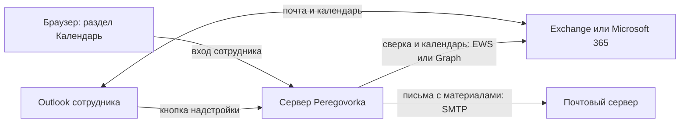

# Интеграция с Outlook и Exchange

*Для кого: администратор Peregovorka, администратор Exchange, сотрудник, который выбирает нужную статью.*

## Зачем это нужно

Интеграция связывает встречи в Peregovorka с календарём Outlook. Сотрудник назначает встречу там, где привык, а ссылка на конференцию попадает в приглашение. Интеграция выключена по умолчанию.

> **Что проверено.** На настоящем сервере Exchange, в Microsoft 365 и в настоящем Outlook эта интеграция не проверялась. Разработчики проверяли её на подставных серверах, которые повторяют документированные ответы Microsoft, и в настоящем браузере с заменой библиотеки Outlook. Перед внедрением проведите пилот на своих ящиках. Подробности: [Требования и совместимость](Outlook-Требования-и-совместимость).

## Из чего состоит интеграция

| Часть | Что делает | Что нужно | Кто настраивает |
| --- | --- | --- | --- |
| **Надстройка Outlook** | кнопка **Добавить конференцию** в окне встречи: создаёт комнату и вставляет ссылки в приглашение | HTTPS-адрес Peregovorka, установка манифеста | администратор Peregovorka и Exchange |
| **Серверная сверка** | следит за событием организатора: перенос, отмена, приглашённые, серии | учётная запись EWS или приложение Microsoft Graph с правами на календари | администратор Peregovorka и Exchange |
| **Раздел «Календарь»** | показывает события Outlook в Peregovorka, создаёт, изменяет и отменяет встречи | настроенная сверка, согласие каждого сотрудника | администратор включает, сотрудник подключает сам |
| **Гостевые ссылки** | вторая ссылка для участников без учётной записи | отдельное разрешение администратора | администратор разрешает, организатор выдаёт |

EWS (Exchange Web Services) и Microsoft Graph — способы, которыми программы обращаются к почте и календарям. EWS применяют для локального Exchange, Graph для Microsoft 365.

Каждая следующая часть необязательна. Надстройка работает без сверки, но тогда сервер не узнает о переносах и отменах, сделанных вне панели надстройки.

## Как части связаны между собой

Кто какие письма отправляет:

| Письмо | Кто отправляет |
| --- | --- |
| Приглашение, созданное в Outlook | сам Outlook и Exchange, когда сотрудник нажимает **Отправить** |
| Приглашение, созданное в разделе «Календарь» | Exchange по запросу Peregovorka |
| Протоколы и материалы встреч | Peregovorka через сервер SMTP: это отдельная настройка, [Как подключить почту](Как-подключить-почту) |

## Что выбрать

| Ваша почта | Надстройка | Подключение к календарям |
| --- | --- | --- |
| Локальный Exchange 2016, 2019 или Subscription Edition | базовые функции | EWS |
| Microsoft 365 (Exchange Online) | базовые функции и передача изменений при отправке | Microsoft Graph |

Для Microsoft 365 выбирайте Graph: Microsoft отключает EWS в Exchange Online, см. [Требования и совместимость](Outlook-Требования-и-совместимость).

## Статьи раздела

| Что нужно | Статья | Для кого |
| --- | --- | --- |
| Понять, что умеет интеграция | [Возможности интеграции](Outlook-Возможности-интеграции) | все |
| Проверить, подходит ли ваша среда | [Требования и совместимость](Outlook-Требования-и-совместимость) | администратор |
| Включить интеграцию и подключить надстройку | [Как подключить надстройку Outlook](Как-подключить-надстройку-Outlook) | администратор |
| Раздать надстройку сотрудникам | [Централизованная установка надстройки](Outlook-Централизованная-установка-надстройки) | администратор Exchange |
| Дать серверу доступ к календарям | [Как подключить календарь Exchange](Как-подключить-календарь-Exchange) | администратор |
| Подключить свой календарь | [Как пользоваться календарём Outlook](Как-пользоваться-календарём-Outlook) | сотрудник |
| Создать конференцию из Outlook | [Конференции через Outlook](Outlook-Конференции-через-Outlook) | сотрудник |
| Создать конференцию из Peregovorka | [Конференции через календарь Peregovorka](Outlook-Конференции-через-календарь-Peregovorka) | сотрудник |
| Пригласить внешних участников | [Гостевые ссылки в приглашениях](Outlook-Гостевые-ссылки-в-приглашениях) | администратор, организатор |
| Понять переносы, отмены и серии | [Синхронизация и повторяющиеся встречи](Outlook-Синхронизация-и-повторяющиеся-встречи) | администратор, организатор |
| Найти причину ошибки | [Диагностика типичных ошибок](Outlook-Диагностика-типичных-ошибок) | администратор |
| Решить проблему с письмами | [Решение проблем: Outlook и почта](Решение-проблем-Outlook-и-почты) | администратор |

## Порядок внедрения

1. Сверьте свою среду с [требованиями](Outlook-Требования-и-совместимость).
2. Включите интеграцию и добейтесь успешных проверок: [Как подключить надстройку Outlook](Как-подключить-надстройку-Outlook).
3. Установите надстройку одному-двум сотрудникам: [Централизованная установка надстройки](Outlook-Централизованная-установка-надстройки).
4. Если нужны сверка и календарь, настройте доступ: [Как подключить календарь Exchange](Как-подключить-календарь-Exchange).
5. Проведите пилот по списку ниже.
6. Откройте надстройку и календарь всем сотрудникам.

## Что проверить на пилоте

- Кнопка появилась в классическом Outlook и в Outlook в браузере.
- Вход в панели прошёл, ссылка попала в приглашение и в поле «Место».
- Письмо дошло до внутреннего и внешнего участника, ссылки открываются.
- Перенос и отмена в Outlook дошли до Peregovorka.
- Серия отмечена словом **серия** в таблице **Созданные конференции**.
- В той же таблице в столбце **Сверка** нет надписи **не отслеживается**.

## Что дальше

- [Требования и совместимость](Outlook-Требования-и-совместимость)
- [Как подключить надстройку Outlook](Как-подключить-надстройку-Outlook)
- [Как подключить календарь Exchange](Как-подключить-календарь-Exchange)
- [Что проверено](Границы-проверки)
