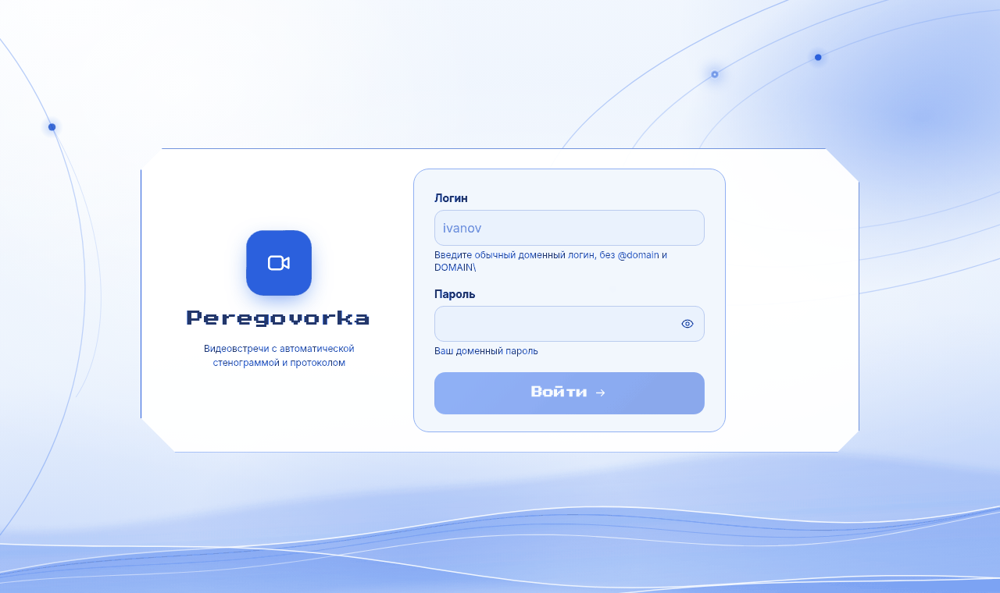

# Как войти в систему

*Для кого: сотрудник и администратор, который помогает со входом.*

## Зачем это нужно

Вход показывает системе, кто вы. От этого зависят комнаты, которые вы видите, и действия, которые вам доступны.

## Когда пригодится

- Вы открываете Peregovorka впервые.
- Система показала незнакомый экран при входе.
- Система не пускает вас или просит завершить другой сеанс.

Гостю и зрителю трансляции учётная запись не нужна. Они входят по ссылке: [Маршрут гостя](Маршрут-гостя), [Маршрут зрителя](Маршрут-зрителя).

## Что потребуется

- Адрес сервера, например `https://meet.example.org`.
- Логин и пароль учётной записи организации.
- Телефон с приложением-аутентификатором, если у вас включён второй фактор. Второй фактор — это одноразовый код, который нужен в дополнение к паролю.

## Где найти

Откройте адрес сервера в браузере. Форма входа появится сама, если вы ещё не вошли.

## Как это сделать

1. В поле **Логин** введите логин, например `ivanov`. Форма подсказывает вводить логин без домена. Сервер принимает и формы `ДОМЕН\логин` и `логин@домен`.
2. В поле **Пароль** введите пароль. Значок глаза показывает введённый текст. Надпись **Включён Caps Lock** предупреждает о верхнем регистре.
3. Нажмите **Войти**.
4. Если появился один из экранов ниже, выполните его.

### Экран «Код подтверждения»

Он появляется, если у вас включён второй фактор.

1. Откройте приложение-аутентификатор на телефоне.
2. Введите шестизначный код или резервный код в поле **Код подтверждения**.
3. Нажмите **Подтвердить**. Кнопка **Назад** возвращает к логину и паролю.

### Экран «Подтвердите, что вы не робот»

Он появляется после нескольких неудачных попыток входа.

1. Введите **Символы с картинки**. Регистр не важен.
2. Нажмите **Продолжить**. Кнопка **↻ Другая** показывает другую картинку.

### Экран со списком устройств

Он появляется, если у вашей учётной записи открыто слишком много сеансов. Сеанс — это вход с одного устройства или браузера. Администратор задаёт предел, по умолчанию их пять.

1. Найдите в списке устройство, которым вы больше не пользуетесь.
2. Нажмите **Завершить и войти здесь**.

Кнопка **Отмена** возвращает к форме входа, все сеансы при этом остаются открытыми.

### Экран подтверждения документов

Он появляется, если организация требует ознакомиться с документами.

1. Откройте документ по ссылке и прочитайте его.
2. Поставьте отметку **Я ознакомился(лась) с документом …** у каждого документа.
3. Нажмите **Подтверждаю**. Кнопка **Выйти** закрывает вход без подтверждения.

### Экран настройки второго фактора

Он появляется, если политика организации требует второй фактор. Пока вы его не настроите, остальные разделы недоступны.

1. Введите **Ваш пароль** и нажмите **Настроить**.
2. Отсканируйте код приложением-аутентификатором на телефоне. Если камеры нет, введите показанный ключ вручную.
3. Введите **Код** из приложения и нажмите **Включить**.
4. Сохраните резервные коды. Каждый подходит один раз. Сервер показывает их только сейчас.
5. Отметьте, что коды сохранены, и нажмите **Готово**.

Коды пригодятся, если телефон потеряется. Новые коды создаются в [личном кабинете](Как-изменить-профиль-и-параметры).

### Экран «Задайте свой пароль»

Его видит только локальный администратор при первом входе с паролем из терминала установки. Подробнее: [Быстрый старт](Быстрый-старт).

## Вход в приложениях

- **В приложениях для Windows и Linux:** сначала добавьте организацию, затем войдите на странице сервера. Шаги: [для Windows](Как-установить-приложение-для-Windows), [для Linux](Как-установить-приложение-для-Linux). Пароль не хранится, компьютер запоминается на срок, который задал администратор. По умолчанию это 30 дней.
- **В приложении для Android:** добавьте сервер, затем войдите на странице сервера: [Как установить приложение для Android](Как-установить-приложение-для-Android).

## Что получится

Откроется страница **Переговорки**. Ваше имя видно сверху справа.

Если вы открыли ссылку на комнату до входа, после входа откроется эта комната. Так же работают ссылка равноправной комнаты и ссылка на встречу из календаря. Другие адреса, например ссылка на страницу завершённой встречи, после входа ведут на **Переговорки**: откройте такую ссылку ещё раз.

Чтобы выйти, нажмите на своё имя и выберите **Выйти**. Во время встречи пункт недоступен: сначала выйдите из комнаты.

## Если не получается

| Сообщение | Причина | Что сделать |
| --- | --- | --- |
| **Неверный логин или пароль.** | ошибка в логине или пароле | проверьте раскладку и Caps Lock, введите данные заново |
| **Слишком много неудачных попыток. Повторите через N мин.** | сработала защита от подбора пароля | подождите указанное время |
| **Срок действия пароля истёк. Смените пароль в домене.** | истёк доменный пароль | смените пароль обычным способом вашей организации |
| **Требуется сменить пароль в домене.** | домен требует новый пароль | смените пароль и войдите снова |
| **Учётная запись заблокирована в домене. Обратитесь в службу поддержки.** | блокировка в каталоге | обратитесь в поддержку |
| **Учётная запись отключена или просрочена.** | запись отключена | обратитесь к администратору |
| **Вход этой учётной записи ограничен политикой домена.** | ограничение в домене | обратитесь к администратору |
| **Нет разрешения на вход в систему.** | вы не входите в разрешённые группы | попросите администратора добавить вас |
| **Неверный код. Проверьте время на телефоне или используйте резервный код.** | неверный код или расходится время | включите автоматическое время на телефоне, используйте резервный код |
| **Служба входа временно недоступна.** | сервер не связался с каталогом | повторите позже, сообщите администратору |
| **Недопустимый Origin. Откройте приложение по адресу …** | сайт открыт не по рабочему адресу | откройте адрес, указанный в сообщении |

Пароль доменной учётной записи меняется в домене, а не в Peregovorka. Если вы его забыли, обратитесь в службу поддержки вашей организации. Контакты находятся в пункте **Помощь и поддержка**, если организация их указала.

Администратору: [Решение проблем: вход и каталог](Решение-проблем-входа-и-каталога).

## Что дальше

- [Первый день в Peregovorka](Первый-день-в-Peregovorka)
- [Как изменить профиль и параметры](Как-изменить-профиль-и-параметры)
- [Как найти и открыть комнату](Как-найти-и-открыть-комнату)
