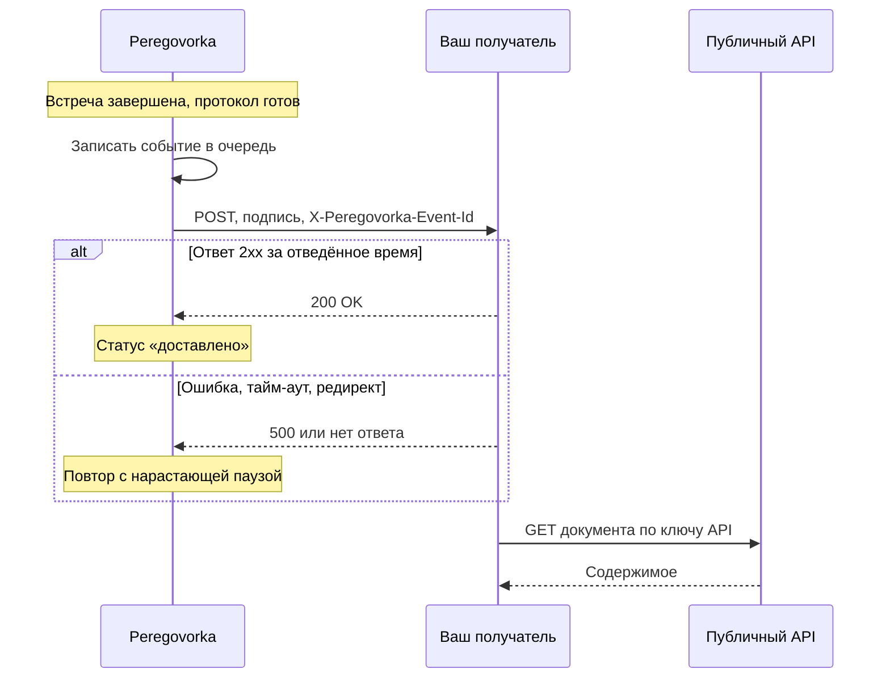
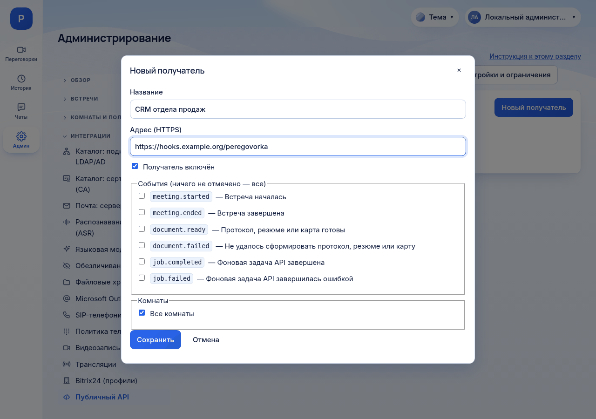

# Как использовать webhook

*Для кого: администратор сервера и разработчик интеграции.*

## Зачем это нужно

Webhook (подписка на события) сам сообщает вашей системе, что в Peregovorka что-то произошло: встреча началась или закончилась, протокол готов, фоновая задача выполнена. Ваша система не опрашивает сервер: она получает запрос `POST` на свой адрес.

## Когда пригодится

- CRM или система задач должна получать протокол сразу после встречи.
- Нужно вести собственный учёт встреч: начало, конец, причина завершения.
- Заказанный через API протокол долго формируется, и опрашивать его состояние неудобно.

## Как это устроено

Сервер записывает событие в свою базу и отправляет его отдельной фоновой службой. Сбой получателя или перезапуск сервера событие не теряет. Поэтому доставка идёт по принципу «как минимум один раз»: одно событие может прийти дважды, и получатель обязан это выдержать.



В событии нет текста протокола и стенограммы. Содержимое получатель запрашивает отдельно, ключом [публичного API](Как-использовать-публичный-API).

## Что потребуется

- Права администратора сервера. Подписки создаёт только администратор в интерфейсе, через API или ключом их создать нельзя.
- Публичный API должен быть включён. Пока он выключен, события в очередь не ставятся, хотя кнопка **Проверить** работает.
- Адрес получателя по HTTPS с действительным сертификатом. Сервер Peregovorka должен достучаться до него по сети.
- На стороне получателя: обработчик, который проверяет подпись и отвечает кодом `2xx`, а долгую работу выполняет после ответа.

## Где найти

**Администрирование → Интеграции → Публичный API**, вкладка **События (webhooks)**. В левой панели раздел подписан **Админ**. Настройки попыток и защиты адресов: вкладка **Настройки и ограничения** той же страницы.

## Как это сделать

### Создайте подписку

1. Откройте **Администрирование → Интеграции → Публичный API**.
2. На вкладке **Настройки и ограничения** проверьте, что отмечено **Публичный API включён**. Если нет, отметьте и сохраните.
3. Откройте вкладку **События (webhooks)** и нажмите **Новый получатель**.
4. Заполните **Название**, например «CRM».
5. Заполните **Адрес (HTTPS)**, например `https://hooks.example.org/peregovorka`.
6. Оставьте отмеченным **Получатель включён**.
7. В блоке **События** отметьте нужные. Если не отметить ничего, придут все события.
8. В блоке **Комнаты** оставьте **Все комнаты** или снимите отметку и выберите нужные.
9. Нажмите **Сохранить**.
10. В окне **Секрет подписи** скопируйте значение вида `whsec_…` и сохраните его как пароль. Позже он показан не будет. Нажмите **Я сохранил секрет**.



### Напишите проверку подписи

Заголовок `X-Peregovorka-Signature` содержит `v1=<hex>`. Это HMAC-SHA256 от строки `<timestamp>.<тело>`, где `timestamp` берётся из заголовка `X-Peregovorka-Timestamp`, а тело запроса берётся **как есть, байтами**. Не разбирайте JSON и не собирайте его заново до проверки: подпись перестанет сходиться.

Получатель выполняет четыре проверки:

1. Метка времени не старше 5 минут. Так отсекается повторное предъявление перехваченного запроса.
2. Хотя бы одна подпись из заголовка совпадает с вычисленной. При замене секрета подписей две, через запятую.
3. Сравнение выполняется за постоянное время.
4. `X-Peregovorka-Event-Id` ещё не обрабатывался. Если обрабатывался, ответьте `200` и ничего не делайте.

Пример на Python, только стандартная библиотека:

```python
import hashlib, hmac, time

def verify(headers: dict, body: bytes, secret: str, tolerance: int = 300) -> bool:
    ts = headers.get("X-Peregovorka-Timestamp", "")
    if not ts.isdigit() or abs(time.time() - int(ts)) > tolerance:
        return False
    expected = hmac.new(secret.encode(), f"{ts}.".encode() + body, hashlib.sha256).hexdigest()
    given = [p.strip()[3:] for p in headers.get("X-Peregovorka-Signature", "").split(",")
             if p.strip().startswith("v1=")]
    return any(hmac.compare_digest(g, expected) for g in given)
```

Пример на Node.js для Express. Обратите внимание на `express.raw`: он сохраняет исходные байты тела.

```javascript
const crypto = require("crypto");
const express = require("express");
const app = express();
const SECRET = process.env.PEREGOVORKA_WEBHOOK_SECRET;
const seen = new Set();                    // в рабочей системе храните идентификаторы в базе

app.post("/peregovorka", express.raw({ type: "application/json" }), (req, res) => {
  const ts = req.get("X-Peregovorka-Timestamp") || "";
  if (!/^\d+$/.test(ts) || Math.abs(Date.now() / 1000 - Number(ts)) > 300) return res.sendStatus(400);
  const expected = crypto.createHmac("sha256", SECRET).update(`${ts}.`).update(req.body).digest("hex");
  const given = (req.get("X-Peregovorka-Signature") || "").split(",").map((p) => p.trim())
    .filter((p) => p.startsWith("v1=")).map((p) => p.slice(3));
  const a = Buffer.from(expected);
  const ok = given.some((g) => { const b = Buffer.from(g); return b.length === a.length && crypto.timingSafeEqual(a, b); });
  if (!ok) return res.sendStatus(401);
  const id = req.get("X-Peregovorka-Event-Id");
  if (seen.has(id)) return res.sendStatus(200);
  seen.add(id);
  res.sendStatus(200);                     // ответьте сразу, обработку выполните после
  const event = JSON.parse(req.body);
  console.log(event.type, event.data);
});
app.listen(8080);
```

### Отправьте тестовое событие

1. На карточке получателя нажмите **Проверить**.
2. Сервер сразу отправит событие `webhook.test` только этому получателю. Повторов у него нет.
3. Прочитайте итог вверху вкладки. Успех: «проверочное событие доставлено (HTTP 200)». Неудача: «не доставлено» и причина.
4. Нажмите **История**, чтобы увидеть запись о доставке.

**Проверить** работает и при выключенном API. Тогда сообщение предупреждает: «Публичный API выключен: проверочное событие ушло, но настоящие события не создаются, пока API не включён.»

### Проверьте настоящим событием

1. Откройте комнату, входящую в подписку, и начните встречу.
2. Завершите встречу.
3. В **Истории** появятся `meeting.started` и `meeting.ended` со статусом **доставлено**, если они были выбраны в подписке.

## Что получится

Каждое событие приходит запросом `POST` с телом JSON в кодировке UTF-8.

```json
{
  "id": "evt_0123456789abcdef01234567",
  "type": "meeting.ended",
  "api_version": "1",
  "created": "2026-11-07T10:30:00.123456+00:00",
  "data": {
    "meeting_id": "mtg_5e0f0c1a2b3c4d5e6f708192a3b4c5d6",
    "room": {"id": "rom_9a8b7c6d5e4f30211203f4e5d6c7b8a9", "slug": "planerka", "name": "Планёрка"},
    "started_at": "2026-11-07T09:30:00+00:00",
    "ended_at": "2026-11-07T10:30:00+00:00",
    "end_reason": "manual"
  }
}
```

### События

| Событие | Когда | Поля `data` |
| --- | --- | --- |
| `meeting.started` | встреча началась | `meeting_id`, `room` (`id`, `slug`, `name`), `started_at` |
| `meeting.ended` | встреча завершена | то же, плюс `ended_at` и `end_reason` |
| `document.ready` | готов протокол, резюме или карта | `meeting_id`, `kind`, `document_id` |
| `document.failed` | протокол, резюме или карту сформировать не удалось | то же, плюс `error` |
| `job.completed` | выполнена задача, заказанная через API | `job_id`, `kind`, `meeting_id` и `document_id` либо `map_id` |
| `job.failed` | задача через API завершилась ошибкой | `job_id`, `kind`, `meeting_id`, `error` |
| `webhook.test` | нажата кнопка **Проверить** | `message` |

`webhook.test` нельзя выбрать в подписке. Значения `end_reason`: `manual` завершено вручную, `api` через API, `admin` администратором, `idle` автозавершение забытой встречи, `empty` все вышли, `temp_ttl` истёк срок временной комнаты.

Персональных данных участников и текстов встреч в событиях нет. Но есть название комнаты и текст ошибки формирования. Учитывайте это, если название комнаты само по себе конфиденциально.

Порядок прихода не гарантирован: доставки идут параллельно, а неудачная повторяется позже следующих. Сортируйте по полю `created`.

### Заголовки запроса

| Заголовок | Значение |
| --- | --- |
| `X-Peregovorka-Event` | тип события |
| `X-Peregovorka-Event-Id` | идентификатор события, у повторов тот же |
| `X-Peregovorka-Delivery` | идентификатор доставки |
| `X-Peregovorka-Timestamp` | время этой попытки, секунды Unix |
| `X-Peregovorka-Signature` | `v1=<hex>`, при замене секрета две подписи через запятую |
| `X-Peregovorka-Attempt` | номер попытки |
| `X-Peregovorka-Retry` | `manual`, если отправлено кнопкой **Повторить** |
| `User-Agent` | `Peregovorka-Webhook/1` |

### Повторы и состояние получателя

Значения ниже действуют по умолчанию, меняются на вкладке **Настройки и ограничения**.

| Параметр | Значение | Подпись настройки |
| --- | --- | --- |
| Попыток на одно событие | 8, паузы 10 с, 20 с, 40 с и далее до часа, разброс ±20 % | **Попыток доставки одного события** |
| Ожидание ответа | 10 с | **Таймаут ответа получателя** |
| Статус «деградация» | 5 неудач подряд | **«Деградация» после неудач подряд** |
| Отключение получателя | 20 неудач подряд | **Отключать получателя после неудач подряд** |
| История доставок | 14 дней | **Хранить историю доставок** |

Успехом считается только ответ `2xx`. Редиректы не выполняются: `301` и `302` считаются неудачей. Ответ `410 Gone` отключает получателя сразу. Неудачи считаются по попыткам, а не по событиям. Успешная доставка обнуляет счётчик и возвращает статус **работает**.

## Обслуживание подписки

**Заменить секрет без простоя.** Нажмите **Заменить секрет**, затем **Выпустить новый секрет** и сохраните новое значение. 24 часа в заголовке идут две подписи, новая и прежняя. Обновите секрет на стороне получателя в этот срок.

**Включить отключённого получателя.** Нажмите **Включить снова** на карточке. Счётчик неудач сбросится, накопленные ожидающие события будут отправлены.

**Отправить повторно.** Откройте **История** и нажмите **Повторить** у нужной строки. Уйдёт то же событие с тем же `Event-Id`, новой меткой времени и подписью. Отключённому получателю повтор недоступен, сначала включите его.

**Удалить.** Нажмите **Удалить** и введите название получателя. История его доставок удалится вместе с ним.

Все действия с подписками пишутся в [журнал аудита](Справочник-журнал-аудита-и-события).

## Получатель во внутренней сети

По умолчанию сервер отказывается вызывать внутренние адреса: loopback, 10.x, 172.16–31.x, 192.168.x, CGNAT, link-local. Так сервис нельзя использовать для обращения к внутренним ресурсам. Адрес проверяется при сохранении и при каждой отправке, причём допустимыми должны быть все адреса, в которые разрешается имя.

Для установки в закрытой сети:

1. На вкладке **Настройки и ограничения** найдите **Разрешённые внутренние узлы и сети**.
2. Укажите имена или сети через запятую: `crm.example.org, 192.0.2.0/24`.
3. Если у получателя сертификат внутреннего удостоверяющего центра, отметьте **Проверять сертификат получателя по корпоративному УЦ (LDAP_CA_FILE)**.
4. Сохраните.

Для изолированной сети есть **Разрешить http:// у получателей**. Тогда события пойдут открытым текстом, с подписью, но без шифрования. Адреса службы метаданных облака запрещены всегда, разрешить их нельзя.

## Если не получается

| Что видно | Причина | Что сделать |
| --- | --- | --- |
| «Адрес получателя не принят: …» при сохранении | внутренний адрес, `http://`, логин и пароль в адресе | укажите публичный HTTPS или разрешите узел, см. выше |
| «адрес запрещён политикой» в истории | имя стало указывать на внутренний адрес | проверьте DNS получателя |
| «Не задан APP_MASTER_KEY…» | на сервере нет ключа для шифрования секретов | задайте ключ при установке, см. [Справочник: конфигурация](Справочник-конфигурация) |
| «таймаут 10 с» | получатель отвечает медленно | отвечайте `200` сразу, работу выполняйте после |
| «сбой соединения (ConnectError)» | нет сети, закрытый порт, сертификат не принят | проверьте доступ с сервера и цепочку сертификата |
| «HTTP 301 (редиректы не выполняются)» | адрес ведёт на другой адрес | укажите конечный адрес |
| HTTP 401 или 403 от вашего обработчика | подпись не сошлась, тело изменено до проверки, старый секрет | проверяйте исходные байты, сверьте секрет |
| Статус **деградация** | несколько неудач подряд | откройте **История**, устраните причину, следующая успешная доставка вернёт статус |
| Статус **отключён** | 20 неудач подряд или ответ `410` | устраните причину, нажмите **Включить снова** |
| События не приходят, история пуста | API выключен, событие не выбрано, комната не входит в подписку | проверьте **Публичный API включён**, блоки **События** и **Комнаты** |

Сервер также пишет `webhook_degraded` и `webhook_disabled` в журнал событий с категорией `api`: **Администрирование → Хранение и журналы → Журнал событий**.

## Что дальше

- [Как использовать публичный API](Как-использовать-публичный-API): получить содержимое по событию.
- [Справочник: публичный API](Справочник-публичный-API): методы, права, ошибки.
- [Журнал аудита и события](Справочник-журнал-аудита-и-события).
- [Маршрут интегратора](Маршрут-интегратора).
