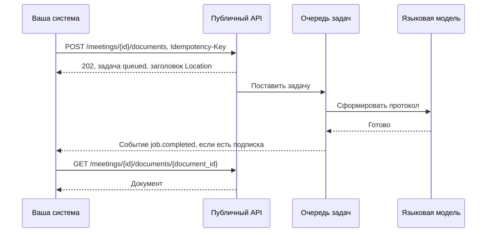
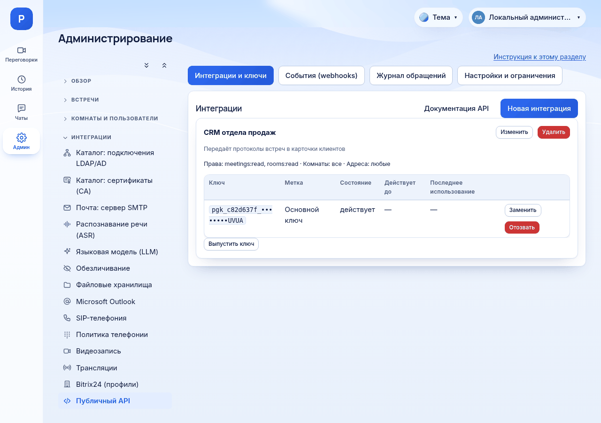

# Как использовать публичный API

*Для кого: интегратор и администратор сервера.*

## Зачем это нужно

Публичный API даёт вашим системам доступ к данным Peregovorka по ключу: комнаты, встречи, участники, стенограммы, протоколы, карты, чат, сведения об аудиозаписях. Можно также заказать протокол и завершить встречу. Изменять и удалять встречи, протоколы и записи через API нельзя.

## Когда пригодится

- CRM или система задач забирает протокол после встречи.
- Хранилище знаний собирает стенограммы.
- Учётная система считает встречи и участников.

Все методы, права и коды ошибок: [Справочник: публичный API](Справочник-публичный-API). Чтобы не опрашивать сервер, подключите [webhook](Как-использовать-webhook).

## Как это устроено



Запрос проходит проверки по порядку: подлинность ключа, состояние ключа и интеграции, разрешённый адрес, право, ограничение частоты. Об отозванном ключе или запрещённом адресе сервер сообщает только тому, кто предъявил верный секрет.

## Что потребуется

- Права администратора сервера, чтобы включить API и выпустить ключ. Интеграция сама ключи не выпускает.
- Базовый адрес: `https://meet.example.org/api/public/v1`.
- HTTPS. Ключ передаётся только в заголовке `Authorization`, в адресе запроса не принимается.
- Для заказа протокола: настроенная [языковая модель](Как-настроить-языковые-модели).

По умолчанию API выключен.

## Где найти

**Администрирование → Интеграции → Публичный API**. На странице четыре вкладки: **Интеграции и ключи**, **События (webhooks)**, **Журнал обращений**, **Настройки и ограничения**. Кнопка **Документация API** открывает справочную страницу сервера.

## Как это сделать

### Подключите интеграцию

1. Откройте вкладку **Настройки и ограничения**, отметьте **Публичный API включён** и сохраните.
2. Откройте вкладку **Интеграции и ключи** и нажмите **Новая интеграция**.
3. Заполните **Название**, например «CRM».
4. В блоке **Права** отметьте только нужное. Для чтения стенограмм: `rooms:read`, `meetings:read`, `transcripts:read`.
5. В блоке **Комнаты** оставьте **Все комнаты (в том числе созданные позже)** или выберите конкретные.
6. Если система обращается с постоянных адресов, заполните **Разрешённые адреса (необязательно)**: по одному адресу или сети на строку.
7. Нажмите **Сохранить**.
8. На карточке интеграции нажмите **Выпустить ключ**.
9. Скопируйте ключ из окна **Ключ выпущен** и сохраните как пароль. Он показывается один раз. Формат: `pgk_<8 символов>_<43 символа>`. Нажмите **Я сохранил ключ**.



### Проверьте ключ

```bash
export PG_URL=https://meet.example.org/api/public/v1
export PG_KEY=pgk_xxxxxxxx_...            # ваш ключ
curl -s -H "Authorization: Bearer $PG_KEY" "$PG_URL/me"
```

В ответе будут название интеграции, права и область комнат. `GET /me` не требует отдельного права.

### Получите завершённые встречи

```bash
curl -s -H "Authorization: Bearer $PG_KEY" "$PG_URL/meetings?state=ended&limit=2"
```

Новые встречи идут первыми. Для следующей страницы передайте `after=<next_cursor>`. Когда `next_cursor` равен `null`, страниц больше нет. Отбор: `room_id`, `state` (`active` или `ended`), `started_after`, `started_before`.

### Получите стенограмму

```bash
export MTG=mtg_...                        # идентификатор из предыдущего ответа
curl -s -H "Authorization: Bearer $PG_KEY" "$PG_URL/meetings/$MTG/transcript?limit=100"
curl -s -H "Authorization: Bearer $PG_KEY" "$PG_URL/meetings/$MTG/transcript?format=srt" -o talk.srt
```

Форматы: `json` с курсором, `txt`, `md`, `vtt`, `srt`.

### Закажите протокол

1. Дайте интеграции права `protocols:generate`, `jobs:read`, `protocols:read`.
2. Если нужно событие о готовности, создайте подписку на `job.completed`: [Как использовать webhook](Как-использовать-webhook).
3. Поставьте задачу с ключом идемпотентности. Он защищает от второго протокола при повторе запроса:

   ```bash
   curl -s -X POST "$PG_URL/meetings/$MTG/documents" \
     -H "Authorization: Bearer $PG_KEY" -H "Content-Type: application/json" \
     -H "Idempotency-Key: crm-order-42" \
     -d '{"kind": "protocol", "instruction": "Только решения и поручения"}'
   ```

4. Ответ `202 Accepted` содержит задачу со статусом `queued` и заголовки `Location` и `Retry-After`.
5. Дождитесь `job.completed` или опрашивайте `GET /jobs/{id}` с паузой.
6. Возьмите `document_id` из поля `result` и прочитайте документ:

   ```bash
   curl -s -H "Authorization: Bearer $PG_KEY" "$PG_URL/meetings/$MTG/documents/pro_...?format=md"
   ```

Встреча должна быть завершена. У одной интеграции может быть не более 5 незавершённых задач.

### Обрабатывайте ограничения

При ответе `429` подождите столько секунд, сколько указано в заголовке `Retry-After`, и повторите запрос. Значения по умолчанию, в запросах в минуту на одну интеграцию:

| Класс | По умолчанию | Настройка |
| --- | --- | --- |
| чтение | 600 | **Чтение** |
| изменения | 120 | **Изменения** |
| запуск формирования документов | 10 | **Запуск генерации** |
| ссылки и скачивание | 30 | **Скачивание** |

Это настройки защиты от перегрузки, а не измеренная пропускная способность сервера.

## Что получится

Система получает данные по ключу. Обращения видны на вкладке **Журнал обращений**: время, ключ, запрос, статус, длительность, адрес и код ошибки. Заголовки и тела запросов не сохраняются. Журнал хранится 30 дней, срок меняется в **Хранить журнал обращений**.

Проверено автоматическими тестами сервера. Интеграция с конкретной внешней системой на вашей стороне проверяется вами.

## Обслуживание ключей

- **Заменить** выпускает новый ключ. Прежний работает ещё 24 часа, затем перестаёт действовать.
- **Отозвать** прекращает действие ключа сразу.
- **Изменить** меняет права, комнаты и адреса, снятие отметки **Интеграция включена** останавливает все её ключи.
- **Удалить** удаляет интеграцию и ключи, для подтверждения нужно ввести название. Журнал обращений сохраняется до конца срока хранения.

## Если не получается

| Код | Причина | Что сделать |
| --- | --- | --- |
| 503 `api_disabled` | API выключен | включите **Публичный API включён** |
| 401 `unauthorized` | нет заголовка | передайте `Authorization: Bearer pgk_…` |
| 401 `invalid_api_key` | ключ неверен | проверьте ключ; ответ одинаков для неверного секрета и несуществующего ключа |
| 401 `key_revoked`, `key_expired` | ключ отозван или срок замены истёк | выпустите новый |
| 403 `insufficient_scope` | не хватает права | поле `required_scope` называет право; добавьте его интеграции |
| 403 `ip_not_allowed` | адрес не разрешён | дополните **Разрешённые адреса**. За прокси проверьте [определение адреса клиента](Как-настроить-reverse-proxy-и-HTTPS) |
| 404 `not_found` | объекта нет или он вне области комнат | проверьте идентификатор и блок **Комнаты** |
| 409 `meeting_not_ended` | встреча идёт | дождитесь завершения |
| 409 `llm_not_configured` | языковая модель не настроена | настройте модель |
| 409 `anonymizer_not_configured` | в комнате включено обезличивание, а служба не готова | см. [Как настроить обезличивание](Как-настроить-обезличивание) |
| 409 `no_materials` | нет реплик, чата и схемы | формировать не из чего |
| 429 `too_many_jobs` | 5 незавершённых задач | дождитесь завершения или отмените лишние |

Если на сервере включены [доверенные подсети](Как-настроить-безопасность-входа), API тоже ограничивается ими. Чтобы исключить его, отметьте **Не ограничивать публичный API (у ключей свои списки адресов)** в **Администрирование → Безопасность → Доверенные подсети**.

В ответе об ошибке есть `request_id`. Он же в заголовке `X-Request-ID`. Сообщите его администратору.

## Что дальше

- [Справочник: публичный API](Справочник-публичный-API).
- [Как использовать webhook](Как-использовать-webhook).
- [Маршрут интегратора](Маршрут-интегратора).
- [Журнал аудита и события](Справочник-журнал-аудита-и-события).
