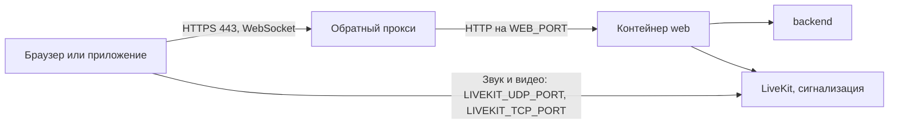

# Как настроить reverse proxy и HTTPS

*Для кого: администратор сети и администратор сервера.*

## Зачем это нужно

Браузер даёт доступ к микрофону, камере и экрану только на странице, открытой по HTTPS. Поэтому Peregovorka всегда публикуется по HTTPS. Обратный прокси (reverse proxy) принимает запросы пользователей на порту 443 и передаёт их приложению. На нём завершается шифрование.

## Когда пригодится

- Сервер стоит за корпоративным прокси, WAF или балансировщиком.
- Сервер общий, и один nginx обслуживает несколько сайтов.
- Нужно разрешить вход по второму адресу.
- Пользователи видят «Недопустимый Origin» или не подключаются к звонку.

## Как это устроено

Прокси передаёт страницу, API и сигнализацию. Звук и видео через него не идут: клиенты подключаются к серверу звонков напрямую.



Настройка на внешнем прокси с настоящей нагрузкой не измерялась. Требования ниже взяты из конфигурации `frontend/nginx.conf` и шаблонов `deployment/nginx/*.tpl`.

## Что потребуется

- DNS-имя, например `meet.example.org`, указывающее на обратный прокси (`shared-host`) или на сервер (`standalone`).
- Сертификат, выданный доверенным центром, с полной цепочкой. Подробно о выпуске и замене: [Как настроить сертификаты](Как-настроить-сертификаты).
- Доступ к настройкам прокси и к файлу `.env` на сервере.

## Где найти

- Файл `.env`: `APP_PUBLIC_URL`, `LIVEKIT_PUBLIC_URL`, `ALLOWED_ORIGINS`, `NGINX_TLS_CERT`, `NGINX_TLS_KEY`.
- **Администрирование → Безопасность → Сеть и IP-адреса (прокси, WAF)**: как определяется адрес клиента.
- **Администрирование → Система → Сетевая доступность**: перечень портов.

## Как это сделать

### Выберите схему публичного адреса

| Схема | `APP_PUBLIC_URL` и `LIVEKIT_PUBLIC_URL` | Сертификат | Звонки |
| --- | --- | --- | --- |
| Корпоративный домен за внешним прокси (рекомендуется) | `https://meet.example.org` и `wss://meet.example.org/livekit` | выдан доверенным центром, TLS завершает прокси | ничего на устройствах добавлять не нужно |
| Свой центр сертификации | то же имя | сертификат корпоративного центра | центр должен быть доверен на устройствах |
| Доступ по IP | `https://192.0.2.10` и `wss://192.0.2.10/livekit` | обычно самоподписанный (создаёт установщик) | **устройство должно доверять сертификату**, иначе звонки не подключатся; рекомендуется перейти на имя |

Свой сертификат на nginx установщика (`standalone`): задайте `NGINX_TLS_CERT` и `NGINX_TLS_KEY` в `.env` и выполните команду:

```bash
sudo scripts/install.sh --profile standalone --from nginx
```

### Выполните требования к прокси

| Требование | Что будет, если нарушено |
| --- | --- |
| WebSocket Upgrade для `/livekit/` и `/api/v1/ws` | комната не подключается, нет реплик (проба даёт `400` или `426` вместо `101`) |
| Заголовки `Upgrade` и `Connection: upgrade` передаются, HTTP/1.1 к бэкенду, таймаут чтения не менее 1 часа | встречи рвутся через минуту |
| `Host` сохраняется, `X-Forwarded-For` добавляется, `X-Forwarded-Proto` передаётся как есть (`https`) | ошибки входа и CSRF, смешанное содержимое |
| Путь `/livekit/` передаётся без изменений | 404 на `/rtc/v1`, медленный вход |
| Для `/livekit/` и `/api/v1/ws`: без буферизации (`proxy_buffering off`, `proxy_request_buffering off`) и `tcp_nodelay on` | лишние десятки–сотни миллисекунд на сообщение |
| Медиа не проксируется: клиенты идут напрямую на `LIVEKIT_NODE_IP` по `LIVEKIT_TCP_PORT/tcp` и `LIVEKIT_UDP_PORT/udp` | страница открывается, но нет звука и видео |
| Прокси не требует входа для `/guest/*`, `/api/v1/guest/*`, `/api/v1/ws`, `/api/v1/meetings/*`, `/livekit/`, `/drawio/` | гость не сможет войти |
| Прокси не требует входа для `/live/*`, `/hls/*`, `/llhls/*`, `/rec/template`, `/api/v1/live/*` | зритель не откроет эфир, запись и трансляция не получат страницу |
| Прокси не требует входа для `/cdn-origin/*`, если есть [узлы CDN](Узлы-CDN) | узел не получит видео от источника |
| Для `/api/public/` прокси не вырезает заголовок `Authorization` | интеграции получают `401 unauthorized` |

Пример для nginx: `proxy_http_version 1.1; proxy_set_header Upgrade $http_upgrade; proxy_set_header Connection "upgrade"; proxy_read_timeout 3600s;`. Готовые блоки `location` лежат в `deployment/nginx/*.tpl`. Для Apache нужен `mod_proxy_wstunnel`. Caddy и Traefik пропускают WebSocket автоматически. В Nginx Proxy Manager включите «Websockets Support». Эти варианты описаны по документации прокси и в проекте не проверялись.

### Проверьте WebSocket

```bash
scripts/smoke-test.sh

curl -i -N --http1.1 -H 'Connection: Upgrade' -H 'Upgrade: websocket' -H 'Sec-WebSocket-Version: 13' \
     -H 'Sec-WebSocket-Key: dGhlIHNhbXBsZSBub25jZQ==' 'https://meet.example.org/livekit/rtc?access_token=ТОКЕН'
```

Ожидаемый результат: `HTTP/1.1 101`, без токена `401`. Маршрут `/rtc/v1` без параметров отвечает `400 join_request is required`, это норма. Ответ `404` указывает на устаревший LiveKit.

### Разрешите дополнительные адреса

Браузер присылает заголовок `Origin`. Сервер сверяет его со списком: `APP_PUBLIC_URL` плюс `ALLOWED_ORIGINS`. Страница, открытая по другому адресу (например, через IP или SSH-туннель), получает «Недопустимый Origin» (HTTP 403, WebSocket закрывается кодом 4403).

1. Найдите отклонённый адрес:

   ```bash
   ./scripts/logs.sh backend --tail 500 | grep "Origin отклонён"
   ```

2. В `.env` задайте основной адрес и, при необходимости, дополнительные:

   ```bash
   APP_PUBLIC_URL=https://meet.example.org
   ALLOWED_ORIGINS=https://meet.example.org,https://192.0.2.10
   ```

3. Примените изменения: `./scripts/ctl.sh restart backend`.

Проверка Origin и CSRF остаются включёнными; список лишь расширяет разрешённые адреса. Подстановок `*` нет. Заголовки `X-Forwarded-Host` и `X-Forwarded-Proto` в проверке Origin не доверяются. Cookie привязаны к хосту: у каждого адреса вход свой; при `COOKIE_SECURE=true` каждый адрес должен открываться по HTTPS.

### Настройте определение адреса клиента

Адрес клиента определяется по `X-Forwarded-For` (или `X-Real-IP`, `Forwarded`, заголовку вашего WAF) **только от доверенных прокси**. Контейнер web сообщает backend, с какого адреса к нему подключились (`X-PG-Peer`; снаружи подделать нельзя). Если подключился узел, которого нет среди доверенных, заголовки о клиенте игнорируются: клиент, зашедший напрямую, не может выбрать «свой» адрес. Список доверенных прокси и источник адреса задаются в **Администрирование → Безопасность → Сеть и IP-адреса (прокси, WAF)** (по умолчанию значения `.env`: `TRUSTED_PROXY_CIDRS`, по умолчанию `127.0.0.0/8,::1/128`, и `TRUSTED_PROXY_HOPS`, по умолчанию 1; внешний прокси плюс nginx хоста — 2). Там же — блок «Что сервер видит сейчас»: адрес соединения, цепочка заголовков, результат и подсказки. **Прокси с публичным адресом (WAF, CDN) нужно добавить в доверенные**: иначе все пользователи будут выглядеть как адрес WAF, и ограничения по IP станут общими.

### Включите HSTS, если нужно

HSTS в приложении и шаблонах **не включён намеренно**: если после включения сертификат окажется недействительным, пользователи не смогут обойти предупреждение. Включайте на узле, который завершает TLS и которым вы управляете, и только после проверки цепочки:

1. Проверьте цепочку: `openssl s_client -connect meet.example.org:443 -servername meet.example.org </dev/null | openssl x509 -noout -dates -issuer`.
2. Добавьте `add_header Strict-Transport-Security "max-age=300" always;` в блок `server` с `ssl`; повторите директиву в каждом `location`, где задаёте свои заголовки.
3. Повышайте срок поэтапно: 300 секунд → сутки → неделя → 15 552 000 (6 месяцев). `includeSubDomains` нужен, только если все поддомены отдают HTTPS. `preload` не используйте.
4. Откат: значение `max-age=0` на срок прежнего значения.

Полный чек-лист: `docs/HTTPS_AND_HSTS.md` в репозитории.

### Проверьте трансляции через прокси

Адреса `/hls/…` проходят через ваш прокси к контейнеру web как обычные запросы; ничего особенного не требуется, но:

- не включайте для `/hls/` сжатие (gzip/brotli): видео уже сжато, а плейлист мал;
- не задавайте собственное кэширование: заголовки `Cache-Control` ставит nginx контейнера web (плейлист — 1 секунда, сегменты — 5 минут);
- оставьте буферизацию ответа выключенной или умеренной и не ограничивайте скорость на канал: поток читается в реальном времени;
- в журнал вашего прокси попадают адреса вида `/hls/<доступ>/<срок>/<подпись>/…`: подпись действует ограниченное время, но не публикуйте такие журналы.

То же относится к `/llhls/`, эфиру с малой задержкой. Шаблоны nginx хоста отдельного правила для него не имеют: запрос идёт в общий блок `location /` с таймаутом 120 секунд. Влияет ли это и буферизация внешнего прокси на задержку, не проверялось. Если задержка эфира выше ожидаемой, отключите буферизацию для `/llhls/`. Подробнее: [Качество эфира](Качество-эфира).

## Что получится

- Страница открывается по `https://meet.example.org`, в браузере нет предупреждений о сертификате.
- `scripts/smoke-test.sh` завершается без ошибок.
- Тестовый звонок двух участников идёт со звуком и видео.
- Гость входит по ссылке, зритель открывает эфир.
- В **Сеть и IP-адреса (прокси, WAF)** блок **Что сервер видит сейчас** показывает ваш настоящий адрес.

## Если не получается

| Что видно | Причина и что сделать |
| --- | --- |
| `ERR_CONNECTION_RESET` при входе в комнату через VPN | слишком большой MTU адаптера VPN (помогало `MTU=1250`); Windows: `netsh interface ipv4 set subinterface "<адаптер>" mtu=1250 store=persistent` |
| Звонок «подключается» бесконечно | закрыты `LIVEKIT_UDP_PORT/udp` и `LIVEKIT_TCP_PORT/tcp` или неверный `LIVEKIT_NODE_IP` |
| Ошибка WebSocket при открытой странице | устройство не доверяет сертификату, VPN-маршрут |
| «Недопустимый Origin» | адрес не в `APP_PUBLIC_URL` и `ALLOWED_ORIGINS` |
| Все пользователи видны с одного адреса, блокировка задевает всех | прокси не в доверенных: добавьте его в **Сеть и IP-адреса (прокси, WAF)** |
| Зритель видит запрос входа прокси | пути эфира закрыты, см. таблицу требований |
| Встречи рвутся через минуту | таймаут чтения прокси меньше часа |
| Ошибка входа, смешанное содержимое | неверный `X-Forwarded-Proto` или `COOKIE_SECURE=true` на адресе без HTTPS |

## Что дальше

- [Как опубликовать сервис в интернете](Как-опубликовать-сервис-в-интернете).
- [Как настроить сертификаты](Как-настроить-сертификаты).
- [Справочник: порты и сеть](Справочник-порты-и-сеть).
- [Решение проблем HTTPS и прокси](Решение-проблем-HTTPS-и-прокси).
