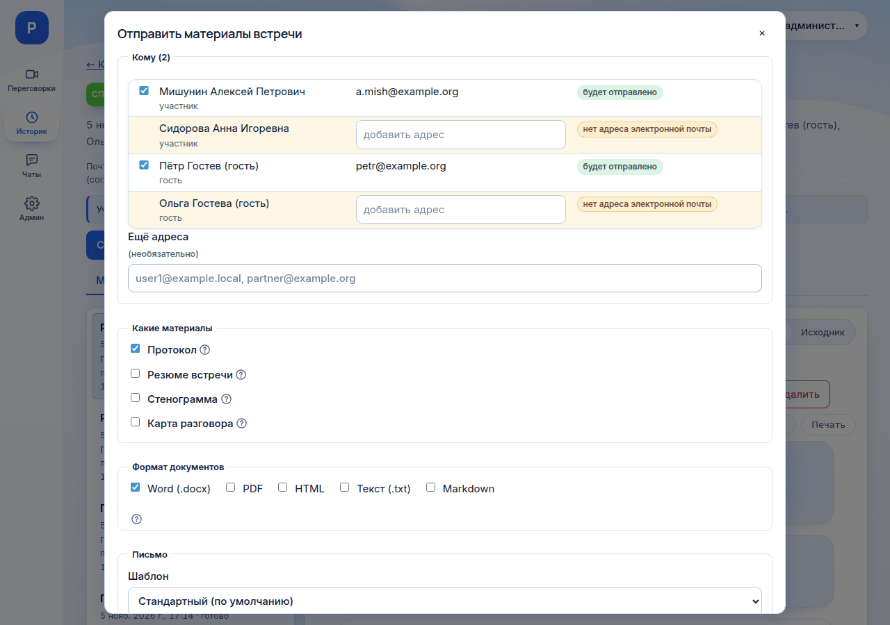

# Как отправить материалы

*Для кого: организатор встречи, руководитель комнаты, администратор.*

## Зачем это нужно

Участники по умолчанию теряют доступ к завершённой встрече, как только уходят с её страницы. Письмо с материалами оставляет им протокол, резюме, стенограмму или карту разговора. На странице встречи можно отправить их участникам и на любые другие разрешённые адреса.

## Когда пригодится

- Нужно разослать протокол всем участникам.
- Нужно отправить стенограмму человеку, который не был на встрече.
- Гость оставил почту и попросил материалы.

Автоматическая рассылка после каждой встречи настраивается отдельно: [Автоотправка материалов](Автоотправка-материалов). Здесь описана ручная отправка.

## Что потребуется

- Встреча завершена.
- Вы организатор, руководитель комнаты или администратор, и страница встречи открыта.
- Материал сформирован: [Как сформировать протокол](Как-сформировать-протокол), [Карта разговора](Карта-разговора).
- Администратор настроил исходящую почту: [Как подключить почту](Как-подключить-почту).

## Где найти

**История** → встреча → кнопка **Отправить материалы**.

## Как это сделать

1. Нажмите **Отправить материалы**. Откроется окно **Отправить материалы встречи**.

   

2. В блоке **Кому** проверьте получателей. В списке все люди встречи, с пометкой роли: руководитель, участник, гость, зритель эфира. Отметки уже поставлены: по правилу рассылки комнаты, а если его нет, то у всех, у кого есть адрес.
3. Снимите лишние отметки.
4. Если у человека нет адреса, введите его в строке, поле **добавить адрес**. Адрес действует только для этого письма.
5. В поле **Ещё адреса** впишите другие адреса через запятую, например `partner@example.org`.
6. В блоке **Какие материалы** отметьте нужное: **Протокол**, **Резюме встречи**, **Стенограмма**, **Карта разговора**. Несформированный материал помечен **не готов** и недоступен. Подсказка рядом объясняет причину.
7. В блоке **Формат документов** выберите форматы: **Word (.docx)**, **PDF**, **HTML**, **Текст (.txt)**, **Markdown**. Можно несколько. Карта всегда вкладывается отдельным HTML-файлом.
8. В блоке **Письмо** выберите **Шаблон**. **Тему** и **Текст письма** можно поправить, сам шаблон при этом не меняется. Список материалов и ссылка на встречу добавляются под текстом автоматически.
9. Нажмите **Отправить (N)**, где N: число получателей.
10. Прочитайте итог. Там указано, сколько писем поставлено в очередь и кто пропущен. Нажмите **Закрыть**.

Письма уходят в фоне, с повторами при временной ошибке почтового сервера.

### Как проверить, что письма ушли

На вкладке **Материалы встречи** ниже документов находится блок **Отправленные материалы**: когда, кто, какой шаблон, какие материалы, сколько получателей. Кнопка **Подробнее** показывает состояние по каждому адресу: **в очереди**, **отправляется**, **отправлено**, **ошибка**.

Блок видят те, кто может отправлять материалы: организатор встречи, руководитель комнаты и администратор.

### Отправить гостям и зрителям эфира

- Гость с адресом и отметкой **Присылать мне протокол и материалы встречи на этот адрес** попадает в список как обычный получатель.
- Гость без согласия или без адреса показан в списке с пояснением **гость не дал согласия получать материалы** или **нет адреса электронной почты**. Адрес без согласия в этом окне не показывается. Вы можете ввести адрес вручную, если получили разрешение от самого гостя.
- Зритель эфира попадает в список, только если указал почту и согласился получать материалы.

Почта гостей видна на странице встречи только организатору, руководителю и администратору.

## Что получится

Получатель находит письмо с вложениями. Каждая отправка записывается в журнал аудита.

Важно знать:

- **Запись по почте не отправляется.** Только документы, стенограмма и карта.
- **Большие документы не вкладываются.** Если документы вместе больше 10 МБ (значение настраивает администратор), в письме будет ссылка на страницу встречи. Откроет её только тот, у кого есть доступ. Заранее выдайте доступ через **Управление доступом** или отправьте меньше форматов.
- **Письмо не даёт доступа к остальным материалам встречи.** Доступ выдаётся отдельно: [Где найти материалы встречи](Где-найти-материалы-встречи).
- **Обезличивание.** Документ уходит таким, каким сформирован. Стенограмма в письме обезличена, если обезличивание включено в комнате. См. [Как работает обезличивание](Как-работает-обезличивание).
- **Неполный документ можно отправить вручную.** Обрезанный документ уходит с заметной пометкой о неполноте. Автоматическая рассылка такие документы не отправляет.
- **Карта разговора открывается у получателя без входа в систему.** Это отдельный файл с данными внутри.

## Если не получается

| Симптом | Причина | Что сделать |
| --- | --- | --- |
| Нет кнопки **Отправить материалы** | встреча идёт, или вы не организатор, не руководитель и не администратор | завершите встречу или попросите организатора |
| «Исходящая почта не настроена» | нет почтового сервера | обратитесь к администратору: [Как подключить почту](Как-подключить-почту) |
| Кнопка **Отправить** неактивна | не выбран получатель или материал, есть некорректный адрес, пустая тема или текст, для документов не выбран формат | заполните блоки окна |
| «домен запрещён политикой отправки» | администратор разрешил только некоторые домены; разрешённые домены показаны в подсказке | используйте разрешённый адрес или обратитесь к администратору |
| «нет адреса электронной почты» | в каталоге нет адреса | впишите адрес в строке |
| Материал помечен **не готов** | он не сформирован | сформируйте его и откройте окно снова |
| «Слишком много отправок за час» | сработало ограничение: 30 отправок в час на человека | повторите позже |
| «Слишком много получателей (не больше 300)» | превышен предел одной отправки | разделите отправку |
| В строке получателя **ошибка** | почтовый сервер отказал | причина показана в **Подробнее**; см. [Решение проблем Outlook и почты](Решение-проблем-Outlook-и-почты) |
| Получатель не открывает ссылку из письма | у него нет доступа к встрече | выдайте доступ через **Управление доступом** |

## Что дальше

- [Автоотправка материалов](Автоотправка-материалов)
- [Сценарий: получение протокола](Сценарий-Получение-протокола)
- [Где найти материалы встречи](Где-найти-материалы-встречи)
