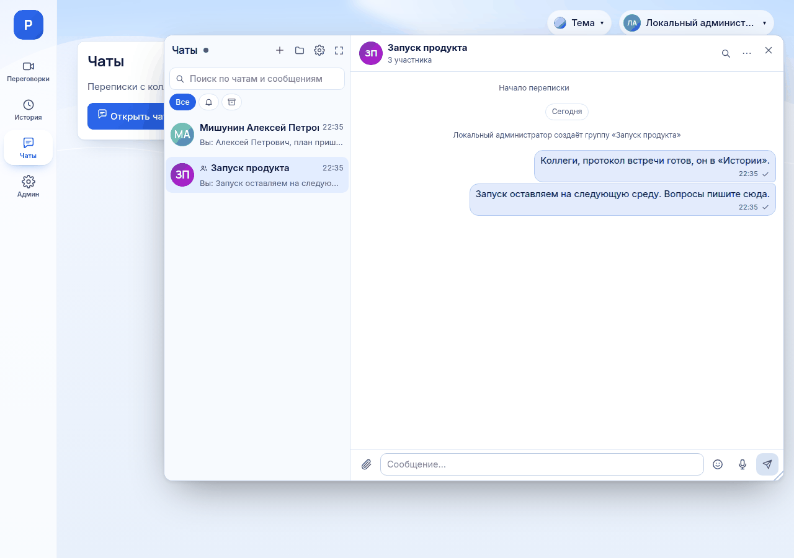

# Как отправлять сообщения и файлы в чатах

*Для кого: сотрудник.*

## Зачем это нужно

Статья показывает, как написать сообщение, приложить изображение или документ, скачать полученный файл и найти старую переписку. Общее устройство чатов, папки и диктовка описаны в статье [Как пользоваться корпоративными чатами](Как-пользоваться-корпоративными-чатами).

## Когда пригодится

- Нужно быстро передать коллеге документ или снимок экрана.
- Нужно ответить на конкретное сообщение, а не писать в общий поток.
- Вы помните слово из переписки, но не помните, где оно было.

## Что потребуется

- Вход в Peregovorka своей учётной записью. Гости корпоративными чатами не пользуются.
- Чаты включены администратором.
- Для файлов: вложения не отключены, файл подходит под [пределы вложений](Пределы-вложений).

## Где найти

Нажмите **Чаты** на панели разделов. Окно открывается поверх текущей страницы, идущая встреча не прерывается.

В приложении для Android: вкладка **Чаты** внизу экрана.

## Как это сделать

### Написать сообщение

1. Выберите переписку в списке слева. Если её нет, нажмите **Новый чат**, выберите **Личный** и найдите сотрудника.
2. Введите текст в поле **Сообщение…**.
3. Нажмите Enter или кнопку **Отправить**. Shift+Enter переносит строку.

Что можно использовать в тексте:

| Что нужно | Как ввести |
| --- | --- |
| Жирный текст | `**слово**` |
| Курсив | `_слово_` |
| Код в строке | слово в обратных апострофах |
| Блок кода | три обратных апострофа до и после текста |
| Упомянуть участника группы | начните вводить `@` и выберите человека |
| Вставить эмодзи | кнопка **Эмодзи** |

Ссылки становятся кликабельными. HTML не работает: он показывается как обычный текст.

Черновик незаконченного сообщения запоминается в браузере для каждой переписки отдельно.

### Отправить изображение или документ

1. Откройте переписку.
2. Добавьте файл одним из способов:
   - нажмите **Прикрепить файл** и выберите файл;
   - перетащите файл в область ввода;
   - вставьте снимок экрана из буфера обмена сочетанием Ctrl+V.
3. Дождитесь, пока рядом с именем файла появится его размер. Многоточие означает, что файл ещё загружается.
4. Если нужно, допишите текст. Лишний файл уберите крестиком рядом с его именем.
5. Нажмите **Отправить**.

Пока файл загружается, кнопка отправки недоступна. Загруженный, но не отправленный файл сервер удаляет примерно через 2 часа.

### Посмотреть и скачать файл

- **Изображение** показывается прямо в сообщении. Нажмите на него, чтобы открыть крупно.
- **Документ** показывается строкой с именем, размером и типом. Нажмите на строку, файл скачается.
- Подпись **файл недоступен** означает, что файла больше нет в хранилище.

Открыть файл может только участник переписки. Публичных ссылок на вложения нет.

### Ответить, изменить, удалить

Откройте меню сообщения: щёлкните правой кнопкой мыши или наведите указатель и нажмите **Ещё**. На сенсорном экране нажмите на сообщение.

| Пункт | Что делает | Кому доступен |
| --- | --- | --- |
| **Реакция** | ставит эмодзи | всем участникам |
| **Ответить** | добавляет цитату к вашему сообщению | всем участникам |
| **Скопировать текст** | копирует текст сообщения | всем участникам |
| **Переслать** | отправляет текст в другую вашу переписку | всем участникам, если в сообщении есть текст |
| **Изменить** | открывает текст для правки | только автору |
| **Доставка и прочтение** | показывает, кто прочитал | только автору |
| **Удалить** | удаляет сообщение у всех вместе с вложениями | только автору |

Клавиша ↑ в пустом поле ввода открывает на правку ваше последнее сообщение.

### Найти сообщение

**По всем перепискам:**

1. Введите не меньше двух знаков в поле **Поиск по чатам и сообщениям** над списком.
2. Выберите результат. Поиск находит переписки, сотрудников и сообщения.

**Внутри одной переписки:**

1. Нажмите значок поиска в заголовке переписки или выберите **Поиск по сообщениям** в меню.
2. Введите слово. Точную фразу возьмите в кавычки: «итоговый отчёт».
3. При необходимости выберите **Автор** и **Даты**.
4. Переходите между совпадениями кнопками **Раньше** и **Позже** или клавишей Enter. Shift+Enter идёт в обратную сторону.

Счётчик показывает номер совпадения и общее число, например `3 из 12`. Найденные слова подсвечиваются.

## Что получится

Сообщение появляется в переписке без перезагрузки страницы, на всех ваших устройствах. Состояние своего сообщения видно рядом со временем:

| Значок или подпись | Что значит |
| --- | --- |
| часы | сообщение отправляется |
| одна галочка | доставлено |
| две галочки | прочитано |
| **не отправлено** | сообщение не ушло: нажмите **Повторить** или **Убрать** |

## Если не получается

| Что видно | Причина | Что сделать |
| --- | --- | --- |
| Окно **Файл не прикреплён** | файл больше предела или его тип не разрешён | нажмите **Понятно**, передайте файл почтой или через файлообменник организации |
| Подсказка **Вложения отключены** | администратор выключил вложения | обратитесь к администратору |
| Файл загружается, но появляется ошибка о хранилище | хранилище вложений недоступно | повторите позже, сообщите администратору |
| **Файл дошёл не целиком** или **контрольная сумма не совпала** | сеть, прокси или защитная программа изменили файл по дороге | повторите отправку; если повторяется, сообщите администратору |
| **Содержимое файла не соответствует…** | расширение не совпадает с настоящим типом файла | сохраните файл в правильном формате |
| **Слишком часто. Подождите немного.** | превышен предел сообщений в минуту | подождите и отправьте снова |
| Пункта **Переслать** нет | в сообщении только вложение | скачайте файл и отправьте его заново |
| Сотрудник не находится | учётная запись отключена или каталог недоступен | попробуйте фамилию или логин, спросите администратора |

## Что дальше

- [Как пользоваться корпоративными чатами](Как-пользоваться-корпоративными-чатами)
- [Пределы вложений](Пределы-вложений)
- [Как пользоваться чатом встречи](Как-пользоваться-чатом-встречи)
