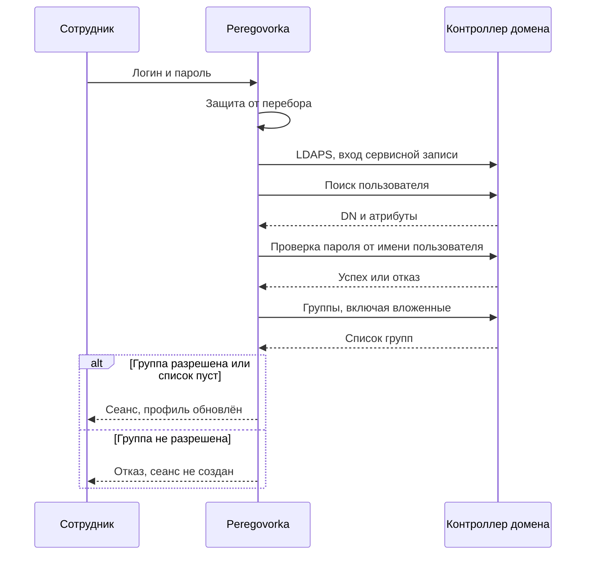

# Как подключить Active Directory

*Для кого: администратор Peregovorka и администратор домена.*

На настоящем Active Directory подключение не проверялось: в репозитории нет записи о такой проверке. Проверка шла на подставном каталоге и автоматическими тестами. Начните с тестовой группы пользователей и выполните шаги проверки на этой странице.

## Зачем это нужно

Сотрудники входят своей доменной учётной записью. Группы каталога определяют, кто может войти и кто получает права администратора. Профиль сотрудника заполняется из каталога.

## Когда пригодится

- В организации есть домен, и отдельные пароли для Peregovorka не нужны.
- Нужно ограничить вход определённой группой.
- Нужно задать администраторов системы через группу домена.

Без каталога работает только локальный администратор. Самостоятельной регистрации пользователей нет.

## Как это устроено

Peregovorka только читает каталог и не меняет его. Пароль пользователя проверяется в домене при каждом входе и в базе не хранится.

Логин принимается как `user1`, `ДОМЕН\user1` и `user1@example.org`. Подключений может быть несколько, для разных доменов. Они проверяются по порядку, а домен и суффикс в логине выбирают нужное.

Вход допускается, только если пользователь не отключён в домене. Пустой пароль отклоняется.

## Что потребуется

- LDAPS на контроллерах домена, порт 636, или глобальный каталог, порт 3269. Допустим LDAP со STARTTLS, порт 389.
- Доступ по сети с сервера Peregovorka до контроллера.
- Корневой и промежуточные сертификаты вашего удостоверяющего центра в формате PEM или DER, файл до 256 КБ. Закрытые ключи не принимаются.
- Имя контроллера в подключении должно совпадать с именем в сертификате (SAN). Проверку цепочки и имени отключить нельзя.
- Сервисная учётная запись только на чтение каталога.
- Вход локальным администратором `admin`, см. [Быстрый старт](Быстрый-старт).

## Где найти

В левой панели раздел подписан **Админ**. **Администрирование → Интеграции**: **Каталог: подключения LDAP/AD** и **Каталог: сертификаты (CA)**. **Администрирование → Комнаты и пользователи**: **Кто может входить** и **Администраторы сервера**.

## Как это сделать

### Загрузите сертификаты

1. Откройте **Администрирование → Интеграции → Каталог: сертификаты (CA)**.
2. Выберите файл `.pem`, `.crt` или `.cer` либо вставьте PEM текстом.
3. Нажмите **Разобрать сертификат**. Проверьте субъект, издателя, серийный номер, отпечаток SHA-256, срок действия и тип.
4. Нажмите **Добавить в набор**.
5. Повторите для промежуточных сертификатов.

Сертификат сервера, а не удостоверяющего центра, добавляется только с отдельным подтверждением.

### Создайте подключение

1. Откройте **Администрирование → Интеграции → Каталог: подключения LDAP/AD**.
2. Нажмите **＋ Добавить подключение**.
3. Заполните:

   | Поле | Пример |
   | --- | --- |
   | **Название** | Основной домен |
   | **Сервер (имя или IP)** | `dc1.example.org`, без схемы и слэшей |
   | **Протокол** | **LDAPS (шифрование с первого байта)** |
   | **Порт** | 636 |
   | **Домен (NetBIOS)** | `EXAMPLE` |
   | **Суффикс UPN** | `example.org` |
   | **Таймаут, с** | значение по умолчанию |
   | **Base DN** | `DC=example,DC=org` |
   | **DN или логин** | `CN=svc-read,OU=Service,DC=example,DC=org` |
   | **Пароль** | пароль сервисной записи, хранится зашифрованным |

4. В блоке **Для чего используется** отметьте **Вход пользователей** и, если нужно, **Вход администраторов**.
5. Нажмите **Сохранить и проверить**.
6. Проверка идёт по этапам: DNS, TCP, TLS (цепочка и имя), вход сервисной записи, чтение Base DN. Все этапы должны пройти. При сбое на экране будет названа причина.

Если каталог нестандартный, откройте блок **Атрибуты каталога (обычно менять не нужно)**.

### Задайте администраторов

1. Откройте **Администрирование → Комнаты и пользователи → Администраторы сервера**.
2. Введите в поиск название группы, от двух символов, и нажмите **Найти**. Либо введите DN группы вручную.
3. Нажмите **＋ Добавить**, затем **Сохранить**.

Вложенные группы учитываются. Новые права применяются при следующем входе пользователя.

### Ограничьте вход

1. Откройте **Администрирование → Комнаты и пользователи → Кто может входить**.
2. Добавьте группы в **Разрешённые группы**. Достаточно членства в одной.
3. Нажмите **Сохранить**.

**Внимание.** Пока список пуст, входит любой активный пользователь каталога. На странице в этом случае есть предупреждение **Ограничение входа не настроено**. После первой группы список становится закрытым.

Правило действует со следующей попытки входа, перезапуск не нужен. Уже открытые сеансы не прерываются. Локальный администратор, гости по ссылке и члены групп администраторов от этого списка не зависят.

### Проверьте человека

1. На странице **Кто может входить** найдите блок **Проверить пользователя**.
2. Введите логин и нажмите **Проверить**. Пароль не нужен.
3. Система покажет, найден ли пользователь, пропустят ли его, по какой группе и получит ли он права администратора. Проверяются сохранённые группы, поэтому сначала сохраните изменения.

Затем войдите настоящей учётной записью из разрешённой группы и попросите войти человека вне группы. Первый вход должен пройти, второй должен быть отклонён.

## Что получится

Сотрудники входят доменным логином и паролем. Администраторы видят раздел **Админ**. В контрольном списке на странице **Обзор** пункт **Подключение к каталогу (LDAPS)** отмечен выполненным.

## Защита учётных записей домена

Защита от перебора работает на сервере: **Администрирование → Безопасность → Защита входа от перебора**. После порога неудач по учётной записи, по умолчанию 10, попытки с незнакомых адресов перестают доходить до каталога. Сама запись не блокируется.

Пока порог не сработал, неверные пароли доходят до домена и считаются его политикой блокировки. Если порог блокировки в домене 10 или меньше, уменьшите **Неудач по учётной записи до защиты каталога**, чтобы значение стало ниже порога домена. Подробнее: [Как настроить безопасность входа](Как-настроить-безопасность-входа).

Если учётная запись заблокирована в домене, пользователь увидит «Учётная запись заблокирована в домене. Обратитесь в службу поддержки.»

## Профиль сотрудника

Профиль заполняется из каталога при каждом входе: ФИО, электронная почта (атрибут `mail`, настраивается в подключении), должность, подразделение, телефон. Фото из каталога не берётся.

Сотрудник загружает фото сам и обновляет данные кнопкой **Обновить данные из Active Directory** в личном кабинете. Какие поля он может менять сам, задаётся в **Администрирование → Комнаты и пользователи → Правка профиля**. Значение, изменённое человеком, сильнее данных каталога. Кнопка **Восстановить из LDAP** снимает правку. Дополнить профиль можно из [Bitrix24](Как-подключить-Bitrix24).

## Прежний способ: параметры в `.env`

В старых версиях каталог задавался в `.env`: `LDAP_URIS`, `LDAP_BASE_DN`, `LDAP_BIND_DN`, `LDAP_BIND_PASSWORD`, `LDAP_CA_FILE`, `LDAP_ADMIN_GROUP_DN`, `LDAP_ACCESS_GROUP_DN` и другие. Такая настройка продолжает работать как основное подключение. Если система не перенесла её сама, на странице подключений появится **Обнаружена старая конфигурация LDAP** с кнопкой **Перенести настройки**. После переноса строки `LDAP_*` можно удалить.

## Если не получается

| Что видно | Причина | Что сделать |
| --- | --- | --- |
| Этап TLS: имя не совпадает | в подключении имя или IP, которого нет в SAN | укажите имя из сертификата |
| Этап TLS: цепочка не доверена | не загружен корневой или промежуточный сертификат | загрузите в **Каталог: сертификаты (CA)** |
| Вход сервисной записи отклонён | неверный DN, логин или пароль | проверьте **DN или логин**, введите пароль заново |
| «Неверный логин или пароль.» | неверный пароль либо пользователь не найден | сервер намеренно не различает эти случаи; проверьте **Проверить пользователя** |
| Отказ по группе | пользователь не входит в разрешённые группы | добавьте его в группу; при отказе в журнале `login_denied_acl` |
| «Учётная запись заблокирована в домене…» | политика домена | разблокируйте в домене, проверьте порог защиты |
| «Слишком много неудачных попыток. Повторите позже.» | сработала защита от перебора | см. **Администрирование → Безопасность → События и блокировки** |
| «Учётная запись отключена или просрочена.» | запись отключена в домене | включите запись в домене |
| «Срок действия пароля истёк…», «Требуется сменить пароль в домене.» | политика паролей домена | смените пароль в домене; Peregovorka пароль не меняет |
| «Вход этой учётной записи ограничен политикой домена.» | ограничение времени или рабочих станций | проверьте запись в домене |
| «Служба входа временно недоступна…» | контроллер не отвечает | проверьте сеть и контроллер; локальный администратор при этом входит |
| Нет прав администратора | права применяются при следующем входе, группа не сохранена | выйдите, войдите снова, проверьте **Администраторы сервера** |
| Сотрудник не получает письма | в каталоге нет атрибута `mail` | заполните его или укажите другой атрибут |

Журнал сервера: `scripts/logs.sh backend`. Коды: `invalid_credentials`, `account_locked`, `tls_error`, `service_account_error`. Другие случаи: [Решение проблем входа и каталога](Решение-проблем-входа-и-каталога).

## Что дальше

- [Как настроить безопасность входа](Как-настроить-безопасность-входа).
- [Как подключить Bitrix24](Как-подключить-Bitrix24).
- [Как настроить переговорки и доступ](Как-настроить-переговорки-и-доступ).
- [Решение проблем входа и каталога](Решение-проблем-входа-и-каталога).
