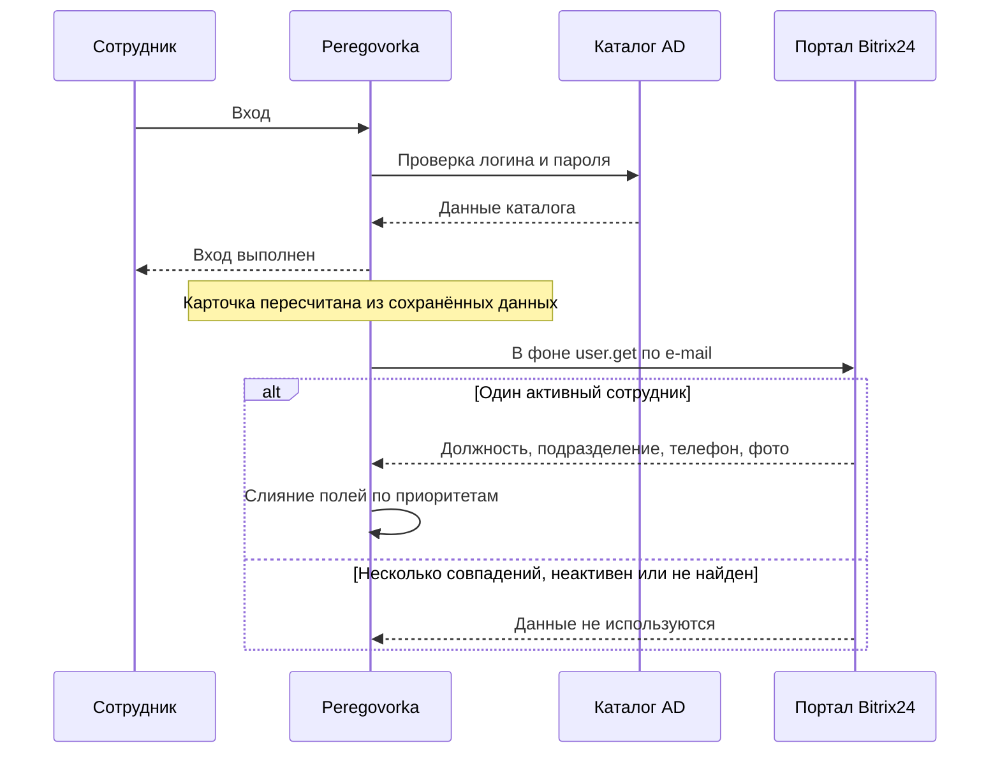

# Как подключить Bitrix24

*Для кого: администратор сервера.*

На настоящем портале Bitrix24 эта интеграция не проверялась. Она написана по документации REST Bitrix24 и проверена автоматическими тестами на подставных ответах. Поэтому подключайте её в порядке, указанном ниже: сначала диагностика, потом проверка на одном человеке, и только потом включение.

## Зачем это нужно

Peregovorka может дополнять карточку сотрудника данными портала Bitrix24: должность, подразделение, рабочий телефон, фото. Каталог Active Directory остаётся основой входа. Bitrix24 только дополняет профиль.

Запись в Bitrix24 не выполняется. CRM, календарь и уведомления портала не используются. Для событий встреч в вашу систему есть [webhook](Как-использовать-webhook) и [публичный API](Как-использовать-публичный-API).

## Когда пригодится

- В каталоге нет или устарели должности и телефоны, а портал ведётся аккуратно.
- Нужны фото сотрудников из портала.

Если каталог заполнен хорошо, интеграция не нужна.

## Как это устроено

Вход и комната от портала не зависят. При входе карточка пересчитывается по уже сохранённым данным, без обращения к сети. Запрос к порталу идёт в фоне.

Люди сопоставляются по e-mail из каталога, после первого совпадения по сохранённому номеру сотрудника Bitrix24. Если совпадений несколько, сотрудник неактивен или его нет, данные портала не используются. Учётная запись при этом работает как обычно.

Используются методы REST `user.current`, `scope`, `user.get`, `department.get`.

Данные запрашиваются в фоне не чаще срока **Обновлять данные человека не чаще** (по умолчанию 24 часа). После сбоя портала повтор не раньше чем через 10 минут. Одновременно к порталу идёт не более 3 запросов.

## Что потребуется

- Права администратора сервера Peregovorka.
- Право создавать входящий вебхук в портале Bitrix24.
- Доступ по HTTPS с сервера Peregovorka до портала.
- Совпадающие e-mail в каталоге и на портале.
- Если сертификат портала выпущен внутренним удостоверяющим центром: сертификат этого центра, добавленный на сервер, см. [Как подключить Active Directory](Как-подключить-Active-Directory).

## Где найти

**Администрирование → Интеграции → Bitrix24 (профили)**.

## Как это сделать

### На стороне Bitrix24

1. В портале откройте **Разработчикам → Другое → Входящий вебхук**.
2. Выдайте права только на чтение:
   - **Пользователи**: `user_brief` как минимум, `user_basic`, если нужны телефон и e-mail;
   - **Подразделения**: `department`, чтобы показывать название подразделения. Без этого права поле останется пустым, остальное заработает.
3. Скопируйте адрес вида `https://portal.example.org/rest/<номер>/<секрет>/`. Внутри него секрет, храните как пароль.

### На стороне Peregovorka

1. Откройте **Администрирование → Интеграции → Bitrix24 (профили)**.
2. Заполните **Адрес портала**: `https://portal.example.org`.
3. Вставьте адрес в **Входящий webhook**. Он должен принадлежать тому же узлу, что и портал.
4. Пока оставьте **Брать данные профиля из Bitrix24** выключенным.
5. В блоке **Что подтягивать** оставьте нужное: **Должность**, **Подразделение**, **Рабочий телефон**, **Фото профиля**.
6. Если сертификат портала внутренний, отметьте **Доверять корпоративному удостоверяющему центру (LDAP_CA_FILE)**.
7. Сохраните настройки.
8. Нажмите **Запустить диагностику**. Она проверяет соединение, владельца вебхука, выданные права, чтение сотрудников и подразделений. Ничего не сохраняет. Ждите итог **Интеграция готова к работе**.
9. В блоке **Проверка на одном человеке** введите логин или e-mail сотрудника, который уже входил в систему, и нажмите **Показать, что изменится**. Сверьте значения «было» и «стало». Ничего не меняется.
10. Если результат верен, отметьте **Брать данные профиля из Bitrix24** и сохраните.
11. Если нужно обновить данные сразу, нажмите **Обновить профили сейчас**. Обрабатывается до 200 человек за запуск, самые недавние по входу. Эта кнопка работает только при включённой интеграции.

Есть ещё две проверки:

- **Проверить подключение** показывает, от чьего имени создан вебхук.
- **Показать, что вернёт портал** ищет сотрудника по e-mail и ничего не сохраняет.

### Приоритеты полей

Для каждого поля задаётся порядок источников через запятую: `ad` каталог, `bitrix` портал, `local` то, что человек указал сам. Берётся первый источник с заполненным полем. Пустое значение не стирает прежнее.

| Поле | Подпись | По умолчанию |
| --- | --- | --- |
| ФИО | **ФИО** | `ad, bitrix, local` |
| Электронная почта | **E-mail** | `ad, bitrix, local` |
| Должность | **Должность** | `bitrix, ad, local` |
| Подразделение | **Подразделение** | `bitrix, ad, local` |
| Телефон | **Телефон** | `bitrix, ad, local` |
| Фото | **Фото** | `local, bitrix, ad` |

Фото, загруженное самим человеком, портал не заменяет, пока `local` стоит раньше `bitrix`. Правка пользователя в личном кабинете сильнее любой синхронизации.

## Что получится

После входа сотрудника или ручного обновления в его карточке появятся данные портала. Фото приводится к квадрату 256×256 и хранится на вашем сервере. Секрет вебхука хранится зашифрованным, не возвращается в интерфейс и не пишется в журналы.

## Безопасность

- Только чтение, запись в портал не выполняется.
- Фото скачивается только с узла портала, без редиректов, не больше 5 МБ, только изображения. Картинка перекодируется.
- Адреса loopback и link-local, включая метаданные облака, не принимаются.
- `http://` работает только при **Разрешить небезопасный http://**. Это настройка для изолированных тестов: секрет пойдёт без шифрования.
- Массовая синхронизация и обновление одного человека пишутся в журнал аудита как `bitrix24.sync` и `bitrix24.sync_user`.

## Если не получается

| Что видно | Причина | Что сделать |
| --- | --- | --- |
| «Для включения укажите адрес портала и webhook» | поле пустое | заполните оба поля |
| Сообщение о сертификате | внутренний удостоверяющий центр | отметьте **Доверять корпоративному удостоверяющему центру (LDAP_CA_FILE)**, проверьте файл на сервере |
| Портал не ответил за отведённое время | сеть или межсетевой экран | проверьте доступ с сервера, увеличьте **Таймаут запроса к порталу** |
| «портал перенаправляет запрос» | неточный адрес | укажите точный адрес с `https` |
| «портал вернул не JSON» | страница защиты или не тот адрес | проверьте адрес вебхука |
| «у вебхука нет права на этот метод» | не хватает права | добавьте **Пользователи** и **Подразделения** в настройках вебхука |
| «На портале несколько активных сотрудников с таким e-mail» | дубль | исправьте данные на портале |
| «На портале нет сотрудника с таким e-mail» | адреса различаются | сверьте e-mail в каталоге и на портале |
| Должность есть, подразделения нет | нет права `department` | выдайте право вебхуку |
| Фото не меняется | у человека своё фото и `local` выше `bitrix` | это ожидаемо; при необходимости измените приоритет **Фото** |
| **Обновить профили сейчас** даёт отказ | интеграция выключена | сначала включите её |

События пишутся в **Администрирование → Хранение и журналы → Журнал событий**, категория `profile`: `bitrix_profile_refresh_failed`, `bitrix_photo_rejected`, `bitrix_sync_done`.

## Что дальше

- [Как подключить Active Directory](Как-подключить-Active-Directory): основной источник учётных записей.
- [Как использовать публичный API](Как-использовать-публичный-API).
- [Что проверено](Границы-проверки).
