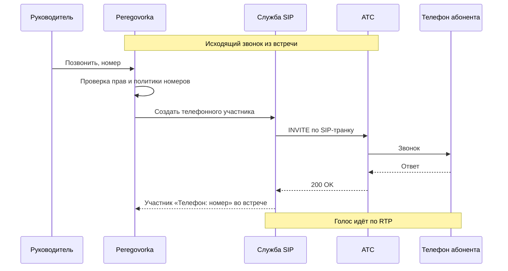

# Как подключить SIP-телефонию

*Для кого: администратор сервера и инженер АТС.*

С настоящей АТС звонок не проверялся. Проверены автоматические тесты на подставном сервере звонков и живой сценарий интерфейса в браузере. Служба телефонии запускалась, отвечала на запросы и выполняла исходящую попытку, но настоящего разговора через АТС не было. При первом подключении пройдите проверку из раздела «Что получится».

## Зачем это нужно

Телефонный абонент может позвонить в комнату, а руководитель может позвонить абоненту из комнаты. Абонент виден среди участников как «Телефон: +7000…». Его речь попадает в стенограмму и запись так же, как речь других участников.

Телефония необязательна. По умолчанию служба не запущена и порты не открыты.

## Когда пригодится

- Участник в дороге и может подключиться только по телефону.
- В комнате есть внутренний номер, на который звонят коллеги с офисных аппаратов.
- Нужно быстро подключить внешнего эксперта звонком из встречи.

## Как это устроено



Для входящего звонка на время идущей встречи создаётся правило «внутренний номер → комната». После встречи правило удаляется. Когда встречи нет, входящий звонок отклоняется.

Используется собственная служба LiveKit SIP в контейнере `livekit-sip` рядом с сервером звонков. Внешних облачных сервисов нет. Служба не регистрируется на АТС как телефон: это SIP-транк между сервером и АТС. SIP-профиль в интерфейсе равен такому транку.

## Что потребуется

- АТС с SIP-транком. Примеры ниже для Asterisk с PJSIP. Другие АТС подходят по модели обычного SIP-транка, но проверены не были.
- Окно вне рабочего времени. Включение и выключение перезапускает сервер звонков: идущие звонки прерываются на несколько секунд.
- Адрес сервера Peregovorka, видимый из сети АТС. За NAT его нужно проверить отдельно.
- Порты только для адресов АТС:

  | Назначение | Порты | Кому нужны |
  | --- | --- | --- |
  | Сигнализация SIP | `SIP_SIGNALING_PORT`, по умолчанию 5060, UDP и TCP | только АТС |
  | Голос RTP | `SIP_RTP_START`–`SIP_RTP_END`, по умолчанию 20000–20100, UDP | только АТС |

  Браузеры эти порты не используют. Одному звонку нужна пара портов RTP. Для большего числа одновременных звонков расширьте `SIP_RTP_END`.
- Комната со сквозным шифрованием и телефония несовместимы. Сервер не даст включить одно при включённом другом.

## Где найти

- **Администрирование → Интеграции → SIP-телефония**: состояние, профили, проверки.
- **Администрирование → Интеграции → Политика телефонии**: ограничения и журнал вызовов.
- Настройки комнаты, вкладка **Телефония**: профиль и внутренний номер комнаты.

## Как это сделать

### Включите службу

1. Откройте **Администрирование → Интеграции → SIP-телефония**.
2. В блоке **Состояние** нажмите **Установить и включить** и подтвердите. Либо выполните на сервере:

   ```bash
   sudo scripts/sip.sh enable
   scripts/sip.sh status
   ```

3. При необходимости задайте в `.env`: `SIP_BIND_ADDR` (для внутренней АТС укажите внутренний адрес сервера), `SIP_MEDIA_IP` (адрес для голоса за NAT), `SIP_ALLOWED_CIDRS` (подсети АТС), `SIP_SIGNALING_PORT`, `SIP_RTP_START`, `SIP_RTP_END`.

### Откройте порты

Межсетевой экран сам не меняется. Внутреннюю АТС в интернет не публикуйте.

```bash
sudo scripts/sip.sh firewall           # показать правила ufw
sudo scripts/sip.sh firewall --apply   # создать правила только для SIP_ALLOWED_CIDRS
```

Без `SIP_ALLOWED_CIDRS` скрипт откажется работать.

### Создайте SIP-профиль

1. На странице **SIP-телефония** нажмите **＋ Добавить SIP-профиль**.
2. Заполните **Название** и отметьте **Профиль включён** и, если нужно, **Профиль по умолчанию**.
3. В блоке **Подключение к АТС** заполните:
   - **Адрес АТС (SIP host)**: имя или IP без схемы;
   - **Порт** и **Транспорт**: `udp`, `tcp` или `tls`;
   - **Направление**: **Двусторонний (входящие и исходящие)**, **Исходящий (комната звонит на телефоны)** или **Входящий (на телефоны комнат звонят с АТС)**;
   - **Логин** и **Пароль**, если АТС их требует. Если АТС принимает транк по IP, оставьте пустыми;
   - **Caller ID / номер**: с какого номера звонит комната.
4. В блоке **Номера и адреса** заполните:
   - **Допустимые номера назначения**: префиксы через запятую, пусто значит любые. Это защита от случайных и платных звонков;
   - **Разрешённые адреса АТС для входящих**: IP или подсети. Для входящих заполняйте всегда.
5. При необходимости откройте **Кодеки, шифрование и время ожидания**.
6. Нажмите **Сохранить**. Профиль сам синхронизируется со службой как транк.

<!-- снимок: форма SIP-профиля, Админ → Интеграции → SIP-телефония -->

### Настройте АТС

Кнопка **Инструкция по подключению АТС** выдаёт готовые параметры по настройкам вашего сервера и текст для инженера АТС. Пример для Asterisk PJSIP, где `192.0.2.20` это адрес сервера Peregovorka, видимый из АТС:

```ini
[peregovorka]
type=endpoint
transport=transport-udp
context=from-peregovorka
disallow=all
allow=ulaw,alaw,g722
aors=peregovorka
direct_media=no

[peregovorka]
type=aor
contact=sip:192.0.2.20:5060

[peregovorka]
type=identify
endpoint=peregovorka
match=192.0.2.20
```

В `extensions.conf` направьте внутренний номер комнаты на `PJSIP/peregovorka`.

### Проверьте подключение

1. На карточке профиля нажмите **Проверить настройки**. Проверяются значения профиля, DNS, ответ АТС на SIP OPTIONS, транки, служба и порт.
2. Если транков нет, нажмите **Синхронизировать**.
3. Введите свой номер в поле тестового вызова и нажмите **Тестовый вызов**.
4. Кнопка **Проверить подключение** вверху страницы ведёт по шагам: настройки, служба, АТС, тестовый вызов, звук.

### Настройте комнату

1. Откройте настройки комнаты, вкладку **Телефония**.
2. Выберите **Использовать SIP-профиль по умолчанию** или **Конкретный SIP-профиль**.
3. Отметьте **Разрешить исходящие звонки** и **Разрешить входящие звонки**.
4. Для входящих укажите **Внутренний номер комнаты**: 2–16 цифр, у каждой комнаты свой.
5. При желании добавьте **Сохранённые номера**, до 30.
6. Сохраните.

Во время встречи руководитель открывает окно **Позвонить**, вводит номер или выбирает сохранённый.

### Задайте ограничения

В **Администрирование → Интеграции → Политика телефонии** можно задать:

| Настройка | Значение | По умолчанию |
| --- | --- | --- |
| **Кто может звонить из комнат** | руководители и администраторы или только администраторы | см. форму |
| **Запрещённые направления** | префиксы, куда нельзя звонить ни из одной комнаты | пример `00, 810` |
| **Одновременных телефонных вызовов** | на весь сервер, входящие и исходящие вместе, 0 без ограничения | пример 10 |
| **Предельная длительность вызова** | минут, 0 без ограничения | пример 120 |
| **Неудачных вызовов до блокировки** | за окно подсчёта, 0 выключает защиту | пример 5 |
| **Скрывать середину номера в журнале** | `+7••••••1234` | см. форму |
| **Хранить журнал вызовов** | дней | пример 365 |

Значения вместимости здесь это настройки. Сколько звонков реально выдержит сервер, не измерялось.

## Что получится

После первого подключения проверьте вручную и запишите результат:

1. Исходящий звонок соединяется.
2. Входящий звонок на внутренний номер попадает в идущую встречу.
3. Звук слышен в обе стороны.
4. Реплика абонента появляется в стенограмме.
5. После встречи входящий звонок на этот номер отклоняется.
6. Если сервер за NAT, повторите проверку голоса.

## Безопасность

- Пароль транка хранится зашифрованным и не попадает в журналы.
- Звонки пишутся в журнал аудита, номер частично скрыт.
- Профили настраивает только администратор.
- Входящий TLS на порту 5061 в поставляемой конфигурации не настроен. Исходящие по TLS работают по настройке, с настоящей АТС это не проверялось.

## Если не получается

| Что видно | Причина | Что сделать |
| --- | --- | --- |
| 401, 403 | неверный логин или пароль, нет прав | сверьте с настройкой АТС |
| 404 | нет маршрута к номеру | проверьте план набора АТС |
| 408 | АТС не ответила | проверьте адрес, порт, межсетевой экран |
| 480 | абонент недоступен | повторите позже |
| 486, 600 | занято | повторите позже |
| 488 | не совпали кодеки или шифрование | сверьте кодеки и **Шифрование медиа (SRTP)** |
| 503 | АТС перегружена | обратитесь к инженеру АТС |
| Голос односторонний или пропадает | закрыт диапазон RTP или недостижимый адрес | откройте RTP, задайте `SIP_MEDIA_IP` |
| «Телефония выключена на сервере» | служба не включена | нажмите **Установить и включить** |
| «Профиль ещё не синхронизирован» | транков нет | нажмите **Синхронизировать** |
| Нельзя включить телефонию в комнате | в комнате включено сквозное шифрование | выключите его или телефонию |

Журнал службы: `scripts/logs.sh livekit-sip`. Состояние: `scripts/sip.sh status`.

## Что дальше

- [Справочник: порты и сеть](Справочник-порты-и-сеть).
- [Настройки комнаты](Настройки-комнаты).
- [Как управлять службами](Как-управлять-службами).
- [Диагностика](Диагностика).
