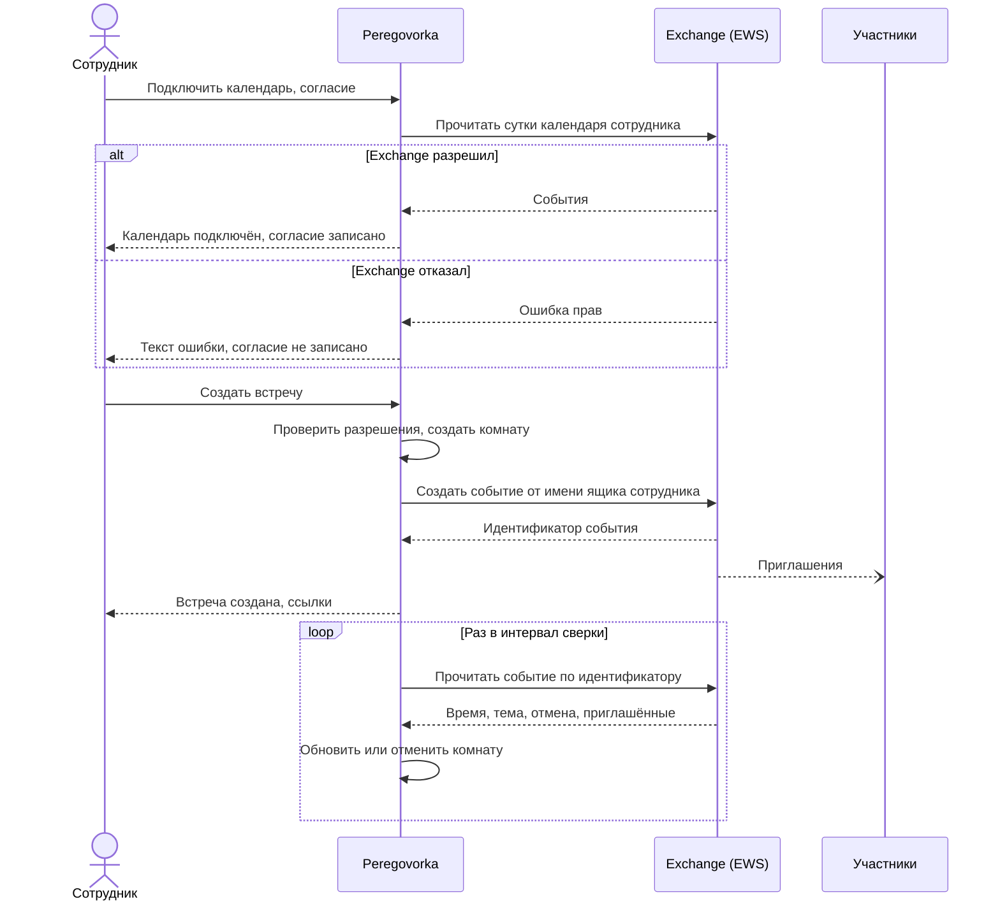

# Как подключить календарь Exchange

*Для кого: администратор Peregovorka и администратор Exchange.*

## Зачем это нужно

Здесь вы даёте серверу Peregovorka доступ к календарям. На этом доступе работают две функции:

- **Серверная сверка.** Сервер замечает перенос и отмену встречи, сделанные в Outlook, и обновляет комнату.
- **Раздел «Календарь».** Сотрудник видит свои события Outlook в Peregovorka и создаёт встречи оттуда.

Подключение к Exchange одно, второго для календаря настраивать не нужно.

> На настоящем сервере Exchange и в Microsoft 365 эта интеграция не проверялась. Запросы построены по документации Microsoft и проверены на подставных серверах. Не подтверждены права и области имперсонации, политики доступа Graph, вид рассылаемых приглашений, серии с исключениями и часовые пояса Windows в EWS. Сначала подключите один пилотный ящик.

## Когда пригодится

- Встречи переносят с телефона или через помощника, а комната должна обновляться.
- После отмены встречи ссылка не должна пускать участников.
- Сотрудники хотят видеть свои встречи и назначать новые прямо в Peregovorka.

## Что потребуется

- Включённая интеграция: [Как подключить надстройку Outlook](Как-подключить-надстройку-Outlook).
- Права администратора Peregovorka.
- Адрес почты в профиле каждого сотрудника. Он приходит из каталога, у Active Directory это атрибут `mail`.
- Для EWS: адрес сервера Exchange по HTTPS и служебная учётная запись.
- Для Microsoft 365: права на регистрацию приложения в Microsoft Entra ID и на согласие администратора.
- Сетевой доступ от сервера Peregovorka к Exchange. Для Graph нужны `login.microsoftonline.com` и `graph.microsoft.com`. Национальные облака Microsoft не поддержаны: эти адреса заданы в коде.
- Доверие к сертификату Exchange. Peregovorka проверяет его по системному хранилищу. Если сертификат выдан внутренним центром, положите корневой сертификат в файл `<DATA_ROOT>/ca/outlook-ca.pem`. Раздел **Каталог: сертификаты (CA)** для EWS не применяется.

## Как это устроено



С Microsoft Graph порядок тот же. Вместо учётной записи работает приложение Entra ID.

Сервер использует одну служебную учётную запись или приложение. Пароль сотрудника не запрашивается и не хранится.

## Какие права выдать

Успешный вход сотрудника в Peregovorka не даёт серверу прав на его ящик. Успешный вход служебной учётной записи в EWS тоже не даёт прав на чужие календари. Права проверяет сам Exchange.

| Подключение | Сверка и просмотр | Создание и изменение встреч |
| --- | --- | --- |
| Microsoft Graph | право приложения `Calendars.ReadBasic.All` с согласием администратора | ещё и право приложения `Calendars.ReadWrite` |
| EWS | роль `ApplicationImpersonation` или право «Рецензент» на календари | только `ApplicationImpersonation` |

Служебная запись с имперсонацией и приложение Graph технически могут открыть любой ящик в выданной области. Peregovorka обращается только к ящику вошедшего сотрудника и только после его согласия. Защита остальных ящиков держится на настройках Exchange, поэтому выдавайте область узко:

- для EWS задайте область управления (Management Scope);
- для Graph задайте [политику доступа приложения](https://learn.microsoft.com/en-us/graph/auth-limit-mailbox-access) на нужную группу ящиков.

Право `Calendars.ReadBasic.All` по описанию Microsoft не открывает текст события. Описание в карточке события при таком праве может быть пустым. Это не проверялось на настоящем Microsoft 365.

## Где найти

**Администрирование → Интеграции → Microsoft Outlook**:

- блок настроек **Серверная сверка календаря**;
- блок настроек **Календарь в Peregovorka**;
- карточка **Проверка доступа к календарю**.

<!-- снимок: карточка «Проверка доступа к календарю» с результатом проверки, Администрирование → Интеграции → Microsoft Outlook -->

## Как это сделать

### Вариант А. Локальный Exchange (EWS)

1. Заведите служебную учётную запись, например `svc-peregovorka`.
2. Выдайте права в Exchange Management Shell. Команды ниже взяты из документации продукта и на настоящем сервере не выполнялись, сверьте их со справкой Microsoft для вашей версии.

   Имперсонация, нужна для создания встреч. Ограничьте её областью управления:

   ```powershell
   New-ManagementRoleAssignment -Name PeregovorkaSync -Role ApplicationImpersonation -User svc-peregovorka
   ```

   Или только чтение, на календарь каждого организатора:

   ```powershell
   Add-MailboxFolderPermission -Identity organizer@example.org:\Calendar -User svc-peregovorka -AccessRights Reviewer
   ```

   В ящике на русском языке папка может называться `Календарь`.

3. В Peregovorka в блоке **Серверная сверка календаря** выберите **Способ сверки**: **EWS (локальный Exchange)**.
4. Заполните **Адрес(а) EWS**. Достаточно имени сервера или балансировщика: `mail.example.org`. Путь `/EWS/Exchange.asmx` добавится сам. Допустим только HTTPS.

   Сейчас сохраняется один адрес. Несколько адресов форма отклоняет с ошибкой «Адрес EWS: https://сервер/EWS/Exchange.asmx». Если серверов несколько, укажите адрес балансировщика.

5. В поле **Учётная запись сверки** укажите `ДОМЕН\пользователь` или `пользователь@домен`. Заполните **Пароль учётной записи сверки**. Он хранится зашифрованно.
6. Оставьте **Способ входа в EWS**: **Определить автоматически**. Оставьте **Доступ к календарям организаторов**: **Автоматически (имперсонация, затем «Рецензент»)**.
7. Нажмите **Сохранить**.
8. В карточке **Проверка доступа к календарю** нажмите **Определить способы входа**. Запрос идёт без учётных данных. Если появилась кнопка **Применить**, нажмите её.
9. Введите адрес пилотного ящика и нажмите **Проверить доступ**. Вход и права проверяются отдельно: ответ называет способ входа, сервер и способ доступа.

Способы входа:

| Способ | Когда выбрать |
| --- | --- |
| **Определить автоматически** | сначала Basic. Если сервер Basic не предлагает, берётся NTLM или Negotiate из его ответа |
| **Basic (логин и пароль)** | сервер принимает только его |
| **NTLM (Windows-аутентификация)** | обычный вариант для домена |
| **Negotiate (Kerberos, при отказе NTLM)** | сервер предлагает Negotiate |
| **Только Kerberos** | вход только по Kerberos. Имя сервера в адресе должно совпадать с именем службы `HTTP/<имя>`, за балансировщиком это имя балансировщика |

Если область Kerberos и KDC не находятся по DNS, заполните **Область Kerberos (необязательно)** и **Сервер KDC (необязательно)**. **Домен (для NTLM/Kerberos)** нужен, только если в логине нет домена.

### Вариант Б. Microsoft 365 (Graph)

1. Зарегистрируйте приложение в Microsoft Entra ID.
2. Добавьте право **приложения** `Calendars.ReadBasic.All`. Если встречи будут создаваться из Peregovorka, добавьте `Calendars.ReadWrite`. Дайте согласие администратора.
3. Создайте секрет приложения.
4. Ограничьте приложение группой ящиков политикой доступа.
5. В блоке **Серверная сверка календаря** выберите **Microsoft Graph (Microsoft 365)**.
6. Заполните **Идентификатор каталога (Tenant ID)**, **Идентификатор приложения (Client ID)** и **Секрет приложения**. Нажмите **Сохранить**.
7. Введите адрес пилотного ящика и нажмите **Проверить доступ**.

### Включить раздел «Календарь»

Шаги нужны, только если сотрудники будут работать с календарём в Peregovorka. Для одной сверки их можно пропустить.

1. В блоке **Календарь в Peregovorka** включите **Раздел «Календарь» для сотрудников**.
2. Если встречи будут создаваться из Peregovorka, включите **Создавать и менять встречи из Peregovorka**.
3. Если раздел нужен не всем, заполните **Группы, которым доступен календарь**: один DN группы в строке. Пустое поле означает всех сотрудников.
4. Нажмите **Сохранить**.
5. Попросите пилотного сотрудника подключить календарь: [Как пользоваться календарём Outlook](Как-пользоваться-календарём-Outlook).
6. Создайте встречу, перенесите её, отмените. Сверьте результат в Outlook.

Создавать встречи могут те, кому это разрешено в поле **Кому разрешено создавать конференции**. Администраторы сервера проходят проверки групп всегда.

## Что получится

- **Проверить доступ** отвечает, что вход выполнен и календарь читается.
- В таблице **Созданные конференции** в столбце **Сверка** появляется время последней сверки.
- У сотрудника работает раздел **Календарь**. На главной странице у кнопки **Календарь** есть подпись **встречи из Outlook**.
- Встреча, созданная из Peregovorka, лежит в ящике сотрудника. Он её организатор, приглашения рассылает Exchange.

Кнопка **Сверить сейчас** запускает проход вне очереди и показывает, сколько встреч проверено, отменено и перенесено.

## Что сервер делает с ящиком

- Читает события за видимый период, не больше 45 дней за запрос.
- Показывает основной и дополнительные календари ящика самого сотрудника. Общие и чужие календари не показываются.
- Для сверки читает одно событие по идентификатору: тему, время, отмену, приглашённых. Текст письма не запрашивается.
- Изменяет и отменяет только будущие события, организатор которых сам сотрудник. Организатор определяется по событию в Exchange, а не по данным браузера.
- При ошибке связи показывает последние известные события до 15 минут с пометкой, что они могли устареть.

Ограничения обращений заданы в коде: ответ списка кэшируется на минуту, на пользователя не больше 40 запросов списка и 20 изменений в минуту, в одном процессе не больше 4 одновременных обращений к Exchange. За один проход сверки обрабатывается не больше 200 встреч, проходы идут примерно раз в минуту. Это защита от перегрузки, а не замер вместимости.

## Если не получается

| Симптом | Причина | Что сделать |
| --- | --- | --- |
| «Адрес EWS: https://сервер/EWS/Exchange.asmx» при сохранении | введено несколько адресов или адрес неверен | оставьте один адрес |
| «Сервер … не предлагает способ …» | выбран способ, который сервер не принимает | нажмите **Определить способы входа** |
| «Сервер … отклонил учётную запись» | неверный логин или пароль, запись заблокирована или не допущена к EWS | проверьте запись и форму имени `ДОМЕН\пользователь` |
| «Вход выполнен, но прав на календарь организатора нет» | вход есть, прав на ящик нет | выдайте роль или право «Рецензент» |
| «Kerberos: не удалось получить билет…» | нет связи с KDC или неверное имя службы | проверьте область, KDC и `HTTP/<имя>` |
| «Адрес EWS на … не найден (HTTP 404)» | неверный путь | обычно нужен `/EWS/Exchange.asmx` |
| «Microsoft Entra ID отклонил вход приложения» | неверный каталог, приложение или секрет | проверьте значения и срок секрета |
| «Graph отказал в доступе к календарю…» | нет права, нет согласия администратора или ящик закрыт политикой | выдайте право, добавьте ящик в группу политики |
| «Создавать и менять встречи сотрудников можно только в режиме «Имперсонация»» | выбран делегированный доступ | выдайте `ApplicationImpersonation` или оставьте календарь для просмотра |
| «В вашем профиле нет адреса почты» | в каталоге пуст адрес | заполните атрибут в каталоге |

Остальные ошибки: [Диагностика типичных ошибок](Outlook-Диагностика-типичных-ошибок).

## Что дальше

- [Как пользоваться календарём Outlook](Как-пользоваться-календарём-Outlook)
- [Синхронизация и повторяющиеся встречи](Outlook-Синхронизация-и-повторяющиеся-встречи)
- [Диагностика типичных ошибок](Outlook-Диагностика-типичных-ошибок)
- [Что проверено](Границы-проверки)
