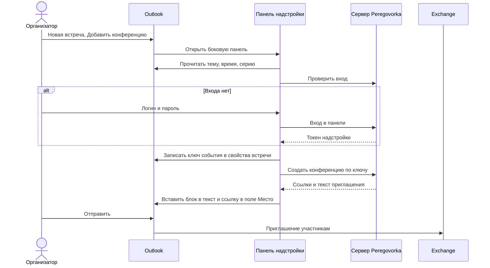

# Как подключить надстройку Outlook

*Для кого: администратор Peregovorka и администратор Exchange.*

## Зачем это нужно

Надстройка добавляет в окно встречи Outlook кнопку **Добавить конференцию**. Организатор нажимает её, Peregovorka создаёт комнату, а ссылка попадает в приглашение. Участники получают обычное приглашение Outlook.

Надстройка состоит из веб-страниц и программного интерфейса вашего сервера. Администратор один раз устанавливает файл-манифест. Логика надстройки дальше обновляется вместе с сервером.

> На настоящем сервере Exchange и в настоящем Outlook надстройка не проверялась. Панель проверялась в настоящем браузере с заменой библиотеки Outlook и с настоящим сервером Peregovorka. Манифест прошёл официальный валидатор Microsoft. Отдельные исправления сделаны по сообщениям об ошибках из среды с Exchange 2019, но успех этих исправлений там не подтверждён. Начните с одного сотрудника.

## Когда пригодится

- Встречи в организации назначают в Outlook.
- Нужно, чтобы ссылка на конференцию появлялась в приглашении без ручного копирования.
- Участникам нужна постоянная ссылка, которая переживает перенос встречи.

## Что потребуется

- Права администратора Peregovorka.
- Публичный адрес Peregovorka по HTTPS. Outlook не загружает надстройки по HTTP.
- Сертификат, которому доверяют рабочие станции. Самоподписанный сертификат не подойдёт.
- Доступ компьютеров с Outlook к этому адресу.
- Прямая выдача манифеста, без перенаправлений: Exchange 2019 за перенаправлениями не идёт.
- Роль Exchange **Org Marketplace Apps** или **Org Management**, если надстройку ставят для организации.
- Сверьтесь со статьёй [Требования и совместимость](Outlook-Требования-и-совместимость).

Если доступ к серверу ограничен разделом **Доверенные подсети**, добавьте туда сети рабочих мест: ограничение действует и на программный интерфейс надстройки.

## Как это устроено

Главные правила:

- Ключ события хранится в свойствах встречи. Повторное нажатие и обрыв сети дают ту же комнату, дубля нет.
- Peregovorka не обращается к Exchange на этом пути. Приглашение отправляет сам Outlook.
- Вход в панели не использует куки. Токен надстройки годится только для программного интерфейса надстройки.
- Единого входа нет. Пароль Outlook надстройка не получает.

## Где найти

**Администрирование → Интеграции → Microsoft Outlook**. На странице расположены:

- **Состояние и проверки**;
- **Надстройка для этого сервера**;
- **Настройки интеграции**;
- **Проверка доступа к календарю**;
- **Созданные конференции**;
- **Журнал надстройки и сверки**.

Страница установки для пользователей и администраторов Exchange открывается без входа: `https://meet.example.org/outlook`.

<!-- снимок: блоки «Состояние и проверки» и «Надстройка для этого сервера», Администрирование → Интеграции → Microsoft Outlook -->

## Как это сделать

1. Откройте **Администрирование → Интеграции → Microsoft Outlook**.
2. В блоке **Настройки интеграции** включите **Включить интеграцию с Outlook**.
3. Заполните **Публичный адрес Peregovorka для надстройки**, если он отличается от адреса приложения. Пустое поле означает адрес приложения.
4. Выберите **Где завершается HTTPS**. Обычно хватает значения **Определить автоматически**.
5. Если создавать конференции можно не всем, заполните **Кому разрешено создавать конференции**: DN групп, по одному в строке.
6. Выберите **Тип почтовой системы**.
7. Нажмите **Сохранить**, затем **Проверить заново** в блоке **Состояние и проверки**.
8. Исправьте строки с крестиком. Порядок разбора: [Диагностика типичных ошибок](Outlook-Диагностика-типичных-ошибок).
9. Нажмите **Скачать надстройку для этого сервера**. Вы получите архив `Peregovorka-Outlook.zip`.
10. Проверьте кнопку у одного сотрудника: на странице `/outlook` раскройте инструкцию для его клиента и добавьте манифест из файла.
11. Сотрудник создаёт встречу и нажимает **Добавить конференцию** в группе **Peregovorka**.
12. Сотрудник входит в панели и получает ссылку в приглашении.
13. Убедитесь, что встреча появилась в таблице **Созданные конференции**, а в журнале есть строка **конференция добавлена**.
14. Установите надстройку остальным: [Централизованная установка надстройки](Outlook-Централизованная-установка-надстройки).

В архиве лежат `Peregovorka-Outlook.xml`, `README.txt`, `Install-OutlookAddin.ps1`, `Test-OutlookAddin.ps1` и `Uninstall-OutlookAddin.ps1`. Паролей и ключей в нём нет. Скачивание из администрирования пишется в аудит.

## Настройки

| Настройка | Что делает | Значение по умолчанию |
| --- | --- | --- |
| **Публичный адрес Peregovorka для надстройки** | попадает в манифест и ссылки. После смены манифест ставят заново | адрес приложения |
| **Где завершается HTTPS** | четыре варианта: **Определить автоматически**, **На внешнем reverse proxy**, **На WAF, балансировщике или другом шлюзе**, **На самом сервере Peregovorka** | автоматически |
| **Кому разрешено создавать конференции** | пусто означает любого сотрудника. Администраторам разрешено всегда | пусто |
| **Открывать вход за** | за сколько минут до начала открывается комната, от 0 до 240 | 10 минут |
| **Держать комнату открытой после планового окончания** | через сколько закрыть комнату, от 5 до 1440 минут | 120 минут |
| **Хранить завершённые комнаты без встреч** | срок для пустых комнат. Комнаты, где шли встречи, остаются с материалами | 30 дней |
| **Запланированных конференций на одного пользователя** | предел активных конференций | 100 |
| **Срок действия входа надстройки** | от 1 до 720 часов. Вход продлевается сам, но не дольше 30 дней от ввода пароля | 168 часов |
| **Пускать гостей без учётной записи** | см. [Гостевые ссылки в приглашениях](Outlook-Гостевые-ссылки-в-приглашениях) | выключено |
| **Тип почтовой системы** | подсказки, инструкции и доступность **Передавать изменения при отправке приглашения** | локальный Exchange 2016/2019 |
| **Источник библиотеки Office.js** | откуда страницы берут библиотеку Microsoft | с этого сервера |
| **Передавать изменения при отправке приглашения** | только для Microsoft 365. При **Отправить** время и тема уходят на сервер. Отправку не блокирует | выключено |

## Права доступа

| Кто | Что может |
| --- | --- |
| Администратор сервера | настраивает интеграцию, видит все конференции, меняет любую запланированную конференцию |
| Сотрудник из разрешённых групп | создаёт конференции из Outlook |
| Создатель конференции | обновляет её и управляет гостевой ссылкой |
| Администратор Exchange | ставит и удаляет надстройку в организации |

Отключённая учётная запись теряет доступ сразу. Токены надстройки ограничены 30 запросами в минуту на пользователя и отзываются кнопкой **Выйти** в панели.

## Что получится

В панели появляется **Конференция в приглашении**, ссылка и две отметки: **Ссылка в тексте приглашения** и **Ссылка в поле «Место»**. В тексте встречи появляется блок **Подключение к встрече Peregovorka**.

Ссылка имеет вид `https://meet.example.org/m/<код>`. До открытия входа страница показывает название, время и обратный отсчёт. Участник, который вошёл слишком рано, получает отказ и видит время открытия.

Если выключить интеграцию, манифест перестанет выдаваться, а ссылки `/m/…` перестанут работать.

## Библиотека Office.js на сервере

Страницы надстройки подключают библиотеку Microsoft с вашего сервера. Файлы скачиваются с CDN Microsoft при сборке образа и обновляются вместе с ним.

1. Найдите строку **Библиотека Microsoft Office.js** в блоке **Состояние и проверки**. Она показывает, есть ли копия и когда получена.
2. Если копии нет, панель берёт библиотеку с CDN Microsoft. Тогда компьютерам с Outlook нужен доступ к CDN. Чтобы положить файлы на сервер, пересоберите web с доступом к `officeapis.public.onecdn.static.microsoft`: `scripts/update.sh --force-build`.
3. В Outlook в браузере на локальном Exchange при первом запуске панели браузер спросит, доверять ли домену Outlook. Нажмите **ОК** и откройте панель заново. Если нажали «Отмена», очистите данные сайта Peregovorka в браузере.
4. После смены **Источника библиотеки Office.js** скачайте манифест заново и обновите надстройку.

Загрузка библиотеки проверена в настоящем браузере на заменённом узле Outlook. В настоящем Outlook в браузере и в классическом Outlook она не проверялась.

## Обновление и удаление

Манифест нужно установить заново, если изменились:

- адрес сервера;
- **Источник библиотеки Office.js**;
- **Передавать изменения при отправке приглашения**.

Порядок обновления и удаления: [Централизованная установка надстройки](Outlook-Централизованная-установка-надстройки). Созданные комнаты и ссылки в отправленных приглашениях после удаления надстройки продолжают работать.

## Если не получается

| Симптом | Причина | Что сделать |
| --- | --- | --- |
| Кнопка не появилась | манифест ещё не дошёл до клиента | подождите до нескольких часов, перезапустите Outlook, запустите `Test-OutlookAddin.ps1` |
| «Ошибка надстройки» в классическом Outlook | страница не запустилась во встроенном браузере | откройте **Журнал надстройки и сверки**, строка **Office не запустил панель** называет причину |
| «Ошибка настройки» в Outlook в браузере | не подтверждено доверие к домену или библиотека не запустилась | см. раздел об Office.js выше |
| Вход не открывается | рабочая станция не доверяет сертификату | установите доверие или замените сертификат |
| «Конференция создана, ссылка не вставлена» | Outlook не дал изменить встречу | нажмите **Вставить ссылку ещё раз**, новая комната не создастся |
| Манифест не скачивается | интеграция выключена или адрес не HTTPS | проверьте настройки и строку **Публичный адрес** |

Полный разбор: [Диагностика типичных ошибок](Outlook-Диагностика-типичных-ошибок).

## Чего нет

- Единого входа: для локального Exchange универсального способа нет.
- Поддержки мобильного Outlook: в манифесте она не заявлена.
- Автоматической выдачи гостевых ссылок по списку приглашённых.
- Записи итогов встречи в календарь.

## Что дальше

- [Централизованная установка надстройки](Outlook-Централизованная-установка-надстройки)
- [Как подключить календарь Exchange](Как-подключить-календарь-Exchange)
- [Как настроить reverse proxy и HTTPS](Как-настроить-reverse-proxy-и-HTTPS)
- [Конференции через Outlook](Outlook-Конференции-через-Outlook)
- [Что проверено](Границы-проверки)
