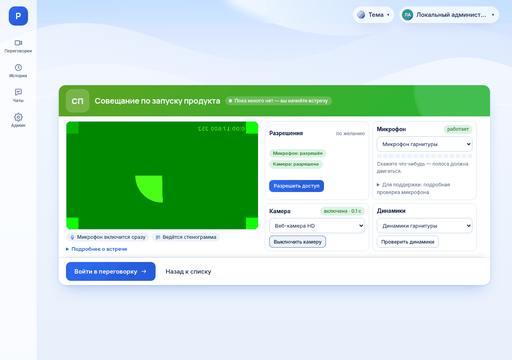

# Как проверить камеру и микрофон

*Для кого: все, кто входит во встречу, в том числе гости. В приложении для Android экрана проверки нет.*

## Зачем это нужно

Проверка показывает, что вас услышат и увидят, ещё до входа в комнату. Звук и изображение с проверки никуда не отправляются.

## Когда пригодится

- Перед первой встречей.
- После смены гарнитуры, камеры или компьютера.
- Перед важной встречей или выступлением.

## Что потребуется

- Микрофон или гарнитура. Камера и динамики по желанию.
- Страница, открытая по адресу `https://`. Без защищённого соединения браузер не даёт доступ к устройствам.

## Где найти

Экран проверки открывается перед входом в любую комнату. Нажмите на карточку комнаты или откройте ссылку на встречу. Гость видит ту же проверку на странице гостевой ссылки.

Участник и гость презентационной комнаты входят зрителями, поэтому проверки у них нет. Микрофон и камера у них выключены до тех пор, пока руководитель не даст слово.

## Как это сделать

### Разрешите доступ

1. На карточке **Разрешения** нажмите **Разрешить доступ**.
2. Браузер покажет запрос возле адресной строки. Сайт подскажет, куда смотреть.
3. Нажмите **Разрешить**. Название кнопки зависит от браузера.

Результат: на карточке написано **Микрофон: разрешён** и **Камера: разрешена**.

### Проверьте микрофон

1. На карточке **Микрофон** выберите устройство в списке.
2. Нажмите **Проверить микрофон**.
3. Скажите что-нибудь.

Результат: появляется отметка **работает**, полоса уровня движется. Если полоса стоит на месте, выберите другое устройство в списке.

### Проверьте камеру

1. На карточке **Камера** выберите устройство в списке.
2. Нажмите **Проверить камеру**.
3. Посмотрите на область предпросмотра слева. Статус **ждём кадр…** означает, что камера ещё включается.

Результат: вы видите себя, у карточки стоит статус **включена**.

Камера включится в комнате, только если вы оставите её включённой здесь. Чтобы войти без видео, нажмите **Выключить камеру**.

### Проверьте динамики

1. На карточке **Динамики** выберите устройство в списке.
2. Нажмите **Проверить динамики**.

Результат: вы слышите короткий сигнал. Если браузер не умеет выбирать устройство, под кнопкой написано **Звук пойдёт на устройство по умолчанию.**

### В приложениях для Windows и Linux

На экране входа проверка та же. Кроме того, устройства можно проверить заранее, без встречи:

1. Откройте **Настройки → Звук и видео**.
2. Нажмите **Проверить микрофон**, **Проверить звук** и **Включить просмотр**.

Результат: под шкалой написано **Сигнал есть — микрофон работает**, вы слышите мелодию и видите себя. Каждая проверка останавливается сама через минуту. Подробнее: [Как настроить звук и видео в приложении для Windows](Как-настроить-звук-и-видео-в-приложении-Windows).

**В приложении для Android:** отдельной проверки нет. На листе входа в комнату переключатели **Микрофон включён** и **Камера включена** задают состояние при входе.

## Что получится

Выбранные устройства перейдут в комнату. Обычно микрофон включается сразу после входа. На экране входа об этом написано: **Микрофон включится сразу**. Если руководитель настроил комнату иначе, экран пишет **Микрофон при входе выключен**, и вы включите его сами.

Руководитель презентации сам выбирает **Микрофон при входе**: **Включён** или **Выключен**.

Проверка необязательна. Войти можно и без микрофона, и без камеры, но тогда вас не услышат или не увидят.

## Если не получается

| Что видно | Почему | Что сделать |
| --- | --- | --- |
| **Доступ к микрофону заблокирован. Нажмите значок разрешений возле адресной строки браузера…** | вы запретили доступ раньше | нажмите значок слева от адреса, разрешите доступ, затем **Проверить снова** |
| Значок разрешений не помогает | настройка задана в браузере | нажмите **Скопировать адрес настроек (…)** и вставьте адрес в адресную строку |
| **Вы войдёте без возможности говорить: микрофон заблокирован в браузере.** | доступ к микрофону запрещён | разрешите доступ; иначе вы войдёте слушателем |
| **Микрофон не найден** | устройство не подключено | подключите гарнитуру, список обновится сам |
| **Windows сообщает, что микрофон занят…** | устройство держит другая программа | закройте другие конференции и программы записи |
| Полоса уровня не движется | выключена кнопка на гарнитуре или низкий уровень входа | включите микрофон на гарнитуре, проверьте уровень в настройках системы |
| **Камера не обнаружена** | камеры нет или она отключена | подключите камеру. Войти можно без видео |
| **Камера занята другой программой или недоступна.** | камеру держит другая программа | закройте другие программы с камерой |
| **Страница открыта не по HTTPS** | адрес начинается с `http://` | откройте `https://…` или обратитесь к администратору |

Подробный разбор: [Решение проблем: микрофон](Решение-проблем-микрофона).

Служба поддержки может попросить отчёт. Откройте **Для поддержки: подробная проверка микрофона**, нажмите **Подробная проверка микрофона**, затем **Скопировать полный отчёт**.

## Что дальше

- [Как настроить устройства](Как-настроить-устройства)
- [Как войти во встречу](Как-войти-во-встречу)
- [Как включить микрофон и камеру](Как-включить-микрофон-и-камеру)
