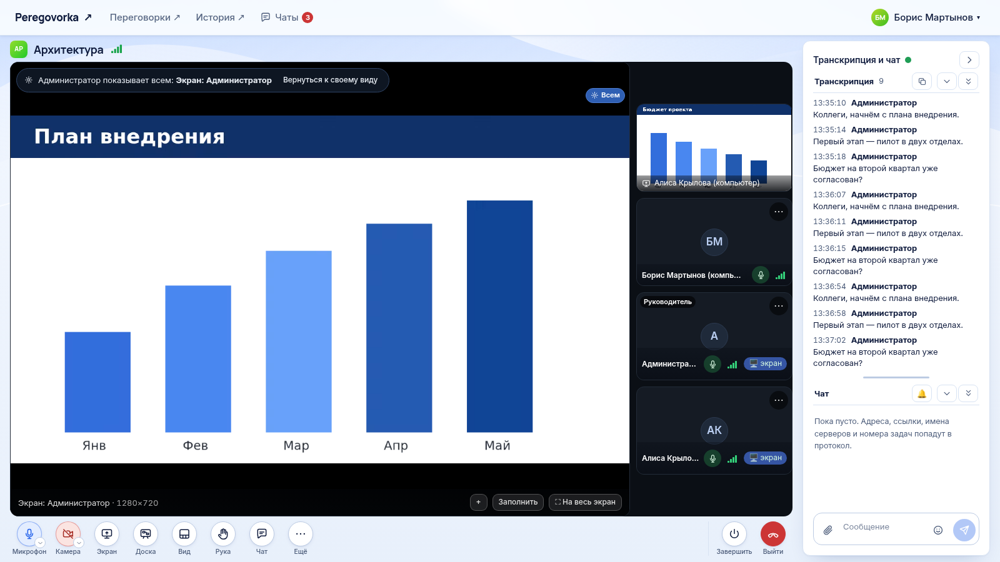

# Как провести встречу

*Для кого: все участники встречи. Управление участниками, записью и настройками описано в статье [Как управлять встречей](Как-управлять-встречей).*

## Зачем это нужно

Эта статья показывает всю встречу от входа до выхода и объясняет кнопки в комнате. По каждой теме есть отдельная подробная инструкция.

## Когда пригодится

- Вы впервые участвуете во встрече.
- Вы забыли, где находится нужная кнопка.
- Вам нужна общая доска.

## Что потребуется

- Учётная запись и доступ к комнате, либо [гостевая ссылка](Как-подключить-гостя).
- Страница, открытая по защищённому адресу `https://`.
- Микрофон и, при желании, камера.

Если комната защищена паролем, его вводят все, включая руководителей и администраторов. Исключение: в трансляционной комнате руководитель и администратор входят без пароля.

## Где найти

Раздел **Переговорки** → карточка комнаты → **Войти** или **Присоединиться**.

*Комната во время показа экрана (вымышленные данные).*

## Как это сделать

### 1. Войдите

1. Найдите комнату: [Как найти и открыть комнату](Как-найти-и-открыть-комнату).
2. Проверьте оборудование и нажмите **Присоединиться** или **Войти в переговорку**: [Как войти во встречу](Как-войти-во-встречу).

Если подходящей комнаты нет, создайте её: [Как создать комнату](Как-создать-комнату).

Чтобы позвать людей, отправьте им ссылку: [Как пригласить коллег](Как-пригласить-коллег), для людей без учётной записи [Как подключить гостя](Как-подключить-гостя).

### 2. Освойтесь в комнате

Панель кнопок находится внизу. Что вы видите, зависит от ваших прав и ширины экрана.

| Кнопка | Что делает | Подробно |
| --- | --- | --- |
| **Микрофон** | включает и выключает звук. Стрелка открывает выбор устройств | [Как включить микрофон и камеру](Как-включить-микрофон-и-камеру) |
| **Камера** | включает и выключает видео | [Как включить микрофон и камеру](Как-включить-микрофон-и-камеру) |
| **Экран** или **Стоп** | начинает и останавливает показ экрана | [Как показать экран](Как-показать-экран) |
| **Доска** | открывает общую доску | ниже в этой статье |
| **Вид** | меняет вашу раскладку | [Как настроить вид встречи](Как-настроить-вид-встречи) |
| **Рука** | поднимает и опускает руку | [Реакции и поднятая рука](Реакции-и-поднятая-рука) |
| **Зрители** | список зрителей в презентационной комнате | [Как управлять встречей](Как-управлять-встречей) |
| **Чат** | открывает чат встречи | [Как пользоваться чатом встречи](Как-пользоваться-чатом-встречи) |
| **Ещё** | реже нужные действия | ниже в этой статье |
| **Завершить** | завершает встречу для всех, кнопка видна тем, у кого есть право | [Как выйти и восстановить связь](Как-выйти-и-восстановить-связь) |
| **Выйти** | вы выходите, встреча продолжается у остальных | [Как выйти и восстановить связь](Как-выйти-и-восстановить-связь) |

На телефоне **Доска** и **Вид сцены** находятся в меню **Ещё**, а кнопка **Экран** скрыта, если браузер не умеет показывать экран.

Пункты **Ещё**: **Устройства…**, **Шумоподавление**, **Качество видео**, **Показ экрана со звуком**, **Профиль показа экрана**. Участникам с правом управления также видны пункты записи, стенограммы и трансляции.

Вверху находится шапка комнаты. В ней видны название комнаты и метки: **АУДИОЗАПИСЬ**, **ВИДЕОЗАПИСЬ**, **ПРЯМОЙ ЭФИР**, **Транскрибация остановлена**, **Презентация**, **У вас слово**. Значок связи показывает качество соединения. Руководитель видит в шапке шестерёнку настроек.

Панель справа, **Транскрипция и чат**, показывает стенограмму и чат. Панель можно свернуть.

### 3. Работайте на общей доске

1. Нажмите **Доска**. Откроется редактор схем draw.io. Правки видны всем сразу.
2. Нажмите **Развернуть**, чтобы открыть доску почти на всё окно только у себя. Вернитесь кнопкой **Вернуться к встрече** или клавишей Esc.
3. Сохранить схему можно в меню выгрузки: PNG, SVG, PDF или `.drawio`. Схема из нескольких страниц приходит в PNG и SVG архивом ZIP, по файлу на страницу. PDF остаётся одним документом.

Кто рисует, определяет настройка комнаты **Общая доска**. По умолчанию в обычной комнате рисуют все, а в презентационной руководители и те, кому дали слово. Если у вас только просмотр, подсказка у кнопки сообщит об этом. Когда другой участник меняет закрытую у вас доску, кнопка показывает **Доска · обновлена**.

### 4. Закончите встречу

Нажмите **Выйти**, если уходите сами. Нажмите **Завершить**, если вы ведёте встречу и она окончена для всех.

Если вы ушли со вкладки встречи, встреча может продолжиться в небольшом окне: [Плавающее окно встречи](Плавающее-окно-встречи).

### В приложении для Android

Основные действия находятся внизу экрана: микрофон, камера, рука, **Чат**, **Участники**, **Ещё**, **Выйти из конференции**. Доски, стенограммы в комнате, записи и управления участниками в приложении нет.

## Что получится

Вы участвуете во встрече: говорите, видите других, показываете материалы и пишете в чат. Если вы оставались в комнате до завершения, откроется страница встречи со стенограммой, записями и документами. Если вы вышли раньше, ищите встречу в разделе **История**: [Где найти материалы встречи](Где-найти-материалы-встречи).

## Если не получается

| Что происходит | Что сделать |
| --- | --- |
| Нет микрофона в браузере | откройте страницу по адресу `https://` и разрешите доступ. См. [Решение проблем с микрофоном](Решение-проблем-микрофона) |
| Подключение идёт бесконечно | см. [Решение проблем: звонки и сеть](Решение-проблем-звонков-и-сети) |
| Микрофон занят другой программой | освободите микрофон или выберите другой стрелкой у кнопки |
| Участник не видит доску | в комнате выбрана **Доска только у руководителей (остальные её не видят)** |
| Встреча закончилась сама | см. [Завершение забытых встреч](Завершение-забытых-встреч) |
| Связь пропала | см. [Как выйти и восстановить связь](Как-выйти-и-восстановить-связь) |

## Что дальше

- [Как управлять встречей](Как-управлять-встречей)
- [Где найти материалы встречи](Где-найти-материалы-встречи)
- [Сценарий: организация совещания](Сценарий-Организация-совещания)
