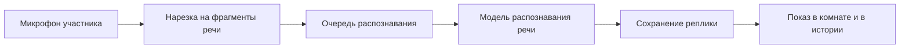

# Как работают стенограмма и протоколы

*Для кого: все, кому важно понимать, откуда берётся текст и почему его нужно проверять. Подойдёт руководителям и специалистам по безопасности.*

Страница объясняет устройство, а не шаги. Инструкции: [Как получить стенограмму](Как-получить-стенограмму), [Как сформировать протокол](Как-сформировать-протокол). Настройка для администратора: [Как настроить языковые модели](Как-настроить-языковые-модели), [Как настроить распознавание речи](Как-настроить-распознавание-речи).

## Стенограмма

Речь превращается в текст на вашем сервере. Сторонние службы для этого не нужны.

- **Каждый участник распознаётся отдельно.** Микрофон каждого приходит на сервер отдельной дорожкой. Поэтому автор реплики определяется по дорожке, а не угадывается по голосу. Если двое говорят одновременно, получаются две независимые реплики. Если двое говорят в один микрофон, обе реплики будут подписаны одним именем.
- **Что не распознаётся.** Звук показа экрана и служебные участники в стенограмму не попадают.
- **Почему текст появляется с задержкой.** Реплика появляется после паузы в речи. Пословного вывода внутри незаконченной фразы нет.
- **Как определяется конец реплики.** Значения по умолчанию: пауза 700 мс, минимальная длина речи 250 мс, порог обнаружения речи 0,5. Администратор может их изменить: [Справочник: конфигурация](Справочник-конфигурация).
- **Если сервер перегружен.** При переполнении очереди отдельный фрагмент отбрасывается: защита памяти важнее одной реплики. В этом случае часть слов не попадёт в текст, а звонок продолжится.
- **Шумоподавление.** Оно выполняется на устройстве участника, поэтому сервер получает уже обработанный звук. Нейросетевое шумоподавление может съедать окончания слов на очень тихой речи. Если стенограмма стала хуже, выберите **Стандартное**.
- **Нецензурные слова.** По умолчанию они заменяются звёздочками при показе и выгрузке. Звук, записи и исходный текст в базе не меняются. Словарь неполон: слова через пробелы вида «х у й» не распознаются. Чат встречи не маскируется.

Точность распознавания на живых разговорах в проекте не измерялась. Встроенный тест **Протестировать модель** использует синтетическую речь: он годится для сравнения моделей между собой, но не как оценка качества.

## Протокол и резюме

Документ пишет языковая модель, подключённая по API. Встроенной модели в продукте нет. Модель получает стенограмму, чат встречи, текстовое описание схемы с доски и инструкцию. Ссылки, адреса, имена серверов и номера задач из чата передаются ей дословно: для таких данных чат точнее устной речи.

Администратор выбирает один из двух режимов в **Администрирование → Встречи → Протоколы: инструкции и режим**, поле **Внешняя модель формирует документ**.

### Свободный режим (по умолчанию)

Модель пишет документ по инструкции. Оформление зависит от модели. Встреча, которая помещается в окно контекста модели, отправляется одним запросом. Более длинная разбирается по частям: сначала краткие заметки по каждой части, затем итоговый документ по заметкам. Раздел **Присутствовали** добавляет система.

### Структурный режим

Модель решает только узкую задачу, остальное делает код. Поэтому документ выглядит одинаково у любой модели, а выдумки встречаются реже.

1. Материалы делятся на части, если не помещаются в один запрос.
2. По каждой части модель отвечает строго в заданном формате: темы, решения и предложения, поручения, нерешённые вопросы.
3. Код проверяет каждый пункт: реплика существует, ответственный подтверждён репликой, срок действительно срок, а не время суток. Цитату берёт код.
4. Код объединяет части, убирает повторы и сортирует по времени.
5. Документ собирается кодом: **Краткие итоги**, **Обсуждения**, **Решения**, **Задачи и поручения**, **Предложения, не принятые как решение**, **Открытые вопросы**. У пунктов указан источник: **Где в записи**. Чего нет в репликах, пишется «не указан».

Если модель не вернула разбираемый ответ, система переходит на обычный режим и оставляет предупреждение рядом с документом.

### Оборванный ответ

Ответ модели ограничен по длине. Если ответ оборван, документ получает состояние **обрезано**, а во всех выгрузках и письмах сверху стоит заметная пометка. Автоматическая рассылка такой документ не отправляет.

## Где система может ошибаться

Модель может пропустить поручение, ошибиться в ответственном или сроке, принять предложение за решение. Структурный режим часть ошибок отсекает проверкой по репликам, но не все. Ошибка распознавания речи также переходит в документ. Рабочие протоколы проверяет человек, юридически значимые вычитываются обязательно.

## Что уходит в модель

Текст отправляется на адрес подключённой модели. Если модель внешняя, он покидает сервер. Перед этим на сервере:

- **всегда** убираются пароли, токены, ключи и строки подключения, при любых настройках. Если проверка не выполнилась, запрос не отправляется;
- **если для документа включено обезличивание**, участники заменяются обозначениями вроде «Иван И.» или «Участник 2», а серверы, контакты, реквизиты и суммы метками. При сбое документ не создаётся и текст никуда не уходит.

Окно **Сформировать протокол** заранее показывает, что будет сделано. Подробнее: [Как работает обезличивание](Как-работает-обезличивание), [Безопасность и приватность](Безопасность-и-приватность).

## Карта разговора

Карта строится тем же способом: узкие запросы к модели, проверка и слияние кодом, проверенные данные в базе, отображение. Время тем и участники считаются по репликам, а названия тем и краткое содержание пишет модель. Карта не зависит от протокола. Оценка найденных тем выполнялась автоматически по ключевым словам, ручной проверки карт не было. Подробнее: [Карта разговора](Карта-разговора).

Карты эволюции темы, слой знаний и глобальный поиск запланированы: [Планы развития](Планы-развития).

## Что дальше

- [Запись, стенограмма, протокол: в чём разница](Запись-стенограмма-протокол-в-чём-разница)
- [Как сформировать протокол](Как-сформировать-протокол)
- [Как настроить языковые модели](Как-настроить-языковые-модели)
- [Производительность и масштабирование](Производительность-и-масштабирование)
