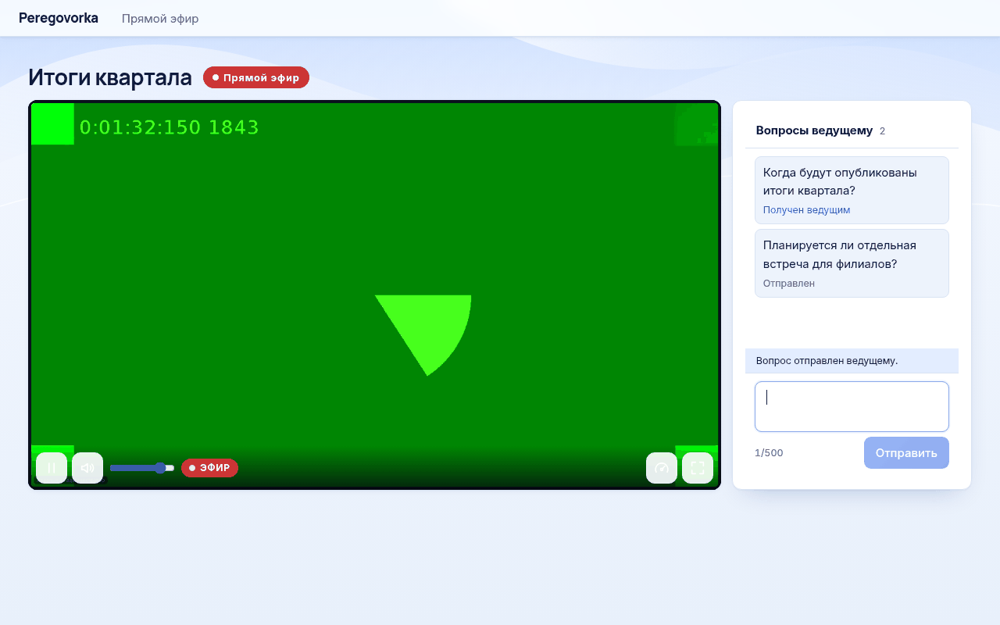

# Как смотреть трансляцию

*Для кого: зритель, сотрудник, который хочет посмотреть эфир.*

## Зачем это нужно

Страница зрителя показывает эфир в браузере. Устанавливать ничего не нужно, учётная запись Peregovorka не требуется.

## Когда пригодится

- Вам прислали ссылку на мероприятие.
- Вы сотрудник и хотите посмотреть эфир из своей комнаты, не выступая.
- Эфир закончился, а организатор открыл запись.

## Что потребуется

- Ссылка от организатора, вида `https://meet.example.org/live/…`.
- Современный браузер на компьютере или телефоне.
- Пароль, если организатор защитил эфир.
- Канал связи. Качество одно для всех и под канал не подстраивается. Ориентир для 1080p: при 12 Мбит/с остановок не было, при 8 Мбит/с были две. Статус: проверено в ограниченном сценарии (один браузер, канал ограничен искусственно, короткий просмотр).

## Где найти

- **Зритель:** откройте ссылку из приглашения.
- **Сотрудник:** на странице «Переговорки» откройте трансляционную комнату. В вопросе «Как вы хотите присоединиться?» выберите **Зритель**. Фильтр **В эфире** покажет комнаты, где эфир идёт сейчас.
- **На телефоне:** откройте ссылку в браузере. В приложении для Android просмотра эфира нет.

## Как это сделать

1. Откройте ссылку.
2. В форме «Представьтесь, чтобы смотреть эфир и задавать вопросы ведущему» укажите **Ваше имя**.
3. При желании укажите почту и отметьте **Присылать мне протокол и материалы встречи на этот адрес**. Адрес видят только организаторы.
4. Нажмите **Смотреть**.
5. Если появилась форма «Трансляция защищена паролем», введите **Пароль** и нажмите **Смотреть**.
6. Если видео пошло без звука, нажмите **Включить звук**. Браузеры часто запрещают автоматический запуск со звуком.

## Что видно до, во время и после эфира

| Когда | Что на странице |
|---|---|
| До эфира | «Эфир скоро начнётся», название, время начала и обратный отсчёт, если организатор их указал. «Страница обновится сама, как только эфир начнётся.» Если нужен пароль: «Пароль потребуется, когда эфир начнётся.» |
| Запуск | «Эфир запускается. Это займёт несколько секунд — страница обновится сама.» |
| Эфир | название, метка **Прямой эфир**, плеер, панель **Вопросы ведущему** |
| После эфира | «Эфир завершён», дата окончания. Если запись открыта: «Запись готовится…», затем **Смотреть запись** |

Обновлять страницу вручную не нужно.

## Кнопки плеера

| Кнопка | Что делает |
|---|---|
| **Смотреть** и **Пауза** | запускает и останавливает видео |
| **Включить звук** и **Выключить звук**, **Громкость** | управляет звуком |
| Метка **ЭФИР** | вы смотрите прямой эфир. Если отстали, вместо неё видно, на сколько, например `−12 с` |
| **К прямому эфиру** | появляется, если вы отстали больше чем на 8 секунд; возвращает к настоящему моменту |
| **Качество просмотра** (шестерёнка) | меню как на YouTube: **Авто**, **Высокое**, **Низкое (360p)**, **Только звук**. Подробности ниже |
| **Статистика воспроизведения** | показывает состояние вашего просмотра: [панель диагностики](Панель-диагностики-эфира) |
| **Во весь экран** | разворачивает видео |

Перемотки назад в прямом эфире нет.

## Качество просмотра: Авто, Высокое, Низкое, Только звук

Звук важнее картинки. Качество можно выбрать самому в меню шестерёнки на нижней панели, а можно оставить **Авто**: страница сама подбирает ступень по вашей связи.

| Пункт | Что это |
| --- | --- |
| **Авто** | подбирается само. Если видео начинает останавливаться, страница сначала включает **Низкое** (360p, эфир идёт без остановок), и только если и оно не тянет, переходит на **Только звук**. Когда связь наладилась, качество возвращается по ступеням само |
| **Высокое** | лучшая картинка, нужен хороший интернет. Выбранное вами качество страница не меняет, а если картинка подвисает, подсказывает выбрать ступень ниже |
| **Низкое (360p)** | для слабой связи. Сервер готовит его по вашей просьбе: первый раз это занимает до 30 секунд, звук всё это время идёт |
| **Только звук** | меньше всего трафика: в десятки раз легче видео |

При каждом переключении страница пишет «Включаем…» и просит подождать несколько секунд: картинка появится сама, кнопки в это время нажимать не нужно, они закрыты. Если новое качество не загрузилось за минуту, страница оставляет прежнее и объясняет, что эфир не прерывался. **Включить видео** на экране звука пробует видео в режиме **Авто**: если связь всё ещё слабая, страница вернёт ступень ниже, но не раньше чем через 10 секунд после загрузки. Выбор запоминается в браузере.

Страница решает по нескольким признакам сразу: остановки, запас буфера, скорость канала, загрузка устройства, фоновая вкладка, режим экономии трафика. Возврат вверх подтверждается пробной загрузкой; если он срывается, следующая попытка откладывается: вы не увидите мигания.

Режим работает у зрителей с низкой задержкой в браузере с поддержкой Media Source (проверялся Chromium; Firefox и Edge не проверялись). В Safari, на iPhone, при раздаче через CDN и при обычном HLS дорожки со звуком нет: кнопка не показывается. Низкое качество перекодируется на сервере только пока им кто-то пользуется (около одного ядра процессора на эфир), через 1,5 минуты после последнего зрителя процесс останавливается. Администратор может отключить автоматический переход и ступени качества в **Интеграции → Трансляции**. Статус: проверено в ограниченном сценарии (один сервер, эмуляция канала 600 кбит/с в Chromium: переход за 5–6 с, возврат за 20–35 с); на реальных мобильных сетях не проверено.

## Как можно смотреть

| Способ | Как открыть | Что важно |
|---|---|---|
| Постоянная ссылка комнаты | ссылка зрителя от организатора | показывает ожидание, идущий эфир, затем последний эфир по его правилам |
| Ссылка конкретного эфира | организатор копирует её во время эфира | во время эфира показывает его, после эфира его запись, если организатор открыл её |
| Внешний плеер | ссылка на поток, вида `…/index.m3u8`, в проигрывателе с поддержкой HLS | только видео, без вопросов; пароль не спрашивается |
| Внешняя площадка | ссылка на RUTUBE, VK Видео, YouTube, Twitch | действуют правила площадки; вопросы ведущему через Peregovorka не задать |

Сервер сам выбирает, как доставить видео на страницу зрителя. Обычно задержка около 3 с. В Safari, на iPhone и iPad, при раздаче через CDN и при большом числе зрителей задержка около 7,5 с. Статус: проверено в ограниченном сценарии (один сервер, 1080p, сеть зрителя в замер не входила; Safari и iPhone этим замером не проверялись). Переключаться вручную не нужно. Если быстрый способ не сработал, плеер сам перейдёт на обычный поток.

## После эфира

Если организатор открыл запись, та же ссылка покажет кнопку **Смотреть запись**. Рядом указан срок: «Запись доступна по этой ссылке до…». Если задан пароль, страница спросит его снова. Кнопка **Скачать запись** есть, только если организатор разрешил скачивание.

| Сообщение | Что значит |
|---|---|
| «Запись готовится — обычно несколько минут. Страница обновится сама.» | файл закрывается, подождите |
| «Запись готовится дольше обычного. Откройте ссылку позже.» | файл не готов уже больше 30 минут |
| «Срок просмотра записи по этой ссылке завершён.» | срок вышел, попросите организатора продлить его |
| «Организатор закрыл доступ к записи.» | организатор закрыл просмотр |
| «Запись удалена и больше недоступна.» | файла больше нет |
| «Запись этого эфира не удалось сохранить.» | запись не сохранилась |

Если показано только «Эфир завершён» без кнопки, организатор не открывал запись.

## Если не получается

| Что видно | Почему | Что сделать |
|---|---|---|
| «Трансляция не найдена: ссылка неверна или отозвана.» | ссылка ошибочна или её заменили | попросите новую ссылку |
| «Эфир идёт на внешних площадках. Ссылку на просмотр даёт организатор.» | у эфира нет собственного просмотра | попросите ссылку на площадку |
| «Неверный пароль.» | пароль не подошёл или его сменили | уточните пароль |
| «Слишком много попыток. Повторите позже.» | слишком много неверных паролей | подождите 10 минут |
| Снова просит пароль во время просмотра | организатор сменил пароль | попросите новый пароль |
| «Нет подключения к сети. Эфир продолжится автоматически, когда связь восстановится.» | пропала сеть | дождитесь связи |
| «Не удаётся получить поток эфира…» или «Эфир не воспроизводится: поток не поступает…» | нет связи с сервером или эфир прервался | проверьте сеть и нажмите **Повторить** |
| «Этот браузер не умеет воспроизводить прямой эфир.» | браузер устарел | откройте другой браузер |
| Видео часто останавливается | канал слабее потока | страница сама перейдёт на **Низкое**, а при необходимости на «только звук»; закройте другие загрузки, подключитесь к другой сети, сообщите организатору |
| Написано «Только звук», картинки нет | связь была слабой или режим выбран вручную | дождитесь возврата видео или нажмите **Включить видео** и подождите несколько секунд: картинка загружается |
| У **Зритель** написано «Просмотр для этой комнаты не включён» | эфир идёт только на площадки | попросите ссылку на площадку |
| Запрошен вход в систему вместо страницы эфира | прокси организации закрывает страницу | сообщите администратору |

Администратору: подробная диагностика в [Диагностика трансляций](Диагностика-трансляций).

## Что дальше

- [Вопросы зрителей](Вопросы-зрителей)
- [Запись трансляции](Запись-трансляции)
- [Маршрут зрителя](Маршрут-зрителя)
