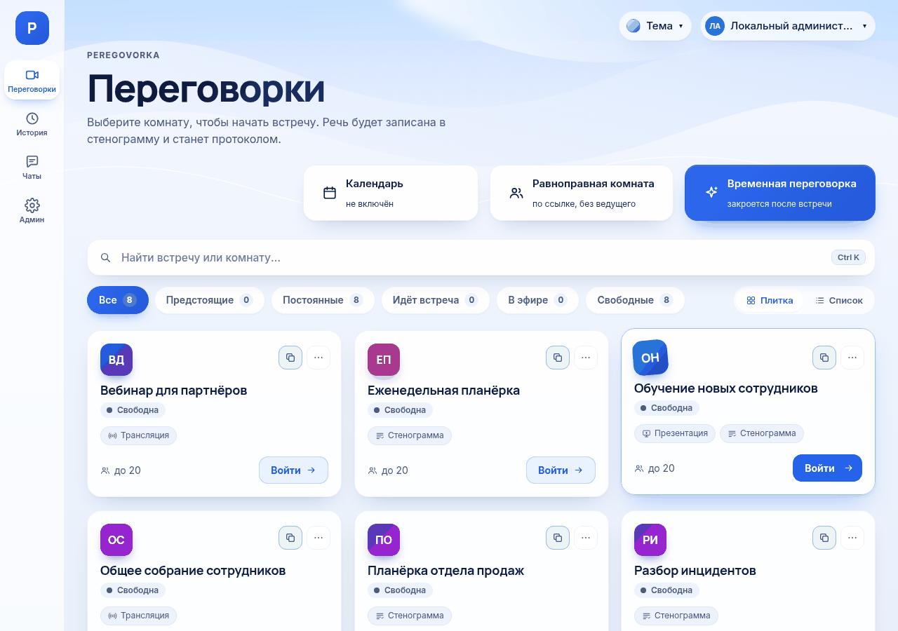

# Как создать комнату

*Для кого: администратор (постоянная комната), сотрудник (временная и равноправная комната).*

## Зачем это нужно

Комната — это адрес, по которому люди встречаются. У неё есть название, настройки и список тех, кто может войти. Встреча начинается, когда в комнату входит первый участник.

## Когда пригодится

Выберите вид комнаты по задаче:

| Вид комнаты | Когда выбрать | Кто создаёт | Сколько живёт |
| --- | --- | --- | --- |
| Постоянная | планёрки отдела, переговорная, постоянный проект | администратор | пока её не удалят |
| Временная переговорка | разовая встреча, разбор инцидента | любой сотрудник, если разрешено | закрывается сама после встречи |
| Равноправная комната | быстрая встреча без ведущего по ссылке | любой сотрудник, если разрешено | закрывается сама |
| Встреча из календаря | встреча с датой и приглашениями | сотрудник с подключённым календарём | по расписанию |

Материалы закрытой временной комнаты остаются в разделе **История**.

Трансляцию на большую аудиторию готовьте по статье [Создание трансляционной комнаты](Создание-трансляционной-комнаты).

## Что потребуется

- Для постоянной комнаты: права администратора.
- Для доступа по группам и людям: подключённый каталог, см. [Как подключить Active Directory](Как-подключить-Active-Directory).
- Для временной комнаты: администратор не выключил этот вид комнат. По умолчанию он включён.
- Для равноправной комнаты: администратор включил этот вид комнат. По умолчанию он выключен.

## Где найти

| Вид комнаты | Путь |
| --- | --- |
| Постоянная | **Администрирование → Комнаты и пользователи → Комнаты и доступ → ＋ Создать комнату** |
| Временная | страница **Переговорки** → кнопка **Временная переговорка** |
| Равноправная | страница **Переговорки** → кнопка **Равноправная комната** |
| Встреча из календаря | **Календарь → Создать встречу** |

На панели разделов администрирование называется **Админ**.

## Как это сделать

### Создать постоянную комнату

1. Откройте **Администрирование → Комнаты и пользователи → Комнаты и доступ**.
2. Нажмите **＋ Создать комнату**. Откроется форма **Новая комната**.
3. На вкладке **Основное** заполните два обязательных поля:
   - **Название**: как комнату увидят люди, например «Переговорная Север»;
   - **Адрес комнаты**: часть ссылки, например `it-1`. Допустимы латиница, цифры, `-` и `_`, от 2 до 63 знаков, первый знак: буква или цифра.
4. Проверьте **Максимум участников**. По умолчанию 20.
5. На вкладке **Встреча и запись** выберите **Тип комнаты**: **Обычная**, **Презентационная** или **Трансляционная**.
6. На вкладке **Доступ и гости** добавьте людей:
   1. Выберите **Группа AD** или **Пользователь AD**.
   2. Введите не меньше двух знаков и нажмите **Найти**.
   3. У нужной строки нажмите **＋ В доступ**.
   4. Для руководителя комнаты нажмите **＋ Руководителем**.
7. Нажмите **Создать**.
8. Форма останется открытой с сообщением **Комната создана**. Теперь доступны вкладка **Трансляция**, гостевая ссылка и проверка получателей рассылки.
9. Закончите настройку и нажмите **Сохранить**, затем **Закрыть**.

Назначьте хотя бы одного руководителя. Без него комнатой управляет только администратор, а запись в обычной комнате сможет включать любой участник.

Описание каждой вкладки: [Настройки комнаты](Настройки-комнаты).

### Создать временную переговорку

1. Откройте страницу **Переговорки**.
2. Нажмите **Временная переговорка**.
3. Введите **Название встречи**.
4. Нажмите **Создать**. Откроется экран входа в комнату.
5. Нажмите **Войти в переговорку**. Шестерёнка и кнопка копирования видны только внутри комнаты.
6. Добавьте коллег: шестерёнка **Настройки → Настройки комнаты… → Доступ и гости**, затем **＋ В доступ** и **Сохранить**.
7. Нажмите **Скопировать ссылку** в шапке комнаты, то есть в её верхней строке, и отправьте адрес коллегам.

Вы становитесь руководителем комнаты. Сразу после создания войти можете только вы: коллега войдёт по ссылке, когда вы добавите его в доступ. Людям без учётной записи нужна гостевая ссылка.

По умолчанию один сотрудник может держать 2 активные временные комнаты, всего на сервере 30.

### Создать равноправную комнату

1. Откройте страницу **Переговорки**.
2. Нажмите **Равноправная комната**.
3. При желании введите **Название встречи (необязательно)**.
4. Нажмите **Создать**.
5. Нажмите **Копировать ссылку** и отправьте её участникам.
6. Нажмите **Войти**.

У всех участников равные права. Ведущего нет. Создатель управляет ссылкой: в меню комнаты выберите **Управление ссылкой…**. Там можно перевыпустить ссылку, продлить срок, ограничить вход приглашёнными и закрыть комнату.

Ссылка имеет вид `https://example.org/p/<код>`.

## Что получится

- Постоянная комната появляется в разделе **Переговорки** у тех, кто есть в списках доступа. Её адрес: `https://example.org/rooms/<адрес>`.
- Руководители и администраторы тоже видят её в списке и входят всегда.
- Временная комната видна её участникам, пока она не закрыта.
- Равноправную комнату в общем списке видят только создатель, приглашённые и администратор.

## Если не получается

| Что видно | Причина | Что сделать |
| --- | --- | --- |
| Нет кнопки **Временная переговорка** | администратор выключил этот вид комнат | обратитесь к администратору |
| Нет кнопки **Равноправная комната** | вид комнат выключен, это значение по умолчанию | включите в **Администрирование → Система → Общие настройки** |
| **У вас уже 2 активных временных переговорок** | достигнут предел на сотрудника | завершите одну из комнат |
| **Достигнут общий предел активных временных переговорок** | достигнут предел сервера | повторите позже или увеличьте предел |
| **Адрес комнаты: латиница, цифры…** | адрес не подходит под правило | исправьте адрес на вкладке **Основное** |
| Адрес занят | он используется или был прежним адресом другой комнаты | выберите другой адрес |
| Сотрудник не видит комнату | пуст список доступа, или человека нет в списке и в группе | добавьте его на вкладке **Доступ и гости** |
| Поиск в каталоге выдаёт ошибку | каталог не подключён или недоступен | проверьте [подключение каталога](Как-подключить-Active-Directory) |

## Что дальше

- [Настройки комнаты](Настройки-комнаты)
- [Управление участниками комнаты](Управление-участниками-комнаты)
- [Управление гостевыми ссылками](Управление-гостевыми-ссылками)
- [Как настроить переговорки и доступ](Как-настроить-переговорки-и-доступ)
