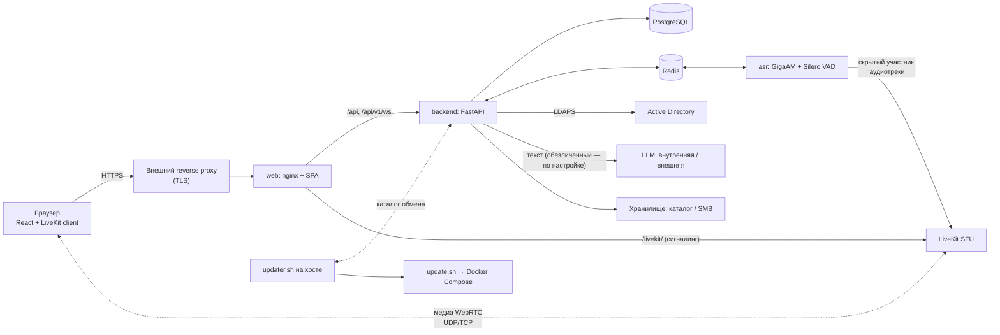

# Как устроена Peregovorka

> Относится к версии 0.39.4 · проверено 2026-10-25 · уровень проверки: 1 (чтение кода и `ARCHITECTURE.md`, `docs/INTERNALS.md`, `docs/ASR_CONTRACT.md`) · тип страницы: объяснение

Страница отвечает на вопрос «из чего состоит система и почему она устроена именно так». Инструкции — в разделе «Руководства».

## Компоненты

| Сервис Compose | Технология | Ответственность |
| --- | --- | --- |
| `web` | nginx и собранный React | статика, прокси `/api/` на backend и `/livekit/` на LiveKit |
| `backend` | Python 3.12, FastAPI, SQLAlchemy, Alembic | вход, сессии, права, комнаты, встречи, токены LiveKit, API, аудит, настройки, стенограммы, фоновые задачи |
| `livekit` | LiveKit Server (закреплённая версия) | звук, видео, показ экрана |
| `asr` | GigaAM v3 e2e RNNT, Silero VAD, PyTorch | распознавание речи каждого участника |
| `postgres`, `redis` | PostgreSQL 16, Redis 7 | данные; очереди, сессии, события |
| `llm-local` | llama.cpp, Qwen3 1.7B | встроенная языковая модель, сеть без выхода наружу |
| `livekit-sip` | LiveKit SIP | телефония (профиль `sip`, по умолчанию выключен) |
| хост | `scripts/updater.sh` (systemd от root) | обновление из браузера; контейнеры доступа к Docker не получают |

## Путь одной встречи

1. Пользователь входит через Active Directory (LDAPS); сервер создаёт сессию в Redis, браузеру отдаётся cookie `HttpOnly`.
2. При входе в комнату backend проверяет права, создаёт встречу, посылает команду ASR и выдаёт короткоживущий токен LiveKit (по умолчанию 5 минут). Ожидания распознавания нет.
3. Браузер параллельно открывает LiveKit и канал событий (`WebSocket /api/v1/ws`).
4. ASR входит в комнату скрытым участником и подписывается на **микрофонный трек каждого участника отдельно**. VAD режет речь на сегменты, очередь ограничена, GigaAM распознаёт, реплика уходит в Redis (`asr:segments`).
5. Backend записывает реплику в базу идемпотентно (по `segment_uid`) и рассылает по WebSocket.
6. После завершения встречи backend формирует документы в фоне (очередь тяжёлых задач уступает звонкам).

## Почему так

| Решение | Причина |
| --- | --- |
| Микрофон каждого участника — отдельный трек, ASR подписывается на каждый | «кто говорит» определяется по идентичности трека, без диаризации общего микса |
| LiveKit-комната = встреча, а не постоянная комната | нет «залипшего» состояния между сеансами |
| Identity в LiveKit — `u-<uuid>`, не из пользовательского ввода | исключает подмену |
| Сессия на сервере в Redis, cookie содержит только случайный id | нет долгоживущих JWT и `localStorage` с токенами |
| Стабильный идентификатор пользователя — `objectGUID` | логины в каталоге переименовывают |
| Backend и ASR общаются только через Redis | backend не знает про GigaAM, ASR не знает про базу |
| Языковая модель получает узкие задачи, остальное делает код | небольшая модель теряет и выдумывает при свободном пересказе |
| Версии LiveKit и зависимостей закреплены | старый сервер LiveKit не знает `/rtc/v1`, вход замедляется на секунды |
| Обновление выполняет помощник на хосте | контейнеры не получают доступ к Docker |
| Редактор доски — draw.io, не свой | готовое зрелое решение; запускается в песочнице без доступа к приложению |

## Где что хранится

| Данные | Место |
| --- | --- |
| Пользователи, комнаты, встречи, стенограммы, документы, настройки | PostgreSQL |
| Сессии, ключи встреч, очереди, события, слово, поднятые руки | Redis |
| Записи, выгрузки, сертификаты, аватары, вложения чатов, логотипы | `DATA_ROOT` или выбранный SMB-профиль |
| Модели | `DATA_ROOT/models` |
| Секреты | `.env` (права 600) и зашифрованно в БД |

## Схема интерфейса

Один React-интерфейс обслуживает браузер и приложение для Windows. Приложение (Electron) добавляет оболочку (организации, настройки), трей, уведомления, сохранённый вход и политики; страницы организаций — те же, что в браузере, в изолированных разделах (`persist:org-<id>`), без Node.js ([[Справочник: приложение для Windows|Справочник-приложение-для-Windows]]).

## Что дальше

- [[Безопасность и приватность|Безопасность-и-приватность]]
- [[Как работают стенограмма и протоколы|Как-работают-стенограмма-и-протоколы]]
- [[Производительность и масштабирование|Производительность-и-масштабирование]]
