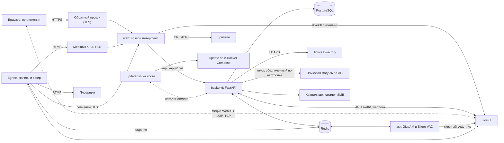

# Как устроена Peregovorka

*Для кого: все, кто хочет понять систему за десять минут.*

Страница отвечает на вопрос, из чего состоит система и почему она устроена именно так. Инструкции лежат в разделах для сотрудников и администраторов, подробное устройство в разделе [Архитектура и техническое устройство](Архитектура-и-техническое-устройство).

## Компоненты

Что делает каждая служба, одной таблицей: [Назначение и состав](Архитектура-Назначение-и-состав#состав-серверной-части).

## Путь одной встречи

1. Пользователь входит через Active Directory (LDAPS) или под локальной учётной записью. Сервер создаёт сессию в Redis, браузер получает cookie `HttpOnly`.
2. При входе в комнату `backend` проверяет права, создаёт встречу, посылает команду ASR и выдаёт короткоживущий токен LiveKit. Ожидания распознавания нет.
3. Браузер параллельно открывает соединение с LiveKit и канал событий `WebSocket /api/v1/ws`.
4. ASR входит в комнату скрытым участником и подписывается на **микрофон каждого участника отдельно**. VAD режет речь на сегменты, GigaAM распознаёт, реплика уходит в Redis (`asr:segments`).
5. `backend` записывает реплику в базу без дублей (по `segment_uid`) и рассылает по WebSocket.
6. После завершения встречи `backend` формирует документы в фоне через очередь тяжёлых задач.

## Путь одного эфира

1. Ведущий нажимает **Выйти в эфир**. `backend` проверяет настройки, нагрузку и место и запускает задание Egress.
2. Браузер внутри Egress открывает страницу-рекордер и смотрит комнату как скрытый участник. Кодировщик делает один поток.
3. Поток расходится: MP4 на локальный диск, сегменты HLS в `DATA_ROOT/live`, внутренний RTMP в MediaMTX, RTMP на площадки.
4. Зритель открывает ссылку и называет имя, сервер выдаёт подписанный адрес. Плеер берёт самую быструю доступную ветку и сам откатывается на более простую.

Подробно: [Трансляции: последовательности](Архитектура-Последовательности-трансляций).

## Почему так

| Решение | Причина |
| --- | --- |
| Микрофон каждого участника: отдельная дорожка, ASR подписывается на каждую | «кто говорит» определяется по дорожке, без разделения общего звука на голоса |
| Комната LiveKit соответствует встрече, а не постоянной комнате | нет «залипшего» состояния между сеансами |
| Идентификатор в LiveKit `u-<uuid>`, не из пользовательского ввода | исключает подмену |
| Сессия на сервере в Redis, cookie содержит только случайный идентификатор | нет долгоживущих JWT и `localStorage` с токенами |
| Стабильный идентификатор пользователя: `objectGUID` | логины в каталоге переименовывают |
| Стенограмма между `backend` и ASR идёт только через Redis, по HTTP только управление моделями | `backend` не знает про GigaAM, ASR не знает про базу |
| Языковая модель получает узкие задачи, остальное делает код | небольшая модель теряет и выдумывает при свободном пересказе |
| Версии LiveKit и зависимостей закреплены | старый сервер LiveKit не знает `/rtc/v1`, вход замедляется на секунды |
| Обновление выполняет помощник на хосте | контейнеры не получают доступ к Docker |
| Браузер Egress в памяти, файл записи на диске | на занятом диске браузер не успевал подняться, а файл в памяти обрывал длинный эфир |
| Редактор доски: draw.io, не свой | готовое зрелое решение, запускается в песочнице без доступа к приложению |

## Где что хранится

| Данные | Место |
| --- | --- |
| Пользователи, комнаты, встречи, стенограммы, документы, настройки | PostgreSQL |
| Сессии, ключи встреч, очереди, события, слово, поднятые руки | Redis |
| Записи, выгрузки, сертификаты, фото профилей, вложения чатов, логотипы | `DATA_ROOT` или выбранное хранилище |
| Сегменты эфира, файл записи во время задания | `DATA_ROOT/live` |
| Модели | распознавание речи: `DATA_ROOT/models`; распознавание имён для обезличивания: внутри образа `backend` |
| Секреты | `.env` (права 600) и зашифрованно в базе |

Полный перечень каталогов: [Развёртывание](Архитектура-Развёртывание#где-лежат-данные). Персональные данные: [Обработка персональных данных](Архитектура-Обработка-персональных-данных).

## Схема интерфейса

Один интерфейс на React обслуживает браузер и приложения для Windows и Linux. Приложение (Electron) добавляет оболочку (организации, настройки), трей, уведомления, сохранённый вход и политики. Страницы организаций те же, что в браузере, в изолированных разделах (`persist:org-<id>`), без Node.js ([Справочник: приложение для Windows](Справочник-приложение-для-Windows)).

## Что дальше

- [Архитектура и техническое устройство](Архитектура-и-техническое-устройство)
- [Безопасность и приватность](Безопасность-и-приватность)
- [Как работают стенограмма и протоколы](Как-работают-стенограмма-и-протоколы)
- [Производительность и масштабирование](Производительность-и-масштабирование)
