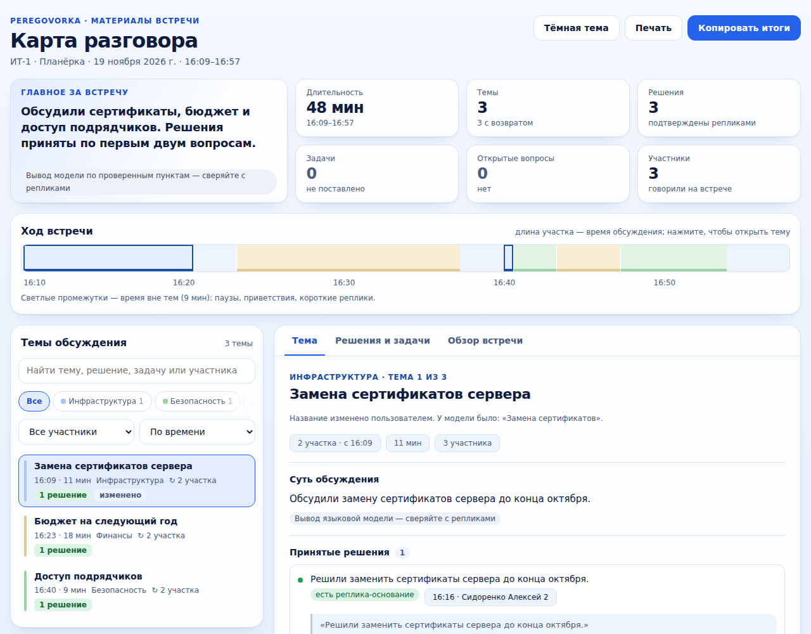

# Карта разговора

*Для кого: участники встречи, организатор, руководитель комнаты.*

## Зачем это нужно

Карта отвечает на три вопроса: что обсуждали, к каким решениям пришли и кто что делает дальше. Сверху — главный итог встречи и показатели, ниже — темы с поиском и временной шкалой, справа — содержимое выбранной темы. Из любого вывода можно перейти к реплике, на которой он основан. Это быстрее, чем читать всю стенограмму, и удобно тому, кого на встрече не было.

## Когда пригодится

- Встреча длилась несколько часов, и нужно найти одну тему.
- Нужно объяснить коллеге ход обсуждения.
- Хотите увидеть, к каким темам возвращались несколько раз.

## Что потребуется

- Встреча завершена, в стенограмме есть реплики. Карта строится только по стенограмме.
- Смотреть карту могут все, у кого есть доступ к встрече.
- Формировать могут организатор, руководитель комнаты и администратор.
- Править темы могут руководитель комнаты и администратор.
- Для карты назначена языковая модель. Её назначает администратор.

## Где найти

**История** → встреча → вкладка **Карта разговора**.

## Как это сделать

### Сформировать карту

1. Откройте вкладку **Карта разговора**.
2. Если нужны особые условия, нажмите **Параметры…**. Откроется окно **Модель и параметры**. Там можно выбрать режим **Обезличивания**, а руководитель и администратор могут выбрать другую модель на этот раз.
3. Нажмите **Сформировать карту** на вкладке или в окне **Параметры…**.
4. Дождитесь результата. Состояние меняется: **В очереди**, **Обрабатывается**, **Готово**. Тяжёлые задачи выполняются по одной, поэтому карта может ждать очередь. Со страницы можно уйти, карта всё равно сформируется. Но если ваш доступ к встрече временный, вернуться к ней вы не сможете.

По умолчанию карты сами не строятся. Руководитель может включить это: **Настройки комнаты… → Материалы → Карта разговора после встречи**. Варианты: **Как в общих настройках**, **Формировать автоматически**, **Не формировать автоматически**.

### Читать карту

| Часть | Что показывает |
| --- | --- |
| **Главное за встречу** | короткий итог: что решили и какой следующий шаг. Его пишет модель только по проверенным решениям и поручениям; если их нет, так и сказано |
| Показатели | длительность, число тем, решений, задач, открытых вопросов и участников. Считаются по самой карте |
| **Ход встречи** | шкала времени. Каждый участок — отрезок темы; если к теме возвращались, у неё несколько участков. Штриховка — участок, который не удалось разобрать; светлые промежутки — время вне тем |
| **Темы обсуждения** | список тем по времени: начало, длительность, категория, «↻ участки», если к теме возвращались, и число решений, задач и вопросов. Поиск, фильтр по категории и по участнику, порядок «По времени», «Сначала долгие», «Сначала с решениями» |
| **Тема** | выбранная тема: **Суть обсуждения**, **Принятые решения**, **Задачи и поручения**, **Предложено, но не согласовано**, **Открытые вопросы**, **Когда обсуждали**, **Кто участвовал**, **Подтверждающие реплики**, **Связанные обсуждения** |
| **Решения и задачи** | все результаты встречи в одном месте, без повторов. У задачи — ответственный и срок, если они названы в стенограмме; если нет, написано «не назван» |
| **Обзор встречи** | последовательность обсуждения, время по категориям, активность участников, связи между темами, площадь тем и раздел **Достоверность** |

1. Нажмите тему в списке или участок на шкале. Справа появится её содержимое.
2. Нажмите время у реплики, чтобы перейти к ней. Откроется вкладка **Стенограмма** с подсвеченной репликой.
3. **Копировать итоги** кладёт в буфер обмена итог, решения, задачи, предложения и вопросы — текстом для письма или чата.

На клавиатуре: в списке тем стрелки вверх и вниз переключают темы, во вкладках — стрелки влево и вправо.

Что откуда берётся:

- Время, участники и цитаты — из стенограммы.
- Решение, задача, предложение и вопрос попадают на карту, только если найдена реплика-основание. «Можно попробовать» — это предложение, а не решение.
- Ответственный и срок не додумываются.
- Названия тем, суть и итог встречи — вывод модели: сверяйте их с репликами.
- Доля участника — длительность его реплик, а не оценка вклада.

Категории тем: **Инфраструктура**, **Разработка**, **Безопасность**, **Организационные вопросы**, **Финансы**, **Процессы**, **Данные и регламенты**, **Продукт и клиенты**, **Продажи и маркетинг**, **Команда и персонал**, **Право и соответствие**, **Общие обсуждения**. Это предметная область, а не оценка. На карте видны только встретившиеся категории.

Карты, построенные до версии 0.78.0, открываются как раньше, но без итога от модели и без раздела «Предложено, но не согласовано». Чтобы они появились, переформируйте карту.

### Поправить тему

Нужны права руководителя комнаты или администратора.

1. Выберите тему и нажмите **Править**.
2. Измените **Название темы**, **Категорию** или добавьте **Заметку к теме**.
3. Нажмите **Сохранить**.

Правки хранятся отдельно от ответа модели и не теряются при переформировании. **Вернуть как у модели** отменяет правку.

### Переформировать карту

1. Нажмите **Переформировать**.
2. Пока новая карта строится, показывается прежняя. Она заменится, только если новая построена успешно.
3. Если новая карта хуже, нажмите **Вернуть прежнюю карту**. Повторное нажатие вернёт новую.

Один человек может запустить не больше 12 построений карты в час.

### Сохранить и отправить

- **Скачать HTML**: один файл, который открывается без сервера и без входа. В нём работают поиск, фильтры, шкала, все три режима и тёмная тема.
- **Печать**: кнопка в скачанном файле или печать браузера. На бумаге — итог, все решения и задачи, затем все темы подряд.
- Отправить по почте: [Как отправить материалы](Как-отправить-материалы). Карта вкладывается отдельным HTML-файлом.

В файле карты время реплики показано текстом: переход к стенограмме работает только на сервере Peregovorka.

## Что получится

На вкладке показана карта. Переформирование и скачивание попадают в журнал аудита и в **Историю действий**.

## Если не получается

| Симптом | Причина | Что сделать |
| --- | --- | --- |
| Кнопка формирования неактивна | встреча идёт, нет реплик, модель не настроена или карта уже формируется | подсказка на кнопке и строка под ней называют причину |
| Кнопок формирования нет | у вас нет прав | попросите организатора |
| Состояние **Ошибка** | модель не ответила или вернула неразбираемый ответ | нажмите **Переформировать**; руководитель может выбрать другую модель в **Параметры…** |
| «Новую карту построить не удалось» | новая карта не получилась, показана прежняя | нажмите **Параметры…** и выберите другую модель |
| «Исходная стенограмма недоступна: возможно, удалена согласно сроку хранения» | реплик, на которые ссылается карта, уже нет | срок хранения текста удаляет карту вместе со стенограммой: она исчезнет при ближайшей очистке |
| «Слишком много запросов на построение карт за час» | сработало ограничение | повторите позже |
| Нет кнопки **Править** | править могут руководитель и администратор | обратитесь к руководителю комнаты |

Качество тем проверялось автоматически по ключевым словам, ручной проверки карт не проводилось. Считайте карту подсказкой, а не документом.

## Что дальше

- [Как сформировать протокол](Как-сформировать-протокол)
- [Как отправить материалы](Как-отправить-материалы)
- [Как работает обезличивание](Как-работает-обезличивание)
