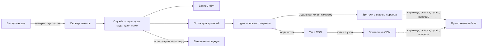

# Кто создаёт нагрузку при трансляции

*Для кого: организатор мероприятия, администратор.*

## Зачем это нужно

Вопрос «сколько зрителей выдержит сервер» не имеет одного ответа. Выступающие, служба эфира, зрители с вашего сервера и зрители на CDN нагружают разное. Эта страница показывает, кто за что отвечает и что об этом известно на самом деле.

Вместимость всей системы при эфире не подтверждена. Сквозного испытания, где одновременно идут эфир, встречи, запись, распознавание речи и настоящие зрители, не было. Статус: неизвестно.

## Когда пригодится

- Вы планируете большое мероприятие.
- Надо решить, нужны ли CDN или внешняя площадка.
- Администратор выбирает сервер.

## Как идёт поток

## Кто что нагружает

| Кто | Что нагружает | Зависит от числа зрителей? |
|---|---|---|
| **Выступающие** | сервер звонков, как участники обычной встречи | нет |
| **Служба эфира** | процессор и память основного сервера: браузер и кодирование одного общего кадра | нет. Кодирование одно на эфир, а не на зрителя |
| **Запись** | локальный диск во время эфира, затем том записей | нет |
| **Внешняя площадка** | один исходящий поток с вашего сервера | нет. Зрители площадки вас не нагружают |
| **Зритель с вашего сервера** | исходящий канал и nginx: получает свою копию видео. При низкой задержке ещё служба низкой задержки | да, почти линейно |
| **Зритель на узле CDN** | видео идёт с узла: нагружает узел и его канал. Основной сервер отдаёт узлу один поток | видео нет, служебные запросы да |
| **Любой зритель** | приложение, база, Redis: открытие страницы, выдача и продление ссылки, пульс раз в 30 с, вопросы | да |
| **Просмотр записи после эфира** | основной сервер: запись не идёт через CDN | да |

Главное: CDN снимает с основного сервера видео, но не служебные запросы. Страница зрителя, ссылка, пульс и вопросы всё равно идут на основной сервер. Как ведёт себя основной сервер при тысячах таких зрителей, не проверялось.

## Что известно в цифрах

Все значения получены на одном тестовом сервере на 20 ядер, зрители смоделированы программой, сеть проходила через виртуальный мост. Настоящий интернет-канал не проверялся. Перенос этих чисел на ваш сервер будет оценкой.

| Что измеряли | Результат | Условия | Статус |
|---|---|---|---|
| Служба эфира, 720p | ≈ 1,2 ядра, пик ≈ 2,2 | 5 минут, синтетические камеры | Проверено в ограниченном сценарии |
| Служба эфира, 1080p | 3 ядра, память 1,63 → 1,94 ГБ | эфир 2 часа, синтетический докладчик | Проверено в ограниченном сценарии |
| Служба эфира, 1440p | нет данных | | Неизвестно |
| Запас на один эфир | 3–4 ядра, 1–2 ГБ | вывод из замеров выше, на эфиры дольше 2 часов не распространяется | Расчётная оценка |
| Прямая раздача, 1080p | 300 зрителей, 1,55 Гбит/с, без остановок | 60 с, настоящих браузеров было до 5 | Проверено в ограниченном сценарии |
| Трафик на зрителя, 1080p | ≈ 5,2 Мбит/с | вывод из строки выше | Проверено в ограниченном сценарии |
| Трафик на зрителя, 720p | ≈ 3,1 Мбит/с | по битрейту, прямого замера нет | Расчётная оценка |
| Низкая задержка | 300 клиентов, 0 ошибок; служба 0,9 ядра и 65 МБ, nginx 2,1 ядра | один генератор, длительность по умолчанию 40 с, фактическая не записана | Проверено в ограниченном сценарии |
| Узел CDN 8 vCPU, 1080p | 1500 зрителей, 7,87 Гбит/с, 4,76 ядра, без остановок | 60 с, узел, источник и генератор на одной машине | Проверено в ограниченном сценарии |
| Трафик источника с узлом | 5,5 Мбит/с вместо 1408 Мбит/с на 300 зрителей | 60 с, считались только сегменты видео | Проверено в ограниченном сценарии |
| Прямой просмотр WebRTC | под нагрузкой не измерялся | несколько браузеров | Требует дополнительного тестирования |
| Служебные запросы тысяч зрителей | не измерялись | | Требует дополнительного тестирования |
| Конкуренция эфира и встреч за процессор | не измерялась | | Требует дополнительного тестирования |
| Настоящие зрители в интернете в масштабе | не больше 5 браузеров | | Требует дополнительного тестирования |

Полные таблицы: [Производительность и требования к серверу для трансляций](Производительность-и-требования-к-серверу-для-трансляций).

## Как считать канал

Исходящий канал при прямой раздаче: число зрителей умножить на битрейт. Для 100 зрителей 1080p это около 520 Мбит/с. Это расчётная оценка: она не учитывает потери, пики и то, что по этому же каналу идут встречи и площадки.

Порог «Предупреждать о нагрузке при зрителях», 150 по умолчанию, только показывает предупреждение и ничего не ограничивает. Обоснования именно этого числа замером нет. Статус: неизвестно.

## Как снизить нагрузку

- Откажитесь от собственного просмотра, если эфир нужен только площадкам: сервер не будет раздавать видео.
- Перенесите аудиторию на внешнюю площадку.
- Подключите [узлы CDN](Узлы-CDN) или [сторонний CDN](CDN-для-массовых-мероприятий).
- Снизьте качество: [Качество эфира](Качество-эфира).
- Не проводите крупный эфир одновременно с большими встречами на этом же сервере.
- Выполните пробу на своём оборудовании до мероприятия.

## Что дальше

- [Массовые трансляции](Массовые-трансляции)
- [Производительность и требования к серверу для трансляций](Производительность-и-требования-к-серверу-для-трансляций)
- [Узлы CDN](Узлы-CDN)
