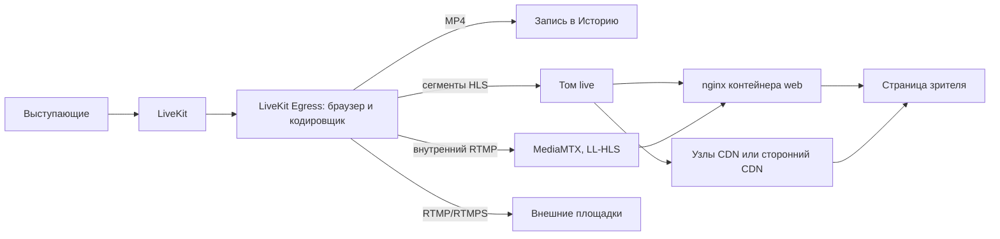

# Массовые трансляции

*Для кого: администратор, организатор крупных мероприятий.*

## Зачем это нужно

Страница объясняет, как устроен эфир в Peregovorka, какими путями видео доходит до зрителей и когда хватает одного сервера, а когда нужны CDN или внешние площадки. Что такое эфир и чем он отличается от встречи, сказано в [Режим трансляции](Режим-трансляции).

Вместимость всей системы при эфире не подтверждена. Наибольшее проверенное число: 1500 зрителей, смоделированных программой на одном узле CDN в течение 60 секунд. Настоящих браузеров одновременно было до 5. Статус: требует дополнительного тестирования. Не обещайте аудиторию без пробы на своём оборудовании.

## Как это устроено

- Один процесс **LiveKit Egress** собирает общий кадр комнаты и кодирует его один раз. Отдельного кодирования на зрителя нет.
- Выходов четыре: файл MP4, обычный HLS, внутренний поток для низкой задержки и внешние площадки.
- **HLS** это короткие видеофайлы и список к ним. Сегменты отдаёт nginx контейнера web с диска, мимо приложения. Служебные запросы зрителя идут через приложение: выдача ссылки, пульс, вопросы.
- **LL-HLS** это HLS с короткими частями и задержкой около 3 с. Его делает необязательная служба MediaMTX без перекодирования.
- **Ссылка зрителя** открывает страницу просмотра, **ссылка на поток** открывает сам плейлист. Обе можно отозвать.
- Адрес потока подписан, поэтому пароль зрителя защищает и страницу, и видео.

## Какими путями смотрят зрители

Сервер выбирает путь для каждого зрителя сам.

| Путь | Задержка, 1080p | Кому выдаётся |
|---|---|---|
| LL-HLS | 2,86 с | зрители с основного сервера, в пределах «Зрителей с низкой задержкой, не больше» (300 по умолчанию) |
| Обычный HLS | 7,45 с | Safari, iPhone и iPad, комнаты с CDN, зрители сверх предела, запасной путь |
| WebRTC | 70 мс | выключен по умолчанию; включается «Зрителей по WebRTC, не больше»; нужен доступ к серверу звонков по UDP или TCP |
| Выход на площадку | 2,28 с до её сервера | внешние площадки, дальше их собственная задержка |
| Зритель VK Видео Live | 5,33 с | плеер площадки выбрал 360p |
| Зритель RUTUBE | 14,29 с | около 12 с вносит площадка |

Статус всех значений: проверено в ограниченном сценарии. Условия: один сервер, один центр обработки данных, синтетический докладчик, сеть зрителя не проверялась, Safari и iOS не проверялись. LL-HLS дополнительно проверен в эфире на 2 часа: 2,84 с, плеер при этом потерял 3,5 % кадров на загруженном тестовом сервере.

## Что будет при сбое пути

Зрителю ничего делать не нужно.

| Что отказало | Что происходит |
|---|---|
| WebRTC не соединился за 8 секунд | плеер переходит на HLS |
| LL-HLS ещё не готов, первые 10 секунд эфира | зритель смотрит обычный HLS, плеер переходит сам |
| Служба MediaMTX остановилась | плеер уходит на обычный HLS и остаётся на нём; запись и площадки не затронуты |
| Узел CDN перестал отвечать | плеер берёт другой узел, затем основной сервер |
| Все узлы недоступны | основной сервер или, если снят флажок резервной раздачи, повторы попыток |

## Что важно знать

| Вопрос | Ответ |
|---|---|
| От чего зависит нагрузка | [Кто создаёт нагрузку при трансляции](Кто-создаёт-нагрузку-при-трансляции) |
| Трафик на зрителя | ≈ 5,2 Мбит/с в 1080p (проверено в ограниченном сценарии: 300 моделируемых зрителей, 60 с); ≈ 3,1 Мбит/с в 720p (расчётная оценка) |
| Канал зрителя | 1080p: 12 Мбит/с без остановок, 8 Мбит/с с двумя остановками. Статус: проверено в ограниченном сценарии, один браузер, искусственное ограничение канала. Для 1440p данных нет |
| Качество | одна дорожка: [720p, 1080p или 1440p](Качество-эфира). Автоподстройки под канал зрителя нет |
| Запись | MP4 пишется тем же процессом, отдельного браузера не нужно |
| Шифрование | при сквозном шифровании и шифровании хранилища комнаты эфир недоступен |
| Эфиры на сервере | по умолчанию 1. Значение 2 и выше не испытано: требует дополнительного тестирования |
| Эфир и встречи на одном сервере | эфир не вытесняет встречи намеренно: служба эфира и сервер звонков получают процессор наравне, а новый эфир не начнётся при нагрузке выше предела. Защита идущих встреч под настоящей нагрузкой не проверялась |
| Комната с CDN | никогда не получает LL-HLS, даже при откате на основной сервер |

## Как выбрать схему

| Аудитория | Схема |
|---|---|
| Небольшая, внутри организации | прямая раздача с основного сервера, [HLS](Собственная-трансляция-по-HLS) |
| Выше предупреждения «Предупреждать о нагрузке при зрителях» | проба на своём канале, затем CDN или площадка |
| Большая, закрытая | [свои узлы CDN](Узлы-CDN) или [сторонний CDN](CDN-для-массовых-мероприятий) |
| Большая, открытая | [внешняя площадка](Трансляция-по-ссылке-и-внешние-площадки) |

## Что дальше

- [Режим трансляции](Режим-трансляции)
- [Создание трансляционной комнаты](Создание-трансляционной-комнаты)
- [Управление прямым эфиром](Управление-прямым-эфиром)
- [Производительность и требования к серверу для трансляций](Производительность-и-требования-к-серверу-для-трансляций)
- [Диагностика трансляций](Диагностика-трансляций)
