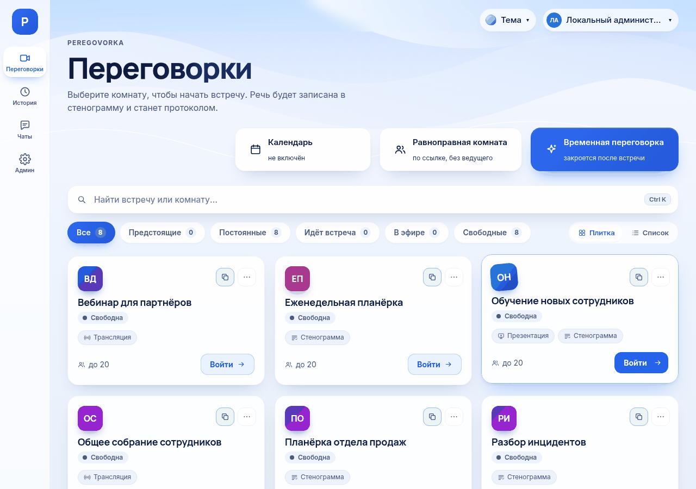
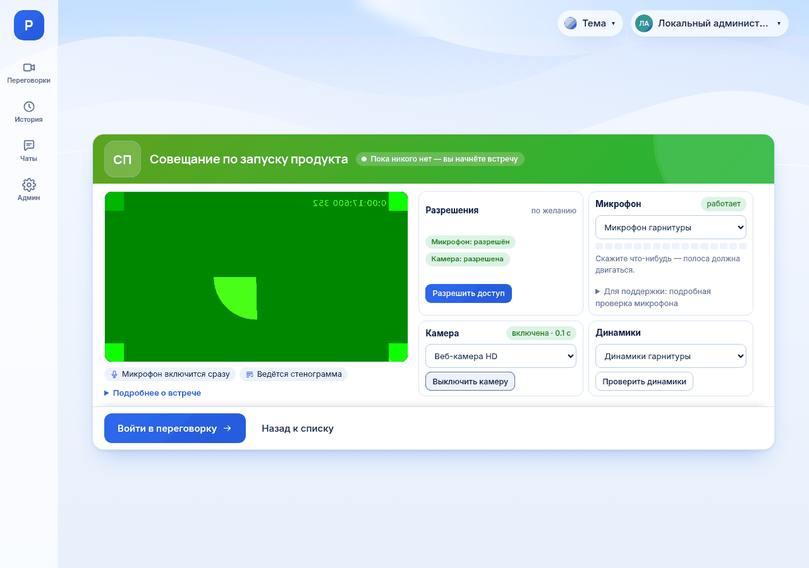

# Первый день в Peregovorka

*Для кого: сотрудник, который открывает Peregovorka впервые.*

Это сквозной сценарий: от первого входа до участия во встрече. У каждого шага указано, что вы должны увидеть. Если видите другое, смотрите раздел [Если не получается](#если-не-получается) в конце страницы.

## Зачем это нужно

Peregovorka — это система видеовстреч вашей организации. После этого сценария вы сможете войти, проверить оборудование, зайти в комнату и поговорить с коллегами. Вся работа займёт около 15 минут.

## Что потребуется

- Адрес сервера вашей организации, например `https://meet.example.org`. Его сообщает администратор.
- Рабочий логин и пароль. Обычно это те же данные, что для входа в компьютер.
- Компьютер с браузером Chrome или Edge. На компьютере должен быть микрофон или гарнитура. Камера не обязательна.
- Название комнаты или ссылка на встречу. Если их нет, сценарий покажет, как создать свою комнату.

Вы хотите работать на телефоне или в приложении? Сначала прочитайте [Веб-версия и приложения](Веб-версия-и-приложения). В приложениях для Windows и Linux шаги с 4 по 12 те же. В приложении для Android вход и встреча выглядят иначе, различия отмечены ниже.

## Как это сделать

### Шаг 1. Откройте адрес сервера

1. Запустите Chrome или Edge.
2. Вставьте адрес сервера в адресную строку и нажмите Enter.

**Что увидите:** страницу входа с полями **Логин** и **Пароль**.

### Шаг 2. Войдите

1. В поле **Логин** введите логин, например `ivanov`.
2. В поле **Пароль** введите пароль.
3. Нажмите **Войти**.

**Что увидите:** страницу **Переговорки**. Перед ней могут появиться дополнительные экраны: код подтверждения, документы организации, настройка защиты входа. Что делать на каждом из них, описано в статье [Как войти в систему](Как-войти-в-систему).

### Шаг 3. Осмотрите главную страницу

Слева находится панель разделов. На телефоне это нижняя полоса.

| Раздел | Что там |
| --- | --- |
| **Переговорки** | комнаты и предстоящие встречи |
| **Календарь** | ваш календарь Outlook, если организация его подключила |
| **История** | прошедшие встречи и их материалы |
| **Чаты** | переписка вне встреч |
| **Админ** | настройки сервера, только для администраторов |

Сверху справа находится ваше имя. Нажмите на него, чтобы открыть меню: **Личный кабинет**, **История моих встреч**, **Выйти**.

**Что увидите:** в центре страницы поиск, фильтры и карточки комнат.

### Шаг 4. Проверьте свои данные

1. Нажмите на своё имя сверху справа.
2. Выберите **Личный кабинет**.
3. Проверьте ФИО и подразделение.
4. Нажмите **Загрузить фото**, если хотите показать коллегам своё фото вместо инициалов.

**Что увидите:** свою карточку с именем и фото. Шаг можно пропустить. Подробнее: [Как изменить профиль и параметры](Как-изменить-профиль-и-параметры).

### Шаг 5. Найдите комнату

1. Вернитесь на страницу **Переговорки**.
2. Введите название в поле **Найти встречу или комнату…**. Быстрый переход к полю: Ctrl+K.
3. Либо нажмите фильтр: **Все**, **Предстоящие**, **Постоянные**, **Идёт встреча**, **В эфире**, **Свободные**.

**Что увидите:** карточку нужной комнаты.

Комнат нет? Нажмите **Временная переговорка**, введите **Название встречи** и нажмите **Создать**. Вы сразу перейдёте к шагу 7 и станете руководителем этой комнаты. Кнопки нет, если администратор выключил временные комнаты.

### Шаг 6. Откройте комнату

Нажмите на карточку комнаты. На ней написано:

- **Войти**, если комната свободна;
- **Присоединиться**, если встреча уже идёт;
- **Мест нет**, если комната заполнена.

Если вы получили ссылку от коллеги, откройте её. Комната откроется сразу, когда вы уже вошли в систему.

**Что увидите:** экран входа с названием комнаты, карточками оборудования и списком того, что произойдёт после входа.

### Шаг 7. Проверьте оборудование

Проверка необязательна, но экономит время на встрече.

1. На карточке **Разрешения** нажмите **Разрешить доступ**.
2. В окне браузера разрешите доступ к микрофону и камере.
3. Нажмите **Проверить микрофон** и скажите несколько слов.
4. Нажмите **Проверить камеру**, если хотите войти с камерой.
5. Нажмите **Проверить динамики**.

**Что увидите:** у микрофона отметку **работает** и движущуюся полосу, у камеры своё изображение, из динамиков короткий звук. Подробнее: [Как проверить камеру и микрофон](Как-проверить-камеру-и-микрофон).

### Шаг 8. Войдите во встречу

1. Если на экране есть поле **Пароль комнаты**, введите пароль от организатора.
2. Нажмите **Войти в переговорку** или **Присоединиться**.

**Что увидите:** комнату с плитками участников и панелью кнопок внизу. Если в комнате никого нет, встреча начинается с вашего входа.

Обычно микрофон включается сразу. Камера включается, только если вы оставили её включённой на проверке. В презентационной комнате вы входите зрителем: микрофон и камера выключены, пока руководитель не даст слово.

### Шаг 9. Поговорите

1. Посмотрите на кнопку **Микрофон**. Нажмите её, чтобы выключить или включить звук.
2. Нажмите **Камера**, чтобы показать себя.
3. Нажмите **Рука**, если хотите попросить слово.
4. Нажмите **Чат** и напишите сообщение. Enter отправляет его, Shift+Enter переносит строку.

**Что увидите:** коллеги слышат вас, значок микрофона на вашей плитке показывает, что вы говорите. Сообщение появляется в чате. Если в комнате ведётся стенограмма, реплики появляются в правой панели **Транскрипция и чат**.

### Шаг 10. Выйдите из встречи

Нажмите красную кнопку **Выйти**.

**Что увидите:** страницу **Переговорки**. У остальных участников встреча продолжится. Кнопка **Завершить** заканчивает встречу для всех, её видят только те, у кого есть такое право.

## Что получится

Вы вошли в систему, проверили оборудование и поучаствовали во встрече. Плитка с вашим именем была видна всем участникам, а ваши реплики попали в стенограмму, если она велась.

Материалы встречи находятся в разделе **История**. Обычному участнику они доступны, только пока открыта страница завершённой встречи. Подробнее: [Где найти материалы встречи](Где-найти-материалы-встречи).

## Если не получается

| Что видно | Почему | Что сделать |
| --- | --- | --- |
| Страница не открывается | нет сети или неверный адрес | проверьте адрес, включите VPN, если он нужен в вашей организации |
| **Неверный логин или пароль.** | ошибка в данных | проверьте раскладку и Caps Lock, затем [Как войти в систему](Как-войти-в-систему) |
| **Для вас пока нет доступных комнат.** | вам не открыт доступ к постоянным комнатам | создайте временную переговорку или попросите доступ у администратора |
| Вы открыли ссылку на комнату до входа, а после входа попали на главную страницу | сайт после входа открывает главную страницу | откройте ссылку ещё раз или найдите комнату поиском |
| Браузер не спрашивает разрешение | доступ запрещён раньше | [Как проверить камеру и микрофон](Как-проверить-камеру-и-микрофон) |
| Вас не слышат | выключен или занят микрофон | [Решение проблем: микрофон](Решение-проблем-микрофона) |
| **Связь потеряна.** | оборвалось соединение | подождите, страница подключится сама: [Как выйти и восстановить связь](Как-выйти-и-восстановить-связь) |

**В приложении для Android:** страница сервера открывается внутри приложения, а экрана проверки оборудования нет. Микрофон и камера выбираются на листе входа в комнату переключателями. См. [Как установить приложение для Android](Как-установить-приложение-для-Android).

## Что дальше

- [Первые шаги с Peregovorka](Первые-шаги-с-Peregovorka): пробная встреча вдвоём, от входа до протокола
- [Маршрут сотрудника](Маршрут-сотрудника): все статьи для работы в порядке изучения
- [Как включить микрофон и камеру](Как-включить-микрофон-и-камеру)
- [Как показать экран](Как-показать-экран)
