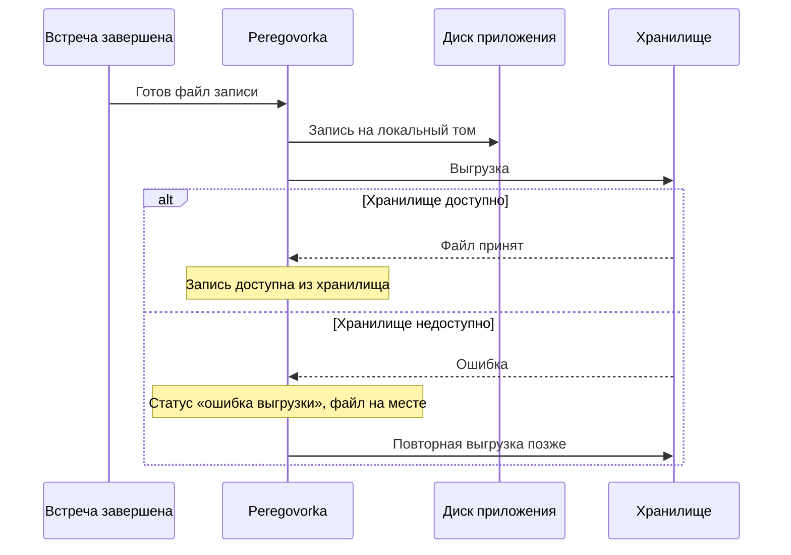
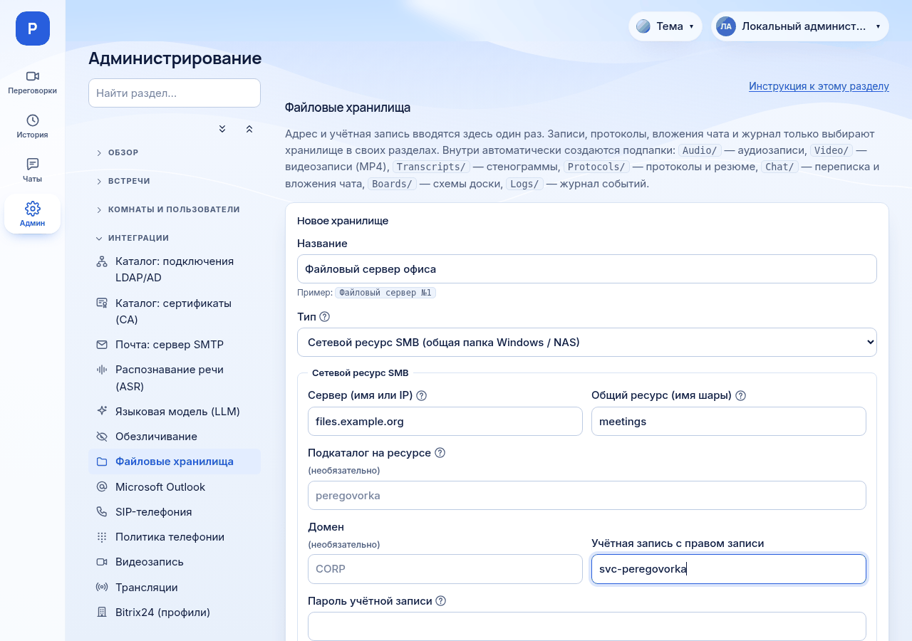

# Подключение внешних хранилищ

*Для кого: администратор сервера.*

## Зачем это нужно

Записи встреч, протоколы и вложения чата занимают много места. Внешнее хранилище позволяет держать их не на диске сервера приложения, а на файловом сервере или NAS (сетевом хранилище). Там проще организовать объём и резервные копии.

## Что поддерживается

| Способ | Что это | Кто подключает | Когда выбрать |
| --- | --- | --- | --- |
| Сетевой ресурс SMB | общая папка Windows или NAS, приложение подключается само, монтировать не нужно | администратор в браузере | у вас есть файловый сервер Windows или NAS с SMB |
| Локальный каталог | каталог внутри контейнера, по умолчанию `/data/exports`, лежит в `DATA_ROOT` | администратор в браузере | небольшая установка, всё на одном диске |
| Внешний том | каталог на сервере, куда уже смонтированы NFS, iSCSI, SMB или отдельный диск | системный администратор монтирует, приложение подключает | NFS, второй диск, SMB с особыми параметрами монтирования |

Других типов нет. Объектные хранилища S3, WebDAV и FTP приложением не поддерживаются.

### Что проверено

| Что | Статус |
| --- | --- |
| SMB на Samba | проверено на тестовом экземпляре: запись, удаление, перенос файлов 300 и 600 МБ, остановка сервера SMB посреди копирования |
| NFSv4.2 как внешний том | проверено в виртуальной машине Ubuntu 24.04 с настоящим сервером NFS на той же машине, приложение целиком на этой машине не запускалось |
| Windows Server SMB | не проверялось |
| Настоящий NAS, в том числе QNAP | не проверялось |
| SMB, смонтированный системой как внешний том | не проверялось |
| Запись под нагрузкой, большие объёмы, миллионы файлов | не проверялось |

Перед рабочим применением проверьте хранилище у себя, см. раздел «Что получится».

## Когда пригодится

- Диск сервера заполняется записями.
- Материалы должны лежать на файловом сервере организации.
- Записи и протоколы нужно хранить раздельно.

## Как это устроено

Хранилище создаётся один раз. Функции затем только выбирают его в своих разделах, адрес и пароль второй раз вводить не нужно. Внутри автоматически создаются подпапки.

| Функция | Подпапка | Где выбрать хранилище |
| --- | --- | --- |
| Аудиозаписи | `Audio/` | **Хранение и журналы → Хранилище аудиозаписей** |
| Видеозаписи | `Video/` | **Интеграции → Видеозапись** |
| Стенограммы | `Transcripts/` | **Хранение и журналы → Хранилище документов встреч** |
| Протоколы и резюме | `Protocols/` | **Хранение и журналы → Хранилище документов встреч** |
| Переписка | `Chat/` | **Хранение и журналы → Хранилище документов встреч** |
| Схемы доски | `Boards/` | **Хранение и журналы → Хранилище документов встреч** |
| Вложения чата | `Chat/files/` | **Хранение и журналы → Хранилище вложений чата** |
| Журнал событий | `Logs/journal/` | **Хранение и журналы → Хранение журнала** |

Сбой хранилища не теряет запись: файл остаётся на диске приложения и выгружается повторно.

Вложение чата ведёт себя иначе: при недоступном хранилище оно не принимается, пользователь увидит ошибку, а в журнал попадёт `chat_file_save_failed`.

## Что потребуется

Для SMB:

- Адрес сервера, имя общего ресурса, при необходимости подкаталог.
- Служебная учётная запись с правом записи и создания папок.
- Доступ с сервера приложения до файлового сервера, порт 445/TCP. Нестандартный порт указывается как `имя:порт`.
- Вход определяется сервером: NTLM или Kerberos. Приложение само не требует шифрования SMB. Если данные идут через недоверенную сеть, включите шифрование на файловом сервере или в сети.

Для внешнего тома: `sudo` на сервере и работающий помощник обновлений, см. [Внешние тома](Внешние-тома).

Права администратора сервера Peregovorka.

## Где найти

**Администрирование → Интеграции → Файловые хранилища**. В левой панели раздел подписан **Админ**.

## Как это сделать

### Подключите SMB

1. Откройте **Администрирование → Интеграции → Файловые хранилища**.
2. Нажмите **＋ Добавить хранилище**.
3. Заполните **Название**, например `Файловый сервер №1`.
4. В поле **Тип** выберите **Сетевой ресурс SMB (общая папка Windows / NAS)**. После создания тип не меняется.
5. Заполните:
   - **Сервер (имя или IP)**: `files.example.org`, без `smb://` и слэшей;
   - **Общий ресурс (имя шары)**: `meetings`;
   - **Подкаталог на ресурсе**: при необходимости;
   - **Домен**: при необходимости;
   - **Учётная запись с правом записи**: `svc-peregovorka`;
   - **Пароль учётной записи**: хранится зашифрованным и после сохранения не показывается.
6. Нажмите **Сохранить**.
7. Нажмите **Проверить** в строке хранилища. Приложение выполнит пробную запись и создаст подпапки.

### Подключите локальный каталог

1. В форме нового хранилища выберите **Локальный каталог на сервере приложения**.
2. В поле **Каталог внутри контейнера** укажите абсолютный путь внутри контейнера, например `/data/exports`. Это не путь Windows и не путь на сервере.
3. Нажмите **Сохранить**, затем **Проверить**.

### Подключите внешний том

1. Смонтируйте ресурс на сервере, например в `/mnt/nas-nfs`.
2. В форме выберите **Локальный каталог на сервере приложения**.
3. Отметьте **Внешний том: смонтированная сетевая папка или диск**.
4. В поле **Путь на сервере** укажите `/mnt/nas-nfs`.
5. Нажмите **Сохранить**, затем **Проверить**. Кнопка ставит на том метку и запоминает, что он смонтирован.

Если том отключится, запись, выгрузка и перенос в него остановятся, а не заполнят системный диск. Полная инструкция: [Внешние тома](Внешние-тома).

### Назначьте хранилище функциям

1. Откройте нужный раздел из таблицы выше, например **Хранение и журналы → Хранилище аудиозаписей**.
2. Включите выгрузку: **Выгружать аудиозаписи во внешнее хранилище** или **Выгружать протоколы во внешнее хранилище**.
3. Выберите созданное хранилище.
4. Сохраните и нажмите **Проверить подключение**.

Выбор хранилища не переносит уже записанные файлы. Они остаются на прежнем месте. Перенести их можно отдельно: [Как перенести данные между хранилищами](Как-перенести-данные-между-хранилищами).

## Что получится

В таблице хранилищ в колонке **Используется для** перечислены функции. Проверьте полный путь:

1. Проведите короткую встречу с записью.
2. Откройте на файловом сервере папку `Audio/`: там появится файл.
3. Запустите сверку: **Хранение и журналы → Целостность хранилищ**. Отсутствующих файлов быть не должно.
4. Откройте запись в материалах встречи и прослушайте.
5. Отключите хранилище на время и убедитесь, что запись новой встречи не потерялась и выгрузилась после восстановления.

## Обслуживание

- **Сверка.** **Целостность хранилищ** сравнивает базу с файлами. Неизвестные файлы только показываются, ничего не удаляется и не импортируется. Если хранилище недоступно, объекты не помечаются удалёнными.
- **Шифрование.** Содержимое хранилищ можно шифровать, см. [Шифрование](Шифрование).
- **Удаление хранилища.** Хранилище, выбранное какой-либо функцией или содержащее вложения чата, удалить нельзя. Файлы на самом ресурсе при удалении не стираются.
- **Резервные копии.** Содержимое внешнего хранилища не входит в архив `backup.sh`. Копируйте его средствами хранилища.

## Если не получается

| Что видно | Причина | Что сделать |
| --- | --- | --- |
| **Проверить** сообщает об ошибке входа | неверная учётная запись или пароль | проверьте домен, логин и пароль, введите пароль заново |
| Нет соединения с сервером | закрыт порт 445, неверное имя | проверьте сеть с сервера приложения |
| Нет прав записи | у учётной записи нет права создавать файлы | выдайте право на подкаталог |
| «не подключён: запись остановлена» | внешний том не смонтирован | смонтируйте, приложение подключит том само |
| «не отвечает: запись остановлена» | сервер хранения недоступен | восстановите связь, данные на месте |
| Запись со статусом «ошибка выгрузки» | хранилище было недоступно | после восстановления выгрузка повторится |
| «хранилище вложений недоступно» | хранилище вложений не отвечает | проверьте хранилище |
| Хранилище не удаляется | оно используется | сначала выберите другое в функциях |

Подробный разбор: [Решение проблем файловых хранилищ](Решение-проблем-файловых-хранилищ). Журнал: **Хранение и журналы → Журнал событий**, категория `storage`.

## Что дальше

- [Внешние тома](Внешние-тома).
- [Как перенести данные между хранилищами](Как-перенести-данные-между-хранилищами).
- [Сроки хранения материалов](Сроки-хранения-материалов).
- [Решение проблем файловых хранилищ](Решение-проблем-файловых-хранилищ).
