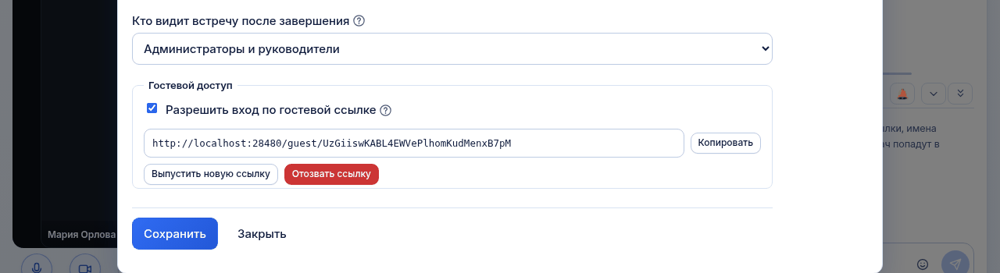

# Управление гостевыми ссылками

*Для кого: руководитель комнаты и администратор.*

## Зачем это нужно

Гостевая ссылка пускает во встречу человека без учётной записи: партнёра, подрядчика, клиента. Статья показывает, как включить ссылку, передать её, заменить и отозвать.

Инструкция для самого гостя: [Как подключить гостя](Как-подключить-гостя).

## Когда пригодится

- На встречу приглашён внешний участник.
- Ссылка попала к постороннему, её нужно заменить.
- Сотрудничество закончилось, гостевой вход пора закрыть.

## Что потребуется

- Права руководителя этой комнаты или администратора.
- Для постоянной комнаты: только эти права.
- Для временной переговорки: администратор разрешил **Разрешить владельцу временной комнаты выпускать гостевую ссылку**. По умолчанию выключено.
- Для встречи из Outlook или календаря: см. [Гостевые ссылки в приглашениях](Outlook-Гостевые-ссылки-в-приглашениях).

## Где найти

| Что нужно | Путь |
| --- | --- |
| Включить, заменить, отозвать | шестерёнка **Настройки** → **Настройки комнаты…** → **Доступ и гости** → блок **Гостевой доступ** |
| Скопировать ссылку | карточка комнаты → кнопка **Копировать гостевую ссылку** или меню `⋯` → **Скопировать гостевую ссылку** |

Ссылку видят только руководители комнаты и администраторы. Обычные участники её не получают.

## Как это сделать

### Включить гостевой вход

1. Откройте вкладку **Доступ и гости**.
2. Отметьте **Разрешить вход по гостевой ссылке**.
3. Нажмите **Сохранить**. Ссылка появится в этом же блоке.
4. Нажмите **Копировать**.
5. Отправьте ссылку гостю почтой или в мессенджере.

Ссылка имеет вид `https://example.org/guest/<код>`.

### Скопировать ссылку ещё раз

1. Откройте страницу **Переговорки**.
2. Найдите карточку комнаты.
3. Нажмите кнопку **Копировать гостевую ссылку** или выберите **Скопировать гостевую ссылку** в меню `⋯`.

Копирование не меняет ссылку.

### Заменить ссылку

1. Откройте вкладку **Доступ и гости**.
2. Нажмите **Выпустить новую ссылку**.
3. Подтвердите действие.
4. Отправьте новую ссылку тем, кому она нужна.

Прежняя ссылка перестаёт работать сразу. Гости, которые сейчас на встрече, отключаются.

### Отозвать ссылку

1. Откройте вкладку **Доступ и гости**.
2. Нажмите **Отозвать ссылку**.
3. Подтвердите действие.

Гостевой доступ выключается, гости на встрече отключаются, ссылка перестаёт работать.

### Чем отзыв отличается от выключения

| Действие | Гости на встрече | Старая ссылка |
| --- | --- | --- |
| Снять отметку **Разрешить вход по гостевой ссылке** и сохранить | отключаются | сохраняется, снова заработает после включения |
| **Выпустить новую ссылку** | отключаются | перестаёт работать, вход остаётся включённым |
| **Отозвать ссылку** | отключаются | перестаёт работать, вход выключается |

## Что получится

Гость открывает ссылку, вводит имя и проверяет оборудование. Он попадает в идущую встречу как **Имя (гость)**.

Правила для гостя:

- Гость не может начать встречу. Пока сотрудник не открыл комнату, гость видит **Встреча ещё не началась** и ждёт: страница обновляется сама.
- Если у комнаты есть пароль, гость вводит **Пароль комнаты**.
- Гости считаются в **Максимум участников**.
- Если организация требует подтвердить документы, гость подтверждает их перед входом.
- Гость говорит и включает камеру, если комната это разрешает. В презентационной комнате гость слушает.
- Гость пишет в чат встречи.
- Гость не показывает экран и не видит историю, стенограмму и материалы.
- Если гость указал почту и согласился, он сможет получить материалы встречи.

Действия с гостевой ссылкой записываются в журнал аудита.

## Если не получается

| Что видно | Причина | Что сделать |
| --- | --- | --- |
| Ссылка не появилась после отметки | настройка не сохранена | нажмите **Сохранить** |
| Кнопки копирования гостевой ссылки нет на карточке | вход выключен, или вы не руководитель | включите вход или обратитесь к руководителю |
| **Гостевая ссылка для временных переговорок отключена администратором** | это значение по умолчанию | администратор включает настройку в **Общие настройки** |
| **Гости во встречах Outlook отключены администратором** | гости запрещены политикой Outlook | см. [Гостевые ссылки в приглашениях](Outlook-Гостевые-ссылки-в-приглашениях) |
| Гость видит **Встреча ещё не началась** | в комнате нет сотрудника | откройте комнату |
| Гость видит **Ссылка недоступна** | ссылка заменена, отозвана или введена с ошибкой | отправьте действующую ссылку |
| Гость видит **Доступ закрыт** | ссылка отозвана во время встречи | выпустите новую ссылку, если доступ нужен |
| **В комнате нет свободных мест** | достигнут **Максимум участников** | увеличьте значение |
| Удалённый гость вернулся | сервер не пускает его до конца встречи только с той же вкладки браузера или с того же адреса под тем же именем. С новой вкладки и под другим именем он войдёт: учётной записи у гостя нет | нажмите **Выпустить новую ссылку** |

## Что дальше

- [Как подключить гостя](Как-подключить-гостя)
- [Управление участниками комнаты](Управление-участниками-комнаты)
- [Сценарий: встреча с внешними участниками](Сценарий-Встреча-с-внешними-участниками)
- [Гостевые ссылки в приглашениях](Outlook-Гостевые-ссылки-в-приглашениях)
