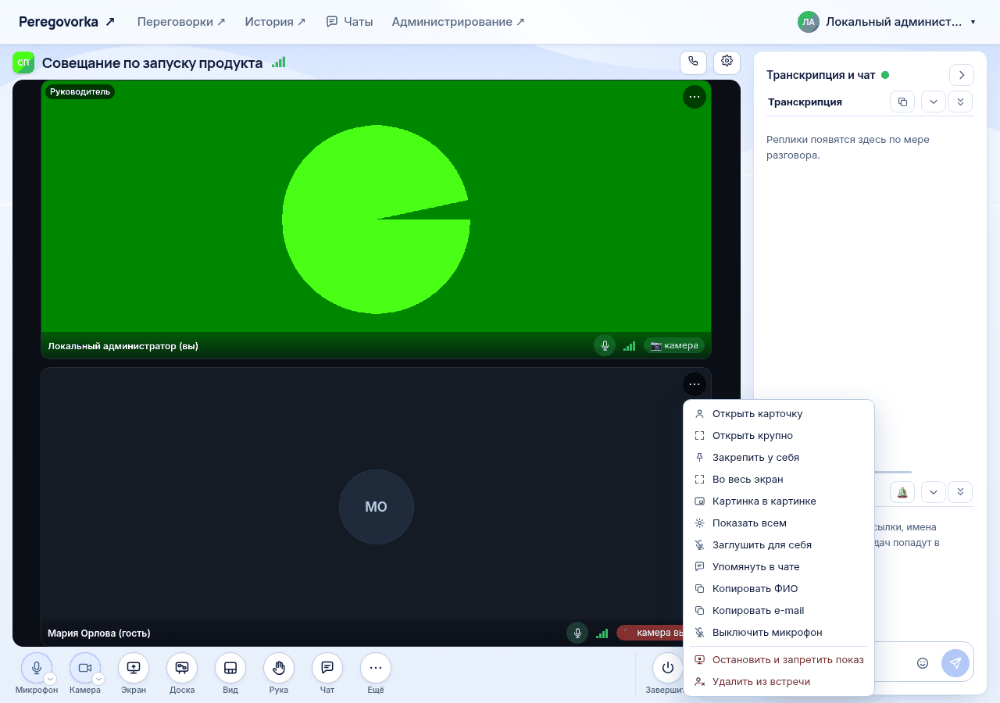

# Управление участниками комнаты

*Для кого: руководитель комнаты и администратор.*

## Зачем это нужно

Статья объединяет всё, что связано с людьми в комнате: кто может войти, кто руководит, как управлять участниками во время встречи и как открыть материалы после неё.

## Когда пригодится

- Новый сотрудник или отдел должен получить доступ к комнате.
- На совещании нужно дать слово, выключить чей-то микрофон или удалить человека.
- Человек не был на встрече, но ему нужен протокол.

## Что потребуется

- Права руководителя этой комнаты или администратора.
- Для поиска групп и людей: подключённый каталог.
- Для управления во время встречи: браузер или приложение для Windows и Linux.

В приложении для Android: управления участниками во встрече нет.

## Где найти

| Задача | Путь |
| --- | --- |
| Доступ и руководители | шестерёнка **Настройки** → **Настройки комнаты…** → **Доступ и гости** |
| Действия с участником | кнопка действий на плитке участника или правая кнопка мыши по плитке |
| Все микрофоны сразу | **Ещё → Выключить у всех микрофоны** |
| Зрители презентации | кнопка **Зрители** на панели встречи |
| Доступ после встречи | **История** → встреча → **Управление доступом** |

## Как это сделать

### Дать доступ к комнате

1. Откройте вкладку **Доступ и гости**.
2. Выберите **Группа AD** или **Пользователь AD**.
3. Введите не меньше двух знаков и нажмите **Найти**.
4. У нужной строки нажмите **＋ В доступ**.
5. Нажмите **Сохранить**.

Запись появится в списке **Кто может заходить** с пометкой **группа** или **человек**. Кнопка ✕ убирает её.

Доступ по группе удобнее: новый сотрудник отдела получает доступ, когда попадает в группу. Если каталог недоступен, введите DN группы или objectGUID пользователя в поле ниже поиска.

### Назначить руководителя

1. Найдите человека или группу так же, как для доступа.
2. Нажмите **＋ Руководителем**.
3. Нажмите **Сохранить**.

Руководитель входит в комнату всегда, даже если его нет в списке доступа. Администраторы сервера являются руководителями всех комнат автоматически.

Руководитель не может оставить комнату совсем без руководителей. Это может только администратор.

### Управлять участником во встрече

1. Наведите указатель на плитку участника и нажмите кнопку действий или щёлкните правой кнопкой мыши.
2. Выберите действие.

| Пункт меню | Что происходит |
| --- | --- |
| **Выключить микрофон** | микрофон участника выключается. Он сможет включить его снова |
| **Выключить камеру** | камера участника выключается |
| **Остановить показ экрана** | показ прекращается, запрета нет |
| **Остановить и запретить показ** | участник не сможет показывать экран до конца встречи. Руководителю запретить нельзя |
| **Разрешить показ экрана** | снимает запрет |
| **Снять поднятую руку** | опускает руку участника |
| **Дать слово** / **Забрать слово** | только в презентационной комнате |
| **Удалить из встречи** | отключает человека, см. ниже |

Пункты появляются, когда действие возможно. Например, **Выключить камеру** видно только при включённой камере. Руководителя удалить нельзя.

### Выключить все микрофоны

1. Нажмите **Ещё**.
2. Выберите **Выключить у всех микрофоны**.

Ваш микрофон не выключится. Каждый участник сможет включить свой снова.

### Дать слово в презентационной комнате

Вариант 1, через список зрителей:

1. Нажмите **Зрители** на панели встречи.
2. Найдите человека поиском **Найти зрителя по имени**.
3. Нажмите **Дать слово**.

Вариант 2: выберите **Дать слово** в меню на плитке.

Человек получает микрофон, камеру, показ экрана и правку доски до конца встречи или пока слово не заберут. Руководителем он не становится.

### Удалить человека из встречи

1. Откройте меню на плитке.
2. Выберите **Удалить из встречи** и подтвердите.

Что произойдёт с сотрудником:

- он отключится на всех своих устройствах;
- он не сможет вернуться в эту встречу, пока она идёт;
- следующие 10 минут он не сможет войти в эту комнату, даже если началась новая встреча;
- он потеряет доступ к материалам этой встречи.

Что произойдёт с гостем: его подключение закроется. Гостевая ссылка продолжит работать. Чтобы гость не вернулся, выпустите новую ссылку, см. [Управление гостевыми ссылками](Управление-гостевыми-ссылками).

Чтобы сотрудник больше не мог войти совсем, уберите его из списка доступа.

### Открыть материалы встречи другому человеку

1. Откройте **История** и нужную встречу.
2. Нажмите **Управление доступом**.
3. Выберите **Пользователь (ФИО, логин, почта)** или **Группа каталога**.
4. Найдите человека и нажмите **Выдать доступ**.
5. Для группы нажмите **Состав группы…**, проверьте список и подтвердите выдачу.

Человек получает только просмотр материалов этой встречи. Руководителем и участником комнаты он не становится. Кнопка **Отозвать** закрывает доступ сразу.

## Что получится

- Человек из списка доступа видит комнату в разделе **Переговорки** и может войти.
- Изменения списков действуют без перезапуска.
- Удаление и выдача доступа записываются в журнал.

## Если не получается

| Что видно | Причина | Что сделать |
| --- | --- | --- |
| Сотрудник не видит комнату | его нет в списке и в группах | добавьте его или проверьте членство в группе |
| Поиск пишет **Ничего не найдено** | опечатка или каталог не содержит запись | попробуйте другую часть имени или логин |
| **Каталог не подключён** | администратор не настроил каталог | см. [Как подключить Active Directory](Как-подключить-Active-Directory) |
| Нет пункта **Удалить из встречи** | на плитке руководитель, или вы не руководитель | проверьте роль |
| **Руководителя комнаты удалить нельзя** | человек входит в список руководителей | сначала уберите его из списка |
| В комнате без руководителей нельзя выключать чужие микрофоны | участники такой комнаты управляют записью, но не друг другом | назначьте руководителя |
| Участник сразу включает микрофон снова | выключение не запрещает включить | используйте презентационную комнату |

## Что дальше

- [Настройки комнаты](Настройки-комнаты)
- [Управление гостевыми ссылками](Управление-гостевыми-ссылками)
- [Кто что может во встрече](Кто-что-может-во-встрече)
- [Справочник: роли и права](Справочник-роли-и-права)
