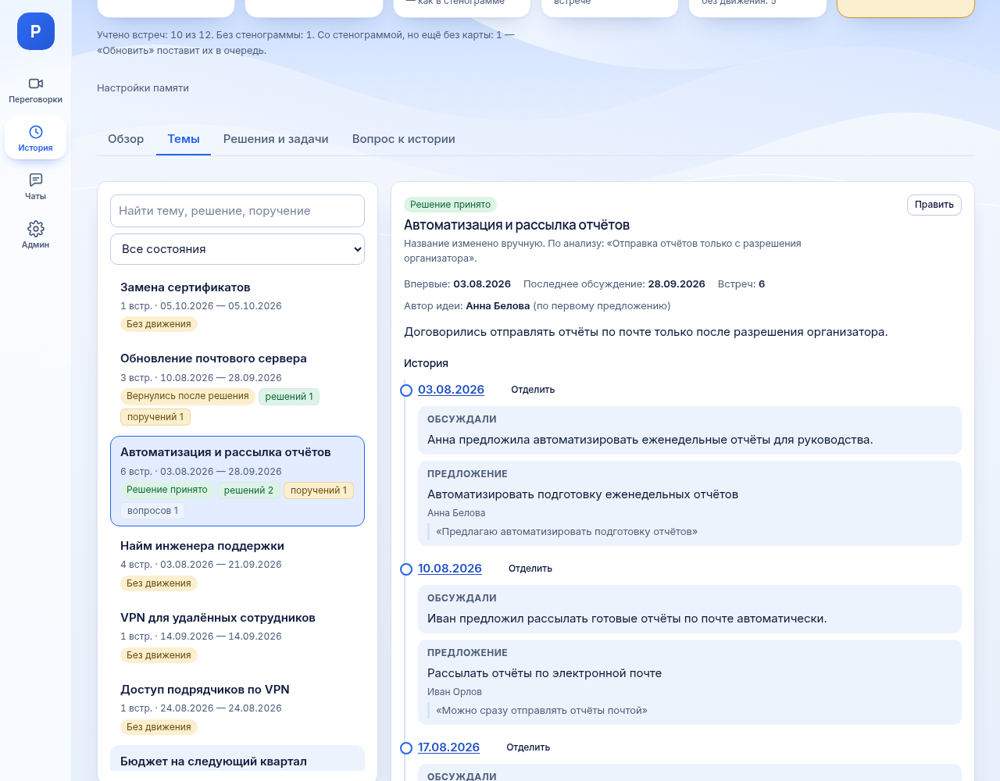

# Эволюция обсуждений

*Для кого: руководитель комнаты, участники регулярных совещаний, руководитель, которому нужен итог за период.*

## Зачем это нужно

Регулярные совещания в одной комнате возвращаются к одним и тем же вопросам. Идею предлагают, через неделю уточняют, потом находят риск, принимают решение, а через месяц снова к нему возвращаются. «Эволюция обсуждений» собирает такие обсуждения разных встреч в одну **сквозную тему** и показывает её историю. Она отвечает на вопросы:

- какие темы комната обсуждает сейчас и какие появились впервые;
- какие решения приняты и где их пересматривали;
- какие вопросы остались открытыми, а какие темы давно не двигаются;
- где обсуждение повторяется без результата.

Это память комнаты и подсказки для руководителя, а не таск-трекер: ничего не назначается и не меняется автоматически.

## Когда пригодится

- Нужно вспомнить, когда и кто предложил идею и почему от прежнего решения отказались.
- Руководитель хочет за несколько минут понять, что происходит в команде за месяц или квартал.
- Кажется, что одну и ту же тему обсуждают на каждой встрече, — нужно проверить.

## Что потребуется

- В комнате включено распознавание речи: память строится только по встречам со стенограммой. Сама память запись и распознавание не включает.
- Для карт встреч назначена языковая модель (та же, что для [карты разговора](Карта-разговора)).
- Включить память может руководитель комнаты или администратор.
- Смотреть могут все, у кого есть доступ к встречам комнаты. Каждый видит историю **только по тем встречам, к которым у него есть доступ**: о других встречах память ничего не сообщает.

## Где найти

- **История** → список **Эволюция обсуждений…** → выберите комнату.
- Или на странице любой встречи: **Эволюция обсуждений комнаты →**.

## Как это сделать

### Включить память комнаты

1. Откройте **Эволюцию обсуждений** нужной комнаты.
2. Нажмите **Включить память комнаты**.
3. Для последних встреч со стенограммой, но без карты, карты поставятся в очередь (не больше 10 за раз; они строятся по одной). По мере готовности темы появятся на странице.

После каждой следующей встречи карта строится сама, и её темы связываются с прежними. Чтобы догнать остальные встречи, нажимайте **Обновить** (не чаще 6 раз в час).

### Читать историю

Сверху выберите период: **Месяц**, **Квартал**, **Год**, **Всё время** или **Свой период**. Показатели (темы в работе, решения, поручения, открытые вопросы, «вернулись после решения», «требуют внимания») считаются за выбранный период. Строка под ними говорит, сколько встреч учтено и сколько не учтено — без стенограммы или ещё без карты.

| Вкладка | Что показывает |
| --- | --- |
| **Обзор** | **Наблюдения** и **Развитие тем**: строки — темы, столбцы — встречи периода; ◆ решение, ▲ поручение, ? вопрос, ○ предложение, ● обсуждали |
| **Темы** | список сквозных тем с поиском и фильтром по состоянию; справа — история выбранной темы по встречам: что обсуждали, предложения, решения, поручения и вопросы с цитатами |
| **Решения и задачи** | решения, поручения, открытые вопросы и предложения за период со ссылками на встречи |
| **Вопрос к истории** | ответ на вопрос по истории комнаты со ссылками на события-основания |

Состояния темы: **Новая**, **Обсуждается**, **Решение принято**, **Поручения в работе**, **Вернулись после решения**, **Без движения** (больше 30 дней без решения), **Закрыта** (только вручную). Состояние считается по событиям, а не придумывается моделью.

### Наблюдения

Каждое наблюдение объясняет, **почему** оно появилось, показывает события-основания (нажмите — откроется встреча), предлагает действие и указывает уверенность.

| Наблюдение | Когда появляется |
| --- | --- |
| Обсуждали N раз, решения нет | тема была на 3+ встречах за неделю и больше, на двух последних не появилось ничего нового |
| Обсуждение развивается | то же, но появляются новые предложения и вопросы — это нормальное развитие, не повторение |
| Вернулись к теме после решения | после решения тему снова обсуждали без нового решения |
| Решения на разных встречах | по теме принимались решения в разные даты — проверьте, не противоречат ли они |
| Поручения без ответственного / без срока | в стенограмме не названы ответственный или срок |
| Нет сведений о выполнении | поручению больше 14 дней, а тема больше не обсуждалась. **Это не значит, что поручение не выполнено** |
| Предложение больше не обсуждалось | предложению больше 21 дня, решения и поручения по нему нет |
| Путь от обсуждения до решения | тема дошла от предложения до решения — положительная динамика |

Кнопка **Скрыть** убирает наблюдение. Оно не появится снова, пока не появится новое основание. **Полезно** отмечает наблюдение для других руководителей.

### Исправить ошибку

Нужны права руководителя комнаты или администратора. Выберите тему на вкладке **Темы** и нажмите **Править**:

- **Название**, **Состояние** (например, **Закрыта**), **Автор идеи**, **Заметка**;
- **Это та же тема, что…** → **Объединить** — если анализ разделил одну тему на две;
- **Отделить** у встречи в истории — если обсуждение этой встречи ошибочно попало в тему.

Правки хранятся отдельно. Повторный анализ их не отменяет и ту же ошибку не повторит.

### Вопрос к истории

Напишите вопрос, например: «Когда впервые предложили автоматизировать отчёты?» или «Какие поручения без ответственного?». Peregovorka сама отбирает до 40 подходящих событий из доступных вам встреч, и модель отвечает только по ним, со ссылками [E1], [E2]. Без модели показываются найденные события. Не больше 20 вопросов в час.

## Что получится

Накопительная история комнаты: как возникали идеи, кто их предлагал, какие решения принимались и к чему возвращались. Включение, правки и вопросы попадают в журнал аудита.

## Как это работает

- Источник — [карта разговора](Карта-разговора) каждой встречи: она строится по стенограмме, независимо от протокола. Протоколы и резюме для памяти не нужны.
- Темы разных встреч связывает одно короткое обращение к модели на встречу: модель получает названия и суть тем и выбирает среди похожих тем комнаты, которые подобрал код. Стенограммы, цитаты и авторы пунктов в это обращение не входят. Если модель недоступна, связывает только строгое правило похожих названий: лучше не связать, чем связать разные вопросы.
- Если в комнате или на сервере включено [обезличивание](Как-работает-обезличивание), обращения к модели проходят его. Людей между встречами память связывает по стенограмме, а не по обозначениям обезличивания.
- Обработка идёт в фоне, после готовой карты и раз в 15 минут; неизменённые встречи повторно не обрабатываются.

## Сроки хранения

События памяти удаляются вместе с текстом встречи по [сроку хранения](Сроки-хранения-материалов). Руководитель может оставить историю дольше стенограммы: тогда события остаются без цитат с пометкой «первоисточник удалён по сроку хранения». При удалении комнаты память удаляется вместе с ней.

## Если не получается

| Симптом | Причина | Что сделать |
| --- | --- | --- |
| «Нет доступа к истории встреч этой комнаты» | у вас нет доступа ни к одной встрече комнаты | попросите руководителя комнаты |
| Тем нет, «Учтено встреч: 0» | у встреч нет стенограммы или карты ещё строятся | дождитесь карт; проверьте распознавание речи в комнате |
| «Со стенограммой, но ещё без карты» | карты строятся по очереди | нажмите **Обновить** |
| Одна тема разбита на несколько | модель недоступна или не уверена | объедините темы вручную |
| Разные вопросы попали в одну тему | ошибка связывания | **Отделить** у нужной встречи |

Качество связывания проверено на синтетической истории из 11 встреч с ручной разметкой. Без модели ложных объединений 0, найдена четверть связей. С настоящей моделью качество не измерялось. Считайте темы и наблюдения подсказкой и сверяйте их со встречами.

## Что дальше

- [Карта разговора](Карта-разговора)
- [Сроки хранения материалов](Сроки-хранения-материалов)
- [Как работает обезличивание](Как-работает-обезличивание)
